# Technical Design: Workflow Scheduler (+ Phase 2: Perf & Response-Parity Testing)
**Date**: 2026-10-13 | **Status**: Draft | **Requirements**: [Discovery (Approved)](2026-10-12_workflow-scheduler_discovery.md) · [PRD](../prds/2026-10-13_workflow-scheduler_prd.md)

## 1. Overview
We build our own workflow platform in C#: an SDK for writing workflows as single-file .NET 10 scripts, a
control plane (API, engine, scheduler), agents on Windows/Linux machines, and a React dashboard with live
push updates. Phase 2 adds core-owned load generation, source connectors, and a parity framework, with
service teams supplying only request/response hooks.

**Design goals (in priority order)**
1. **Reliability** — every run reaches exactly one terminal state; no state lost on any single failure (NFR-004, NFR-033, NFR-034).
2. **Speed** — dispatch p95 ≤ 50 ms, ≤ 10 ms engine overhead per node, run start ≤ 1 s (NFR-028–NFR-030).
3. **Lean** — control plane ≤ 2 vCPU / 1 GB at peak; idle agent ≤ 100 MB (NFR-031, NFR-032).
4. **Same everywhere** — identical code paths locally and on Azure, Windows and Linux (NFR-015–NFR-017).
5. **Few moving parts** — one database, one blob store, no message broker, no cache tier.

**Constraints**: C# for backend/SDK/hooks; own engine; three deployment profiles (local single machine,
self-hosted bare metal / Azure VMs, Azure PaaS; §9) from one versioned codebase with per-OS builds; the first build
targets this single machine (pure local on `localhost` / raw IP, plus Docker Compose per environment with domain URLs),
while bare-metal and Azure code paths stay supported and lab/CI-verified; Windows + Linux;
backend and frontend in separate codebases; zero-downtime deploys; scale ≤ 2,000 runs/day, ≤ 200
nodes/workflow, 90-day retention.

**Codebase today**: empty repo (only `.github/` and `docs/`). No existing conventions to follow; this
design sets them.

**How the design meets the speed and footprint targets**
- **Single-writer engine**: one active engine process holds active run state in memory and is the only writer. No distributed locks or claim races on the hot path. A hot standby takes over via a lease.
- **Write-ahead + group commit**: each state transition is appended to PostgreSQL before its side effect. Appends from all runs are batched per commit (≤ 2 ms window), so the critical path is about two commits per node.
- **Push between platform components, no UI polling**: API → engine uses PostgreSQL `LISTEN/NOTIFY`; engine → agent uses a gRPC bidirectional stream; engine → browser uses SignalR. Tasks may poll external asynchronous APIs (FR-062).
- **Warm task hosts**: workflows are compiled once at registration. Agents keep one globally capped pool of pre-spawned, never-used host processes for versions with queued or recent work, so dispatch is an IPC message, not a process start or a compile.
- **Allocation-light hot paths**:
  - System.Text.Json source generation, pooled buffers, and protobuf on internal links.
  - The agent is Native AOT (about 30 MB RAM).
  - The control plane uses Server GC with DATAS, which keeps the heap proportional to load.

## 2. Tech Stack Selection
| Layer | Choice | Why (vs alternatives) | Docs |
|-------|--------|-----------------------|------|
| Runtime | .NET 10 (LTS) | Mandated C#; LTS; file-based apps for workflows; Native AOT for the agent. | [link](https://learn.microsoft.com/dotnet/core/whats-new/dotnet-10/overview) |
| Workflow format | .NET 10 file-based app (`workflow.cs`, `#:package`) | One file per workflow (approved). Compiled once at registration via `dotnet publish -p:PublishAot=false`, because AOT is the default for file-based publish and Bond and reflection-based code need the JIT. | [link](https://learn.microsoft.com/dotnet/core/sdk/file-based-apps) |
| API | ASP.NET Core 10 Minimal APIs | Lowest-overhead ASP.NET Core model; built-in OpenAPI. Rejected MVC controllers: more allocation, no benefit here. | [link](https://learn.microsoft.com/aspnet/core/fundamentals/minimal-apis) |
| API docs | `Microsoft.AspNetCore.OpenApi` | Built in (no Swashbuckle dependency). Also the source for TS type generation. | [link](https://learn.microsoft.com/aspnet/core/fundamentals/openapi/overview) |
| Live push (browser) | ASP.NET Core SignalR with MessagePack protocol; **Azure SignalR Service** in Azure, in-process locally | WebSocket push with groups and auto-reconnect. MessagePack is about 30–50% smaller than JSON. Azure SignalR Service lets the engine publish without being the connection host and offloads connection memory from our processes (NFR-031). Rejected: raw WebSockets (we'd rebuild groups and reconnect), SSE (one-way, needs a separate command channel), Redis backplane (extra component). | [SignalR](https://learn.microsoft.com/aspnet/core/signalr/introduction) · [Azure SignalR](https://learn.microsoft.com/azure/azure-signalr/signalr-overview) |
| Engine ↔ agent | gRPC bidirectional streaming (`Grpc.AspNetCore`, `Grpc.Net.Client`) | Persistent, multiplexed, binary, and push in both directions with sub-ms overhead; works through Azure Container Apps ingress (HTTP/2). Rejected: queue broker (adds latency and a component), agents polling the DB (latency, and agents would hold DB credentials). | [link](https://learn.microsoft.com/aspnet/core/grpc/) |
| Agent ↔ task host | gRPC over Unix domain sockets (Windows 10+ and Linux) | Same stack as above; one code path on both OSes; no TCP ports. | [link](https://learn.microsoft.com/aspnet/core/grpc/interprocess-uds) |
| Database | PostgreSQL 17; Azure Database for PostgreSQL Flexible Server (zone-redundant HA) | Its strengths match our needs: transactional append, partitioning for 90-day drop-retention, JSONB for variables/metadata, `LISTEN/NOTIFY` (removes the need for a broker), and an identical container image locally. Rejected: Azure SQL (no LISTEN/NOTIFY; local emulation weaker), Cosmos DB (no cross-document transactions for run+command; cost at 2.4M events/day), EventStoreDB (extra system; we need relational read models anyway). | [PG](https://www.postgresql.org/docs/17/) · [Flexible Server HA](https://learn.microsoft.com/azure/postgresql/flexible-server/concepts-high-availability) |
| Data access | Npgsql (binary COPY, batching) + Dapper | Fastest .NET path; explicit SQL on hot paths; minimal allocation. Rejected: EF Core (change tracking and LINQ translation overhead on hot paths; extra abstraction over a schema we own). | [Npgsql](https://www.npgsql.org/doc/) · [Dapper](https://github.com/DapperLib/Dapper) |
| Migrations | DbUp (plain SQL scripts) | Small and predictable; SQL scripts are reviewable, and expand/contract is explicit. | [link](https://dbup.readthedocs.io/) |
| Blob store | Azure Blob Storage (`Azure.Storage.Blobs`) in Azure; local filesystem locally (`IBlobStore`) | Logs, reports, artifacts, packages, histograms kept out of the DB (NFR-024). Lifecycle policies move data to cool tier and handle deletion. Filesystem locally needs no emulator. | [link](https://learn.microsoft.com/azure/storage/blobs/storage-blobs-introduction) |
| Secrets | Azure Key Vault (`Azure.Security.KeyVault.Secrets`, managed identity); local: user-secrets file outside the repo | Secret references resolved on the agent at use time (FR-029). | [link](https://learn.microsoft.com/azure/key-vault/secrets/about-secrets) |
| Cron | Cronos | Timezone- and DST-correct next-occurrence calculation; tiny; used by Hangfire. Rejected: NCrontab (no timezone/DST handling), Quartz (a full scheduler we don't need). | [link](https://github.com/HangfireIO/Cronos) |
| Latency histograms | HdrHistogram.NET | Lossless, mergeable percentiles across machines (FR-108). Averaging percentiles is wrong. | [link](https://github.com/HdrHistogram/HdrHistogram.NET) |
| Bond | Bond C# packages (`Bond.CSharp`, `Bond.Runtime.CSharp`), pinned, from the Microsoft-internal feed (https://aka.ms/bond); nuget.org exact version as restore fallback | Required codec for dummy services. Upstream OSS archived, internally supported (discovery §12). Isolated in `Wf.Codec.Bond`. | [link](https://microsoft.github.io/bond/manual/bond_cs.html) |
| Telemetry | OpenTelemetry .NET → Azure Monitor exporter (Azure), Aspire dashboard (local) | Vendor-neutral standard (NFR-010); one instrumentation set for both environments. | [OTel](https://opentelemetry.io/docs/languages/dotnet/) · [Azure Monitor](https://learn.microsoft.com/azure/azure-monitor/app/opentelemetry-enable) |
| Local orchestration | Aspire AppHost | One command (`aspire run`) starts PostgreSQL, control plane, agent, UI and dashboard on Windows/Linux (NFR-016). The Docker Compose mode's compose file is generated from the same AppHost (`aspire publish`), so there is one topology definition. Rejected: hand-written docker-compose (no .NET project integration, a second config that drifts). | [link](https://aspire.dev) |
| Local reverse proxy / TLS | Caddy 2: the existing GrihaSetu platform edge, plus one gateway container per environment stack (Docker Compose mode only; pure local has no proxy and no domain) | Reuses the host-native edge and mkcert umbrella certificate that already serve `*.sonapraneeth.in` on this machine, so one site snippet adds every environment's route, cert SAN and hosts entry. The gateway proxies h2c gRPC streams (health-checked, leader only) and WebSockets. Rejected: Caddy `tls internal` (a second CA to trust); Let's Encrypt DNS-01 (DNS API token and rate limits, not needed while every client trusts the mkcert root); nginx/Traefik (more config). | [link](https://caddyserver.com/docs/caddyfile/directives/reverse_proxy) |
| Hosting (control plane) | Three profiles from one codebase with per-OS builds (§9.1). **Local**: `wf-host` process. **Self-hosted** (bare metal / Azure VMs): `wf-api` + `wf-engine` as Windows Services / systemd units. **Azure PaaS**: Azure Container Apps, multiple-revision mode | ACA is managed and zone-redundant; revisions give blue-green with traffic split and rollback in under a minute (NFR-025, NFR-026); supports gRPC and WebSockets. Self-hosted gets the same zero-downtime result with scripted rolling deploys and the engine lease handover. Rejected: AKS (operational weight unjustified at this scale), App Service (no gRPC bidi streaming on Windows plans, weaker revision model). | [ACA](https://learn.microsoft.com/azure/container-apps/overview) · [Windows Service](https://learn.microsoft.com/dotnet/core/extensions/windows-service) · [systemd](https://learn.microsoft.com/dotnet/core/extensions/workers) |
| Self-hosted HA pieces | PostgreSQL + Patroni + etcd; pgBackRest; HAProxy/nginx + keepalived (or existing LB / Azure LB); OTel Collector → Prometheus, Grafana, Loki, Tempo | Standard, proven open-source HA for PG with automatic failover in ≈ 10–20 s. Npgsql multi-host connection strings follow the primary without a proxy. Only used in the self-hosted profile. | [Patroni](https://patroni.readthedocs.io) · [pgBackRest](https://pgbackrest.org) · [Npgsql failover](https://www.npgsql.org/doc/failover-and-load-balancing.html) |
| Agent hosting | Self-contained Native AOT executable as Windows Service / systemd unit | ≤ 100 MB idle (NFR-032); no runtime install on test machines. | [Windows Service](https://learn.microsoft.com/dotnet/core/extensions/windows-service) · [systemd](https://learn.microsoft.com/dotnet/core/extensions/workers) |
| Resource limits | Windows Job Objects (via CsWin32); Linux cgroups v2 | Per-task CPU/RAM caps and kill-on-close (NFR-032). | [Job Objects](https://learn.microsoft.com/windows/win32/procthread/job-objects) · [cgroups v2](https://docs.kernel.org/admin-guide/cgroup-v2.html) |
| Identity | Microsoft Entra ID (`Microsoft.Identity.Web`, MSAL.js); GitHub OIDC federation for CI | Corporate SSO (NFR-007). The CI → Entra token exchange avoids long-lived secrets. | [link](https://learn.microsoft.com/entra/identity-platform/) · [GitHub OIDC](https://docs.github.com/actions/security-for-github-actions/security-hardening-your-deployments/about-security-hardening-with-openid-connect) |
| Frontend framework | React 19 + TypeScript 5 + Vite | Approved. Largest ecosystem for the needed pieces (graph, virtualisation); Vite gives fast builds and code splitting. | [React](https://react.dev) · [Vite](https://vite.dev) |
| Frontend tooling | Bun (package manager/scripts only) | Approved; fast installs. Production serves static files only. | [link](https://bun.sh/docs) |
| Routing / URL state | TanStack Router | Type-safe routes and **search params**, so filters live in the URL (shareable, FR-022). Rejected: React Router (search params untyped). | [link](https://tanstack.com/router/latest) |
| Server state | TanStack Query | Snapshot caching and dedupe; live deltas patch the cache. | [link](https://tanstack.com/query/latest) |
| Lists / tables | TanStack Virtual + TanStack Table | Headless and virtualised: 100k-row lists and 1M-line logs at 60 fps (NFR-006, NFR-020). | [Virtual](https://tanstack.com/virtual/latest) · [Table](https://tanstack.com/table/latest) |
| Components / CSS | Tailwind CSS v4 + shadcn/ui (Radix primitives) | Approved. Accessible primitives copied into the repo; zero runtime CSS-in-JS. | [Tailwind](https://tailwindcss.com/docs) · [shadcn/ui](https://ui.shadcn.com) |
| DAG view | React Flow (`@xyflow/react`) + `@dagrejs/dagre` layout in a Web Worker | Mature, virtualised node rendering. Layout runs off the main thread and is cached per version. Rejected: ELK (≈ 1.4 MB, slower for ≤ 200 nodes). | [React Flow](https://reactflow.dev) · [dagre](https://github.com/dagrejs/dagre) |
| Charts | uPlot | ~50 KB, canvas-based; handles 1 s perf series and 90-day trends at 60 fps. Rejected: Recharts/ECharts (SVG-heavy or ≈ 1 MB). | [link](https://github.com/leeoniya/uPlot) |
| Report renderers | `react-markdown` (no raw HTML), sandboxed `<iframe>` for HTML, `pdfjs-dist` (lazy), Monaco diff editor (lazy), Papa Parse (worker) | Each is lazy-loaded per kind, keeping the initial bundle < 300 KB gz (NFR-020). | [react-markdown](https://github.com/remarkjs/react-markdown) · [pdf.js](https://mozilla.github.io/pdf.js/) · [Monaco](https://microsoft.github.io/monaco-editor/) · [Papa Parse](https://www.papaparse.com) |
| API client types | `openapi-typescript` + `openapi-fetch` | Types generated from the backend OpenAPI document (including SignalR message schemas), with zero runtime cost (~6 KB). | [link](https://openapi-ts.dev) |
| Testing | xUnit v3, FsCheck, Testcontainers, Toxiproxy, BenchmarkDotNet, Vitest, Testing Library, Playwright, axe-core | See §10. | §10 |

**Dependency cost note**: production dependency IDs are centrally pinned in `Directory.Packages.props`; the design avoids a broker and a cache tier.

## 3. System Architecture
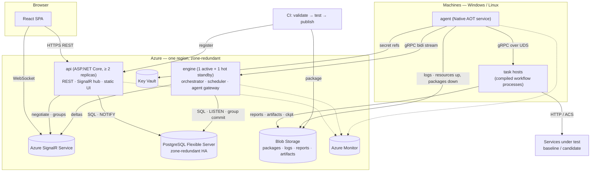

### Components and responsibilities
| Component | Responsibility | Instances | State |
|-----------|----------------|-----------|-------|
| **api** | REST API (reads, commands, registration), SignalR hub (subscribe/negotiate), auth/RBAC, serves SPA static files | ≥ 2, stateless, rolling/blue-green | None (DB) |
| **engine** | Run orchestration (single writer), scheduler, agent gateway (gRPC), reservations, live-event publisher, retention purger | 1 active + 1 hot standby (lease) | Active runs in memory, durable in PG |
| **agent** | Machine registration, heartbeat, task-host pool, resource limits & sampling, log shipping, secret resolution, local result journal | 1 per machine | Local journal (results until acked) |
| **task host** | The compiled workflow in `--task-host` mode: executes stage/task delegates, SDK services (reports, artifacts, outputs), phase 2 libraries (load, parity, hooks) | Globally capped warm pool per agent; a never-used host binds to one task attempt, including hook-invoking tasks (AD-012) | Attempt-local files: persisted deadline, PID/start time/socket metadata, unacknowledged output/log state; no database access |
| **CLI (`wf`)** | `validate`, `test`, `publish`, `clone`, `baseline`, `run [--single-machine]`, `abort`, `local up/down/init-secrets/doctor`, `install --standalone`, `reset` | Dev/CI | — |
| **SDK** | Authoring API, local embedded engine, dry-run harness, describe mode | In workflow process | — |

**Ownership boundaries**: the engine is the only writer of run state. The api writes only commands (trigger and abort included), schedules (user-defined), admin
config, and registrations. Agents never touch the DB. Task hosts talk only to their agent (and to blob via
short-lived SAS grants, and to services under test).

The diagram shows the Azure PaaS profile. **Other profiles** (§9.1) use the same components with different hosting:
- **Local** (`aspire run`): one `wf-host` process runs both api and engine roles with in-process SignalR. It uses a PostgreSQL container or native install, a filesystem blob store, one or more local agents, the Vite dev server, and the Aspire dashboard; no domain name (`localhost`, or the raw IP with `--lan`). An optional **Docker Compose** mode (`wf local up --env <env>`) runs every Linux component in Docker behind Caddy, one stack per environment type, each with its own domain URL and TLS (§9.2).
- **Self-hosted** (bare metal / Azure VMs): `wf-api` and `wf-engine` run as OS services on ≥ 2 hosts. PG HA is provided by Patroni. Blobs live on shared storage. Live push uses the engine `LiveFeed` stream to api nodes.

The code path is identical; only `IBlobStore`, `ISecretStore`, `ILivePublisher` and telemetry exporter implementations differ (config only, NFR-017).

### Architecture diagrams per profile
Three deployment profiles are illustrated through five hosting diagrams. PNG and SVG exports show the diagram and legend without the HTML-only glossary; open the HTML for term definitions or the SVG for lossless zoom. Colours mark component roles and line styles mark connection kinds, explained in each legend.

**HLD 1: Local** ([HTML](diagrams/hld-local.html) · [SVG](diagrams/hld-local.svg)). One machine, `aspire run`, no Kubernetes; Docker only if you want PostgreSQL in a container; no domain name: `http://localhost:<port>`, or the raw IP with `--lan` (§9.2).

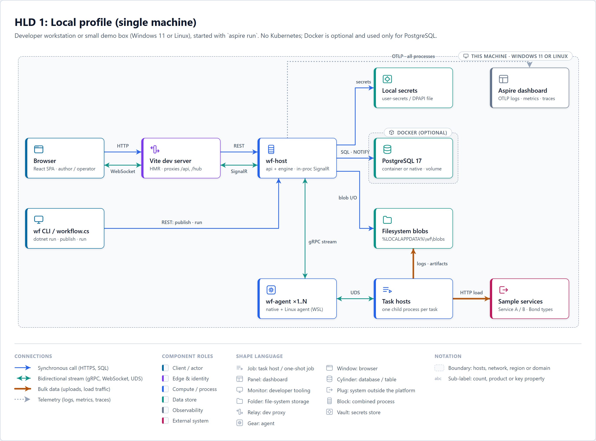

**HLD 1b: Local Docker Compose** ([HTML](diagrams/hld-local-compose.html) · [SVG](diagrams/hld-local-compose.svg)). Optional `wf local up --env <env>` (default `ppe`): production builds in Docker behind a gateway Caddy on `127.2.6.<envId>`; the GrihaSetu edge serves `https://<env>.kardia.sonapraneeth.in` (`dev` or `ppe`) with its mkcert certificate; the Windows agent stays native; LAN machines can join. The diagram shows the `ppe` instance (§9.2).

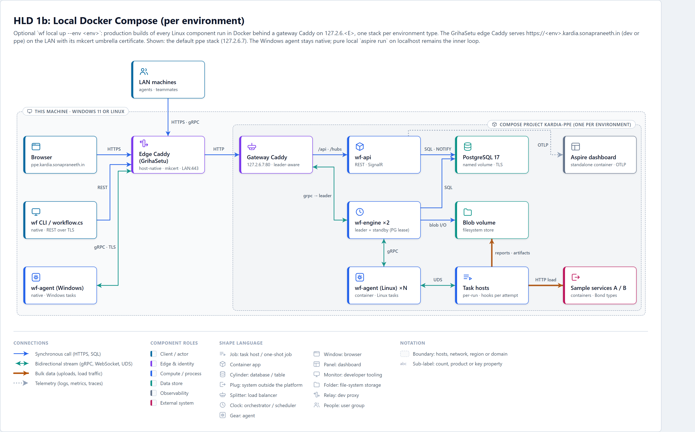

**HLD 2: Bare metal** ([HTML](diagrams/hld-bare-metal.html) · [SVG](diagrams/hld-bare-metal.svg)). Two control-plane hosts behind an LB pair, Patroni PostgreSQL ×3, shared blob share, OTel/Grafana stack (§9.3). Supported by the code, not built on the first (single) machine.

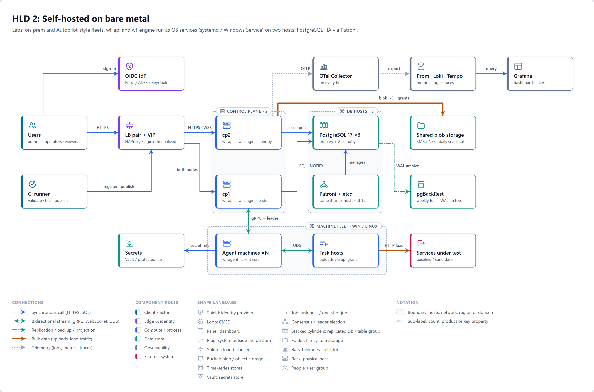

**HLD 3: Azure VMs** ([HTML](diagrams/hld-azure-vm.html) · [SVG](diagrams/hld-azure-vm.svg)). Same binaries as bare metal; Azure supplies LB, zones, managed identity and optionally PG Flexible Server, Blob and Key Vault (§9.3).

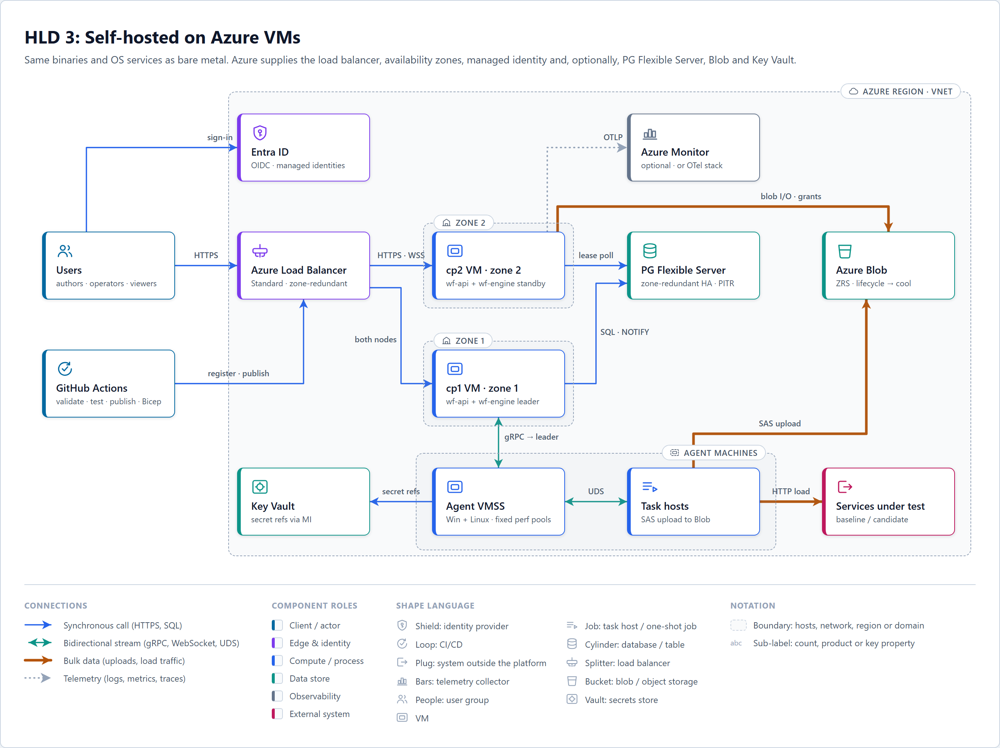

**HLD 4: Azure PaaS** ([HTML](diagrams/hld-azure-paas.html) · [SVG](diagrams/hld-azure-paas.svg)). Api and engine as Container Apps with revisions; Azure SignalR Service for live push; agents stay on VMs (§9.4).

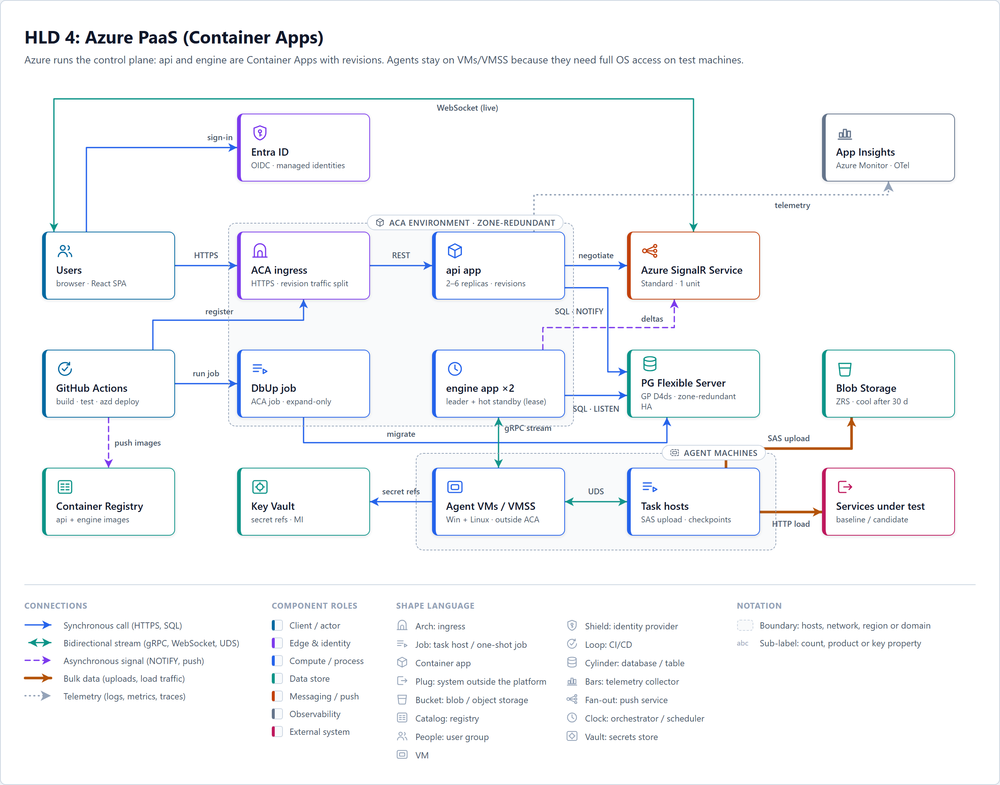

### Engine internals
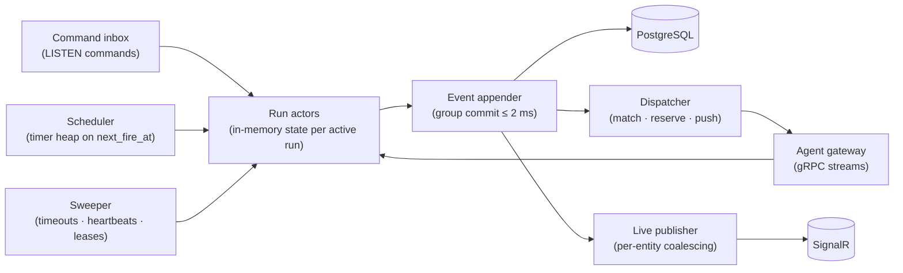
- **Run actor**: a pure state machine (`Wf.Engine.Core`) per active run, driven by a single-threaded channel. It decides transitions; effects (dispatch, publish) run only after the event is durable. The **same `Wf.Engine.Core`** runs inside the SDK's local engine and dry-run harness, so local behaviour equals hosted behaviour (FR-036, FR-040).
- **Group commit**: events from all actors are batched into one multi-row `INSERT` (binary COPY for large batches) per ≤ 2 ms window, then acknowledged to their actors.
- **Memory is a cache, PG is the truth**: a run actor's state changes only when its event is committed, and effects (dispatch, publish, timers) run only after commit. Anything in engine memory can be rebuilt from PG, so a crash loses nothing that was acknowledged.
- **Recovery**: on leadership acquisition, the engine loads active runs (`status in (Queued, Running, Aborting)`) from snapshot tables plus events after `snapshot_seq`, applies unprocessed commands (pending triggers and aborts), re-arms timers, and applies the same per-attempt agent-loss deadline as in normal operation (no separate blanket wait): attempts of an agent that has not reconnected stay reclaimable until 30 s after its last heartbeat (`agents.last_heartbeat_at`), then become `AgentLost`; attempts a reconnected agent does not list in `Hello.inflight` end `AgentLost` at once.
- **Leader lease**: row in `leases` (`engine`, holder, expires_at), renewed every 3 s, TTL 10 s. Fencing: every engine write includes the lease epoch (`WHERE epoch = $current`) so a paused ex-leader cannot write. Agents find the leader as follows. On ACA, the standby's readiness probe fails until it holds the lease, so ingress routes agents only to the leader. Self-hosted agents hold an endpoint list; a standby answers `NotLeader{leaderHint}` and closes the stream.

**Agent-loss timing decision (October 16, 2026):** the owner approved retaining
the full 30 s absolute reclaim deadline and separating classification,
replacement start and task completion. The previous requirement to replace and
complete within those same 30 s was contradictory. With healthy storage, an
active leader and eligible spare capacity, the replacement-start acceptance
budget is an additional 30 s after reclaim expiry, including classification,
dispatch and host startup; completion follows the workload's configured
deadlines. This is not a second reclaim grace or a 30 s total-recovery claim.
Functional virtual-clock evidence remains distinct from real wall-clock
verification. See the [blocker and accepted decision](../decisions/2026-10-16_agent-loss-recovery-timing.md).
Engine-leader and DB failover NFR-033 targets are unchanged.

### Crash and restart recovery (NFR-033, FR-061–FR-064)
Tasks execute on agents, never inside the engine or api, so control-plane failures do not stop work.

| Failure | What keeps running | How it recovers | Effect on a 4 h load test |
|---------|--------------------|-----------------|---------------------------|
| Engine leader crash, restart or deploy | All tasks on agents; agents journal results and perf samples to disk | Standby takes the lease ≤ 10 s (planned handover ≤ 3 s), rebuilds run actors from PG, re-arms `deadline_at` / `retry_at` / schedules; agents reconnect, report in-flight attempts and replay their journals (idempotent) | None. Load continues; live charts pause and resync |
| api node crash or deploy | Everything (api is stateless) | Clients reconnect to another node and resync from `afterSeq` | None |
| DB failover | Agents keep executing and journalling; engine buffers and retries commits | Commits resume when the new primary is up; runs resume ≤ DB failover time + 30 s (NFR-033; Patroni ≈ 10–20 s, PG Flexible zone-redundant HA ≈ 60–120 s, R-1). Windows-only self-hosted sites: manual DB failover (§9.3, R-11) | None |
| Agent process crash, restart or update | **Task hosts keep running** (they are not children that die with the agent, see below) and spool results, logs and perf samples in the attempt directory | Restarted agent re-adopts live hosts within 10 s and reports them in `Hello.inflight`; the engine keeps the attempts `Running`. Agent-loss timeline from the last heartbeat: 15 s → agent `Unhealthy` (no new dispatch); attempts stay `Running` and reclaimable until 30 s → then `AgentLost` and replacement per retry policy. Re-adoption (≤ 10 s) fits inside reclaim grace. If the agent does not return, replacement starts within a separate ≤ 30 s after reclaim expiry, conditional on healthy DB/leader and eligible spare capacity; task completion follows workload deadlines, not a ≤ 30 s total bound | None when hosts are re-adopted; unrecoverable loss follows task retry/checkpoint policy |
| Task host crash, machine reboot, machine lost | Other tasks and shards | Attempt ends `AgentLost`/`TaskError` → platform or author retry; the new attempt resumes from the task's **last checkpoint** | The shard resumes from its last checkpoint (≤ 10 s of load lost); the gap is shown in the report |

**Task hosts outlive the agent.** On Windows each host is in its own named job object (limits applied, no kill-on-close tied to the agent); on Linux each host has its own cgroup under the agent's delegated slice and the unit uses `KillMode=process`, so restarting the agent stops only the agent process. Each attempt directory holds `attempt.json` (pid, process start time, socket path, last acked seq). On start, the agent scans attempt directories, verifies pid + start time (guards against pid reuse), reconnects to the host's socket, and resumes forwarding from the last acked seq. Because hosts survive, agent binary updates do not need a drain; drain is only for machine maintenance or an incompatible agent ↔ task-host protocol migration.

**Checkpoints for long tasks.** `await ctx.Checkpoint.SaveAsync(state)` serialises JSON state (≤ 1 MB, at most once per 5 s); the task host uploads it to blob, then the agent journals `CheckpointSaved{run, taskKey, attempt, seq, uri, sha256}` until the engine acks it, like results. The engine applies it idempotently to `task_checkpoints` (keyed by run + task), keeping the highest `seq`, so neither an agent nor an engine crash loses or regresses a checkpoint. A later attempt of the same task gets it from `ctx.Checkpoint.TryLoad<T>()`, and `ctx.Attempt.ResumedFrom` says from when. Without checkpoints a retried task starts from the beginning. Built-in long tasks checkpoint automatically:
- **Load shard**: every 10 s: position in the load shape, request-source offset, cumulative counts. Resume rejoins the shape at the current time (the ramp is not replayed); the missing interval is recorded and shown in the perf report.
- **Parity**: request-source offset, category tallies, and samples written so far.
- **Request-source download**: resumes by byte offset (HTTP range, Blob/Files ranges, Cosmos continuation token).

An opt-in remote HTTP operation uses the same checkpoint mechanism: save `SubmissionPending` with the stable
logical key **before** the first POST, then save `RemoteSubmitted` with a non-secret operation ID/status location
after acceptance. `SaveAsync` must acknowledge each checkpoint before proceeding (its 5 s write limit may delay
the second save). The external service owns its execution;
it must deduplicate submissions with that key for at least the run's retry window before the host can repeat
a lost submission. Authoritative lookup by key can reattach to a **found** job, but a miss does not prove a
request was never accepted. The engine's `(run, taskKey, attempt)` result deduplication and its API's 24 h
`Idempotency-Key` apply only to internal state/commands; neither makes a remote POST exactly once. Without
remote deduplication, a platform retry may reattach via a successful lookup but may never send another POST
after `SubmissionPending`; if the service supports neither lookup nor deduplication, disable author and platform
retries. An uncertain submission fails with code `RemoteOutcomeUnknown` for operator reconciliation.

**Engine unreachable for long.** Normal tasks just continue. Load shards continue on their precomputed schedule but apply a local safety guard (stop if the shard's own error rate exceeds the test's abort threshold for 10 s, or if the engine has been unreachable longer than `orphanTimeout`, default 10 min), because the central saturation check and kill switch cannot reach them.

### Task placement (decided at run time)
A workflow is **not** pinned to one machine. The unit of placement is the **task attempt**. Each time a task becomes Ready, the dispatcher picks an agent from the machines connected at that moment. Stages (`$init`, `$pre`, `$post`, `$sys-post`) are placed like any task.

**Constraints (SDK)**:
- `RunsOn(...)` sets a selector at workflow, node or task level; the innermost wins. Selectors can use OS, labels, pool or explicit machine names.
- A selector may read run variables (e.g. `RunsOn(v => Machines.Named(v["machines"]))`); it is resolved when the run starts.

**Affinity**:
- `None` (default): each task is placed independently, giving maximum parallelism.
- `Node`: all tasks of a node go to one machine.
- `Run`: the whole run goes to one machine, chosen at first dispatch.
- `SameMachineAs("node")`: share another node's machine.

Data between tasks flows through outputs (≤ 64 KB via the engine) and artifacts (blob), so placement does not affect correctness. Use affinity only when tasks share local disk or machine state.

**Reservation (phase 2)**: `Reserve(count, selector)` reserves machines exclusively for a node (FR-102/103). Tasks of that node run only on its reserved machines, and all other tasks avoid reserved machines.

**Placement algorithm (in memory, O(agents))**:
1. Filter: Healthy, not draining, matches selector/OS, not reserved by another run, free slot available (`max_tasks`, default = cores), RAM headroom ≥ the task's memory limit.
2. Prefer an agent that already has an **unbound warm task host for this workflow package** (no cold start), then the least-loaded agent (slots used / max), then round-robin.
3. No candidate → the task stays Ready with reason `WaitingForMachine` (visible live in the UI). After `placementTimeout` (default 10 min) it fails with category `Placement` and its failure policy applies.
4. Retry after `AgentLost` → re-placed (platform retry, see "Retries and timeouts"). For `Node`/`Run` affinity the pin moves to the new machine unless the task is `.NoAutoRetry()`.

**Warm hosts**: each agent keeps one globally bounded LRU pool of pre-spawned, unbound task hosts, prewarming only versions with queued or recent work on that agent. The pool is capped in process count (default 4) and total RSS (default 200 MB) and is emptied after 5 min without work, so the idle footprint stays within NFR-032. A dispatch binds one host to exactly one task attempt, with no process start; it is never rebound or shared with sibling attempts. Hook-invoking tasks use the same isolation boundary (AD-012). An empty pool costs one cold start (≈ 150–300 ms) and is counted in `wf_task_queue_wait_ms`.

**Isolation decision (October 15, 2026)**: per-attempt hosts replace the original shared-per-run host decision. Concurrent managed tasks in one process share an address space: OS process memory limits and terminating an uncooperative task cannot isolate siblings there. A prewarmed process per attempt preserves independent CPU/RAM enforcement and hard cancellation without sacrificing parallelism or compiling per attempt. Variables and declared input/output snapshots cross the existing agent IPC contract; cross-task state must use outputs/artifacts or explicit machine affinity, not shared process memory. A finished host exits after its result is accepted by the agent; durable result forwarding and re-adoption retain their existing requirements.

For the run's System Events view (FR-018), the committed `Dispatched` event records the chosen agent, selection time and placement reason (selector/affinity or warm-host/least-loaded choice) for that attempt. Subsequent start, retry, completion and failure events retain the task key and attempt number; `WaitingForMachine` records why no agent was available. These are engine-owned run events, not task stdout/stderr or user-authored commands.

**Local**: one machine means one agent. The same algorithm runs and everything lands on that machine. Simulated agents (§9.2) exercise spreading.

**Single-machine runs (testing override)**: any run can be forced onto one worker **without changing the workflow**. This is useful for testing, debugging, reproducing a failure, or validating a new machine.
- **How to trigger**:
  - UI trigger/re-run dialog: "Run on a single machine" toggle + machine picker, which lists only eligible machines.
  - API: `placement: { singleMachine: true, machine?: "<name>" }` on `POST /runs` and `/rerun`.
  - CLI: `wf run <wf> --single-machine [--machine <name>]` or `dotnet run workflow.cs -- --engine <url> --single-machine`.
- **Semantics**: equivalent to `Affinity.Run` with the selector narrowed to that machine.
  - Without `machine`, the engine picks one at first dispatch that satisfies the union of all node/task selectors.
  - Parallel tasks still run in parallel up to the machine's `max_tasks` slots; the rest queue (state `Ready`, reason `WaitingForMachine`).
  - Stages, retries and policies are unchanged. On agent loss, the run's tasks are re-placed together on another eligible machine, or fail with `Placement` if a named machine was requested.
- **Validation at trigger (400 with the conflicting nodes)**:
  - Some node's selector (OS, labels) can't be met by the chosen machine.
  - The machine is reserved, draining or unhealthy.
  - A phase 2 node reserves more than one machine; the fix is to set its count variable to 1.
- **Visibility**: the override is stored on the run (`runs.placement`), shown as a badge, and kept by re-run unless changed.
- **Distinct from the other test paths**: dry-run (§6.1) mocks tasks, and `dotnet run workflow.cs` runs in-process with no agent. Single-machine runs use real agents and real tasks.

### Run state machine
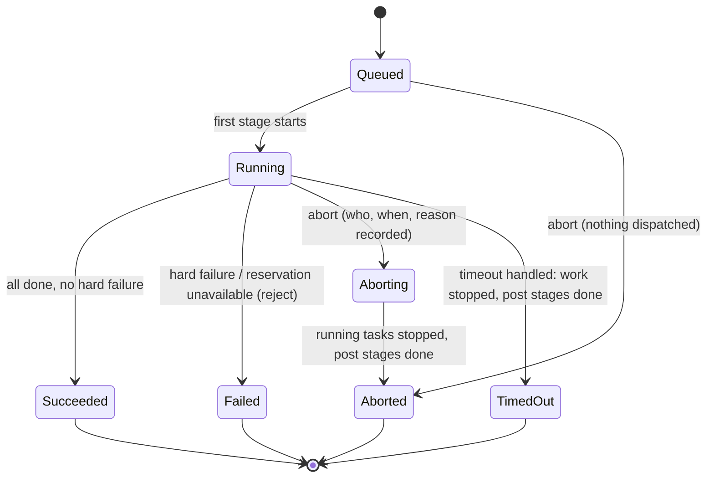
On run timeout there is no `TimingOut` state: the run stays `Running` while timeout cleanup (stop work, run post stages) executes, then ends `TimedOut`.
Node/task states: `Pending → Ready → Dispatched → Running → (Retrying → Dispatched)* → Succeeded | SoftFailed | Failed | TimedOut | Cancelled | Skipped | Reused`.
Terminal states are absorbing; the transition table is the single source of truth (property-tested, §10).
Node/task `Cancelled` means "stopped by an abort or by a hard-failed sibling"; the run ends `Aborted` when the cancellation was abort-driven and `Failed` when a hard-failed sibling caused it.

### Run abort (FR-015)
- **Who and how**: Operator on the workflow's type, or Admin, from the UI (confirm dialog), `POST /api/v1/runs/{id}/abort`, or `wf abort <runId> --reason "…"`. The phase 2 kill switch (`POST /api/v1/runs/{id}/kill-load`) inserts the same `Abort` command with `abort_source = KillSwitch`.
- **Abort record**: `aborted_by` (principal id), `aborted_by_name`, `aborted_at` (UTC, when the api accepted it), `abort_reason` (required, 1–500 chars; kill switch defaults to "Kill switch"), `abort_source` (UI/API/CLI/KillSwitch). The api never writes run state: it rejects terminal runs (409), then inserts an `Abort` command carrying the record (unique per run: `UQ(run_id) WHERE kind = Abort`) in the same transaction as the `audit_log` row. A second abort hits the constraint and returns 202 with the stored record, so the first abort wins and the record is immutable. The engine, the sole writer of run state, copies it into the run's `aborted_*` columns and a `RunAbortRequested` event, so live clients, history, notifications and the run page all read the same data.
- **Flow**: engine applies the command → `Running → Aborting` (pushed live) → `Cancel{attempt, graceMs, reason}` to every running attempt (CancellationToken; processes get CTRL_BREAK / SIGTERM, then are killed after `graceMs`, default 30 s) → running nodes end `Cancelled`, not-started nodes `Skipped` → post-process, system post-process and `always` nodes run with `ctx.Abort` set (bounded by their own timeouts) → reservations released → `Aborted`, `ended_at` = actual stop time.
- **Queued runs** go straight to `Aborted`; nothing is dispatched.
- **Repeat / late aborts**: while `Aborting`, a repeat returns 202 with the stored record; on a terminal run → 409 with the current status. A task that completes between the abort and its `Cancel` keeps its real result.
- **Failover**: the record and command are durable in PG; a new leader applies any unprocessed `Abort` command and resumes the abort of any run already in `Aborting`.
- **Not an abort**: run timeout ends `TimedOut`, a hard failure ends `Failed`. Aborting a scheduled run does not pause its schedule; an aborted run can be re-run.

### Retries and timeouts (FR-014)
- **Where set**: in the script at workflow (`.Defaults(...)`), node, or task level; the innermost wins, like `RunsOn`. The resolved policy per task is written into the manifest, so the engine never re-evaluates script code.
- **Defaults**: 0 retries; attempt timeout 1 h; no node timeout; run timeout 24 h; init/pre stages use the task defaults; post-process and system post-process 15 min each, so abort and timeout always finish.
- **Timeouts** (three levels):
  - *Attempt*: one try. The engine stores `deadline_at` on the attempt and sends it with the dispatch. The task host persists the absolute deadline in `attempt.json` and enforces it itself (cancel, then self-terminate after `graceMs`) even while the agent or engine is down; the agent and the engine enforce it redundantly.
  - *Node*: all of the node's tasks including retries and backoff. Expiry stops the node's running attempts.
  - *Run*: whole run; expiry → running work stopped, post stages run, run ends `TimedOut`. The run stays `Running` during this cleanup (no `TimingOut` state).
  - Stopping = `Cancel{attempt, graceMs}` → CancellationToken / CTRL_BREAK or SIGTERM → kill after `graceMs` (default 30 s). The attempt ends `TimedOut` with category `Timeout`.
- **Retry decision** (engine core, on each failed attempt):
  1. Category in the retry set (default `TaskError`, `Timeout`), retries left, and the task did not throw `NonRetryableException` / call `ctx.Fail(retryable: false)`. Command tasks can also list retryable exit codes; SDK-function tasks can add a predicate `RetryOn(ex => ex is HttpRequestException)`.
  2. Never retried: categories `ValidationError`, `Aborted`, `ResourceLimit`, `Placement`, and attempts in state `Cancelled` because a sibling hard-failed.
  3. Delay = fixed or `base × 2^(n-1)`, capped at `maxDelay` (≤ 10 min), ±20% jitter. If the next attempt cannot start before the node or run deadline, no retry is scheduled.
  4. Otherwise the task is `Retrying` with `retry_at` stored; the sweeper dispatches it when due. Backoff holds no agent slot; placement runs again (affinity pins respected).
  5. Retries exhausted → the task's failure policy applies (hard → node/run fails, dependents skipped; soft → `SoftFailed`, run continues).
- **Platform retries**: `AgentLost` and `PlatformError` attempts are re-placed up to 2 times without using the author's retries (this is what keeps platform-caused failures ≤ 0.01%). `.NoAutoRetry()` turns this off for non-idempotent tasks; they then follow the author's policy only.
- **Durability**: `deadline_at` and `retry_at` are in PG, so a new leader restores every timer from one indexed query at startup. Abort clears pending `retry_at` immediately.
- **Visibility**: each attempt is its own row (agent, times, category, error); the UI shows "attempt 2/4, next in 12 s" live. Metrics: `wf_task_retries_total{category}`, `wf_task_timeouts_total{level}`.
- **Validation and tests**: the validator rejects retries > 10, `maxDelay` > 10 min, or an attempt timeout above its node/run timeout, and warns when worst-case time (attempts × timeout + backoff) exceeds the run timeout. Dry-run uses a virtual clock, so timeout and backoff tests run instantly.

### Remote asynchronous HTTP operations (FR-062, FR-063, FR-064)
`Tasks.Http(...)` remains a single synchronous HTTP call. For a synchronous-only service, a long request
still consumes a connection and an agent slot up to its
request/attempt deadline; a disconnect makes an accepted side effect ambiguous unless the service can
deduplicate or report its outcome. `HttpOperation` cannot manufacture that missing contract.

Authors opt in to `Tasks.HttpOperation(...)` for services implementing the
[asynchronous request-reply pattern](https://learn.microsoft.com/en-us/azure/architecture/patterns/asynchronous-request-reply):

1. The task host checkpoints `SubmissionPending` with an idempotency key derived from `(runId, taskKey)`
   (stable across attempts of this logical task, distinct for a new run), then submits the POST. A terminal
   non-202 2xx response finishes immediately; `202 Accepted`
   must provide a status `Location` or operation ID with a declared status URL template. A missing status
   location fails explicitly. Use a per-request timeout (default 30 s, capped by the remaining attempt
   deadline); never hold the submission connection open for the job's duration.
2. Save `RemoteSubmitted` with the operation reference via `ctx.Checkpoint.SaveAsync` and await durable
   acknowledgement. Poll its status
   using `Retry-After` (capped by the remaining deadline) or jittered backoff (2–60 s), with a timeout
   on each request. A documented status response distinguishes Pending/Running from
   Succeeded/Failed/Cancelled and returns a result or error. An expired status endpoint fails non-retryably
   with code `RemoteOutcomeUnknown`, not success; transient poll failures back off within the remaining
   attempt/node/run deadlines. Remote failure or cancellation unrelated to a local abort fails non-retryably
   by default. Once terminal, write the normal task result.
3. After task-host or machine loss, load `RemoteSubmitted` and poll the **same** job. If the last checkpoint
   is `SubmissionPending` because the response was lost or `RemoteSubmitted` was not acknowledged, re-submit
   with the stable key **only** when the remote service guarantees deduplication for the full retry window.
   Otherwise, look up an already accepted job by key if supported, but never submit again on a lookup miss
   (this can produce an unknown outcome even if the first POST was never sent).
   Lookup-only integrations permit platform retries solely to reattach to a found job; integrations with neither
   deduplication nor lookup require `.NoAutoRetry()` and zero author retries. An ambiguous submission/status
   response fails non-retryably with `TaskError` code `RemoteOutcomeUnknown` and the key for manual lookup.
4. On run abort or deadline, stop polling and attempt the remote API's configured cancel operation with a
   short, bounded request (≤ 10 s within the task-host shutdown grace). A local `Cancelled`/`TimedOut`
   is **not** proof of remote cancellation; emit a confirmed remote-cancel event only after the remote
   service confirms it. Otherwise record remote outcome
   unknown, including when cancel is unsupported, unreachable, or rejected. Never retry a timed-out submit
   with a new key.

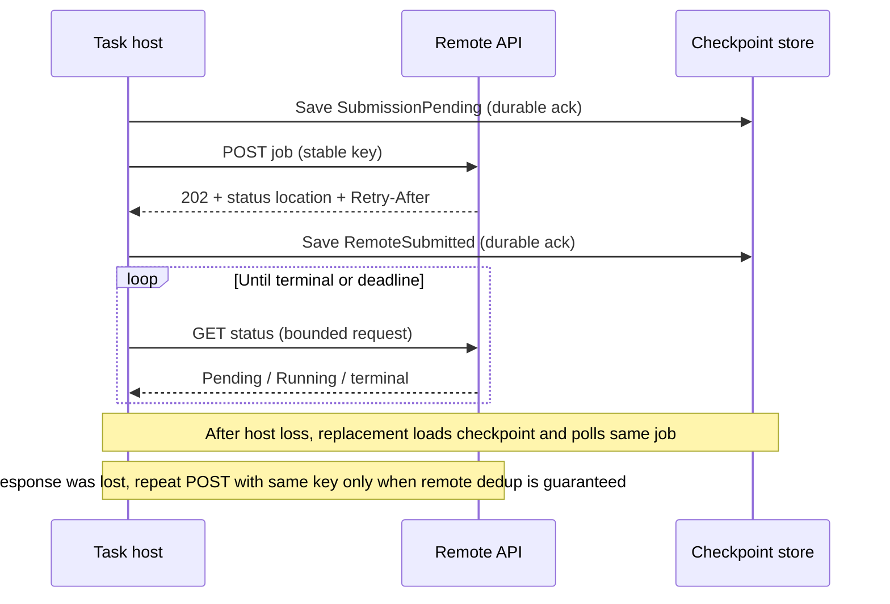

The task host owns the HTTP I/O; its agent slot stays occupied while polling (no extra engine job or
database table). A `202` carrying only an operation ID requires an author-declared status URL template;
other `202` responses without a status location fail. Validated status/cancel URLs stay on declared
trusted origins (submission origin by default, including redirect targets), use the task's secret reference
for authentication, and cannot contain embedded credentials or signed query tokens: checkpoints
and system events must never persist secrets. Poll request/response diagnostics go to per-attempt logs;
the host sends only submit/wait/terminal/cancel **transitions** through the agent as sequenced `TaskProgress`
messages. The engine deduplicates these by `(run, taskKey, attempt, progressSeq)` before appending `run_events`,
atomically advancing `task_attempts.last_progress_seq` with the appended event. This survives leader failover,
so the System Events view and live stream show remote progress without one event per poll. Remote operation
IDs are only shown if safe; remote stdout/stderr are not automatically collected. A new suspend-and-resume
scheduler that frees agent slots is deferred until concurrent waiting tasks justify its complexity.

### Applicable standards
OpenTelemetry semantic conventions (NFR-010) · WCAG 2.2 AA (NFR-009) · RFC 9457 Problem Details (API errors) ·
CloudEvents 1.0 (webhook notifications) · OAuth 2.0 / OIDC with PKCE (RFC 7636) · SemVer 2.0.0 (workflow versions).

## 4. Key Workflows
### 4.1 Registration on merge (FR-041, FR-042, FR-053; NFR-027 ≤ 60 s)
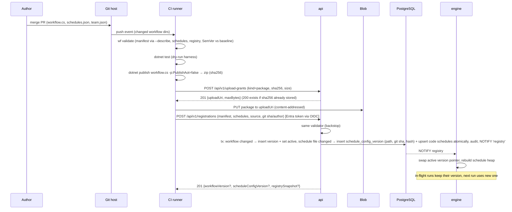
Workflow versions and schedule configs are registered independently: a schedule-file-only change inserts a `schedule_config_versions` row and updates code schedules, with no workflow SemVer bump and no new workflow version. The response is `201 { workflowVersion?, scheduleConfigVersion?, registrySnapshot? }`, listing only what changed; a schedule-only change returns `scheduleConfigVersion` and leaves the active workflow version unchanged.

### 4.2 Trigger and execute (NFR-028 ≤ 50 ms dispatch, NFR-029 ≤ 1 s start, NFR-030 ≤ 10 ms/node)

Implemented acceptance (`3.1.1.1.1`): `POST /api/v1/runs` uses the shared strict
request/response contract, scoped Operator authorization (or scoped/global
Admin), authenticated actor object ID, and shared JSON variable resolution
including workflow defaults. Active selections use the hosted cache; explicit
SemVer/build-independent keys or version UUIDs are restricted to the same
undeleted workflow. Cache unavailability returns 503. Each accepted request
captures a UUIDv7, immutable initial snapshot and run-timeout deadline, then
inserts the command and `pg_notify('commands', runId)` in one PostgreSQL
statement; no API-side run row is created. Invalid values return structured
400 errors with variable paths/hints; JSON bodies are capped at 1 MiB.
Idempotency enforcement (`3.1.1.1.2`) adds an inner endpoint filter after fresh
scoped authorization. Optional visible-ASCII keys are limited to 200 characters
and scoped by authenticated principal plus route. Canonical JSON fingerprints
normalize object ordering, whitespace and omitted request defaults, while
preserving array order and supplied values. A changed request under a live key
returns 409; a matching retry returns the original response, without reselecting
the active version. PostgreSQL key insertion/row locking serializes concurrent
hosts, and the key, command, response and NOTIFY share one transaction.
Unsuccessful acceptance rolls back the reservation; exact 24-hour expiry allows
reuse. Cache outages do not invalidate an already accepted response, but revoked
scope access prevents replay. Expiry is logical on lookup; physical expired-row
purging remains part of maintenance. Placement overrides, pending-command
reads and full execution dispatch below remain their dependent tasks.

Implemented run-now (`3.1.1.2.1`): public
`POST /api/v1/schedules/{id}/run-now` accepts no body or an empty object, with
fresh scoped Operator/Admin authorization. Both origins and paused instances
are supported; deleted instances reject new submissions. The existing trigger
handler captures effective instance variables, the selected immutable version
and permanent `run_series.id`; the optional series UUID survives the command
and fenced recovery into `runs.series_id`, with `trigger=0` (Manual).
No scheduled-fire row, pause change, overlap decision or cursor advance occurs.
The original instance UUID, not its editable configuration, fingerprints keyed
retries; edits/removal therefore preserve replay while another instance under
the same principal/route/key conflicts.

Schedule pins support exact UUID/SemVer or a bounded (256-character) range
grammar: full-version `=`, `>`, `>=`, `<`, `<=` comparisons joined by spaces,
`||` alternatives, and `*`, `major.*`, `major.minor.*` wildcards. Ranges select
the highest eligible same-workflow published version, independent of the
active pointer; omitted pins use the active cache. Prereleases require an
explicit same-core prerelease comparison. Shared WFV026 validates syntax
offline and at registration; no integer-size limit is imposed on components.
Caret/tilde/npm shorthand is deliberately unsupported rather than guessed.

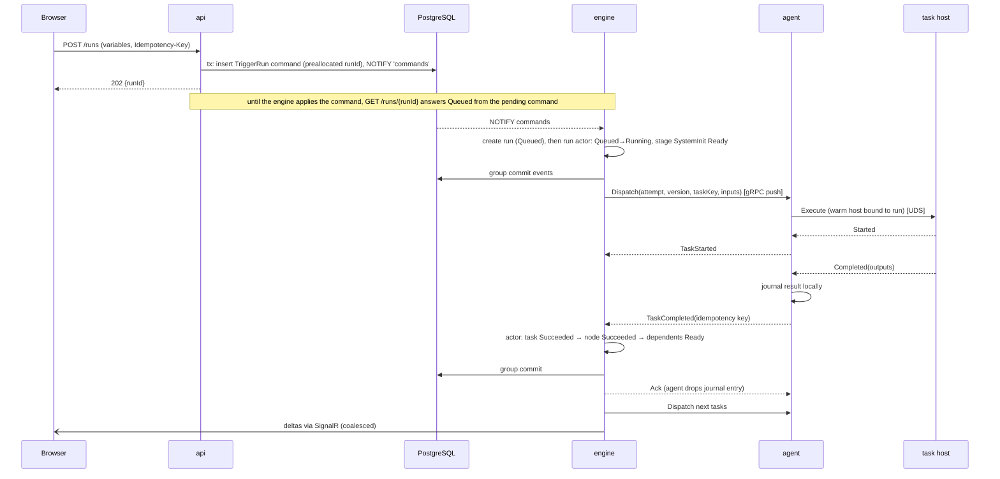
**Latency budget per node (critical path, warm agent)**

| Step | Budget |
|------|--------|
| Group commit (ready + dispatched) | ≤ 4 ms |
| Engine → agent → host (2 IPC hops) | ≤ 1 ms |
| Completion → engine | ≤ 1 ms |
| Group commit (completed + next ready) | ≤ 4 ms |
| **Engine overhead per node** | **≤ 10 ms p95** |

### 4.3 Scheduled fire, exactly once across failover (NFR-002 ≤ 2 s p99)
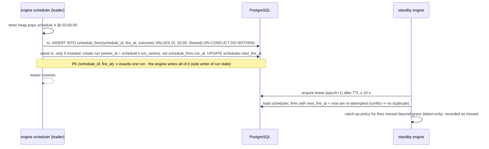
DST/timezone handled by Cronos per schedule timezone. Overlap policy is evaluated in the same transaction (skip → the `schedule_fires` row gets outcome `Skipped` and no run is created).

### 4.4 Live view: subscribe, deltas, resync (FR-018; NFR-001, NFR-019)
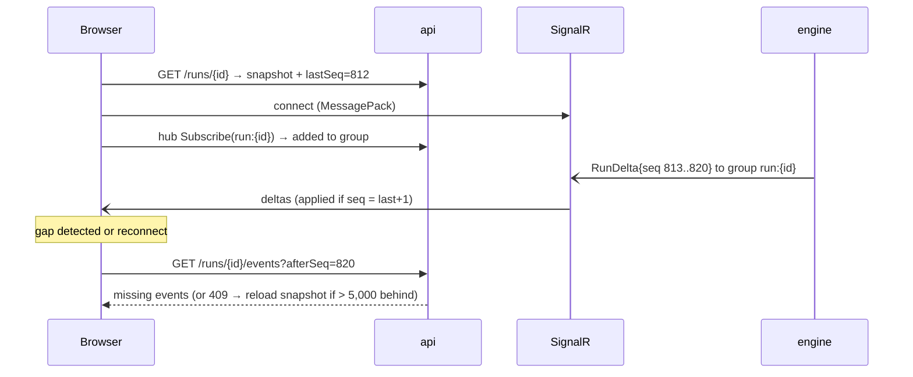
The engine publishes every event to `run:{id}` groups. It publishes coalesced run summaries (≤ 1 per run per 250 ms) to
`type:{id}` / `series:{id}` / `team:{id}` groups for list views. Logs are interest-based: opening a log view
sends `MirrorLogs(attempt)` to the agent, which then streams lines (batched ≤ 4/s) until unsubscribed. Stored logs
are always uploaded to blob in chunks (§4.7).

The separate System Events page reads the durable `run_events` history in sequence order, with node/task/attempt filters and historical pagination; it uses the same live deltas for new events. The workflow page links to that page through a selected run, because events describe an execution, not a reusable definition. A separate read-only Task Plan page instead reads the immutable manifest for the selected workflow version: task kind and declared action (command, HTTP call or SDK function), dependency/order, placement selector, retries and timeouts. For SDK functions, only the declared function is known statically; commands generated inside its code are not shown as a predicted plan. Run links use their pinned version, not today's active version; secret values are never shown (only safe references).
For remote-operation tasks, the plan shows the declared submit/status/cancel contract, not a predicted result;
System Events show submit/wait/outcome/cancel transitions while the task remains `Running` during the wait.
Repeated status checks are task-log diagnostics, not run events.

### 4.5 Phase 2 perf test across reserved machines (FR-102–FR-108, FR-117, FR-125, FR-126)
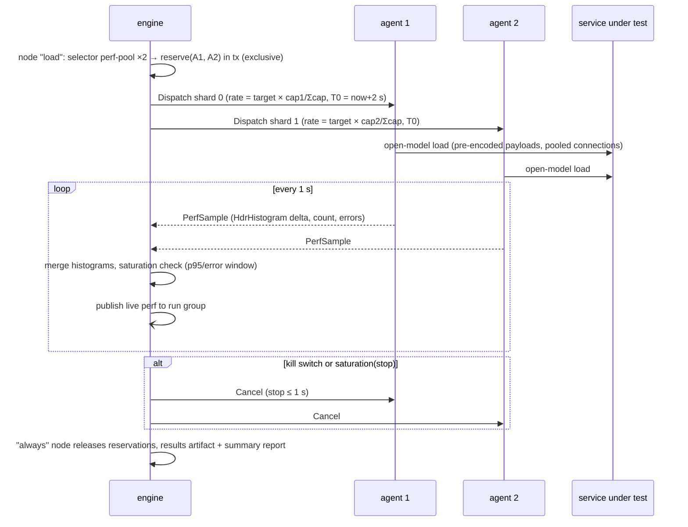
Clock skew: each agent measures its offset to the engine on connect (NTP-style ping exchange). `T0` is sent in engine time and converted locally.
Durability: agents journal `PerfSample` deltas until acked, and the engine appends the merged per-second histograms to blob every 5 s, so an engine failover or agent restart loses no perf data. Shard checkpoints and resume are described in §3 "Crash and restart recovery".

### 4.6 Phase 2 parity (FR-109–FR-111)
For each request (generated or replayed), the task host:
1. Shapes the request once via the service hook.
2. Sends identical bytes to baseline and candidate concurrently.
3. Decodes both responses with the codec, then applies the service normalisation hook.
4. Transcodes both to a canonical tree (Bond → Simple JSON via runtime schema; JSON as-is).
5. Runs the comparator: core rules, then hook extensions or override.

Mismatch counts are tallied by category; up to N samples per category are kept as artifacts. An optional first pass runs baseline vs baseline to
learn noisy paths, which are auto-added to ignore rules (Diffy approach).

### 4.7 Task logs, including very large ones (FR-019)
Logs are task stdout/stderr and `ctx.Log(...)`, not System Events. They never pass through PostgreSQL or the engine and are never held whole in memory.
1. **Capture**: the task host sends stdout/stderr and `ctx.Log(...)` lines to the agent over the existing local socket. Each line gets a timestamp, stream and level. The agent appends them to a spool file per attempt in its work dir (sequential write, 64 KB buffer).
2. **Chunking**: the agent seals a chunk every 8 MB or 10 s, whichever comes first. It gzip-compresses the chunk (stdlib, fastest level; text typically shrinks 5–10×) and uploads it through an `UploadGrant` to `logs/{runId}/{taskKey}/{attempt}/{n:D6}.log.gz`. A small `index.json` lists each chunk's first/last line number, byte range and time range. The spool file is deleted only after upload is acknowledged.
3. **Database**: `task_attempts` stores only `log_uri` (the prefix), `log_bytes`, `log_lines` and `log_truncated`.
4. **Size cap**: the default cap is 2 GB uncompressed per attempt, configurable per task (`.Limits(maxLogBytes: …)`), and admins set a hard ceiling per type. Beyond the cap the agent keeps the first 256 MB plus a rolling last 256 MB, inserts a marker with the dropped line count, and sets `log_truncated`. The task keeps running.
5. **Back-pressure**: if blob storage is unreachable, chunks stay spooled on disk and upload with retry. If the agent's spool quota (default 20 GB) fills, it switches to head-and-tail mode as in step 4. A log problem never fails or slows the task.
6. **Viewing**: the UI opens at the tail and reads only the chunks covering the visible line range, located through the index. The list is virtualised, so a 2 GB log scrolls like a small one. Live tail uses `MirrorLogs`, which runs only while someone is watching.
7. **Search and download**: `?search=` streams the chunks through a decompressor on the api, with a regex time limit of 10 s and at most 1,000 matches returned with line numbers. Download streams the concatenated chunks without buffering them.
8. **Retention**: logs follow run retention (90 days) and the blob lifecycle (cool tier after 30 days). Log bytes are metered separately from the 5 GB artifact budget and exposed as `wf_log_bytes_total` and `wf_log_truncated_total`.

## 5. Data Model
### 5.1 High-Level (entities & relationships)
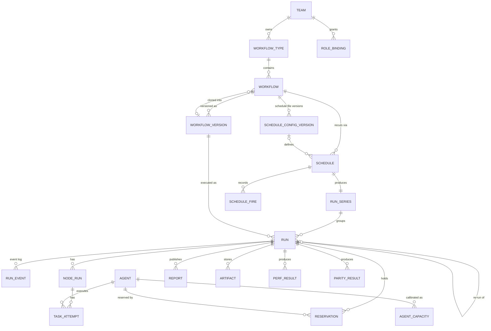
**Ownership**:
- Registry entities (team, type, workflow, version, schedule config versions, code schedules) are written only by registration, except `workflows.active_version_id`, which an Admin can also change through workflow-version activation (`POST .../versions/{v}/activate`: audited registry transaction + `NOTIFY 'registry'`).
- User schedules, role overrides, subscriptions and admin config are written by the api.
- Run, node, task, reservation and result entities are written only by the engine (the api submits commands).
- Payloads (logs, reports, artifacts, packages, histograms, resource series) live in blob; the DB holds pointers.

### 5.2 Low-Level Schema
Conventions:
- IDs are UUID v7 (`Guid.CreateVersion7()`, time-ordered); registry IDs are slugs (`team/type/name`).
- All timestamps are `timestamptz` UTC; enums are `smallint` mapped in code.
- Run-scoped tables are **range-partitioned monthly** on `run_day` (derived from the run's UUID v7 timestamp, so lookups by `run_id` include the partition key without an extra index).

| Table | Column | Type | Null | Index | Notes |
|-------|--------|------|------|-------|-------|
| teams | id | text | N | PK | slug |
| | name, presentation | text, jsonb | N | | presentation = FR-059 config |
| role_bindings | id | uuid | N | PK | |
| | scope_kind, scope_id | smallint, text | N | UQ(scope_kind, scope_id, role, principal_id) | Global/Team/Type; Global uses `scope_id = '*'` |
| | role | smallint | N | | Author/Operator/Viewer/Admin |
| | principal_id, principal_kind | uuid, smallint | N | idx(principal_id) | Entra group or user object ID; from `team.json` |
| workflow_types | id | text | N | PK | `team/type` |
| | team_id | text | N | FK, idx | |
| | name, normalized_name | text | N | UQ(team_id, normalized_name) | FR-058 (similarity checked in validator) |
| | metadata_schema | jsonb | N | | required keys + allowed values |
| | retention_days, limits | int, jsonb | Y | | per-type overrides (reports, artifacts) |
| workflows | id | text | N | PK | `team/type/name` |
| | type_id | text | N | FK, idx | |
| | active_version_id | uuid | Y | FK | hot-swap pointer (FR-053) |
| | latest_version_id | uuid | Y | same-workflow FK | latest registration baseline; unchanged by a manual active-version rollback |
| | active_schedule_config_id | uuid | Y | same-workflow FK | active independently versioned code schedule file; known-content reverts reuse historical config IDs |
| | cloned_from_version_id | uuid | Y | FK | lineage (FR-044) |
| | deleted_at | timestamptz | Y | | soft delete |
| workflow_versions | id | uuid | N | PK | |
| | workflow_id | text | N | UQ(workflow_id, semver_key) | |
| | semver, semver_key | text | N | | Full SemVer and generated identity without build metadata; 256-character API/storage bound preserves prereleases and arbitrary-size numeric components supported by the shared validator |
| | manifest | jsonb | N | | DAG, variables, policies, hook package refs |
| | package_uri, package_sha256 | text, bytea | N | | content-addressed zip |
| | source_uri | text | N | | script source for diff |
| | git_commit, git_author, registered_by, change_note | text | N/N/N/Y | | FR-006 |
| | sdk_version | text | N | | |
| | created_at | timestamptz | N | | |
| schedule_config_versions | id | uuid | N | PK | one row per registered schedule-file content |
| | workflow_id | text | N | UQ(workflow_id, content_sha256) | |
| | source_path, git_commit, content_sha256 | text, text, bytea | N | | registered independently of workflow versions (FR-053/054) |
| | content | text | Y (legacy only) | SHA-256 check | exact UTF-8 JSON retained for revalidation against new workflow variables/defaults; new registrations require 1 byte to 1 MiB |
| | git_author, registered_by, registered_at | text, text, timestamptz | N | | |
| schedules | id | uuid | N | PK | |
| | workflow_id | text | N | FK | |
| | origin | smallint | N | | Code / User |
| | code_key | text | Y | UQ(workflow_id, code_key) WHERE origin=Code | instance ID from schedule file |
| | config_version_id | uuid | Y | FK | Code: current `schedule_config_versions` row (source path, commit, hash); null for User |
| | name, timezone | text | N | | |
| | cron / interval_s | text / int | Y | CHECK exactly one | file/registration intervals require positive whole seconds, at most 2,147,483,647; no rounding |
| | variables | jsonb | N | | effective (defaults ← overrides) |
| | version_pin | text | Y | | Exact UUID/SemVer or comparison/wildcard range; null selects active |
| | overlap_policy, catchup_policy | smallint | N | | skip/queue/concurrent · none/latest |
| | paused | bool | N | | |
| | next_fire_at | timestamptz | Y | idx WHERE NOT paused AND deleted_at IS NULL | scheduler heap source |
| | row_version | int | N | | ETag / optimistic concurrency |
| | created_by, updated_by, updated_at, deleted_at | | | | |
| run_series | id | uuid | N | PK | |
| | workflow_id, schedule_id | text, uuid | N | UQ(schedule_id) | one series per schedule, keyed permanently; variable edits keep the series; ad-hoc runs leave `runs.series_id` null |
| schedule_fires | schedule_id, fire_at | uuid, timestamptz | N | PK | **exactly-once key** |
| | outcome, run_id, reason | smallint, uuid, text | N,Y,Y | | Started/Skipped/Missed/CaughtUp |
| runs ⧉ | run_day, id | date, uuid | N | PK(run_day, id) | ⧉ = partitioned |
| | workflow_id, version_id, series_id | text, uuid, uuid | N,N,Y | idx(workflow_id, id DESC), idx(series_id, id DESC) | |
| | trigger, triggered_by | smallint, text | N | | Manual/Schedule/Api/Rerun/CatchUp |
| | variables, metadata | jsonb | N | GIN(metadata jsonb_path_ops) | effective variables; metadata copied from definition |
| | schedule_rev, schedule_config_version_id | int, uuid | Y | | schedule `row_version` and code schedule-config version that fired the run |
| | status, failure_category, status_reason | smallint, smallint, text | N,Y,Y | partial idx(status) WHERE active | |
| | aborted_by, aborted_by_name, aborted_at, abort_reason, abort_source | text, text, timestamptz, text, smallint | Y | idx(aborted_by, aborted_at) WHERE aborted_at IS NOT NULL | set once (FR-015); reason ≤ 500 chars; source UI/API/CLI/KillSwitch |
| | parent_run_id | uuid | Y | | re-run lineage |
| | placement | jsonb | Y | | trigger-time override, e.g. `{singleMachine:true, machine:"lab-07"}` |
| | created_at, started_at, ended_at | timestamptz | N,Y,Y | | |
| | last_seq, snapshot_seq | int | N | | resync + recovery |
| run_events ⧉ | run_day, run_id, seq | date, uuid, int | N | PK | append-only |
| | ts, kind, entity_key, attempt | timestamptz, smallint, text, smallint | N,N,Y,Y | | |
| | payload | bytea | N | | protobuf (compact, fast) |
| node_runs ⧉ | run_day, run_id, node_key | | N | PK | stages stored as nodes `$init`, `$pre`, `$post`, `$sys-post` |
| | status, attempts, failure_category | smallint | N,N,Y | | |
| | started_at, ended_at | timestamptz | Y | | |
| | outputs | jsonb | Y | | ≤ 64 KB (FR-020) |
| | reused_from_run_id | uuid | Y | | FR-016 |
| | pinned_agent_id | uuid | Y | | affinity pin (`Node` / `Run` / `SameMachineAs`) |
| task_attempts ⧉ | run_day, run_id, task_key, attempt | | N | PK | idempotency key |
| | agent_id | uuid | Y | idx(agent_id, started_at) | |
| | status, failure_category, error | smallint, smallint, text | N,Y,Y | | error ≤ 4 KB |
| | queued_at, started_at, ended_at, queue_wait_ms | | Y | | FR-046 |
| | deadline_at, retry_at | timestamptz | Y | partial idx(deadline_at) WHERE running; partial idx(retry_at) WHERE retry_at IS NOT NULL | attempt timeout; next retry due (FR-014), restored on failover |
| | last_progress_seq | int | N | | default 0; atomically advanced with each accepted `TaskProgress` event (FR-064) |
| | outputs | jsonb | Y | | structured task outputs ≤ 64 KB (FR-019) |
| | cpu_avg_pct, cpu_max_pct, ram_peak_mb, net_bytes_sent, net_bytes_received | real, real, int, bigint, bigint | Y | | summary; CPU/RAM/network rate series in blob (FR-046) |
| | log_uri, resource_series_uri | text | Y | | `log_uri` = chunk prefix (§4.7) |
| | log_bytes, log_lines, log_truncated | bigint, bigint, bool | Y | | uncompressed totals; head+tail kept when capped |
| task_checkpoints ⧉ | run_day, run_id, task_key | | N | PK | latest checkpoint per task (FR-061); highest `seq` wins, applied from agent `CheckpointSaved` |
| | attempt, seq, blob_uri, size_bytes, saved_at | smallint, int, text, int, timestamptz | N | | ≤ 1 MB; deleted with the run |
| commands | id | uuid | N | PK | api → engine inbox |
| | kind, run_id, payload | smallint, uuid, jsonb | N,Y,N | partial idx WHERE processed_at IS NULL; UQ(run_id) WHERE kind = Abort | TriggerRun (preallocated run_id; schedule run-now = `TriggerRun` with the schedule's series)/Abort/Rerun; kill-load is an `Abort` with source `KillSwitch` |
| | created_by, created_at, processed_at | | N,N,Y | | |
| idempotency_keys | principal_id, route, key | text, text, text | N | PK | `Idempotency-Key` dedupe (24 h) |
| | status_code, result, expires_at | smallint, jsonb, timestamptz | N | idx(expires_at) | original response replayed on retry; expired rows purged |
| agents | id | uuid | N | PK | |
| | name | text | N | UQ | |
| | os, arch, cores, ram_mb | smallint, smallint, int, int | N | | |
| | max_tasks | int | N | | concurrent task slots (default = cores) |
| | labels, pool | text[], text | N | GIN(labels) | |
| | status, last_heartbeat_at, agent_version | smallint, timestamptz, text | N | | |
| agent_capacities | agent_id, profile_key | uuid, text | N | PK | FR-125; profile = transport + codec + payload-size class + load settings |
| | capacity_rps, source, calibrated_at | int, smallint, timestamptz | N,N,Y | | Manual/Calibrated |
| reservations | id | uuid | N | PK | |
| | run_id, node_key, agent_id | uuid, text, uuid | N | UQ(agent_id) WHERE released_at IS NULL | **exclusivity** |
| | epoch, renewed_at | bigint, timestamptz | N | | renewable lease: engine renews while the node/run is active; epoch is sent with every dispatch (fencing); engine failover keeps the reservation: the new leader adopts and renews the current epoch before expiry |
| | created_at, expires_at, released_at, release_reason | | N,N,Y,Y | | released on run/node completion, failure, abort or lease expiry; expiry → work cancelled and fenced before the machine is reassigned |
| reports ⧉ | run_day, id | | N | PK | |
| | run_id, source_key, kind, title, tags | | N | idx(run_id) | |
| | size_bytes, blob_uri, sha256, created_at | | N | | |
| artifacts ⧉ | run_day, id, run_id, source_key, name, size_bytes, blob_uri, sha256, created_at | | N | PK(run_day, id); idx(run_id) | ≤ 5 GB/run sum enforced on grant |
| perf_results ⧉ | run_day, run_id, node_key | | N | PK | |
| | target_rps, achieved_rps, p50_ms, p95_ms, p99_ms, max_ms, error_rate | real | N | | |
| | saturated, max_sustainable_rps, histogram_uri | bool, real, text | N,Y,N | | |
| parity_results ⧉ | run_day, run_id, node_key | | N | PK | |
| | total, matched, parity_pct | bigint, bigint, numeric(6,3) | N | | |
| | categories, noise_paths, samples_uri | jsonb, jsonb, text | N,Y,N | | |
| daily_rollups | day, workflow_id, node_key | date, text, text | N | PK | trends/dashboards (FR-024/047); UUIDv7 UTC creation day, empty node key = workflow total |
| | runs, failures, soft_failures, duration_count | bigint | N | | refreshed atomically in each run terminal transaction; ordered bucket locks, idempotent exact source aggregation; retained terminal history backfilled by 0036 |
| | p50_ms, p95_ms, cpu_max_pct, ram_peak_mb | double precision (RAM numeric) | Y | | exact interpolated duration quantiles, never averaged across days; null when unobserved; resource maxima include failed/retried attempts; RAM in MiB |
| dashboard_rollups | scope, scope_id, workflow_id, node_key, day | text, uuid, text, text, date | N | PK; idx(day, workflow_id) | workflow (zero UUID), schedule (retained series UUID), machine (agent UUID); node scope selects the workflow projection |
| | observations, failures, soft_failures, duration_count, durations_ms | bigint, double precision[] | N | | 0037 backfills retained terminal history; same ordered bucket lock and terminal transaction as daily_rollups; exact observed source durations, never averaged daily quantiles or approximate sketches |
| | cpu_max_pct, ram_peak_mb, latest_run_id | double precision, numeric, uuid | Y,Y,N | | scope-specific resource maxima and latest contributing run; null unknown telemetry, measured zero preserved; counts and duration arrays constrained independently |
| audit_log ⧉ | id, ts | bigint identity, timestamptz | N | PK(ts, id) | 13 monthly partitions (≥ 1 year) |
| | actor, actor_kind, action, target_kind, target_id, team_id, summary | | N/N/N/N/N/Y/N | idx(target_kind, target_id, ts), idx(actor, ts) | |
| subscriptions | id, principal_id, scope_kind, scope_id, type_scope, series_id, events, channel, target, secret_ref, created_at | | N (series_id, secret_ref Y) | PK(id); unique owner/scope/events/channel/destination configuration; owner UUID keyset and scoped lookup indexes | FR-028; 0038; schedule binds retained series; FK cascades type/series deletion |
| notification_outbox | id, subscription_id, run_day, run_id, payload, created_at, attempts, next_attempt_at, delivered_at, failed_at, last_error | | N (delivered_at, failed_at, last_error Y) | PK(id); unique(subscription_id, run_day, run_id); due index excludes delivered/failed rows | 0038 durable schema; subscription and partitioned-run FK cascades; JSON object payload, nonnegative attempts, bounded sanitized error |
| leases | name | text | N | PK | `engine` |
| | holder, epoch, expires_at | text, bigint, timestamptz | N | | fencing epoch |
| registry_snapshots | id, git_commit, content, registered_at | uuid, text, jsonb, timestamptz | N | PK(id) | team/type registry history |

**Volume (peak, 90 days)**: 2,000 runs/day × 200 nodes × ~6 events = 2.4 M events/day, which over 90 days is ≈ 216 M rows (≈ 35 GB including indexes).
Node runs and task attempts come to about 40 M rows each. Logs, reports, artifacts and histograms are in blob. This is comfortably within one Flexible Server (D4ds, 4 vCore).

#### Schema map and storage mapping
**LLD 1: Schema map** ([HTML](diagrams/lld-schema.html) · [SVG](diagrams/lld-schema.svg)). Key columns, keys and indexes per table, grouped by owning area, with 1:N / 1:1 cardinality.

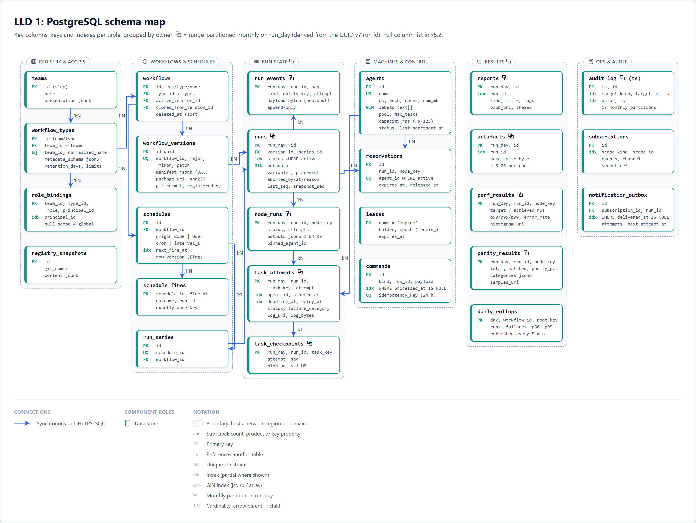

**LLD 2: Write paths** ([HTML](diagrams/lld-data-flow.html) · [SVG](diagrams/lld-data-flow.svg)). Who writes which table or blob prefix. Only the engine writes run state; `run_events` and the snapshot tables are written in the same transaction.

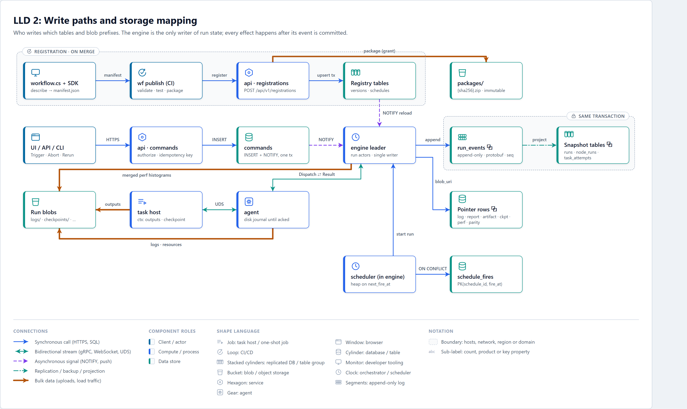

**Blob layout.** One container (Azure) or root folder (filesystem) per environment. The database holds only the pointer column; blobs are immutable once written.

| Prefix | Path | Pointer column | Writer | Deleted |
|---|---|---|---|---|
| packages | `packages/{sha256}.zip` | `workflow_versions.package_uri` | CI (`wf publish`) via api upload grant on register | never (content-addressed) |
| sources | `sources/{sha256}` | `workflow_versions.source_uri` + hash/size | api on register; immutable single-file source ZIP | never |
| logs | `logs/{runId}/{taskKey}/{attempt}/{n:D6}.log.gz` + `index.json` | `task_attempts.log_uri` (prefix) | agent (§4.7) | with the run |
| resources | `resources/{runId}/{taskKey}/{attempt}.bin` | `task_attempts.resource_series_uri` | agent | with the run |
| checkpoints | `checkpoints/{runId}/{taskKey}/{seq}.json` | `task_checkpoints.blob_uri` | task host via SDK | with the run |
| reports | `reports/{runId}/{reportId}` | `reports.blob_uri` | task host | with the run |
| artifacts | `artifacts/{runId}/{artifactId}/{name}` | `artifacts.blob_uri` | task host | with the run |
| perf | `perf/{runId}/{nodeKey}/hist-*.hdr` | `perf_results.histogram_uri` | engine (merged per-second histograms, §4.5) | with the run |
| parity | `parity/{runId}/{nodeKey}/samples.jsonl.gz` | `parity_results.samples_uri` | task host | with the run |

Writers (§4.5, §4.7): the agent writes `logs/` and `resources/`; the task host writes reports, artifacts, checkpoints and parity samples; the engine writes the merged `perf/` histograms and every run-scoped pointer row. All task-host and agent uploads use short-lived per-prefix `UploadGrant`s (SAS on Azure, signed api URL on filesystem), so writers can touch only their own run's prefix.

### 5.3 Migrations & Versioning
- **DbUp** runs ordered SQL scripts (`backend/db/migrations/NNNN_description.sql`) from an ACA job before each deployment. Scripts are idempotent where possible.
- **Expand → migrate → contract** (NFR-025): a release only *adds* (columns nullable or defaulted, new tables, new indexes `CONCURRENTLY`). Backfills run as batched jobs. Removal ships ≥ 1 release later. Every release must run against both the old and new schema; CI runs the previous release's integration tests against the new schema.
- **Partitions**: the engine's maintenance loop pre-creates next month's partitions. Retention drops whole partitions older than the global maximum. Per-type shorter retention deletes in batches of ≤ 5,000 rows off-peak (`FR-030`).
- **Event payload versioning**: protobuf with additive fields only; `kind` values are never reused.
- **Manifest versioning**: `manifest.schemaVersion`. The validator and engine support the current and previous schema versions.

#### Retention configuration

`GET/PUT /api/v1/admin/retention` reuse the existing global Admin policy, including local Development
access; no separate login or authentication flow. Migration `0040_retention_config.sql` seeds the
singleton defaults; existing nullable `workflow_types.retention_days` stores exact per-type overrides.
The JSON contract is `{"default_days":90,"audit_days":365,"per_type":{"team/type":30}}`.
Defaults and overrides accept integer days from 1 to 36,500; audit accepts 365 to 36,500 independently
of run retention. Overrides must name registered workflow types (at most 256). Run-owned events, logs,
reports, artifacts and metrics share run retention; an absent override inherits `default_days`.

PUT is a full replacement: omitted override entries revert to inheritance. All three JSON properties
are required; unknown, duplicate, null and mistyped members, query parameters, invalid day ranges and
unknown types return 400. Requests are bounded to 64 KiB, including chunked bodies (413); non-JSON is
415. Both routes require a nonempty audit-principal UUID and return no-store responses. One PostgreSQL
statement reads a consistent configuration snapshot. PUT locks the singleton to serialize writers,
locks referenced types, replaces defaults/overrides and appends `retention.update` with complete
before/after configuration in the same transaction. Last committed replacement wins; an audit failure
rolls everything back. Missing/inconsistent persisted configuration is 500, not a fabricated default;
database failures are logged and sanitized as 503. Configuration changes alone do not launch a purge.
The live-load purge gate is exercised separately from the functional maintenance regressions by
`RetentionPurgeTests`, tagged `Performance` and run alone in both backend CI OS jobs. It seeds 5,000
expired full-graph runs with 20,000 real filesystem objects under a 14-day override, plus 150 retained
runs under default, shorter and longer policies. Four additional active runs use real `RunStore`
snapshots/events. Four steady HTTP lanes offer 200 requests/second to production metrics/timeline
routes using RSA-signed Viewer JWTs, consume entire responses and verify unchanged committed answers.
After warmup, 6,000 baseline samples are compared with every sample overlapping actual maintenance;
the row-deletion subset is independently gated. Both p95 increases must be strictly below 10%:
no artificial latency floor, discarded outliers, HTTP retry or mocked transport. The fixture drains
shared bounded blob batches continuously, more aggressively than the hosted ten-second tick.
Local evidence `compose-results/retention-purge-live-paced-blobs.trx` records baseline p95 33.965 ms,
132,021 maintenance samples at 28.075 ms and 21,897 row-deletion samples at 30.623 ms. All expired
rows, report locators and blobs disappear; all retained child rows/blobs and active runs survive.
Earlier unpaced work exceeded the gate, motivating smaller row transactions and paced blob batches;
the original lease fence and the workload/threshold were not weakened. This is measured local
evidence, not a guarantee on every shared host or a claim that remote CI has run.

`RetentionService` runs only in the engine host. The current database-fenced leader pre-creates this
month and next month's complete run/audit partition families daily. Policy deletion runs only from
02:00 inclusive to 04:00 exclusive UTC. A sweep removes at most 5,000 runs, in transactions of at most
25 runs with 250 ms pacing; each transaction reacquires the current policy and engine lease fence.
The smaller transactions preserve the existing one-second database fence: actual 5,001-run testing
exposed roughly 7.5 seconds of PostgreSQL foreign-key checking for one monolithic 5,000-run DELETE.
Neither constraints nor the lease timeout are disabled or relaxed. SQL lock waits are bounded to
100 ms; failed work rolls back and retries on a later ten-second tick.

Both creation and terminal completion must be older than the applicable default/type cutoff. Active
runs, unfinished nodes/attempts, unreleased physical reservations (even if expired), pending reservation
queues, dispatches, commands and unexpired artifact grants are retained. Run and attempt deadlines
must also be more than 24 hours 15 minutes old, preserving offline log recovery capabilities and their
last short-lived upload grants. These conservative safety guards can retain data longer than its
configured minimum; they never turn expiry into a physical-work acknowledgement.

Each transaction explicitly removes run-owned FK children, report-ID locators and processed commands,
refreshes affected daily/dashboard metric buckets under their existing ordered aggregate locks, and
durably queues blob deletion before removing the run. Schedule-fire and rerun lineage references
intentionally outlive the run; reused outputs are already copied into the child. Audit has a separate
5,000-row batch and its independent minimum-one-year cutoff, retaining the exact boundary timestamp.
Whole monthly partitions are detached and dropped only after every table in an expired run family
is empty and its upper bound is past the maximum default/type retention. Audit families use the audit
cutoff independently. Schema, inheritance, canonical names and actual partition bounds are checked;
NOWAIT locks plus a second emptiness check protect readers and concurrent writers. No `CASCADE` is
used, no child of a still-retained run month is removed, and one family is dropped per transaction.

Migration `0041_retention_blob_deletions.sql` makes DB-to-blob cleanup restart-durable. Workers use
SKIP LOCKED tombstones, ten-second cancellable deletions and sanitized one-minute-to-one-hour retry
backoff. Each maintenance tick processes at most 32 tombstones with 25 ms between committed jobs;
the shared bounded batch also prevents catch-up workers from monopolizing storage. Blob IO does not
hold the one-second logical engine lease fence; already-deleted run ownership,
tombstone row locks and fresh reference checks provide its authority. Filesystem and Azure adapters
delete only the exact run's logs, resources, checkpoints, reports, perf and parity prefixes. Packages,
source and other runs are untouched; canonical ID/hash validation and filesystem reparse-point rejection
apply before deletion. The existing orphan-run sweeper now covers all six run prefixes, so a late
capability upload cannot become a permanent orphan.

Artifact bytes are content-addressed and may be shared. GC acquires the same hash-specific transaction
lock as actual artifact publication, checks both artifact and grant references, and deletes only when
none remain. Busy publishers defer their tombstone for ten seconds without consuming failure retries
or starving other queued work. An off-peak inventory also queues unreferenced artifact hashes left by
failed/expired publications. Cancellation leaves unacknowledged tombstones for idempotent retry.

## 6. API Design
**Style**: REST + JSON over HTTPS for queries and commands (`/api/v1`), SignalR (MessagePack) for push, gRPC for
agents. Within v1 only additive changes are allowed; breaking changes go to `/api/v2` alongside v1 for ≥ 1 release.
- **Pagination**: cursor-based (`?limit=50&cursor=<opaque>`, keyset on `(id DESC)` with UUID v7 = time order). Responses include `nextCursor`.
- **Errors**: RFC 9457 `application/problem+json` with `code`, `traceId`, and `errors[]` (validator output: `path`, `message`, `hint`).
- **Concurrency**: `ETag` / `If-Match` on mutable resources (schedules) → 412 on conflict.
- **Idempotency**: an `Idempotency-Key` header on POSTs that create runs or commands (24 h, stored in `idempotency_keys`; a retry gets the original response).
- **Docs**: OpenAPI 3.1 via `Microsoft.AspNetCore.OpenApi` at `/openapi/v1.json`. The TS client is generated from it in frontend CI, and a drift check fails the build.
- **Rate limits**: ASP.NET Core rate limiter per principal (default 50 req/s burst 100; registrations 10/min).

| Method | Route | Auth | Request | Response | Errors |
|--------|-------|------|---------|----------|--------|
| GET | /api/v1/me | User | — | principal, roles per team/type | 401 |
| GET | /api/v1/teams | User | — | teams user can see + presentation | 401 |
| GET | /api/v1/teams/{team}/types | Viewer(team) | — | types + metadata schema + latest status counts | 403, 404 |
| GET | /api/v1/workflows | Viewer(scope) | `team, type, q, meta.<k>=<v>, status, cursor, limit` | page of workflows + latest run summary | 400, 403 |
| GET | /api/v1/workflows/{id} | Viewer | — | workflow + active version manifest | 404 |
| GET | /api/v1/workflows/{id}/versions | Viewer | cursor | versions (SemVer, authors, note) | 404 |
| GET | /api/v1/workflows/{id}/versions/{v} | Viewer | — | immutable version manifest for the read-only Task Plan (secret values excluded) | 404 |
| GET | /api/v1/workflows/{id}/diff | Viewer | `from, to` | manifest diff + source diff | 400, 404 |
| POST | /api/v1/workflows/{id}/versions/{v}/activate | Admin | — | 200 active version | 404, 409 |
| POST | /api/v1/workflows/{id}/versions/{v}/clone | Author(type) | `newName, targetType` | zip scaffold (script with `ClonedFrom`, schedules stub, tests) | 400, 409 |
| POST | /api/v1/registrations | Registrar (CI) | manifest, schedules, registry, source, package ref, git info | 201 `{ workflowVersion?, scheduleConfigVersion?, registrySnapshot? }` (only what changed) | 400 (validation problem), 409 (SemVer) |
| POST | /api/v1/runs | Operator | `workflowId, version?, variables, placement?` + Idempotency-Key | 202 `{runId}` (preallocated; the engine creates the run from the `TriggerRun` command) | 400 (variables, unsatisfiable placement), 403, 409 |
| GET | /api/v1/runs | Viewer | `workflowId, seriesId, status, abortedBy, meta.*, from, to, cursor` | page of runs (abort record inline) | 400 |
| GET | /api/v1/runs/{id} | Viewer | — | snapshot (run incl. abort record, nodes, tasks, reports index) + `lastSeq` | 404 |
| GET | /api/v1/runs/{id}/events | Viewer | `afterSeq` for live resync, or `cursor, limit, nodeKey?, taskKey?, attempt?` for historical paging | ordered events (resync ≤ 5,000; history page + next cursor) | 409 (resync too far behind → reload) |
| POST | /api/v1/runs/{id}/abort | Operator | `reason` (required, ≤ 500) + Idempotency-Key | 202 abort record `{by, byName, at, reason, source}` | 400 (reason missing/too long), 403, 409 (terminal; body has status) |
| POST | /api/v1/runs/{id}/rerun | Operator | `fromNodes?, placement?` + Idempotency-Key (omitted `placement` keeps the original run's override) | 202 `{runId}` | 400 (unsatisfiable placement), 409 |
| POST | /api/v1/runs/{id}/kill-load | Operator | `reason?` (default "Kill switch") | 202 abort record (inserts the same `Abort` command with `abort_source = KillSwitch`) | 409 |
| GET | /api/v1/runs/{id}/tasks/{task}/{attempt}/logs | Viewer | `offset, length`, `search`, or `download` | indexed log range / matches / streamed download | 404 |
| GET | /api/v1/runs/{id}/reports | Viewer | `kind, tag` | report index | 404 |
| GET | /api/v1/reports/{id}/content | Viewer | — | streamed body with `Content-Security-Policy: sandbox allow-scripts; frame-ancestors 'self'` (opaque origin; no `X-Frame-Options DENY`, so the SPA can frame it) and `X-Content-Type-Options: nosniff` (§8) | 404 |
| GET | /api/v1/runs/{id}/artifacts · /api/v1/artifacts/{id}/content | Viewer | — | list · 302 SAS (streamed) or streamed body (filesystem store) | 404 |
| POST | /api/v1/upload-grants | Registrar (CI) | `kind=package, sha256, size` | 201 `{uploadUri, maxBytes}` (SAS or api grant URL); 200 `{exists:true}` if already stored | 400, 403, 413 |
| PUT | /api/v1/uploads/{grant} | Grant (HMAC) | raw stream ≤ `maxBytes` | 201 | 403 (expired/invalid), 413 |
| GET | /api/v1/runs/{id}/metrics | Viewer | — | per stage/node/task timings, resources | 404 |
| GET | /api/v1/schedules | Viewer | `workflowId, origin` | schedules + next fires | 400 |
| POST | /api/v1/schedules | Operator · **UI-only, not part of public API** | user schedule | 201 + ETag | 400, 403 |
| PUT | /api/v1/schedules/{id} | Operator · **UI-only, not part of public API** | schedule + If-Match | 200 + ETag | 409 (origin = code), 412 |
| POST | /api/v1/schedules/{id}/pause · /resume | Operator · **UI-only, not part of public API** | — | 202 | 409 (code-defined) |
| POST | /api/v1/schedules/{id}/run-now | Operator | — | 202 `{runId}` (series derived from the schedule's `run_series`) | 404 |
| DELETE | /api/v1/schedules/{id} | Operator · **UI-only, not part of public API** | If-Match | 204 | 409 (code), 412 |
| GET | /api/v1/series/{id}/runs · /trends | Viewer | `window=7d,30d,90d` | runs · trend series (rollups) | 404 |
| GET | /api/v1/dashboards/{scope}/{id} | Viewer | `window=7d,30d,90d`, `top=1..50` | node rankings: exact p95, hard-failure fraction, max CPU and RAM; contributing run links | 400, 403, 500, 503 |
| GET | /api/v1/machines | Viewer | `label, pool, os, status` | machines + reservations | — |
| PATCH | /api/v1/machines/{id} | Admin | labels, pool, capacity per profile | 200 | 400 |
| POST | /api/v1/machines/{id}/calibrate · /drain | Admin | profile | 202 | 409 (reserved) |
| GET | /api/v1/subscriptions | Owning user + current scoped Viewer | optional paired `scope, scopeId`; `limit=1..100` (default 50), `cursor` | `{items,nextCursor}` | 400, 403, 500, 503 |
| POST | /api/v1/subscriptions | User + current scoped Viewer | `{scope,scopeId,events,channel,target,secretRef?}` | 201 subscription + Location | 400, 403, 409, 413, 415, 500, 503 |
| DELETE | /api/v1/subscriptions/{id} | Owning user (also after role revocation) | canonical subscription UUID | 204; queued rows cascade | 400, 404, 500, 503 |
| GET | /api/v1/audit | Admin / team Author | `actor, target, from, to, cursor` | page | 403 |
| GET/PUT | /api/v1/admin/retention | Admin | defaults + per-type | config | 400 |

**Completion subscriptions (FR-028)**: scope IDs are plain `team/type/workflow`,
`team/type` or canonical lowercase schedule UUIDs, not dashboard base64url IDs.
`Completed` covers every terminal run outcome; `Failed` covers failure, abort and
timeout. Distinct events are stored in ordinal order. Webhook requires an HTTPS
URL (loopback HTTP for local use) without credentials, query or fragment and a
configured signing-secret reference, never a key value. Email accepts one mailbox
without a display name; Teams accepts a configured destination-secret reference,
never a credential-bearing connector URL. Email and Teams omit `secretRef`.
Creation uses strict, bounded 16 KiB JSON, rejecting missing/null/unknown/duplicate
properties and invalid destinations. An identical owned configuration returns 409.
Current existing Viewer grants constrain creates and every list page; descending
UUID keyset pagination returns only the authenticated user's rows. Even global
Admin cannot inspect or delete another user's subscription. Owners may unsubscribe
after revocation; missing and foreign IDs share 404. App-only, Agent and Registrar
identities cannot manage personal subscriptions. Create/delete and safe audit
records commit atomically; no resolved secret values enter responses or audit.
All responses are no-store with explicit sanitized failures. Migration 0038 adds
the durable outbox schema; 0039 enqueues completion notifications atomically.
No new login/logout flow.

**Subscribe controls**: workflow history/version pages, type catalogue and
schedule details share an inline, keyboard-accessible Subscribe panel. The
existing Viewer role is sufficient; neither Operator nor Admin is needed.
Email accepts a mailbox, Teams a configured destination reference, and webhook
an HTTPS URL plus signing reference. Users choose all terminal outcomes or
failures/timeouts/aborts only. No resolved secrets or private Teams URLs belong
in these fields. Saving creates a durable subscription, not a test delivery.
The panel shows only the signed-in user's exact-scope subscriptions, with
bounded descending keyset pagination, explicit refresh, failure states and
unsubscribe. Current access/list revalidation hides cached destinations and
create controls; query enablement uses stable grants, not a transient fetching
flag. Previously loaded owner IDs remain available for unsubscribe after a
denied read or revocation, without exposing their cached destinations. Existing
session transitions cancel and clear personal query caches. Resource changes
reset draft/receipt state; in-scope failures preserve the draft. No automatic
mutation retries or new authentication flow are introduced.

**Terminal outbox and notification dispatch**: the 0039 row trigger runs in the
terminal transaction, including ordinary RunStore and grouped commits. Grouped
status publication precedes the terminal snapshot, so enqueue waits for terminal
status plus `ended_at`. Existing completed history is not backfilled; future run
partitions inherit the trigger. Workflow/schedule/type matching uses exact owning
type, workflow ID and retained series ID. One row per subscription/run survives
exact replay; outbox failure rolls back terminal events, snapshot and projections.
CloudEvents structured JSON uses `specversion=1.0`, `source=urn:kardia:runs`, run
UUID as `id`, workflow ID as `subject`, UTC terminal `time` and
`datacontenttype=application/json`. Type is `io.kardia.run.completed` for success,
otherwise `io.kardia.run.failed`. Data contains only run/workflow/version/series
IDs, terminal status and UTC end time: never variables, outputs, metadata, abort
reasons, destinations or secrets. The dispatcher rejects oversized, foreign or
expanded persisted payloads rather than forwarding extra fields.

Delivery is opt-in on engine hosts, default `Notifications:Enabled=false`.
Rows remain durable while disabled; configure approved destinations before enabling.
Each `Notifications:Webhooks:N` entry requires exact `TypeScope`, `Target`,
`SecretRef`, `Addresses` (1-8 canonical literal IPs) and `SigningKeyBase64`
(32-128 decoded bytes). Supply keys through external secret-backed configuration,
for example `Notifications__Webhooks__0__SigningKeyBase64` in the engine process
environment; never commit them to source, put them in a subscription, or reuse an
upload/agent authentication key. Reference names match this operator-managed
configuration; this is not an implementation of agent DPAPI or Key Vault lookup.
At most 64 distinct destinations across Webhooks, Emails and Teams are accepted.
HTTPS certificate and hostname
verification remain enabled; loopback HTTP requires loopback pins. The client
connects only to approved IPs while preserving the original HTTP/TLS hostname,
without DNS re-resolution, proxies, redirects, cookies or ambient credentials.
Metadata, link-local, multicast and wildcard addresses are rejected; private
unicast addresses require explicit operator pins. Address/key changes require
engine configuration update and restart. Unapproved type/URL/reference tuples
fail permanently without sending. Email mailbox and Teams reference approvals
also match the exact owning type. This is a durable subscription to an
operator-approved type-scoped sink, not an indefinitely retained bearer token:
no JWT, group claims or user membership snapshot is stored or replayed.
Role revocation blocks interactive create/list; stop existing institutional-sink
delivery by unsubscribing or removing its approved destination.

The hosted dispatcher locks subscription before outbox with `SKIP LOCKED`, matching
unsubscribe's cascade order and allowing independent instances without concurrent
duplicate sends. One claim holds a transaction through a bounded 10-second
attempt; stop/cancellation rolls it back. Success is HTTP 2xx. HTTP 5xx, 408, 429,
transport failure and timeout retry after 1, 2, 4, 8, 16, 32 and 60 seconds, with
eight total attempts. Other responses, including redirects, fail permanently.
Only bounded reason codes/status numbers persist and are logged, never remote
bodies, credential URLs, SMTP replies or resolved keys.

`Notifications:Emails:N` requires `TypeScope`, `Target` (one approved recipient
mailbox), `Host` (operator-managed SMTP relay) and `From` (one sender mailbox).
`Port` defaults to 587 and `EnableSsl` defaults to true: standard .NET SMTP
STARTTLS with normal certificate/hostname verification, never implicit SMTPS.
Optional `Username` and `Password` must be supplied together through external
secret-backed configuration; ambient/default credentials are disabled.
Plain SMTP is permitted only to a literal loopback IP and without credentials,
for local mocks/relays, never a remote host or `localhost` DNS name.
Each attempt creates its own SMTP client, sends UTF-8 plain text containing
only the validated event facts, and uses `<run UUID@notifications.kardia>` as
the stable Message-ID. SMTP 4xx and network failures retry; 5xx fail permanently.
Missing STARTTLS never downgrades to plaintext. Ten-second deadlines and host
cancellation apply to SMTP as well as HTTP; remote details are not persisted.

`Notifications:Teams:N` requires `TypeScope`, `Target` (a safe configured
destination reference such as `secret://notifications/teams`), private external
`Url`, and `Addresses` pins with the same HTTP network policy as webhooks.
Only the reference enters subscription storage/API/audit; the resolved URL
may contain its provider-issued signature query but no userinfo or fragment,
and must never be committed or logged. Use a Teams **Workflows** incoming
webhook configured for **Anyone**; tenant-token triggers are unsupported in
this prototype, with no new OAuth/login flow. Assign workflow co-owners to
avoid an orphaned sink. The request is `application/json`, `type=message`,
with one `application/vnd.microsoft.card.adaptive` attachment, null `contentUrl`
and Adaptive Card 1.2 containing only safe run facts. It is not the generic
CloudEvent envelope or the deprecated Office connector MessageCard payload.
Teams reuses webhook HTTP retry, TLS, no-redirect/no-cookie and pinned-IP rules.
Operator-managed pins require updates when provider addresses change.

HTTP 2xx and SMTP acceptance record delivery to the configured relay, not a
guarantee of inbox arrival or downstream Teams workflow completion. Every channel
is at-least-once: a crash/storage failure after remote acceptance can replay the
same event/Message-ID; receiver deduplication remains necessary.

Webhook wire profile: POST `application/cloudevents+json` with
`X-Kardia-Timestamp` (canonical Unix seconds) and
`X-Kardia-Signature: sha256=<lowercase hex HMAC-SHA256>`. Sign ASCII
`timestamp + "."` followed by the **exact transmitted UTF-8 body bytes**.
Receivers must require one of each header, enforce a short timestamp tolerance
(for example five minutes), verify the HMAC in constant time, then deduplicate
`source + id`. This timestamp/HMAC profile is Kardia-specific, not a CloudEvents
signature standard. Delivery is **at least once**, not exactly once: remote
success followed by database/commit failure or cancellation can resend identical
event bytes/ID with a fresh signature timestamp. Removing a subscription cascades
queued rows and waits for an already-running bounded attempt; it cannot retract a
request already received. Eight exhausted attempts remain explicitly failed for
operator inspection; no automatic replay API is claimed.

**Dashboard reads (FR-047)**: `scope` is `workflow`, `schedule`, `node` or `machine`.
Workflow and node IDs are canonical unpadded base64url UTF8 of `team/type/workflow`
and `team/type/workflow/node`; schedule and machine IDs are canonical lowercase UUIDs.
Default window is 30 days including the current UTC creation day, with inclusive
`from` and exclusive `to`; default `top` is 10. Each ranking groups by exact
workflow/node, uses descending metric and ordinal identity tie-breaks, and links
to the latest contributing run (not a claimed percentile exemplar). Slowest means
exact interpolated source p95, never averaged daily percentiles. Terminal runs
only; workflow/schedule/node observations are terminal node occurrences.
Machine observations are terminal task attempts on that exact agent, not complete
node durations or other agents' measurements. Failure fraction counts hard failure,
timeout and cancellation; soft failures remain separate. Skipped/reused observations
count without invented duration. Unknown CPU/RAM/duration remain null and are
excluded from the corresponding ranking; real zero is retained, CPU may exceed
100%, and RAM is MiB. Durable `dashboard_rollups` preserve scope-specific daily
counts, resource maxima, latest contributing IDs and arrays of observed source
durations. Migration 0037 backfills retained history and extends the existing
terminal refresh function in place: both projections commit or roll back with
the terminal events/snapshot, on normal and group-commit paths. Dashboard reads
sum counts separately from unnested durations, then use PostgreSQL's native
interpolation over the selected source durations for exact cross-day quantiles.
No raw run/node/attempt scan supplies rankings, no daily quantiles are averaged,
and no request cache or per-request planner setting is required.
Fresh existing Viewer grants apply on every request, including deleted-schedule
history. Machine analytics filter to currently granted workflow types and disclose
no global machine inventory metadata; inventory itself remains global Admin-only.
Unknown and ungranted resources share 403; responses are `no-store` and failures
are sanitized. No additional login/logout flow.

**Dashboard UI**: `/dashboards/$scope/$id` validates canonical scope identities and
persists `window` and `top` in the URL. Existing charts display each ranking with
an always-visible linked table alternative, explicit observed-duration and
hard/soft-failure counts, null/zero semantics and CPU/RAM units. Workflow history,
schedule detail and machine detail link to their dashboards; ranked rows link to
the corresponding node dashboard. Node links search runs by exact workflow and
UTC creation window across schedules/machines; the separate latest-contribution
link identifies an actual run from the selected dashboard scope. The scoped
dashboard read itself checks current Viewer authority, so machine analytics do
not demand broader inventory access. Fetching/error states hide cached rankings;
refresh, focus and remount recheck access without a permission-triggered retry
loop or new polling/authentication flow.

**UI-only routes** (FR-035): user-defined schedule mutations (create, edit, pause, resume, delete) serve only the Kardia UI. They are left out of the public `/openapi/v1.json` contract, the SDK/public client and the CLI (a separate internal document generates the SPA client), and accept only delegated user tokens issued to the Kardia SPA client (`azp` check); app-only and other-client tokens get 403. This is a product/contract boundary, not a security boundary: a user scripting the UI's token can do nothing beyond what their role already allows in the UI. Code-defined schedules and registration never create or modify user-defined schedules. Schedule reads and `run-now` stay public.

**SignalR hub** `/hubs/live/v1` (MessagePack). Client → server: `Subscribe(scope, id)`, `Unsubscribe(scope, id)`; scopes
`run`, `type`, `series`, `team`, `machines`, `logs:{attempt}`. Authorisation is checked on subscribe. Server → client:
- `RunDelta { runId, events[] }` with `seq`.
- `ListDelta { scope, items[] }` (coalesced 250 ms).
- `ReportAdded`.
- `LogLines { attempt, offset, lines[] }`.
- `PerfSample { node, machine, ts, rps, p50, p95, p99, errors }`.
- `Resync { scope, id }`.

The message schemas are emitted into the OpenAPI document as components, so TS types are generated from one source.

**Agent gRPC** (`agent.proto`, package `wf.agent.v1`):
```proto
service AgentGateway { rpc Connect(stream AgentMessage) returns (stream ControlMessage); }
service LiveFeed     { rpc Subscribe(LiveFilter) returns (stream LiveBatch); } // engine → api nodes (self-hosted/local fan-out)
// AgentMessage: Hello{id,name,os,arch,cores,ramMb,maxTasks,labels,version,inflight[]} | Heartbeat{cpu,ram,disk,slotsUsed}
//   | TaskStarted | TaskCompleted{key,attempt,status,outputs,error,resourceSummary} | LogLines
//   | ResourceSample | PerfSample{hdrDelta,count,errors} | CheckpointSaved{run,taskKey,attempt,seq,uri,sha256}
//   | TaskProgress{key,attempt,progressSeq,kind,safeDetails} | Ack{seq}
// ControlMessage: Dispatch{run,version,packageUri,sha,taskKey,attempt,deadlineAt,reservationEpoch,inputs,limits,secretsRefs,grants}
//   | Cancel{attempt,graceMs,reason} | Drain | MirrorLogs{attempt,on} | Calibrate{profile}
//   | UploadGrant{kind,uploadUri,maxBytes} | NotLeader{leaderHint} | Ack{seq}
```
Both directions carry sequence numbers and acks, and the agent journals unacked results and progress to disk,
giving at-least-once delivery. The engine applies result idempotency on `(run, taskKey, attempt)` and progress
idempotency on `(run, taskKey, attempt, progressSeq)`; neither deduplicates side effects at remote APIs.
Keepalive pings run every 20 s (below the ACA ingress idle timeout).
`uploadUri` is a SAS URL (Azure Blob) or an api grant URL `PUT /api/v1/uploads/{grant}` (filesystem store; streamed to disk, no buffering, HMAC-signed grant valid ≤ 15 min).

### 6.1 SDK surface (authoring)
```csharp
#:package Wf.Sdk@1.*
using Wf.Sdk;

return await Workflow.Define("payments/release-validation/deploy-check", "1.4.0", w => w
    .Type("release-validation")
    .Metadata("area", "checkout")
    .RunsOn(Pool("default"))                                   // workflow-level selector; nodes/tasks may override
    .RunTimeout(4.Hours())
    .Defaults(d => d.Timeout(30.Minutes()).Retry(1, Backoff.Fixed(10.Seconds())))  // every task; nodes/tasks override
    .Variables(v => v
        .String("env", required: true, allowed: ["dev", "staging", "prod"])
        .String("version", required: true)
        .Secret("deployToken"))
    .SystemInit(ctx => ctx.Log("init"))
    .PreSetup(async ctx => ctx.Outputs["cfg"] = await Config.Fetch(ctx.Var("env")))
    .Node("build", n => n.RunsOn(Os.Linux, Label("dotnet")).Affinity(Affinity.Node)
        .Task("restore", Tasks.Command("dotnet", "restore")).Task("compile", Tasks.Command("dotnet", "build -c Release --no-restore"))
        .Retry(2, Backoff.Exponential(5.Seconds())))
    .Node("deploy-eu", n => n.DependsOn("build").Task("deploy", Tasks.Http(HttpMethod.Post, "https://deploy/eu"),
        t => t.Timeout(2.Minutes()).Retry(3, Backoff.Exponential(2.Seconds(), max: 1.Minutes()), on: [Failure.Timeout, Failure.TaskError])))
    .Node("deploy-us", n => n.DependsOn("build").Task("deploy", Tasks.Http(HttpMethod.Post, "https://deploy/us")).Timeout(10.Minutes()))
    .Node("smoke", n => n.DependsOn("deploy-eu", "deploy-us").Parallel(maxParallel: 4)
        .Task("api", Smoke.Api).Task("ui", Smoke.Ui).Task("perf-probe", Smoke.Perf, failure: Failure.Soft))
    .PostProcess(async ctx => await ctx.Reports.Markdown("Summary", Summary.Render(ctx)))
    .SystemPostProcess(ctx => ctx.Log("cleanup")))
  .RunAsync(args);   // local run · --describe · --task-host · --dry-run <mocks.json>
```
- `Workflow.Define(...)` builds an immutable definition. `RunAsync(args)` dispatches by mode:
  - default: local embedded engine;
  - `--engine <url>`: submit the run;
  - `--describe`: emit the manifest;
  - `--task-host --socket <path>`: serve tasks to the agent;
  - `--dry-run <mocks.json>`: harness.
- `ctx.Checkpoint.SaveAsync(state)` / `TryLoad<T>()` and `ctx.Attempt.ResumedFrom` let long tasks resume after machine loss (§3 "Crash and restart recovery").
- `Tasks.HttpOperation(...)` opts into the remote 202/status contract described in §3. Its manifest records the
  declared status/cancel contract and whether the service supports a submission idempotency key or authoritative
  lookup; validation requires `.NoAutoRetry()` and zero author retries if neither is supported. Ordinary `Tasks.Http(...)`
  still performs only one HTTP call and does not infer remote job semantics from a 202 response.
- `ctx.CancellationToken` fires on abort, timeout, or hard-failure cancellation. `ctx.Abort` is null unless the run is being aborted; post stages and `always` nodes can read `By`, `At`, `Reason` (e.g. to include them in the summary report).
- Task delegates are resolved by stable keys (`node/task`), never by reflection over the assembly, so they are trim/AOT-safe.

**Testing workflows** (verified on SDK 10.0.401: a regular test project **cannot** compile a file-based script, error
CS9298 on `#:` directives). `Wf.Sdk.Testing` therefore runs the script out of process:
1. `WorkflowUnderTest.Build("../workflow.cs")` publishes the script once per test session and caches it by content hash.
2. Each test runs the compiled DLL in `--dry-run` with a mock spec (per-task outcome: succeed+outputs / fail / timeout / throw / fail-N-then-succeed) and receives the event log as JSON.
3. Assertions are C# APIs over the event log: `run.Node("smoke").Should().BeSkipped()` and similar.
4. `Validator.Validate(dir)` checks the manifest, `schedules.json`, `team.json`, and `workflow.api.json` (SemVer baseline).

This also tests the exact compiled artifact that production runs.

### 6.2 Phase 2 contracts (core-owned; only `IServiceHooks` is implemented by service teams)
```csharp
public interface ICodec            { string Name { get; } void Encode<T>(T value, IBufferWriter<byte> output); T Decode<T>(ReadOnlySequence<byte> input); JsonNode ToCanonical(ReadOnlySequence<byte> input, Type type); }
public interface ITransport        { string Name { get; } ValueTask<TransportResponse> SendAsync(TransportRequest request, CancellationToken ct); }
public interface IRequestSource    { IAsyncEnumerable<ReadOnlyMemory<byte>> ReadAsync(SourceMode mode, CancellationToken ct); } // local/https/azfiles/blob/cosmos
public interface IServiceHooks<TReq, TResp>               // Wf.Hooks.Abstractions (SemVer, versioned NuGet)
{
    ValueTask ShapeRequestAsync(RequestContext<TReq> ctx) => ValueTask.CompletedTask;   // headers, signing, field tweaks
    TResp NormalizeResponse(TResp response, ResponseContext ctx) => response;          // drop timestamps/IDs
    void ConfigureComparison(ComparisonRules rules) { }                                // add/override rules
    ComparisonResult? Compare(TResp baseline, TResp candidate, CompareContext ctx) => null; // full override (null = use core)
}
```
- **Transport and codec are chosen per test** (`transport: "http"`, `codec: "bond-compact"`), and are registered by name through `#:package` references. An ACS transport is just another package implementing `ITransport` (FR-060).
- **Hooks are NuGet packages** pinned by the workflow (`#:package Catalog.Hooks@1.2.0`). Registering a hook version = publishing the package (FR-106). The manifest records hook package versions, and the validator checks `Wf.Hooks.Abstractions` major-version compatibility.
- **Load generator (`Wf.Load`)**:
  - Open-model arrival scheduling: requests are due at precomputed times regardless of response latency, which avoids coordinated omission.
  - Payloads are pre-encoded into a pooled ring buffer ahead of the send time.
  - `SocketsHttpHandler` with pooled connections and optional HTTP/2 multiplexing.
  - One HdrHistogram per worker, merged per second.

## 7. Frontend Design
The frontend is a separate repo folder (`frontend/`) and a separate build. It is a static SPA served by the `api` app (same origin, so no CORS). It contains no SSR because every page is authenticated and live.

### 7.1 Route Map
| Route | Page | Auth | Data | Notes |
|-------|------|------|------|-------|
| `/` | Home: my teams, recent runs, failing series | User | `/me`, `/runs?mine`, live `team` | |
| `/t/$team` | Team landing with type tiles + status counts | Viewer(team) | types, live `team` | team presentation config (FR-059) |
| `/t/$team/$type` | Type view: grouped/filtered workflow list | Viewer | workflows (search params = filters, `groupBy=meta.<k>`) | virtualised; filters in URL (shareable) |
| `/t/$team/$type/w/$wf` | Workflow: tabs Runs · Schedules · Versions · Trends; Task Plan links | Viewer | workflow, runs, schedules, versions | each run links to its System Events; trigger dialog (typed variables form) |
| `/t/$team/$type/w/$wf/versions/$v` | Version detail, diff vs previous, clone | Viewer | version, diff | Monaco diff (lazy) |
| `/t/$team/$type/w/$wf/versions/$v/tasks/$taskKey` | Task Plan: declared actions, dependencies, placement and policies | Viewer | pinned version manifest | read-only; no secret values; linked from workflow and run |
| `/runs/$runId` | Run: Graph · Timeline · Tasks · System Events · Logs · Reports · Artifacts · Metrics | Viewer | snapshot + live `run` | task links use run's pinned version; abort (confirm dialog, reason required)/re-run/kill-load buttons by role; `Aborted` banner with who, when, reason |
| `/runs/$runId/events` | System Events: chronological attempt and placement history | Viewer | paged `run_events` + live `run` | filter by node/task/attempt; not task logs or audit log |
| `/runs/$runId/reports/$reportId` | Full-page report viewer | Viewer | report content | renderer per kind |
| `/schedules/$id` | Schedule detail/edit (user) or read-only (code) | Viewer/Operator | schedule, fires | |
| `/series/$id` | Series history: runs table, trends, re-trigger | Viewer | series runs, trends | FR-023, FR-024, FR-045 |
| `/machines` · `/machines/$id` | Machine inventory, reservations, utilisation | Viewer | machines, live `machines` | |
| `/admin/*` | Retention, audit, role overview | Admin | | role-gated |
| `*` | 404 | — | — | |

### 7.2 Component Architecture
- `routes/` (TanStack Router file routes, typed search params via zod).
- `features/<area>/` holds data hooks plus feature components: `catalog`, `runs`, `graph`, `logs`, `reports`, `schedules`, `series`, `machines`, `admin`.
- `components/ui/` holds shadcn/ui primitives (owned source) and `components/` holds shared composites (StatusBadge, DataTable, Duration, VariablesForm generated from the variable schema).
- `renderers/` holds the report renderer registry `kind → lazy component`: markdown, html (sandboxed iframe; content served with CSP `sandbox allow-scripts; frame-ancestors 'self'`, opaque origin), json (tree), csv/table (worker parse + virtual table), chart (uPlot), image, pdf (pdf.js), junit/trx (test summary), perf (percentile + timeseries), parity (category breakdown + side-by-side diff), and a download fallback.
- `lib/live/` holds the SignalR connection manager, subscription ref-counting and per-scope stores.

### 7.3 State Management
- **Server snapshots** use TanStack Query (stale-while-revalidate, cache keyed by route params).
- **Live**: one SignalR connection per tab. `useLive(scope, id)` subscribes with ref-counting.
  - Deltas are applied to a per-scope external store (`useSyncExternalStore`) and batched per animation frame, so 1,000 events/s cause ≤ 60 renders/s.
  - Components select narrow slices (node status by key), so a node change re-renders only that node.
  - Gap detection on `seq` → `GET /events?afterSeq` → on 409, refetch the snapshot.
- **URL state**: filters, grouping, tabs, selected node and log position all live in search params.
- No global client-state library.

### 7.4 Design System
Tailwind CSS v4 + shadcn/ui (Radix primitives) + lucide icons. Tokens are CSS variables (`--background`, `--status-succeeded`, …) in light and dark themes, with system preference by default and a toggle.
Status colours always pair with an icon and label (never colour alone). Typography uses the system UI font stack and tabular numerals for metrics.
- Breakpoints: `sm 640`, `md 768`, `lg 1024`, `xl 1280`, `2xl 1536`.
- Desktop-first (an operations tool). At `< md`, the graph collapses to the list view and tables become cards.

### 7.5 Accessibility (WCAG 2.2 AA)
- Radix primitives provide keyboard interaction and focus management. A skip link and landmarks are on every page, and the focus ring is always visible.
- The DAG graph has an equivalent accessible **list/tree view** (`role=treegrid`), with node status announced via `aria-live=polite` throttled to 1 per 2 s.
- Logs use `role=log`; live updates are not announced unless they are followed.
- Charts provide data-table alternatives. Forced-colors mode is supported, and `prefers-reduced-motion` is honoured.
- axe-core runs in Playwright on every route (zero serious/critical).

### 7.6 Performance
- Code-split per route; heavy renderers (Monaco, pdf.js, React Flow) load lazily.
- Initial JS ≤ 200 KB gzip, enforced in CI.
- Virtualise every list over 100 rows (TanStack Virtual); log viewer renders only the visible window and pages from blob by range.
- Graph layout (dagre) runs in a Web Worker; positions are cached per version (layout is stable across runs of the same version).
- Targets: LCP ≤ 1.5 s, INP ≤ 100 ms, a 200-node graph updates at 60 fps while receiving 100 events/s (NFR-020). Stress target: ≥ 30 fps at 500 events/s.
- Previous release's hashed assets are kept in the image, so open tabs never 404 on lazy chunks during deploy (NFR-025).

## 8. Security
- **Authentication**:
  - Users sign in with Entra ID (OIDC auth code + PKCE via MSAL.js). The API validates JWTs with Microsoft.Identity.Web. SignalR uses the access token via `accessTokenFactory`.
  - Agents use a managed identity (Azure PaaS / Azure VMs) or a client certificate (bare metal / local) → a JWT with app role `Agent`.
  - CI uses GitHub OIDC federated credential → app role `Registrar`.
  - Local dev uses a dev auth handler (`wf-host --dev`), which cannot be enabled when `ASPNETCORE_ENVIRONMENT=Production`.
- **Authorisation**:
  - Global roles are Entra app roles (Admin, Registrar, Agent).
  - Team/type roles (Author/Operator/Viewer) come from `team.json` → Entra group mappings, synced into `role_bindings` on registration.
  - Author and Operator independently include Viewer; neither includes the other. Scoped Admin includes all roles within its exact team/type scope. Team grants inherit to their types, never in reverse. Only the exact Entra `Admin` app role is global; database global bindings do not substitute for it.
  - User-scoped grants require a delegated user identity and match user `oid` or complete `groups` claims. App-only Agent/Registrar identities cannot inherit them; malformed/overage group claims fail closed without Graph expansion. Resource ownership comes from stored registry/run data, not submitted team metadata.
  - Policy checks are made per request on resource scope, including on SignalR subscribe. Teams never see other teams' data unless granted (FR-021 isolation).
  - Catalogue teams/types/workflow lists use those same current policies. Type-only grants expose a team container with only visible types and omit team-wide presentation; team grants expose presentation, while only global Admin retains role/group maps. Lists are `no-store`; unknown/ungranted teams produce 404 or empty data. The initial workflow catalogue accepts exact team/type filters (type requires team), canonical opaque ordinal-identity cursors, and limits 1-100 (default 50). It returns active/latest version identities, active metadata and deterministic latest durable-run summaries, not variables, manifests or blob capabilities. Latest-status counts count one latest run per non-deleted workflow, including `NeverRun`. Full-text/metadata/status search follows in the search task; unsupported filters currently return explicit 400 Problem Details.
  - Authenticated internal `GET /api/v1/permissions/{scope}?id=...` reads use those same policies for stored team/type/run/series ownership (or global machines). The response names the exact resource and four independent role booleans, is never cached, and returns 403 for absent/ungranted resources. The SPA's shared `usePermissions`/`Can` layer hides unpermitted actions, refreshes on focus and every 30 seconds, and fails closed during loading, refresh, offline pause or error without unmounting unsaved forms. Mutation endpoints still enforce current authority; schedule mutations and previews require Operator, not Author.
- **Secrets**: references only (`secret://<store>/name`). The store is Key Vault, HashiCorp Vault, or a protected file (DPAPI on Windows, 0600 on Linux), chosen per profile. An agent resolves secrets at task start using its own identity. Values never enter the DB, events or the manifest. The log masker redacts resolved values (exact + base64 forms).
- **Report content**:
  - Streamed by the api from blob on the app's own hostname (no extra hostname) with `Content-Security-Policy: sandbox allow-scripts; frame-ancestors 'self'; default-src 'none'; script-src 'unsafe-inline'; img-src 'self' data:; style-src 'unsafe-inline'` (no `allow-same-origin`, so the document gets an opaque origin even when the content URL is opened directly) and `X-Content-Type-Options: nosniff`. This route omits `X-Frame-Options DENY` so the SPA can frame it; every other response keeps `DENY`.
  - HTML reports render in `<iframe sandbox="allow-scripts">`; report scripts run only in the opaque origin and cannot read Kardia cookies or storage, call the API, submit forms or navigate the top window.
  - Markdown is rendered without raw HTML.
- **Input validation**:
  - Every API body is validated by typed binding + validators. Variables are validated against the version's variable schema.
  - All SQL is parameterised (Dapper). Blob names are server-generated (no user paths).
  - Upload size is enforced by the grant `maxBytes`.
- **Workflow code execution**:
  - Code is trusted (reviewed on check-in) but runs least-privilege: a dedicated OS user (`wfrun`), a per-run working directory, and Job Object/cgroup CPU/RAM limits.
  - Network is unrestricted by design (load tests); no admin rights.
- **Transport**: TLS 1.2+ on every non-loopback, non-container-internal link. Permitted without TLS: agent ↔ task host Unix domain sockets with OS file permissions (owner only), loopback HTTP, and h2c inside the isolated local Docker network of the Docker Compose mode. PG via Entra auth.
- **Audit**: every mutating API call, registration, activation, reservation, abort (with reason) and kill switch writes to `audit_log` (≥ 1 year).
- **OWASP Top 10 coverage**:
  - A01 scope policies.
  - A02 TLS/KV.
  - A03 parameterised SQL + no raw HTML.
  - A04 threat model per milestone.
  - A05 hardened headers (HSTS, CSP, X-Content-Type-Options).
  - A06 Dependabot + `dotnet list package --vulnerable` + `bun audit`.
  - A07 Entra.
  - A08 package SHA-256 verified by agents.
  - A09 audit + OTel.
  - A10 no server-side URL fetch from user input except declared request sources run on agents.

## 9. Infrastructure & Environments
### 9.1 Deployment profiles
Every profile uses the same versioned code and per-OS binaries, packaged as service folders or container images;
environment-specific adapters are selected by config (NFR-017). Three profiles are supported:
- **Local**: one machine, in two modes: **pure local** (no domain; `localhost` or the raw IP) and **Docker Compose** (one stack per environment type, each at its own domain URL).
- **Self-hosted**: bare metal, Azure VMs, or Autopilot-style machine fleets. These are the same class: we run the processes.
- **Azure PaaS**: Azure runs the processes.

**Build target**: the first build runs on this single machine (a Windows 11 workstation, not a bare-metal server) in both Local modes. Self-hosted and Azure code paths ship with it and must keep working; they are verified in CI and the self-hosted lab (US-108), not on this machine. Nothing in the code assumes the Local profile.

| Concern | Local (single machine) | Self-hosted (bare metal / Azure VMs) | Azure PaaS |
|---------|------------------------|--------------------------------------|------------|
| For | Dev, demos, small single-box install | Labs, on-prem, VM fleets; anywhere containers/PaaS are unavailable | Managed production |
| Control plane | `wf-host` (api + engine roles in one process). Compose: `wf-api` + `wf-engine` ×2 containers per environment | `wf-api` + `wf-engine` services (same binary, `--role`) on ≥ 2 hosts (systemd / Windows Service) | ACA apps `api` (2–6 replicas) + `engine` (2) |
| Engine HA | None (restart takes seconds; agents keep running tasks). Compose: leader + standby containers | Leader + standby on different hosts (PG lease) | Leader + standby (PG lease) |
| Agents reach leader | Pure local: `localhost` (LAN agents: raw IP with `--lan`). Compose: `https://<env>.kardia.sonapraneeth.in` through edge + gateway | Endpoint list + `NotLeader` redirect (no LB needed); LB with `/healthz/leader` probe optional | ACA ingress; only the leader is ready |
| Database | PG 17 container (Docker/Podman) or native install | PG 17 + Patroni + etcd (3 Linux hosts), sync replication, pgBackRest. Azure VMs may use PG Flexible instead | PG Flexible, zone-redundant HA |
| DB failover (runs resume ≤ failover + 30 s, NFR-033) | n/a | ≈ 10–20 s (Patroni `ttl` 15 s). Windows-only sites: manual, minutes (R-11) | ≈ 60–120 s (R-1) |
| Blob store | Filesystem (`%LOCALAPPDATA%\wf\blobs` on Windows, `${XDG_DATA_HOME:-~/.local/share}/wf/blobs` on Linux) | Filesystem on shared storage (SMB/NFS); uploads via api grant endpoint. Azure VMs: Azure Blob | Azure Blob (ZRS, lifecycle → cool) |
| Secrets | user-secrets / DPAPI-protected file | HashiCorp Vault or protected file. Azure VMs: Key Vault via managed identity | Key Vault |
| Live push | In-process SignalR | SignalR on each api node, fed by the engine's `LiveFeed` gRPC stream. WebSockets with `skipNegotiation` → no sticky sessions, no Redis | Azure SignalR Service (`LiveFeed` also works) |
| UI/API load balancer | None. Compose: Caddy (TLS, per-environment hostname, leader-aware gRPC route) | HAProxy/nginx pair + keepalived VIP, or existing F5. Azure VMs: Azure Load Balancer Standard | ACA ingress |
| Identity | Dev auth handler (or Entra) | Entra or any OIDC (ADFS, Keycloak). Agents use client certs (bare metal) or managed identity (Azure VMs) | Entra; managed identity |
| Telemetry | Aspire dashboard | OTel Collector → Prometheus, Grafana, Loki, Tempo. Azure VMs: Azure Monitor optional | Azure Monitor |
| Packaging | `dotnet run` / published folders. Compose: the same Linux container images as PaaS | Versioned folders `releases/<ver>` + `current` symlink (Linux) / junction (Windows). Containers optional | Container images (ACR) |
| Provisioning | `aspire run` / `wf local up --env <env>` / `wf install --standalone` | `install-*.ps1/.sh`. Azure VMs: Bicep (`infra/azure-vm`). Autopilot: its own service/rollout tooling with the same binaries and folder layout | Bicep + `azd` (`infra/azure-paas`) |
| Zero-downtime deploy | Exempt: single instance (restart) | Rolling, scripted (§9.3) | Revisions + traffic shift (§9.4) |
| Minimum HA footprint | 1 machine | 2 control-plane hosts, 3 PG/etcd hosts, LB pair, shared storage | Managed |

**Adapter selection (config only)**:
- `Blob:Provider = FileSystem | AzureBlob`
- `Secrets:Provider = File | KeyVault | Vault`
- `Live:Provider = InProcess | LiveFeed | AzureSignalR`
- `Telemetry:Exporter = Otlp | AzureMonitor`

Mixing is allowed. For example, Azure VMs for compute with PG Flexible, Blob and Key Vault for data is a supported hybrid. An S3/MinIO blob adapter is deferred until a self-hosted site lacks shared storage (YAGNI).

### 9.2 Local profile (single machine, e.g. a developer workstation)
The reference dev machine has these prerequisites (verified): Windows 11, 16 cores, 64 GB RAM, .NET SDK 10.0.401, Bun 1.4.2, Docker Desktop (Linux engine), WSL 2. On Linux: .NET 10 SDK, Bun, and Docker or Podman.

| Mode | Command | What runs | Use |
|------|---------|-----------|-----|
| Workflow only | `dotnet run workflow.cs -- --var env=dev` | SDK embedded engine (same `Wf.Engine.Core`) in the workflow process; no DB, agent or UI | Fastest authoring loop |
| Dev stack | `aspire run` (or `dotnet run --project backend/src/Wf.AppHost` without the Aspire CLI) | PG container (persistent volume), `wf-host`, 1 native agent, Vite dev server (HMR), Aspire dashboard | Platform development; ready ≤ 2 min cold, ≤ 20 s warm (NFR-016) |
| Multi-machine simulation | `aspire run -- --agents 3 --linux-agent` | Extra agents with distinct names, labels and work dirs; a Linux agent in a container (or WSL) | Placement, reservations, agent loss (kill one), cross-OS, perf shards, all on one box |
| Docker Compose (prod-like, per environment) | `wf local up --env <env>` (default `ppe`; runs `aspire publish` to a compose file, then `docker compose up -d --wait`); `wf local down --env <env>` | Release builds only: gateway Caddy (with the SPA), `wf-api`, `wf-engine` ×2, PG, Linux agent(s), sample services A/B and the Aspire dashboard, all in Docker behind the GrihaSetu edge at `https://<env>.kardia.sonapraneeth.in` (`dev` or `ppe`). The Windows agent runs natively | Integration tests, demos, a team box other machines can join. Exercises TLS, cookies, OIDC redirects, WSS, gRPC over TLS and leader failover as in production |
| Standalone | `wf install --standalone` | `wf-host` + `wf-agent` as Windows Services / systemd units, native or container PG, built SPA served by `wf-host` at `http://localhost:5000` (raw IP with `--lan`) | Demo or small team box; no HA |

- **Addresses (pure local: dev stack, multi-machine simulation, standalone)**: no domain name, hosts entry or edge. API and agent gRPC are on `http://localhost:5000`; the UI is on the Vite dev server (`http://localhost:5173`) in the dev stack, or on `:5000` when `wf-host` serves the built SPA (standalone). `--lan` adds an HTTPS listener on the machine's raw IP, `https://<raw-ip>:5001`, with an mkcert certificate whose SAN is that IP (`mkcert <raw-ip>`), so LAN agents and browsers can join while plain HTTP never leaves loopback (NFR-007). LAN clients trust the mkcert root once (same step as Compose mode below).

- **Docker is optional**: if `ConnectionStrings:wf` is set (e.g. native PG via `winget install PostgreSQL.PostgreSQL.17`), the AppHost skips the container.
- **Submit to the local stack**: `dotnet run workflow.cs -- --engine http://localhost:5000` runs a script on the local stack exactly as in production.
- **Secrets locally**: `Secrets:Provider=Local` (user-secrets or DPAPI-protected file) by default. There is no Key Vault emulator. To use shared dev secrets, set `Secrets:Provider=KeyVault` and `Secrets:VaultUri`; `DefaultAzureCredential` signs in with the developer's `az login` / Visual Studio identity, so no secret is stored on disk.
- **Data location**: `%LOCALAPPDATA%\wf` (Windows) / `${XDG_DATA_HOME:-~/.local/share}/wf` (Linux) holds blobs, the agent journal and task-host work dirs. `wf reset` wipes them.
- **Footprint target**: idle ≤ 600 MB total (PG ≈ 200 MB, `wf-host` ≈ 250 MB, agent ≤ 100 MB), excluding Vite and the dashboard.
- **Local perf tests**: these run against the sample services on the same box and are functional only. The machine's capacity is marked `Unverified` until calibrated (FR-125).
- **Leader handover locally**: `aspire run -- --engines 2` starts a second engine role, so lease handover and failover can be tested locally.
- **Telemetry under `aspire run`**:
  - The AppHost injects `OTEL_EXPORTER_OTLP_ENDPOINT`, `OTEL_SERVICE_NAME` and `OTEL_RESOURCE_ATTRIBUTES` into every resource it launches.
  - `Wf.ServiceDefaults` (`AddServiceDefaults()`) wires logs, traces and metrics: ASP.NET Core, HttpClient (which also covers the gRPC client), runtime and Npgsql. It also registers our own `AddSource("Wf.*")` / `AddMeter("Wf.*")`; without those, custom spans and meters are silently dropped.
  - Three gaps we cover ourselves:
    - Task hosts are child processes of the agent, not Aspire resources. The agent forwards `OTEL_*` and `TRACEPARENT` to each task host, and the SDK runs the same setup.
    - SPA browser telemetry needs `Dashboard:Otlp:Cors:AllowedOrigins`.
    - The dashboard keeps telemetry in memory: capped (default 10,000 logs and 10,000 traces) and lost on restart. Full task logs live in the blob log store, not the dashboard.

#### Docker Compose mode (prod-like, Docker + Caddy, per environment)
This mode follows the GrihaSetu platform pattern (`Projects\grihasetu\platform`) and reuses its edge proxy and certificate on this machine. Only **production builds** run here. Each **environment type** is its own compose stack with its own loopback address and domain URL; `wf local up --env <env>` picks it (default `ppe`), and several can run side by side.

| Environment | ID | Domain URL | Loopback | Typical use |
|---|---|---|---|---|
| `dev` | 2 | `https://dev.kardia.sonapraneeth.in` | `127.2.6.2` | Development config on Release images (dev auth handler, verbose logs, sample data); automated tests (nightly job) |
| `ppe` | 7 | `https://ppe.kardia.sonapraneeth.in` | `127.2.6.7` | Pre-production; production config; default |

IDs and names are GrihaSetu's standard environment mapping; only these two environments are supported. The hot-reload inner loop stays pure local (`localhost`, no domain). Below, `<env>` is the environment name and `<E>` its ID.

**Why it's optional, not the default**:
- *Gains*: same process split, images, TLS, hostname and leader routing as production. Catches cookie/CORS, OIDC redirect, WSS and HTTP/2 issues that plain `localhost` hides. Other machines on the LAN (Windows test boxes, teammates) can join with a trusted certificate.
- *Costs*: every code change needs an image rebuild (≈ 20–60 s versus hot reload). Debugging means attaching to containers. Docker Desktop adds ≈ 2 GB for its VM. So `aspire run` stays the everyday loop.

**Request path**:

```text
client (this box or LAN) → hosts file: <env>.kardia.sonapraneeth.in → <EDGE_BIND_IP>
  → GrihaSetu edge Caddy, host-native, <EDGE_BIND_IP>:443, mkcert umbrella cert
  → kardia-<env> gateway Caddy container, published on 127.2.6.<E>:80 (plain HTTP / h2c)
  → wf-api (/api, /hubs) · engine leader (gRPC) · built SPA (everything else)
```

**Addressing** (GrihaSetu structured loopback `127.<family>.<app>.<environment>`):

| Field | Value | Source |
|---|---|---|
| Family | `2` = `sonapraneeth.in` | GrihaSetu `docs/structured-loopback-addressing.md` |
| App | `6` = `kardia`. IDs `1`–`5` are homepage, blog, courses, papers and interview-prep; `6` is the first unassigned | Reserve it in that doc before first use. Legacy personal sites (books, docs, go-notes, chaturang, pdf-studio) still run on `127.0.1.x` without family-2 IDs, so an early reservation avoids a clash when they migrate |
| Environment | `<E>` from the table above (e.g. `7` = `ppe`) | Same mapping as every GrihaSetu app |

| Published port | Purpose | Reached through |
|---|---|---|
| `127.2.6.<E>:80` | Gateway Caddy | Edge only |
| `127.2.6.<E>:18888` | Aspire dashboard UI (new stable port, to be added to GrihaSetu's service-port table) | This machine only. It is an ops endpoint, so the edge doesn't route it (same rule as GrihaSetu's private `/metrics`) |
| `127.2.6.<E>:4317` | Dashboard OTLP/gRPC (new stable port, same as above) | The native Windows agent on this box |
| `127.2.6.<E>:5432` | PostgreSQL (TLS) | Admin tools only |

Gateway `80` and PostgreSQL `5432` are already GrihaSetu stable ports. Its rule is one global port per service type ("do not select ports independently inside each app repository"), so `18888` and `4317` go into its table before first use. Neither clashes with an existing entry. Because each environment has its own IP, the same ports never clash between environments.

**Edge route** (`platform/edge/services/kardia.caddy` in the GrihaSetu repo; the source copy lives in `infra/local/edge/`). One snippet holds the route; each environment is a literal site block, because GrihaSetu's cert and hosts scripts discover hostnames from top-level site lines and skip `(snippet)` lines:

```caddyfile
(kardia_site) {
    bind {$EDGE_BIND_IP}
    tls {$EDGE_CERTS_DIR}/accounts.local.pem {$EDGE_CERTS_DIR}/accounts.local-key.pem
    @untrusted not remote_ip 127.0.0.1/32 ::1/128 {$EDGE_BIND_IP} {$EDGE_TRUSTED_CIDRS:127.0.0.1/32}
    respond @untrusted 403

    @grpc header Content-Type application/grpc*
    reverse_proxy @grpc http://{args[0]}:80 {
        transport http {
            versions h2c
        }
        flush_interval -1
    }
    reverse_proxy http://{args[0]}:80
}

dev.kardia.sonapraneeth.in {
    import kardia_site 127.2.6.2
}
ppe.kardia.sonapraneeth.in {
    import kardia_site 127.2.6.7
}
```

- gRPC gets its own h2c upstream because the default HTTP/1.1 transport can't carry gRPC. Everything else, including SignalR WebSockets, uses the plain proxy.
- `flush_interval -1` streams immediately, and Caddy has no default read timeout, so long-lived agent streams stay open.
- `EDGE_TRUSTED_CIDRS` must include the LAN subnets of agent machines; other callers get `403`, the same as GrihaSetu's non-prod routes.
- An environment that isn't running answers `502` from the edge; nothing else changes.

**Gateway** (`kardia-<env>-gateway`: `caddy:2.11.x-alpine` with the `vite build` output baked in, `auto_https off`, server protocols `h1 h2c`):
- `@grpc header Content-Type application/grpc*` → `reverse_proxy h2c://wf-engine-1:8081 h2c://wf-engine-2:8081`, with `lb_policy first`, `health_uri /healthz/leader`, `health_interval 2s` and `flush_interval -1`. Only the leader receives agent traffic. Agents also keep the `NotLeader` redirect (AD-022).
- `/api/*` and `/hubs/*` → `wf-api:8080`.
- Ops paths (`/metrics*`, `/openapi*`, `/swagger*`) → `404`.
- Everything else → SPA: `try_files {path} /index.html`, `/assets/*` gets `Cache-Control: public, max-age=31536000, immutable`, and `/` gets `no-cache`.
- Security headers copied from the GrihaSetu registry snippet:
  - HSTS, `nosniff` and `X-Frame-Options DENY`, except on `/api/v1/reports/*/content`, which omits `X-Frame-Options` and keeps the api's CSP `sandbox allow-scripts; frame-ancestors 'self'` so the SPA can frame reports;
  - `Referrer-Policy` and `Permissions-Policy`;
  - CSP in report-only mode, with `connect-src 'self' https: wss:`.

**Certificate and DNS** (GrihaSetu flow, nothing kardia-specific):
1. Add `kardia.caddy` to `platform/edge/services/`.
2. Run `.\scripts\edge-up.ps1 -Action regen-cert`. `edge-up` discovers hostnames from every `edge/services/*.caddy`, so both kardia hostnames join the mkcert umbrella cert's SANs automatically (once; adding an environment later means editing `kardia.caddy` and regenerating).
3. Run `caddy reload --config edge/Caddyfile.edge --adapter caddyfile`; on Linux, use `edge-up.sh reload` or systemd.
4. Run `.\scripts\apply-edge-hosts.ps1 -ServerIp <EDGE_BIND_IP>`, then `Clear-DnsClientCache`. Hosts entries are also generated from every `*.caddy` file, with a backup and a managed block; `-Environments ppe` limits them to the environments a client needs. Run it on this box and on each LAN client.
5. On LAN clients, trust only `rootCA.pem` from `mkcert -CAROOT`: `certutil -user -addstore Root rootCA.pem` (Windows) or `trust anchor --store rootCA.pem` (Linux). Never copy `rootCA-key.pem`.

- **Valid where trusted**: the certificate is valid on every machine that trusts the mkcert root, which is all clients we control. A publicly trusted certificate (Let's Encrypt DNS-01, because a workstation can't pass HTTP-01) is out of scope for now. It would only matter for clients we can't install a root on.
- **Edge runtime**: on Windows the edge must be host-native Caddy, because Docker Desktop has no Linux-style host networking to reach `127.x.y.z` listeners on the host. On Linux use systemd or the host-network edge container.
- **Containers never use the public name**: inside the compose project, services call each other by service name (`wf-api`, `wf-engine-1`, `sample-svc-a`). The Linux agent dials `h2c://gateway:80`, so containers need no CA.

**Compose project** `kardia-<env>` (containers `kardia-<env>-<service>`; e.g. `kardia-ppe-gateway`):
- **Generated, not hand-written**: `wf local up --env <env>` runs `aspire publish` with the Docker Compose environment from the same AppHost, passing the environment name and ID. `PublishAsDockerComposeService((resource, service) => ...)` callbacks set:
  - the ports bound to `127.2.6.<E>`;
  - labels, healthchecks, `restart: unless-stopped`;
  - the hardening below.
  Anything the generator can't express goes in a checked-in `infra/local/compose.override.yml` (shared by all environments), merged with a second `-f`.
- **Production builds only**:
  - `dotnet publish -c Release /t:PublishContainer` for `wf-api`, `wf-engine`, `wf-agent` and the sample services (SDK container build, no Dockerfile). Images are built once and shared by every environment.
  - `vite build` for the SPA.
  - No source mounts, no `--watch`; `DOTNET_ENVIRONMENT` = `Development` for `dev`, `Ppe` for `ppe`. Only per-environment config (`appsettings.<Environment>.json`, secrets, public URL) differs.
- **Startup order**: a one-shot `kardia-<env>-migrate` container applies migrations as the **migrator** role. `wf-api` and the engines start on `condition: service_completed_successfully` and connect as the **runtime** role. Every service has a healthcheck. `wf local up` uses `docker compose up -d --wait` and never a fixed sleep.
- **Networks**:

  | Network | Members | Internal |
  |---|---|---|
  | `gateway` | Gateway, `wf-api`, engines, Linux agent | No |
  | `database` | `wf-api`, engines, migrate, PG | Yes |
  | `sut` | Linux agent (task hosts), sample services | Yes |
  | `telemetry` | Every service, dashboard | Yes |

- **Hardening** (GrihaSetu defaults):
  - pinned image tags; non-root `user`;
  - `read_only: true` with `tmpfs` for `/tmp`;
  - `cap_drop: [ALL]` (gateway adds `NET_BIND_SERVICE`);
  - `security_opt: [no-new-privileges:true]`.
- **PostgreSQL TLS**:
  - `wf local up` generates a local CA once and a server certificate per environment (like GrihaSetu's `generate-postgres-tls`).
  - Clients use `SSL Mode=VerifyFull;Root Certificate=/run/kardia-ca/pg-ca.pem`, so the TLS code path matches production.
- **Secrets**:
  - Files under `infra/local/secrets/<env>/` (gitignored), created by `wf local init-secrets --env <env>`, which never prints values. Each environment has its own secrets and database.
  - Mounted as Docker secrets at `/run/secrets`.
  - Read with .NET's key-per-file configuration provider (`AddKeyPerFile("/run/secrets")`; file `ConnectionStrings__wf` → key `ConnectionStrings:wf`).
- **Logs and telemetry**:
  - JSON console logs.
  - Labels `kardia.logs=enabled`, `kardia.service=<name>` and `kardia.environment=<env>` are set now, so the GrihaSetu Alloy → Loki pipeline can pick up logs later without changes.
  - Traces, metrics and logs go over OTLP to the standalone Aspire dashboard container (`mcr.microsoft.com/dotnet/aspire-dashboard`). It uses browser-token login and stores telemetry in memory.

**Other notes**:
- **Windows agent stays native.**
  - Containers share the host's kernel; they aren't VMs. Linux containers on Windows run inside Docker Desktop's WSL 2 VM, while Windows containers need the Windows kernel.
  - Docker Desktop's engine is in one mode at a time ("Switch to Windows containers…"). A Linux and a Windows container can't be in the same compose project or Docker network.
  - Windows images are several GB and must match the host's Windows build for process isolation.
  - The agent's job is to run Windows tasks on the real machine anyway, so it runs natively. It dials `https://<env>.kardia.sonapraneeth.in` (hosts → edge) like any remote agent and exports OTLP to `127.2.6.<E>:4317`. One native agent joins one environment; run a second agent instance (own name and work dir) to serve another.
- **Volumes**: `kardia-<env>-pg`, `kardia-<env>-blobs` and `kardia-<env>-agent-<n>` (journal, work dirs). `wf local down --env <env> --wipe` removes them.
- **Footprint**: idle ≈ 1.2 GB in containers per environment (two engines, gateway ≈ 40 MB), plus the Docker Desktop VM. Ready ≤ 3 min cold (image build), ≤ 30 s warm. The reference machine (64 GB) runs several environments at once.
- **Perf numbers**: still functional only. Docker Desktop's VM and NAT distort latency and throughput (§9.2, FR-125).

### 9.3 Self-hosted profile (bare metal, Azure VMs, Autopilot-style fleets)
**Topology (minimum HA)**:
- Hosts `cp1` and `cp2` each run `wf-api` and `wf-engine`. The engine leader is on one host and the standby on the other.
- Three Linux DB hosts run PG primary + sync standby + replica, with Patroni and etcd on all three.
- A load-balancer pair serves UI/API (HTTPS) with health check `/healthz/ready`.
- Blobs live on shared storage. Agents run on any Windows/Linux machines.

**Agent → leader**: agents are configured with `engines: [cp1, cp2]` and connect to any of them. The standby replies `NotLeader{leaderHint}` and the agent reconnects to the leader. After failover, the new leader accepts connections and agents retry the list (≤ 1 s backoff).

**Database**:
- Npgsql multi-host connection string `Host=db1,db2,db3;Target Session Attributes=primary` follows the Patroni primary without a proxy. The LISTEN connection reconnects, and the engine re-scans unprocessed commands.
- Backups: pgBackRest full weekly, continuous WAL archiving to separate storage, point-in-time restore tested monthly. The blob share is snapshotted daily.

**Windows-only data centres** (named exception to NFR-033):
- Supported in full: `wf-api`, `wf-engine` (leader + standby, runs resume ≤ 30 s after engine failover) and agents on Windows Server.
- Not supported: automatic DB failover. Patroni needs Linux, so PG runs on Windows with a streaming replica and an operator-run failover script; DB recovery is manual (RTO in minutes) (R-11).

**Azure VMs differences**:
- Azure Load Balancer Standard replaces HAProxy, and `cp1`/`cp2` are placed in different zones.
- Agents run in VMSS with a fixed count for perf pools, and use managed identity for Key Vault/Blob.
- PG Flexible + Blob can replace self-run PG and storage.

**Zero-downtime deploy** (`deploy/selfhosted.ps1`, which is PowerShell 7 and runs on Windows and Linux hosts; run from CI on a self-hosted runner or by an operator):
1. Copy the release to `releases/<ver>` on every host. Nothing running changes.
2. Run migrations (expand-only) from one host.
3. **API nodes, one at a time**:
   - `/healthz/ready` returns 503 `draining`, so the LB stops sending new requests (≤ 5 s).
   - In-flight requests finish; SignalR connections close with a reconnect hint (max 30 s).
   - Switch `current`, restart, wait for ready, then move to the next node. Clients reconnect to the other node and resync from `afterSeq`.
4. **Engine**:
   - Restart the **standby** on the new version first (no impact).
   - SIGTERM the leader: it flushes, releases the lease, and the new-version standby leads within ≤ 3 s.
   - Upgrade the old leader, which becomes the standby.
5. **Agents** update in waves (10% → 50% → 100%) without draining: the new binary is installed side by side, the agent restarts and re-adopts its running task hosts. Drain is used only for machine maintenance or an incompatible agent ↔ task-host protocol migration. Auto-rollback if the heartbeat fails within 2 min.
6. **Rollback** follows the same steps with `current` pointing at the previous folder. The schema is backward compatible.

On Autopilot-style fleets, steps 3–5 map onto the platform's rolling-deployment and health-check mechanisms. The ordering and health endpoints are unchanged.

### 9.4 Azure PaaS profile
| Environment | Hosting | Data | Config |
|-------------|---------|------|--------|
| Dev | ACA env (api ×2, engine ×2), 2 agent VMs (Win + Linux) | PG Flexible (Burstable), Storage, KV, Azure SignalR Free | env + KV refs |
| Prod | ACA (zone-redundant): api ×2–6 (HTTP autoscale), engine ×2 (leader + standby); agents on VMs/VMSS (Win + Linux) | PG Flexible GP D4ds zone-redundant HA, Storage (ZRS, lifecycle → cool @ 30 d), KV, Azure SignalR Standard (1 unit), App Insights, ACR | env + KV refs |

**Zero-downtime deploy**:
1. Build images (`api`, `engine`; chiseled Ubuntu, non-root) and push to ACR.
2. Run the DbUp ACA job.
3. Create the new revision at 0% traffic and run smoke tests on its revision URL.
4. Shift api traffic to 100%.
5. Engine handover: the new revision's engine waits as standby; the old engine releases the lease on SIGTERM (≤ 3 s gap; runs continue on agents).
6. Deactivate the old revision after 10 min.

Rollback = shift traffic back.

### 9.5 CI/CD (GitHub Actions)
1. **PR**: build + unit + integration (Windows and Linux) + workflow validation (`wf validate` + `dotnet test` for changed workflows) + benchmarks (10% regression gate) + frontend lint/typecheck/test/bundle budget + Playwright + CodeQL. CI DB: Testcontainers PG on Linux; preinstalled PG service on Windows runners.
2. **Main → backend**: one build produces framework-dependent publish folders (self-hosted, local standalone), container images (Azure PaaS), and the Native AOT agent (win-x64, linux-x64, linux-arm64). Deployment to each environment runs per its profile (§9.3 / §9.4).
3. **Main → workflows repo**: `wf validate` → `wf publish` (package + upload blob) → `POST /registrations` → engine `NOTIFY registry` → effective for new runs within ≤ 5 s (FR-053), on every profile. In-flight runs keep their version.
4. **Agents**: a new agent version is published to the blob store, and the engine rolls it out per pool in waves (all profiles).

**Observability**: OTel traces/metrics/logs from every component go to the profile's backend (Aspire dashboard, Prometheus/Grafana/Loki/Tempo, or Azure Monitor). Key metrics:
- Latency: `wf_dispatch_latency_ms`, `wf_engine_overhead_ms`, `wf_group_commit_ms`, `wf_live_lag_ms`.
- Scheduling: `wf_schedule_fire_delay_ms`, `wf_runs_active`, `wf_task_queue_wait_ms`, `wf_placement_wait_ms`, `wf_runs_aborted_total`, `wf_abort_stop_ms` (abort accepted → run terminal), `wf_task_retries_total{category}`, `wf_task_timeouts_total{level}`.
- Health: `wf_agent_connected`, `wf_engine_is_leader`, process CPU/RAM.

Alerts fire on:
- SLO breaches (NFR-001/002/028/029);
- leader flapping;
- agent loss;
- tasks waiting for placement for more than 5 min;
- the PG storage threshold.
## 10. Testing Strategy
| Type | Tooling | Scope | Gate |
|------|---------|-------|------|
| Unit | xUnit v3, FsCheck | Engine core state machine (property tests: any event order → valid state, terminal reached, no lost tasks; aborts at any point → one abort record, `Aborted`), retry/timeout policy on a virtual clock (inheritance, backoff + jitter bounds, retry-on kinds, platform retries, deadlines restored after failover), validator, SemVer rules, schedule math (Cronos, DST), comparison engine, codecs | PR; ≥ 85% line coverage on `Wf.Engine.Core`, `Wf.Validation`, `Wf.Parity` |
| Workflow tests | `Wf.Sdk.Testing` (out-of-process dry-run) + xUnit | Each workflow: DAG shape, failure policies, variables, schedules file, SemVer baseline | PR in workflows repo (must pass before check-in, FR-040, FR-041) |
| Integration | Testcontainers PG (Linux) / service PG (Windows), WebApplicationFactory, in-proc agent | API contracts, registration, scheduler exactly-once, lease handover, recovery, retention | PR, both OS |
| Chaos | Toxiproxy, process kill, VM reboot | Kill engine/agent/task host mid-run, restart agent for update, reboot a machine during a 1 h checkpointing task, remote API job and load test, PG disconnect, network partition → every run terminal, no duplicate internal effects or remote job when its API honors the key, agent restart loses 0 s of work, reboot resumes from the last checkpoint, perf histograms complete (NFR-033, FR-061–FR-064) | Nightly |
| Remote API integration | In-process stub remote API + killed task host | 202/status/Retry-After, immediate completion, lost submit response, restart before/after checkpoint, dedup re-submit, lookup-only hit/miss, status expiry, cancel success/failure, bounded deadlines → at most one remote job with a valid key; unknown outcomes remain explicit (FR-062–FR-064) | PR, both OS |
| Contract | OpenAPI drift check; proto breaking-change check (`buf breaking`) | API + agent protocol back-compat | PR |
| Performance | BenchmarkDotNet; k6-style harness via `Wf.Load` | Engine overhead/node, 200-node no-op ≤ 3 s, dispatch p95 ≤ 50 ms, group commit, codecs, load gen 20k rps on reference VM | PR (micro, 10% gate); nightly (macro) |
| Frontend unit | Vitest + Testing Library | Live store, renderers, forms | PR |
| E2E | Playwright (Chromium, Firefox, WebKit) | Catalogue → trigger → live graph → reports; abort with reason; schedules CRUD; re-run; machines | PR (smoke), nightly (full) |
| Accessibility | axe-core in Playwright | Every route, light + dark | PR, zero serious/critical |
| Security | CodeQL, Dependabot, secret scanning, `dotnet list package --vulnerable`, `bun audit` | All code | PR, no high/critical |
| Cross-OS | Matrix (windows-latest, ubuntu-latest) | Agent, task host, SDK, resource limits | PR |
| Placement | Unit (engine core) + integration (3 simulated agents) | Selectors, affinity pins, reservation exclusion, warm-host preference, `Ready(reason=WaitingForMachine)` → `Failed(category=Placement)` on timeout, re-placement after agent loss | PR |
| Deployment profiles | Local: `aspire run` smoke on Windows + Linux; `wf local up --env dev` on a Linux runner (no edge: clients call the gateway at `127.2.6.2:80` directly) runs scenario A, then kills the engine leader; a second step starts `ppe` beside it and checks both answer on their own addresses. Self-hosted: 2 VMs + 3-node Patroni lab, `deploy/selfhosted.ps1` under load. PaaS: revision deploy under load | Deploy + rollback with 100 active runs and 200 clients: 0 failed runs, 0 HTTP 5xx; Patroni failover → runs resume ≤ failover time + 30 s | Local: PR. Self-hosted/PaaS: nightly + pre-release |

## 11. Code Organization
```
workflow-scheduler/
├─ backend/
│  ├─ Wf.slnx
│  ├─ Directory.Build.props · Directory.Packages.props (central package versions)
│  ├─ db/migrations/NNNN_*.sql
│  ├─ proto/agent.proto · task_host.proto · events.proto
│  ├─ src/
│  │  ├─ Wf.Contracts            # DTOs, enums, proto-generated types (shared)
│  │  ├─ Wf.Engine.Core          # pure DAG state machine (no I/O)
│  │  ├─ Wf.Sdk                  # authoring API, local engine, task host mode
│  │  ├─ Wf.Sdk.Testing          # dry-run harness + assertions
│  │  ├─ Wf.Validation           # manifest/schedule/team/SemVer validators
│  │  ├─ Wf.ControlPlane         # one app, roles: api | engine | all (local)
│  │  ├─ Wf.Agent                # Native AOT agent (Win service / systemd)
│  │  ├─ Wf.Cli                  # wf validate|test|publish|clone|baseline|run [--single-machine]|abort|local up/down/init-secrets/doctor|install --standalone|reset (dotnet tool)
│  │  ├─ Wf.Hooks.Abstractions   # IServiceHooks, ComparisonRules (service-team facing)
│  │  ├─ Wf.Hooks.Testing        # hook test helpers for service teams
│  │  ├─ Wf.Load                 # load generator, rate control, HdrHistogram
│  │  ├─ Wf.Parity               # canonical tree compare, noise learning
│  │  ├─ Wf.Sources              # local, https, Azure Files, Blob, Cosmos (stream + download)
│  │  ├─ Wf.Transport.Http       # ITransport (HTTP/1.1, HTTP/2)
│  │  ├─ Wf.Codec.Json · Wf.Codec.Bond
│  │  └─ Wf.AppHost              # Aspire local orchestration
│  ├─ samples/
│  │  ├─ services/Catalog.Service (Bond Compact Binary/HTTP) · Pricing.Service (Bond Simple JSON/HTTP)
│  │  ├─ hooks/Catalog.Hooks · Pricing.Hooks
│  │  └─ workflows/ (sample teams/types/workflows + schedules.json + tests)
│  └─ tests/ Wf.*.Tests · Wf.Integration.Tests · Wf.Chaos.Tests · Wf.Benchmarks
├─ frontend/
│  ├─ package.json · bun.lock · vite.config.ts · tsconfig.json
│  └─ src/ routes/ · features/ · components/ui/ · renderers/ · lib/{api,live,auth}/ · styles/
├─ infra/
│  ├─ azure-paas/ main.bicep · modules/ · env/{dev,prod}.bicepparam
│  ├─ azure-vm/   main.bicep (VMs, VMSS, Azure LB, NSG, managed identity)
│  ├─ selfhosted/ patroni/ · haproxy/ · otel-collector/ (reference configs)
│  ├─ local/      Caddyfile.gateway · gateway.Dockerfile (Caddy + built SPA) · compose.override.yml · edge/kardia.caddy (copied to GrihaSetu platform) · secrets/<env>/ (gitignored)
│  └─ agent/      install-agent.{ps1,sh}
├─ deploy/ selfhosted.ps1 (rolling deploy/rollback, PowerShell 7 on Windows + Linux) · install-standalone.{ps1,sh}
└─ docs/ plans/ · prds/
```
**Workflows repo layout** (separate repo or folder; same structure in `backend/samples/workflows`):
```
teams/<team>/team.json                       # types, metadata schema, presentation, role → Entra group
teams/<team>/<type>/<workflow>/workflow.cs   # file-based script (#:package Wf.Sdk)
teams/<team>/<type>/<workflow>/schedules.json# code-defined schedules: defaults by category + instance overrides
teams/<team>/<type>/<workflow>/workflow.api.json # SemVer baseline (generated, checked in)
teams/<team>/<type>/<workflow>/tests/*.cs    # workflow tests (xUnit + Wf.Sdk.Testing)
```
**Naming**: projects `Wf.<Area>`; folders kebab-case in the frontend; C# PascalCase; DB snake_case; API routes kebab-case plural nouns.

## 12. Decisions & Alternatives
| ID | Decision | Choice | Alternatives considered | Reason |
|----|----------|--------|------------------------|--------|
| AD-001 | Orchestration engine | Build own (`Wf.Engine.Core`) | Temporal, Durable Task / Durable Functions, Elsa 3, Hangfire/Quartz, Airflow/Argo, Dapr Workflow | Requirement (discovery §5, §9, and §10). Existing engines lack per-machine reservation, warm per-run hosts, ≤ 10 ms/node overhead and C# script authoring together; Temporal/Durable patterns (event sourcing, replay) are borrowed instead. |
| AD-002 | Engine topology | Single active leader + hot standby (PG lease, epoch fencing) | Sharded multi-writer; actor framework (Orleans) | 2,000 runs/day × 200 nodes ≈ 30 events/s average; one process handles ≥ 100× that. Avoids distributed coordination; standby gives HA. Revisit if > 50k runs/day. |
| AD-003 | Database | PostgreSQL 17 (Flexible Server) | Azure SQL, Cosmos DB, SQLite | LISTEN/NOTIFY, partitioning, jsonb + GIN, same engine locally (container) and in Azure, cheap. Cosmos lacks cheap relational queries for history/trends. |
| AD-004 | Messaging | No broker: PG `NOTIFY` + gRPC agent stream | Service Bus, RabbitMQ, Kafka, Redis | Fewer moving parts and lower latency; durability is in the PG commands table. |
| AD-005 | Data access | Npgsql + Dapper, hand-written SQL | EF Core | Hot-path control (COPY / batched inserts for group commit), lower allocations, AOT-friendly. |
| AD-006 | Push to UI | SignalR. Azure PaaS: Azure SignalR Service. Self-hosted/local: SignalR on api nodes fed by engine `LiveFeed` gRPC | SSE, raw WebSockets, polling, Redis backplane | Groups, reconnect, MessagePack. `LiveFeed` + WebSockets with `skipNegotiation` scales api nodes without sticky sessions or Redis. No UI polling (FR-018). |
| AD-007 | Engine ↔ agent | gRPC bidirectional stream, agent dials out | Agent polling via REST, message queue | Push dispatch ≤ 50 ms p95; works through NAT/firewalls; single connection. |
| AD-008 | Workflow format | .NET 10 file-based app (`workflow.cs`) | Class library per workflow, YAML DSL, C# scripting (Roslyn) | User preference; full C#, single file, `#:package` pins deps. Roslyn scripting is effectively unmaintained. |
| AD-009 | Workflow tests | Out-of-process dry-run of the compiled script | Referencing script from test csproj | CS9298 blocks `#:` directives in project builds (verified on SDK 10.0.401); out-of-proc also tests the shipped artifact. |
| AD-010 | Workflow publish | `PublishAot=false`, framework-dependent IL, content-addressed zip | Native AOT per workflow | File-based publish defaults to AOT; AOT is slow to build, per-RID and breaks reflection-heavy user code. |
| AD-011 | Agent build | Native AOT | Framework-dependent | Idle RSS ≤ 100 MB (NFR-032), fast start, no runtime install on test machines. |
| AD-012 | Task isolation | Prewarmed task-host process per task attempt, never shared or rebound; compilation remains once per workflow version | Shared per-run host with dedicated hook hosts (superseded October 15, 2026); in-agent AssemblyLoadContext | Warm IPC dispatch without process startup; per-attempt address spaces make CPU/RAM limits and hard cancellation independent of sibling attempts. A crashing hook kills only its own attempt's host (task `Failed`, category `TaskError`, code `HookError`), never other tasks of the run (NFR-013); ALC unloading is unreliable with user code. |
| AD-013 | Hosting | Three profiles (§9.1): Local (`wf-host`, or per-environment Docker Compose), Self-hosted (OS services on bare metal / Azure VMs), Azure PaaS (ACA multiple-revision mode). First build: Local on this single machine | AKS, App Service, containers-only everywhere | Same artefacts everywhere (NFR-017). ACA gives revision traffic splitting with least ops. Self-hosted needs no container runtime (Windows test labs, Autopilot-style fleets) and reaches zero downtime through rolling deploys plus lease handover. AKS is unnecessary at this scale. |
| AD-014 | Deployables | `api` + `engine` from one codebase; `wf-host` = both locally | Single process; microservices | Stateless API scales independently; engine is a singleton; same code locally. |
| AD-015 | Local blob | Filesystem `IBlobStore` | Azurite | One fewer container; Azurite still supported via config. |
| AD-016 | Schedule file validation | Typed deserialisation + schema from `JsonSchemaExporter` (editor IntelliSense) | JSON Schema validator library | Stdlib only; same types as the server. |
| AD-017 | Hook distribution | NuGet packages pinned by workflow | Upload DLLs via UI; plugin folder | SemVer, reproducible, restorable; FR-106. |
| AD-018 | Frontend stack | React 19 + TS + Vite + Bun; TanStack; Tailwind v4 + shadcn/ui | Astro (islands); Angular; Blazor WASM; MUI/Fluent UI | App is fully dynamic and live, so Astro's static-first model brings no benefit; Blazor WASM payload is large; shadcn is owned source with small CSS. Bun remains the package manager/runtime for tooling. |
| AD-019 | Graph rendering | React Flow + dagre in Worker | Cytoscape.js, D3 custom, ELK | React-native nodes (accessible, styleable), adequate for ≤ 200 nodes. |
| AD-020 | Load gen | Own (`Wf.Load`, open model) | NBomber, k6, JMeter | Must reuse codec/transport/hooks and the agent fleet; open model avoids coordinated omission. |
| AD-021 | Task placement | Per task attempt at run time; selectors + optional affinity (`Node`, `Run`, `SameMachineAs`) + phase 2 reservations | Whole run pinned to one machine; static node → machine mapping in the script | Maximises parallelism and survives machine loss (re-place). Affinity covers tasks that share local state. Static mapping breaks when machines change. |
| AD-022 | Self-hosted leader discovery | Agent endpoint list + `NotLeader{leaderHint}` redirect | Mandatory LB with leader health probe; DNS update on failover | No extra component on the agent path; LB probe stays optional. DNS TTLs slow failover. |
| AD-023 | Self-hosted PG HA | Patroni + etcd, sync replication, Npgsql multi-host | pg_auto_failover, repmgr, Windows failover clustering, single PG | Most widely used PG HA. Failover ≈ 10–20 s, so runs resume ≤ failover + 30 s (NFR-033). Multi-host connection strings avoid a proxy tier. |
| AD-024 | Self-hosted blob | Filesystem store on shared storage (SMB/NFS); uploads via api grant endpoint | MinIO/S3 now; DB large objects | No new dependency or service. An S3 adapter is added only if a site lacks shared storage. |
| AD-025 | Self-hosted packaging | Versioned release folders + `current` symlink/junction; one PowerShell 7 deploy script | Containers on VMs; Ansible; MSI/deb packages | Works on Windows and Linux without a container runtime. Rollback = re-point the link. Fits Autopilot-style deployment tooling. |
| AD-026 | Long-task survival | Task hosts outlive the agent process + opt-in task checkpoints (automatic for load/parity) | Restart tasks from scratch; host as agent child (dies with agent); process snapshotting (CRIU) | Agent restarts and updates become invisible to tasks. Checkpoints bound the loss on machine failure to seconds. CRIU is Linux-only and fragile with sockets. |
| AD-027 | Local modes and addressing | Pure local (`aspire run`, standalone) has no domain: `localhost`, or the raw IP over HTTPS with an mkcert IP-SAN cert (`--lan`). Optional Docker Compose mode `wf local up --env <env>` (default `ppe`), one stack per GrihaSetu environment type (`dev`, `ppe`) at `https://<env>.kardia.sonapraneeth.in`: AppHost-generated compose of Release builds behind a gateway Caddy on structured loopback `127.2.6.<E>`, fronted by the existing GrihaSetu edge Caddy and mkcert umbrella cert | Make containers the only local mode; a domain for pure local; one shared compose stack for all environments; hand-written compose; a separate edge and CA for kardia; Caddy `tls internal`; Let's Encrypt DNS-01 | Pure local stays fast with nothing to configure. Compose gives production-shaped TLS, hostname and process split per environment without slowing the inner loop; per-environment IPs keep ports, data and secrets apart. One topology source. Reusing the GrihaSetu edge means one trusted root, one hosts workflow and no port 443 conflicts with other local stacks. |
| AD-028 | Long-running remote API | Opt-in HTTP task in the existing task host; stable external idempotency key + operation checkpoint + bounded status polling | Hours-long open HTTP request; unconditional retry; new suspend/resume scheduler | Survives machine loss without duplicate remote jobs when the API honors its key. Reuses existing checkpoint/event path; consumes an agent slot while waiting, which is acceptable until capacity data warrants suspension. [Pattern](https://learn.microsoft.com/en-us/azure/architecture/patterns/asynchronous-request-reply). |

## 13. Risks & Open Questions
| # | Risk / question | Impact | Mitigation / spike |
|---|-----------------|--------|--------------------|
| R-1 | Azure PaaS: PG Flexible zone-redundant HA failover takes ~60–120 s, so runs resume up to ~150 s after a DB failover (NFR-033: DB failover time + ≤ 30 s). Self-hosted Patroni ≈ 10–20 s | Engine pauses commits during failover | Agents keep executing and journalling; the engine retries; runs resume ≤ 30 s after the new primary accepts writes. The chaos suite measures it per profile. |
| R-2 | Group-commit latency with synchronous zone-redundant commit may exceed 4 ms | NFR-030 (≤ 10 ms/node) | Local spike completed in task 2.2.2.1.3; measurements below. Keep synchronous critical acknowledgements and bounded batches, immediate collection by default. Local storage misses the latency target; D4ds HA validation remains open. Never acknowledge critical effects before COMMIT. |
| R-3 | cgroups v2 delegation on Linux agents | Per-task limits unavailable | systemd `Delegate=yes`; spike on Ubuntu 24.04 + Azure Linux; fall back to `systemd-run --scope`. |
| R-4 | Bond packages from the Microsoft-internal feed on .NET 10 | Phase 2 Bond codec | Isolated in `Wf.Codec.Bond`; spike early; nuget.org exact version as restore fallback; JSON codec first, and JSON over HTTP if Bond proves unusable. |
| R-5 | File-based script compile time | NFR-022 (validate < 10 s) | Cache build output by content hash; `wf validate` reuses it. |
| R-6 | GitHub-hosted runner latency noise | Benchmark gate flakiness (NFR-027/030) | Run macro benchmarks on self-hosted reference runner; use relative comparisons. |
| R-7 | Azure SignalR message volume at 500 events/s per busy run | Cost | Coalescing (250 ms) for list scopes; run-scope only for viewers; Standard unit = 1M msg/day per unit, monitor. |
| R-8 | ACA ingress idle timeout on long-lived gRPC streams | Agent reconnect churn | Keepalive 20 s; reconnect with resume (journal). |
| R-9 | 20k rps per machine on HTTP/1.1 | FR-125 targets | Calibrate per machine; HTTP/2 multiplexing; scale by shards. |
| R-10 | Self-hosted operations burden (Patroni/etcd, backups, shared storage, OS patching) | Availability depends on site operations | Reference configs in `infra/selfhosted`; runbooks; nightly failover test; or use the hybrid (Azure VMs + PG Flexible + Blob). |
| R-11 | Windows-only sites cannot run Patroni | Named exception to NFR-033: no automatic DB failover; DB recovery is manual (RTO in minutes). Engine, API and agents on Windows stay fully supported | Recommend Linux DB hosts or a managed database; otherwise a streaming replica with an operator-run failover script and runbook. |
| R-12 | Docker Compose mode depends on the GrihaSetu platform edge (repo checkout, mkcert root, hosts entries, `EDGE_TRUSTED_CIDRS`) | LAN agents get certificate errors, `403` or the wrong host | `wf local doctor` checks the hosts entry, cert SAN, root trust and edge reachability; CI bypasses the edge and calls the gateway directly. Reserve loopback app ID `6` (`127.2.6.x`) and the dashboard ports `18888`/`4317` in GrihaSetu's addressing doc. |
| R-13 | Unvalidated assumptions: ≥ 1,000 definitions and ≥ 200 concurrent tasks (NFR-003), Entra ID tenant available (NFR-007), Bond packages available from the internal feed (R-4) | Sizing, auth, phase 2 codec | Validation task: confirm with stakeholders and size-test before M-011.1. |
| R-14 | Remote API idempotency/status retention may be shorter than the task's retry window, or many waiting jobs may exhaust agent slots | Duplicate external side effects or queued work | Require a service contract covering the deadline/retry window, or disable automatic retries and mark uncertain outcomes for operator reconciliation; measure slot occupancy before considering durable suspension. |
| Q-2 | Which profile is production first (Autopilot fleet vs Azure PaaS)? | Order of M-011.2 work and infrastructure | All profiles share code; only deploy tooling differs. Decided for the first build: Local (pure local + Docker Compose) on this single machine, which is not bare metal. Self-hosted next (matches test-lab machines; code kept portable and lab-verified meanwhile), PaaS after. |

### R-2 local group-commit spike (October 15, 2026)

PostgreSQL 17 Alpine in Docker on this shared, virtualized machine; .NET SDK
10.0.402/runtime 10.0.13, x64. Windows client crosses Docker's published port;
Linux client shares the PostgreSQL container network. These are separate local
profiles, not an isolated OS comparison or a zone-redundant HA measurement.
`fsync` and `full_page_writes` are explicitly enabled and checked; every measured
transaction forces `synchronous_commit=on`. Testcontainers' faster defaults were
rejected by the benchmark guard before collecting accepted results.

BenchmarkDotNet covers six configurations; a separate 1,024-event probe per
configuration measures enqueue-to-durable-ack and database persistence (connection,
transaction, statements and COMMIT), then reconstructs the acknowledged core state
from the PostgreSQL snapshot/event tail.

| Client | Actors | Strategy | Commits | Events/commit | Ack p95 / p99 (ms) | Persistence p95 / p99 (ms) |
|--------|--------|----------|---------|---------------|-------------------|---------------------------|
| Windows | 1 | Per-event | 1024 | 1.00 | 14.958 / 20.710 | 14.870 / 20.647 |
| Windows | 1 | Immediate batch | 1024 | 1.00 | 14.119 / 17.050 | 14.035 / 16.984 |
| Windows | 1 | Requested 2 ms batch | 1024 | 1.00 | 29.613 / 33.761 | 14.972 / 18.797 |
| Windows | 32 | Per-event | 1024 | 1.00 | 361.420 / 434.287 | 15.626 / 20.402 |
| Windows | 32 | Immediate batch | 62 | 16.52 | 46.723 / 56.484 | 28.517 / 41.032 |
| Windows | 32 | Requested 2 ms batch | 32 | 32.00 | 42.298 / 46.244 | 29.231 / 29.564 |
| Linux | 1 | Per-event | 1024 | 1.00 | 10.461 / 13.856 | 10.213 / 13.612 |
| Linux | 1 | Immediate batch | 1024 | 1.00 | 9.794 / 11.912 | 9.645 / 11.745 |
| Linux | 1 | Requested 2 ms batch | 1024 | 1.00 | 14.438 / 17.323 | 10.322 / 12.653 |
| Linux | 32 | Per-event | 1024 | 1.00 | 238.477 / 290.524 | 10.726 / 13.685 |
| Linux | 32 | Immediate batch | 62 | 16.52 | 36.628 / 38.251 | 26.886 / 28.521 |
| Linux | 32 | Requested 2 ms batch | 32 | 32.00 | 27.715 / 32.026 | 25.146 / 29.515 |

**Decision:** keep synchronous batching, default to immediate coalescing to avoid
intentional low-load delay; allow an explicitly selected collection window up to
2 ms for bursts. Bound groups to 512 events and backpressure the queue.
Requested timer duration is not a real-time OS scheduling guarantee: queueing,
scheduling and database time remain visible in the measured acknowledgement.
Do not use asynchronous acknowledgement for Ready, Dispatched, results or other
critical effects. Larger groups amortize commits but do not remove the measured
storage floor. Neither local profile meets the 4 ms persistence target; this
spike does not sign off NFR-030 or establish Azure HA performance.

The event-only prototype validates contiguous sequences atomically and returns
receipts only after commit. It is not substituted for the dispatch/result
transactions, which must continue to include attempt/outbox/projection writes.
Production actor integration and reference-environment tuning remain later work.
Reproduce with `dotnet run -c Release --project backend\tests\Wf.Benchmarks --
--filter '*GroupCommit*'`; optional `WF_TEST_POSTGRES` uses isolated schemas on an
external test server. JSON receipts/latencies are exported alongside BDN reports;
missing measurements or disabled durability fail the command.

## 14. Glossary
| Term | Meaning |
|------|---------|
| Workflow | Versioned C# file-based script defining a DAG of nodes plus lifecycle stages |
| Node / Task | DAG vertex; a node contains ≥ 1 tasks run serially or in parallel |
| Run | One execution of a workflow version with specific variables |
| Series | All runs produced by one schedule (fires and Run now), keyed permanently by schedule ID; variable edits keep the series (history + trends). Ad-hoc runs belong to no series |
| Code schedule / User schedule | Schedule from checked-in `schedules.json` (read-only in UI) / created in UI |
| Agent | Native AOT service on a machine that executes tasks and load shards |
| Task host | The compiled workflow process in `--task-host` mode serving tasks to an agent |
| Leader / Standby | Active engine holding the PG lease / hot spare |
| Group commit | Batching many state writes into one DB transaction (≤ 2 ms window) |
| Hooks | Service-team code (`IServiceHooks`) for request shaping, response normalisation, comparison extensions |
| Parity | Comparing baseline vs candidate responses for the same request |
| Open model | Load generation where request send times are fixed independent of responses |
| Expand/contract | Schema migration pattern keeping old and new app versions compatible |
| Deployment profile | Local, Self-hosted (bare metal / Azure VMs) or Azure PaaS; same versioned code with per-OS builds, different packaging and adapter configuration |
| Pure local | Local mode without the compose stack, gateway or domain (PostgreSQL may still be a container): `aspire run` or standalone, reached at `localhost` or the machine's raw IP (`--lan`) |
| Docker Compose mode | Local mode with production builds in Docker, one stack per environment type (`dev`, `ppe`), each at `https://<env>.kardia.sonapraneeth.in` |
| Placement | Run-time choice of which agent runs a task attempt |
| Checkpoint | Small state a long task saves so a retry on another machine resumes instead of restarting |
| Remote operation | External asynchronous job identified by the remote API; its acceptance, status and cancellation are distinct from the local task's state |
| Attempt | One try of a task; retries create new attempts, each with its own agent, timing, and outcome |
| Abort | Operator-requested stop of a started run with a required reason; who/when/why recorded; run ends `Aborted` |
| Selector / Affinity | Constraint on eligible machines (`RunsOn`) / rule keeping tasks on the same machine (`Node`, `Run`, `SameMachineAs`) |
