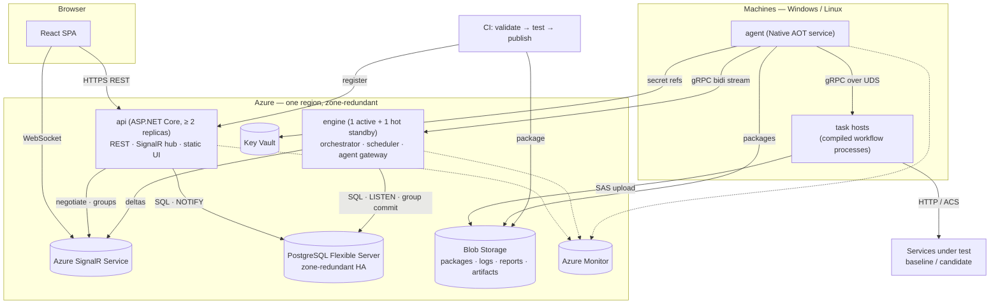
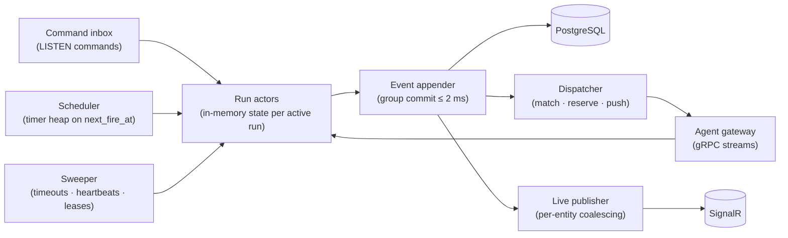
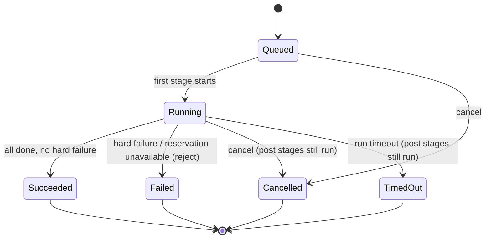
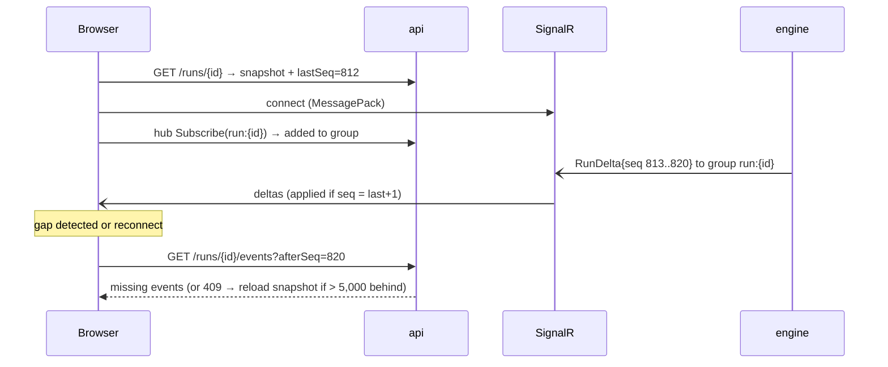
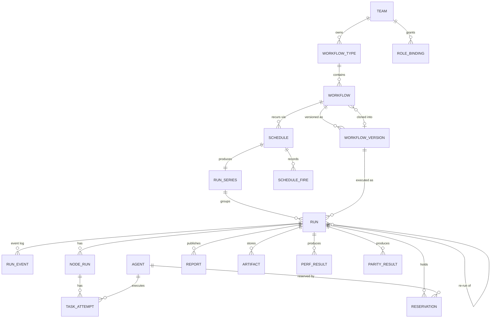

# Technical Design: Workflow Scheduler (+ Phase 2: Perf & Response-Parity Testing)
**Date**: 2026-10-13 | **Status**: Draft | **Requirements**: [Discovery (Approved)](2026-10-12_workflow-scheduler_discovery.md) · [PRD](../prds/2026-10-13_workflow-scheduler_prd.md)

## 1. Overview
We build our own workflow platform in C#: an SDK for writing workflows as single-file .NET 10 scripts, a
control plane (API, engine, scheduler), agents on Windows/Linux machines, and a React dashboard with live
push updates. Phase 2 adds core-owned load generation, source connectors, and a parity framework, with
service teams supplying only request/response hooks.

**Design goals (in priority order)**
1. **Reliability** — every run reaches exactly one terminal state; no state lost on any single failure (NFR-004, NFR-033, NFR-034).
2. **Speed** — dispatch p95 ≤ 50 ms, ≤ 10 ms engine overhead per node, run start ≤ 1 s (NFR-028–NFR-030).
3. **Lean** — control plane ≤ 2 vCPU / 1 GB at peak; idle agent ≤ 100 MB (NFR-031, NFR-032).
4. **Same everywhere** — identical code paths locally and on Azure, Windows and Linux (NFR-015–NFR-017).
5. **Few moving parts** — one database, one blob store, no message broker, no cache tier.

**Constraints**: C# for backend/SDK/hooks; own engine; three deployment profiles (local single machine,
self-hosted bare metal / Azure VMs, Azure PaaS; §9) from the same artefacts; Windows + Linux;
backend and frontend in separate codebases; zero-downtime deploys; scale ≤ 2,000 runs/day, ≤ 200
nodes/workflow, 90-day retention.

**Codebase today**: empty repo (only `.github/` and `docs/`). No existing conventions to follow; this
design sets them.

**How the design meets the speed and footprint targets**
- **Single-writer engine**: one active engine process holds active run state in memory and is the only writer. No distributed locks or claim races on the hot path. A hot standby takes over via a lease.
- **Write-ahead + group commit**: each state transition is appended to PostgreSQL before its side effect. Appends from all runs are batched per commit (≤ 2 ms window), so the critical path is about two commits per node.
- **Push everywhere, no polling**: API → engine uses PostgreSQL `LISTEN/NOTIFY`; engine → agent uses a gRPC bidirectional stream; engine → browser uses SignalR.
- **Warm task hosts**: workflows are compiled once at registration. Agents keep pre-spawned, never-used host processes per version, so dispatch is an IPC message, not a process start or a compile.
- **Allocation-light hot paths**:
  - System.Text.Json source generation, pooled buffers, and protobuf on internal links.
  - The agent is Native AOT (about 30 MB RAM).
  - The control plane uses Server GC with DATAS, which keeps the heap proportional to load.

## 2. Tech Stack Selection
| Layer | Choice | Why (vs alternatives) | Docs |
|-------|--------|-----------------------|------|
| Runtime | .NET 10 (LTS) | Mandated C#; LTS; file-based apps for workflows; Native AOT for the agent. | [link](https://learn.microsoft.com/dotnet/core/whats-new/dotnet-10/overview) |
| Workflow format | .NET 10 file-based app (`workflow.cs`, `#:package`) | One file per workflow (approved). Compiled once at registration via `dotnet publish -p:PublishAot=false`, because AOT is the default for file-based publish and Bond and reflection-based code need the JIT. | [link](https://learn.microsoft.com/dotnet/core/sdk/file-based-apps) |
| API | ASP.NET Core 10 Minimal APIs | Lowest-overhead ASP.NET Core model; built-in OpenAPI. Rejected MVC controllers: more allocation, no benefit here. | [link](https://learn.microsoft.com/aspnet/core/fundamentals/minimal-apis) |
| API docs | `Microsoft.AspNetCore.OpenApi` | Built in (no Swashbuckle dependency). Also the source for TS type generation. | [link](https://learn.microsoft.com/aspnet/core/fundamentals/openapi/overview) |
| Live push (browser) | ASP.NET Core SignalR with MessagePack protocol; **Azure SignalR Service** in Azure, in-process locally | WebSocket push with groups and auto-reconnect. MessagePack is about 30–50% smaller than JSON. Azure SignalR Service lets the engine publish without being the connection host and offloads connection memory from our processes (NFR-031). Rejected: raw WebSockets (we'd rebuild groups and reconnect), SSE (one-way, needs a separate command channel), Redis backplane (extra component). | [SignalR](https://learn.microsoft.com/aspnet/core/signalr/introduction) · [Azure SignalR](https://learn.microsoft.com/azure/azure-signalr/signalr-overview) |
| Engine ↔ agent | gRPC bidirectional streaming (`Grpc.AspNetCore`, `Grpc.Net.Client`) | Persistent, multiplexed, binary, and push in both directions with sub-ms overhead; works through Azure Container Apps ingress (HTTP/2). Rejected: queue broker (adds latency and a component), agents polling the DB (latency, and agents would hold DB credentials). | [link](https://learn.microsoft.com/aspnet/core/grpc/) |
| Agent ↔ task host | gRPC over Unix domain sockets (Windows 10+ and Linux) | Same stack as above; one code path on both OSes; no TCP ports. | [link](https://learn.microsoft.com/aspnet/core/grpc/interprocess-uds) |
| Database | PostgreSQL 17; Azure Database for PostgreSQL Flexible Server (zone-redundant HA) | Its strengths match our needs: transactional append, partitioning for 90-day drop-retention, JSONB for variables/metadata, `LISTEN/NOTIFY` (removes the need for a broker), and an identical container image locally. Rejected: Azure SQL (no LISTEN/NOTIFY; local emulation weaker), Cosmos DB (no cross-document transactions for run+command; cost at 2.4M events/day), EventStoreDB (extra system; we need relational read models anyway). | [PG](https://www.postgresql.org/docs/17/) · [Flexible Server HA](https://learn.microsoft.com/azure/postgresql/flexible-server/concepts-high-availability) |
| Data access | Npgsql (binary COPY, batching) + Dapper | Fastest .NET path; explicit SQL on hot paths; minimal allocation. Rejected: EF Core (change tracking and LINQ translation overhead on hot paths; extra abstraction over a schema we own). | [Npgsql](https://www.npgsql.org/doc/) · [Dapper](https://github.com/DapperLib/Dapper) |
| Migrations | DbUp (plain SQL scripts) | Small and predictable; SQL scripts are reviewable, and expand/contract is explicit. | [link](https://dbup.readthedocs.io/) |
| Blob store | Azure Blob Storage (`Azure.Storage.Blobs`) in Azure; local filesystem locally (`IBlobStore`) | Logs, reports, artifacts, packages, histograms kept out of the DB (NFR-024). Lifecycle policies move data to cool tier and handle deletion. Filesystem locally needs no emulator. | [link](https://learn.microsoft.com/azure/storage/blobs/storage-blobs-introduction) |
| Secrets | Azure Key Vault (`Azure.Security.KeyVault.Secrets`, managed identity); local: user-secrets file outside the repo | Secret references resolved on the agent at use time (FR-029). | [link](https://learn.microsoft.com/azure/key-vault/secrets/about-secrets) |
| Cron | Cronos | Timezone- and DST-correct next-occurrence calculation; tiny; used by Hangfire. Rejected: NCrontab (no timezone/DST handling), Quartz (a full scheduler we don't need). | [link](https://github.com/HangfireIO/Cronos) |
| Latency histograms | HdrHistogram.NET | Lossless, mergeable percentiles across machines (FR-108). Averaging percentiles is wrong. | [link](https://github.com/HdrHistogram/HdrHistogram.NET) |
| Bond | Bond C# packages (`Bond.CSharp`, `Bond.Runtime.CSharp`), pinned, from the Microsoft-internal feed | Required codec for dummy services. Upstream OSS archived, internally supported (discovery §12). Isolated in `Wf.Codec.Bond`. | [link](https://microsoft.github.io/bond/manual/bond_cs.html) |
| Telemetry | OpenTelemetry .NET → Azure Monitor exporter (Azure), Aspire dashboard (local) | Vendor-neutral standard (NFR-010); one instrumentation set for both environments. | [OTel](https://opentelemetry.io/docs/languages/dotnet/) · [Azure Monitor](https://learn.microsoft.com/azure/azure-monitor/app/opentelemetry-enable) |
| Local orchestration | Aspire AppHost | One command (`aspire run`) starts PostgreSQL, control plane, agent, UI and dashboard on Windows/Linux (NFR-016). Rejected: docker-compose (no .NET project integration, separate config). | [link](https://aspire.dev) |
| Hosting (control plane) | Three profiles from the same artefacts (§9.1). **Local**: `wf-host` process. **Self-hosted** (bare metal / Azure VMs): `wf-api` + `wf-engine` as Windows Services / systemd units. **Azure PaaS**: Azure Container Apps, multiple-revision mode | ACA is managed and zone-redundant; revisions give blue-green with traffic split and rollback in under a minute (NFR-025, NFR-026); supports gRPC and WebSockets. Self-hosted gets the same zero-downtime result with scripted rolling deploys and the engine lease handover. Rejected: AKS (operational weight unjustified at this scale), App Service (no gRPC bidi streaming on Windows plans, weaker revision model). | [ACA](https://learn.microsoft.com/azure/container-apps/overview) · [Windows Service](https://learn.microsoft.com/dotnet/core/extensions/windows-service) · [systemd](https://learn.microsoft.com/dotnet/core/extensions/workers) |
| Self-hosted HA pieces | PostgreSQL + Patroni + etcd; pgBackRest; HAProxy/nginx + keepalived (or existing LB / Azure LB); OTel Collector → Prometheus, Grafana, Loki, Tempo | Standard, proven open-source HA for PG with automatic failover in ≈ 10–20 s. Npgsql multi-host connection strings follow the primary without a proxy. Only used in the self-hosted profile. | [Patroni](https://patroni.readthedocs.io) · [pgBackRest](https://pgbackrest.org) · [Npgsql failover](https://www.npgsql.org/doc/failover-and-load-balancing.html) |
| Agent hosting | Self-contained Native AOT executable as Windows Service / systemd unit | ≤ 100 MB idle (NFR-032); no runtime install on test machines. | [Windows Service](https://learn.microsoft.com/dotnet/core/extensions/windows-service) · [systemd](https://learn.microsoft.com/dotnet/core/extensions/workers) |
| Resource limits | Windows Job Objects (via CsWin32); Linux cgroups v2 | Per-task CPU/RAM caps and kill-on-close (NFR-032). | [Job Objects](https://learn.microsoft.com/windows/win32/procthread/job-objects) · [cgroups v2](https://docs.kernel.org/admin-guide/cgroup-v2.html) |
| Identity | Microsoft Entra ID (`Microsoft.Identity.Web`, MSAL.js); GitHub OIDC federation for CI | Corporate SSO (NFR-007). The CI → Entra token exchange avoids long-lived secrets. | [link](https://learn.microsoft.com/entra/identity-platform/) · [GitHub OIDC](https://docs.github.com/actions/security-for-github-actions/security-hardening-your-deployments/about-security-hardening-with-openid-connect) |
| Frontend framework | React 19 + TypeScript 5 + Vite | Approved. Largest ecosystem for the needed pieces (graph, virtualisation); Vite gives fast builds and code splitting. | [React](https://react.dev) · [Vite](https://vite.dev) |
| Frontend tooling | Bun (package manager/scripts only) | Approved; fast installs. Production serves static files only. | [link](https://bun.sh/docs) |
| Routing / URL state | TanStack Router | Type-safe routes and **search params**, so filters live in the URL (shareable, FR-022). Rejected: React Router (search params untyped). | [link](https://tanstack.com/router/latest) |
| Server state | TanStack Query | Snapshot caching and dedupe; live deltas patch the cache. | [link](https://tanstack.com/query/latest) |
| Lists / tables | TanStack Virtual + TanStack Table | Headless and virtualised: 100k-row lists and 1M-line logs at 60 fps (NFR-006, NFR-020). | [Virtual](https://tanstack.com/virtual/latest) · [Table](https://tanstack.com/table/latest) |
| Components / CSS | Tailwind CSS v4 + shadcn/ui (Radix primitives) | Approved. Accessible primitives copied into the repo; zero runtime CSS-in-JS. | [Tailwind](https://tailwindcss.com/docs) · [shadcn/ui](https://ui.shadcn.com) |
| DAG view | React Flow (`@xyflow/react`) + `@dagrejs/dagre` layout in a Web Worker | Mature, virtualised node rendering. Layout runs off the main thread and is cached per version. Rejected: ELK (≈ 1.4 MB, slower for ≤ 200 nodes). | [React Flow](https://reactflow.dev) · [dagre](https://github.com/dagrejs/dagre) |
| Charts | uPlot | ~50 KB, canvas-based; handles 1 s perf series and 90-day trends at 60 fps. Rejected: Recharts/ECharts (SVG-heavy or ≈ 1 MB). | [link](https://github.com/leeoniya/uPlot) |
| Report renderers | `react-markdown` (no raw HTML), sandboxed `<iframe>` for HTML, `pdfjs-dist` (lazy), Monaco diff editor (lazy), Papa Parse (worker) | Each is lazy-loaded per kind, keeping the initial bundle < 300 KB gz (NFR-020). | [react-markdown](https://github.com/remarkjs/react-markdown) · [pdf.js](https://mozilla.github.io/pdf.js/) · [Monaco](https://microsoft.github.io/monaco-editor/) · [Papa Parse](https://www.papaparse.com) |
| API client types | `openapi-typescript` + `openapi-fetch` | Types generated from the backend OpenAPI document (including SignalR message schemas), with zero runtime cost (~6 KB). | [link](https://openapi-ts.dev) |
| Testing | xUnit v3, FsCheck, Testcontainers, Toxiproxy, BenchmarkDotNet, Vitest, Testing Library, Playwright, axe-core | See §10. | §10 |

**Dependency cost note**: the backend adds 9 third-party packages (Npgsql, Dapper, DbUp, Cronos, HdrHistogram, Bond,
gRPC, OpenTelemetry, Microsoft.Identity.Web); everything else is the BCL or ASP.NET Core.

## 3. System Architecture


### Components and responsibilities
| Component | Responsibility | Instances | State |
|-----------|----------------|-----------|-------|
| **api** | REST API (reads, commands, registration), SignalR hub (subscribe/negotiate), auth/RBAC, serves SPA static files | ≥ 2, stateless, rolling/blue-green | None (DB) |
| **engine** | Run orchestration (single writer), scheduler, agent gateway (gRPC), reservations, live-event publisher, retention purger | 1 active + 1 hot standby (lease) | Active runs in memory, durable in PG |
| **agent** | Machine registration, heartbeat, task-host pool, resource limits & sampling, log shipping, secret resolution, local result journal | 1 per machine | Local journal (results until acked) |
| **task host** | The compiled workflow in `--task-host` mode: executes stage/task delegates, SDK services (reports, artifacts, outputs), phase 2 libraries (load, parity, hooks) | Pool per workflow version per agent; bound to one run | None |
| **CLI (`wf`)** | `validate`, `test`, `publish`, `clone`, `baseline` | Dev/CI | — |
| **SDK** | Authoring API, local embedded engine, dry-run harness, describe mode | In workflow process | — |

**Ownership boundaries**: the engine is the only writer of run state. The api writes only commands, schedules (user-defined), admin
config, and registrations. Agents never touch the DB. Task hosts talk only to their agent (and to blob via
short-lived SAS grants, and to services under test).

The diagram shows the Azure PaaS profile. **Other profiles** (§9.1) use the same components with different hosting:
- **Local** (`aspire run`): one `wf-host` process runs both api and engine roles with in-process SignalR. It uses a PostgreSQL container or native install, a filesystem blob store, one or more local agents, the Vite dev server, and the Aspire dashboard.
- **Self-hosted** (bare metal / Azure VMs): `wf-api` and `wf-engine` run as OS services on ≥ 2 hosts. PG HA is provided by Patroni. Blobs live on shared storage. Live push uses the engine `LiveFeed` stream to api nodes.

The code path is identical; only `IBlobStore`, `ISecretStore`, `ILivePublisher` and telemetry exporter implementations differ (config only, NFR-017).

### Engine internals

- **Run actor**: a pure state machine (`Wf.Engine.Core`) per active run, driven by a single-threaded channel. It decides transitions; effects (dispatch, publish) run only after the event is durable. The **same `Wf.Engine.Core`** runs inside the SDK's local engine and dry-run harness, so local behaviour equals hosted behaviour (FR-036, FR-040).
- **Group commit**: events from all actors are batched into one multi-row `INSERT` (binary COPY for large batches) per ≤ 2 ms window, then acknowledged to their actors.
- **Recovery**: on leadership acquisition, the engine loads active runs (`status in (Queued, Running)`) from snapshot tables plus events after `snapshot_seq`, re-arms timers, and waits ≤ 10 s for agents to reconnect and report their in-flight attempts before marking missing ones `AgentLost`.
- **Leader lease**: row in `leases` (`engine`, holder, expires_at), renewed every 3 s, TTL 10 s. Fencing: every engine write includes the lease epoch (`WHERE epoch = $current`) so a paused ex-leader cannot write. Agents find the leader as follows. On ACA, the standby's readiness probe fails until it holds the lease, so ingress routes agents only to the leader. Self-hosted agents hold an endpoint list; a standby answers `NotLeader{leaderHint}` and closes the stream.

### Task placement (decided at run time)
A workflow is **not** pinned to one machine. The unit of placement is the **task attempt**. Each time a task becomes Ready, the dispatcher picks an agent from the machines connected at that moment. Stages (`$init`, `$pre`, `$post`, `$sys-post`) are placed like any task.

**Constraints (SDK)**:
- `RunsOn(...)` sets a selector at workflow, node or task level; the innermost wins. Selectors can use OS, labels, pool or explicit machine names.
- A selector may read run variables (e.g. `RunsOn(v => Machines.Named(v["machines"]))`); it is resolved when the run starts.

**Affinity**:
- `None` (default): each task is placed independently, giving maximum parallelism.
- `Node`: all tasks of a node go to one machine.
- `Run`: the whole run goes to one machine, chosen at first dispatch.
- `SameMachineAs("node")`: share another node's machine.

Data between tasks flows through outputs (≤ 64 KB via the engine) and artifacts (blob), so placement does not affect correctness. Use affinity only when tasks share local disk or machine state.

**Reservation (phase 2)**: `Reserve(count, selector)` reserves machines exclusively for a node (FR-102/103). Tasks of that node run only on its reserved machines, and all other tasks avoid reserved machines.

**Placement algorithm (in memory, O(agents))**:
1. Filter: Healthy, not draining, matches selector/OS, not reserved by another run, free slot available (`max_tasks`, default = cores), RAM headroom ≥ the task's memory limit.
2. Prefer an agent that already has a **warm task host for this run** (no cold start), then the least-loaded agent (slots used / max), then round-robin.
3. No candidate → the task stays Ready with reason `WaitingForMachine` (visible live in the UI). After `placementTimeout` (default 10 min) it fails with category `Placement` and its failure policy applies.
4. Retry after `AgentLost` → re-placed. For `Node`/`Run` affinity the pin moves to the new machine, and the task's retry policy decides whether this is allowed.

**Warm hosts**: each agent keeps a small pool of pre-spawned, unbound task hosts per active version. The first dispatch of a run to an agent binds one, with no process start. Pool size follows recent placement on that agent. An empty pool costs one cold start (≈ 150–300 ms) and is counted in `wf_task_queue_wait_ms`.

**Local**: one machine means one agent. The same algorithm runs and everything lands on that machine. Simulated agents (§9.2) exercise spreading.

**Single-machine runs (testing override)**: any run can be forced onto one worker **without changing the workflow**. This is useful for testing, debugging, reproducing a failure, or validating a new machine.
- **How to trigger**:
  - UI trigger/re-run dialog: "Run on a single machine" toggle + machine picker, which lists only eligible machines.
  - API: `placement: { singleMachine: true, machine?: "<name>" }` on `POST /runs` and `/rerun`.
  - CLI: `wf run <wf> --single-machine [--machine <name>]` or `dotnet run workflow.cs -- --engine <url> --single-machine`.
- **Semantics**: equivalent to `Affinity.Run` with the selector narrowed to that machine.
  - Without `machine`, the engine picks one at first dispatch that satisfies the union of all node/task selectors.
  - Parallel tasks still run in parallel up to the machine's `max_tasks` slots; the rest queue (visible as `WaitingForMachine`).
  - Stages, retries and policies are unchanged. On agent loss, the run's tasks are re-placed together on another eligible machine, or fail with `Placement` if a named machine was requested.
- **Validation at trigger (400 with the conflicting nodes)**:
  - Some node's selector (OS, labels) can't be met by the chosen machine.
  - The machine is reserved, draining or unhealthy.
  - A phase 2 node reserves more than one machine; the fix is to set its count variable to 1.
- **Visibility**: the override is stored on the run (`runs.placement`), shown as a badge, and kept by re-run unless changed.
- **Distinct from the other test paths**: dry-run (§6.1) mocks tasks, and `dotnet run workflow.cs` runs in-process with no agent. Single-machine runs use real agents and real tasks.

### Run state machine

Node/task states: `Pending → Ready → Dispatched → Running → (Retrying → Dispatched)* → Succeeded | SoftFailed | Failed | TimedOut | Cancelled | Skipped | Reused`.
Terminal states are absorbing; the transition table is the single source of truth (property-tested, §10).

### Applicable standards
OpenTelemetry semantic conventions (NFR-010) · WCAG 2.2 AA (NFR-009) · RFC 9457 Problem Details (API errors) ·
CloudEvents 1.0 (webhook notifications) · OAuth 2.0 / OIDC with PKCE (RFC 7636) · SemVer 2.0.0 (workflow versions).

## 4. Key Workflows
### 4.1 Registration on merge (FR-041, FR-042, FR-053; NFR-027 ≤ 60 s)
```mermaid
sequenceDiagram
  participant Dev as Author
  participant GH as Git host
  participant CI as CI runner
  participant API as api
  participant B as Blob
  participant PG as PostgreSQL
  participant E as engine
  Dev->>GH: merge PR (workflow.cs, schedules.json, team.json)
  GH->>CI: push event (changed workflow dirs)
  CI->>CI: wf validate (manifest via --describe, schedules, registry, SemVer vs baseline)
  CI->>CI: dotnet test (dry-run harness)
  CI->>CI: dotnet publish workflow.cs -p:PublishAot=false → zip (sha256)
  CI->>B: upload package (content-addressed)
  CI->>API: POST /registrations (manifest, schedules, source, git sha/author) [Entra token via OIDC]
  API->>API: same validator (backstop)
  API->>PG: tx: insert version, set active, upsert code schedules atomically, audit, NOTIFY 'registry'
  PG-->>E: NOTIFY registry
  E->>E: swap active version pointer; rebuild schedule heap
  Note over E: in-flight runs keep their version; next run uses new one
  API-->>CI: 201 version 1.4.0 active
```

### 4.2 Trigger and execute (NFR-028 ≤ 50 ms dispatch, NFR-029 ≤ 1 s start, NFR-030 ≤ 10 ms/node)
```mermaid
sequenceDiagram
  participant U as Browser
  participant API as api
  participant PG as PostgreSQL
  participant E as engine
  participant A as agent
  participant H as task host
  U->>API: POST /runs (variables, Idempotency-Key)
  API->>PG: tx: insert run(Queued) + command; NOTIFY 'commands'
  API-->>U: 202 {runId}
  PG-->>E: NOTIFY commands
  E->>E: run actor: Queued→Running, stage SystemInit Ready
  E->>PG: group commit events
  E->>A: Dispatch(attempt, version, taskKey, inputs) [gRPC push]
  A->>H: Execute (warm host bound to run) [UDS]
  H-->>A: Started
  A-->>E: TaskStarted
  H-->>A: Completed(outputs)
  A->>A: journal result locally
  A-->>E: TaskCompleted(idempotency key)
  E->>E: actor: task Succeeded → node Succeeded → dependents Ready
  E->>PG: group commit
  E-->>A: Ack (agent drops journal entry)
  E->>A: Dispatch next tasks
  E-)U: deltas via SignalR (coalesced)
```
**Latency budget per node (critical path, warm agent)**

| Step | Budget |
|------|--------|
| Group commit (ready + dispatched) | ≤ 4 ms |
| Engine → agent → host (2 IPC hops) | ≤ 1 ms |
| Completion → engine | ≤ 1 ms |
| Group commit (completed + next ready) | ≤ 4 ms |
| **Engine overhead per node** | **≤ 10 ms p95** |

### 4.3 Scheduled fire, exactly once across failover (NFR-002 ≤ 2 s p99)
```mermaid
sequenceDiagram
  participant S as engine scheduler (leader)
  participant PG as PostgreSQL
  participant S2 as standby engine
  S->>S: timer heap pops schedule X @ 02:00:00
  S->>PG: tx: INSERT run (schedule_id=X, fire_at=02:00) ON CONFLICT DO NOTHING; UPDATE schedule next_fire_at
  Note over S,PG: unique (schedule_id, fire_at) ⇒ exactly one run
  S--xS: leader crashes
  S2->>PG: acquire lease (epoch+1) after TTL ≤ 10 s
  S2->>PG: load schedules; fires with next_fire_at < now are re-attempted (conflict ⇒ no duplicate)
  S2->>S2: catch-up policy for fires missed beyond grace (latest-only), recorded as missed
```
DST/timezone handled by Cronos per schedule timezone. Overlap policy is evaluated in the same transaction (skip → insert a `skipped_fire` record).

### 4.4 Live view: subscribe, deltas, resync (FR-018; NFR-001, NFR-019)

The engine publishes every event to `run:{id}` groups. It publishes coalesced run summaries (≤ 1 per run per 250 ms) to
`type:{id}` / `series:{id}` / `team:{id}` groups for list views. Logs are interest-based: opening a log view
sends `MirrorLogs(attempt)` to the agent, which then streams lines (batched ≤ 4/s) until unsubscribed. Stored logs
are always uploaded to blob in chunks.

### 4.5 Phase 2 perf test across reserved machines (FR-102–FR-108, FR-117, FR-125, FR-126)
```mermaid
sequenceDiagram
  participant E as engine
  participant A1 as agent 1
  participant A2 as agent 2
  participant SUT as service under test
  E->>E: node "load": selector perf-pool ×2 → reserve(A1, A2) in tx (exclusive)
  E->>A1: Dispatch shard 0 (rate = target × cap1/Σcap, T0 = now+2 s)
  E->>A2: Dispatch shard 1 (rate = target × cap2/Σcap, T0)
  A1->>SUT: open-model load (pre-encoded payloads, pooled connections)
  A2->>SUT: open-model load
  loop every 1 s
    A1-->>E: PerfSample (HdrHistogram delta, count, errors)
    A2-->>E: PerfSample
    E->>E: merge histograms; saturation check (p95/error window)
    E-)E: publish live perf to run group
  end
  alt kill switch or saturation(stop)
    E->>A1: Cancel (stop ≤ 1 s)
    E->>A2: Cancel
  end
  E->>E: "always" node releases reservations; results artifact + summary report
```
Clock skew: each agent measures its offset to the engine on connect (NTP-style ping exchange). `T0` is sent in engine time and converted locally.

### 4.6 Phase 2 parity (FR-109–FR-111)
For each request (generated or replayed), the task host:
1. Shapes the request once via the service hook.
2. Sends identical bytes to baseline and candidate concurrently.
3. Decodes both responses with the codec, then applies the service normalisation hook.
4. Transcodes both to a canonical tree (Bond → Simple JSON via runtime schema; JSON as-is).
5. Runs the comparator: core rules, then hook extensions or override.

Mismatch counts are tallied by category; up to N samples per category are kept as artifacts. An optional first pass runs baseline vs baseline to
learn noisy paths, which are auto-added to ignore rules (Diffy approach).

## 5. Data Model
### 5.1 High-Level (entities & relationships)

**Ownership**:
- Registry entities (team, type, workflow, version, code schedules) are written only by registration.
- User schedules, role overrides, subscriptions and admin config are written by the api.
- Run, node, task, reservation and result entities are written only by the engine.
- Payloads (logs, reports, artifacts, packages, histograms, resource series) live in blob; the DB holds pointers.

### 5.2 Low-Level Schema
Conventions:
- IDs are UUID v7 (`Guid.CreateVersion7()`, time-ordered); registry IDs are slugs (`team/type/name`).
- All timestamps are `timestamptz` UTC; enums are `smallint` mapped in code.
- Run-scoped tables are **range-partitioned monthly** on `run_day` (derived from the run's UUID v7 timestamp, so lookups by `run_id` include the partition key without an extra index).

| Table | Column | Type | Null | Index | Notes |
|-------|--------|------|------|-------|-------|
| teams | id | text | N | PK | slug |
| | name, presentation | text, jsonb | N | | presentation = FR-059 config |
| role_bindings | team_id, type_id | text, text | Y | PK(team_id,type_id,role,principal_id) | null = global (Admin) |
| | role | smallint | N | | Author/Operator/Viewer/Admin |
| | principal_id, principal_kind | uuid, smallint | N | idx(principal_id) | Entra group or user object ID; from `team.json` |
| workflow_types | id | text | N | PK | `team/type` |
| | team_id | text | N | FK, idx | |
| | name, normalized_name | text | N | UQ(team_id, normalized_name) | FR-058 (similarity checked in validator) |
| | metadata_schema | jsonb | N | | required keys + allowed values |
| | retention_days, limits | int, jsonb | Y | | per-type overrides (reports, artifacts) |
| workflows | id | text | N | PK | `team/type/name` |
| | type_id | text | N | FK, idx | |
| | active_version_id | uuid | Y | FK | hot-swap pointer (FR-053) |
| | cloned_from_version_id | uuid | Y | FK | lineage (FR-044) |
| | deleted_at | timestamptz | Y | | soft delete |
| workflow_versions | id | uuid | N | PK | |
| | workflow_id | text | N | UQ(workflow_id, major, minor, patch) | |
| | major, minor, patch | int | N | | SemVer |
| | manifest | jsonb | N | | DAG, variables, policies, hook package refs |
| | package_uri, package_sha256 | text, bytea | N | | content-addressed zip |
| | source_uri | text | N | | script source for diff |
| | git_commit, git_author, registered_by, change_note | text | N/N/N/Y | | FR-006 |
| | sdk_version | text | N | | |
| | created_at | timestamptz | N | | |
| schedules | id | uuid | N | PK | |
| | workflow_id | text | N | FK | |
| | origin | smallint | N | | Code / User |
| | code_key | text | Y | UQ(workflow_id, code_key) WHERE origin=Code | instance ID from schedule file |
| | name, timezone | text | N | | |
| | cron / interval_s | text / int | Y | CHECK exactly one | |
| | variables | jsonb | N | | effective (defaults ← overrides) |
| | version_pin | text | Y | | SemVer range or exact |
| | overlap_policy, catchup_policy | smallint | N | | skip/queue/concurrent · none/latest |
| | paused | bool | N | | |
| | next_fire_at | timestamptz | Y | idx WHERE NOT paused AND deleted_at IS NULL | scheduler heap source |
| | row_version | int | N | | ETag / optimistic concurrency |
| | created_by, updated_by, updated_at, deleted_at | | | | |
| run_series | id | uuid | N | PK | |
| | workflow_id, schedule_id | text, uuid | N, Y | UQ(schedule_id) | ad-hoc series allowed |
| schedule_fires | schedule_id, fire_at | uuid, timestamptz | N | PK | **exactly-once key** |
| | outcome, run_id, reason | smallint, uuid, text | N,Y,Y | | Started/Skipped/Missed/CaughtUp |
| runs ⧉ | run_day, id | date, uuid | N | PK(run_day, id) | ⧉ = partitioned |
| | workflow_id, version_id, series_id | text, uuid, uuid | N,N,Y | idx(workflow_id, id DESC), idx(series_id, id DESC) | |
| | trigger, triggered_by | smallint, text | N | | Manual/Schedule/Api/Rerun/CatchUp |
| | variables, metadata | jsonb | N | GIN(metadata jsonb_path_ops) | metadata copied from definition |
| | status, failure_category, status_reason | smallint, smallint, text | N,Y,Y | partial idx(status) WHERE active | |
| | parent_run_id | uuid | Y | | re-run lineage |
| | placement | jsonb | Y | | trigger-time override, e.g. `{singleMachine:true, machine:"lab-07"}` |
| | created_at, started_at, ended_at | timestamptz | N,Y,Y | | |
| | last_seq, snapshot_seq | int | N | | resync + recovery |
| run_events ⧉ | run_day, run_id, seq | date, uuid, int | N | PK | append-only |
| | ts, kind, entity_key, attempt | timestamptz, smallint, text, smallint | N,N,Y,Y | | |
| | payload | bytea | N | | protobuf (compact, fast) |
| node_runs ⧉ | run_day, run_id, node_key | | N | PK | stages stored as nodes `$init`, `$pre`, `$post`, `$sys-post` |
| | status, attempts, failure_category | smallint | N,N,Y | | |
| | started_at, ended_at | timestamptz | Y | | |
| | outputs | jsonb | Y | | ≤ 64 KB (FR-020) |
| | reused_from_run_id | uuid | Y | | FR-016 |
| | pinned_agent_id | uuid | Y | | affinity pin (`Node` / `Run` / `SameMachineAs`) |
| task_attempts ⧉ | run_day, run_id, task_key, attempt | | N | PK | idempotency key |
| | agent_id | uuid | Y | idx(agent_id, started_at) | |
| | status, failure_category, error | smallint, smallint, text | N,Y,Y | | error ≤ 4 KB |
| | queued_at, started_at, ended_at, queue_wait_ms | | Y | | FR-046 |
| | cpu_avg_pct, cpu_max_pct, ram_peak_mb | real, real, int | Y | | summary; series in blob |
| | log_uri, resource_series_uri | text | Y | | |
| commands | id | uuid | N | PK | api → engine inbox |
| | kind, run_id, payload | smallint, uuid, jsonb | N,Y,N | partial idx WHERE processed_at IS NULL | Trigger/Cancel/Rerun/KillLoad/RunNow/Activate |
| | idempotency_key | text | Y | UQ | 24 h dedupe window |
| | created_by, created_at, processed_at | | N,N,Y | | |
| agents | id | uuid | N | PK | |
| | name | text | N | UQ | |
| | os, arch, cores, ram_mb | smallint, smallint, int, int | N | | |
| | max_tasks | int | N | | concurrent task slots (default = cores) |
| | labels, pool | text[], text | N | GIN(labels) | |
| | capacity_rps, capacity_source, calibrated_at | int, smallint, timestamptz | Y | | FR-125 |
| | status, last_heartbeat_at, agent_version | smallint, timestamptz, text | N | | |
| reservations | id | uuid | N | PK | |
| | run_id, node_key, agent_id | uuid, text, uuid | N | UQ(agent_id) WHERE released_at IS NULL | **exclusivity** |
| | created_at, expires_at, released_at, release_reason | | N,N,Y,Y | | |
| reports ⧉ | run_day, id | | N | PK | |
| | run_id, source_key, kind, title, tags | | N | idx(run_id) | |
| | size_bytes, blob_uri, sha256, created_at | | N | | |
| artifacts ⧉ | run_day, id, run_id, source_key, name, size_bytes, blob_uri, sha256, created_at | | N | idx(run_id) | ≤ 5 GB/run sum enforced on grant |
| perf_results ⧉ | run_day, run_id, node_key | | N | PK | |
| | target_rps, achieved_rps, p50_ms, p95_ms, p99_ms, max_ms, error_rate | real | N | | |
| | saturated, max_sustainable_rps, histogram_uri | bool, real, text | N,Y,N | | |
| parity_results ⧉ | run_day, run_id, node_key | | N | PK | |
| | total, matched, parity_pct | bigint, bigint, numeric(6,3) | N | | |
| | categories, noise_paths, samples_uri | jsonb, jsonb, text | N,Y,N | | |
| daily_rollups | day, workflow_id, node_key | date, text, text | N | PK | trends/dashboards (FR-024/047) |
| | runs, failures, soft_failures, p50_ms, p95_ms, cpu_max_pct, ram_peak_mb | | N | | incremental, refreshed every 5 min |
| audit_log ⧉ | id, ts | bigint identity, timestamptz | N | PK(ts, id) | 13 monthly partitions (≥ 1 year) |
| | actor, actor_kind, action, target_kind, target_id, team_id, summary | | N/N/N/N/N/Y/N | idx(target_kind, target_id, ts), idx(actor, ts) | |
| subscriptions | id, principal_id, scope_kind, scope_id, events, channel, target, secret_ref | | N (secret_ref Y) | idx(scope_kind, scope_id) | FR-028 |
| notification_outbox | id, subscription_id, run_id, payload, attempts, next_attempt_at, delivered_at | | | partial idx WHERE delivered_at IS NULL | transactional outbox |
| leases | name | text | N | PK | `engine` |
| | holder, epoch, expires_at | text, bigint, timestamptz | N | | fencing epoch |
| registry_snapshots | id, git_commit, content, registered_at | uuid, text, jsonb, timestamptz | N | | team/type registry history |

**Volume (peak, 90 days)**: 2,000 runs/day × 200 nodes × ~6 events = 2.4 M events/day, which over 90 days is ≈ 216 M rows (≈ 35 GB including indexes).
Node runs and task attempts come to about 40 M rows each. Logs, reports, artifacts and histograms are in blob. This is comfortably within one Flexible Server (D4ds, 4 vCore).

### 5.3 Migrations & Versioning
- **DbUp** runs ordered SQL scripts (`backend/db/migrations/NNNN_description.sql`) from an ACA job before each deployment. Scripts are idempotent where possible.
- **Expand → migrate → contract** (NFR-025): a release only *adds* (columns nullable or defaulted, new tables, new indexes `CONCURRENTLY`). Backfills run as batched jobs. Removal ships ≥ 1 release later. Every release must run against both the old and new schema; CI runs the previous release's integration tests against the new schema.
- **Partitions**: the engine's maintenance loop pre-creates next month's partitions. Retention drops whole partitions older than the global maximum. Per-type shorter retention deletes in batches of ≤ 5,000 rows off-peak (`FR-030`).
- **Event payload versioning**: protobuf with additive fields only; `kind` values are never reused.
- **Manifest versioning**: `manifest.schemaVersion`. The validator and engine support the current and previous schema versions.

## 6. API Design
**Style**: REST + JSON over HTTPS for queries and commands (`/api/v1`), SignalR (MessagePack) for push, gRPC for
agents. Within v1 only additive changes are allowed; breaking changes go to `/api/v2` alongside v1 for ≥ 1 release.
- **Pagination**: cursor-based (`?limit=50&cursor=<opaque>`, keyset on `(id DESC)` with UUID v7 = time order). Responses include `nextCursor`.
- **Errors**: RFC 9457 `application/problem+json` with `code`, `traceId`, and `errors[]` (validator output: `path`, `message`, `hint`).
- **Concurrency**: `ETag` / `If-Match` on mutable resources (schedules) → 412 on conflict.
- **Idempotency**: an `Idempotency-Key` header on POSTs that create runs or commands (24 h).
- **Docs**: OpenAPI 3.1 via `Microsoft.AspNetCore.OpenApi` at `/openapi/v1.json`. The TS client is generated from it in frontend CI, and a drift check fails the build.
- **Rate limits**: ASP.NET Core rate limiter per principal (default 50 req/s burst 100; registrations 10/min).

| Method | Route | Auth | Request | Response | Errors |
|--------|-------|------|---------|----------|--------|
| GET | /api/v1/me | User | — | principal, roles per team/type | 401 |
| GET | /api/v1/teams | User | — | teams user can see + presentation | 401 |
| GET | /api/v1/teams/{team}/types | Viewer(team) | — | types + metadata schema + latest status counts | 403, 404 |
| GET | /api/v1/workflows | Viewer(scope) | `team, type, q, meta.<k>=<v>, status, cursor, limit` | page of workflows + latest run summary | 400, 403 |
| GET | /api/v1/workflows/{id} | Viewer | — | workflow + active version manifest | 404 |
| GET | /api/v1/workflows/{id}/versions | Viewer | cursor | versions (SemVer, authors, note) | 404 |
| GET | /api/v1/workflows/{id}/diff | Viewer | `from, to` | manifest diff + source diff | 400, 404 |
| POST | /api/v1/workflows/{id}/versions/{v}/activate | Admin | — | 200 active version | 404, 409 |
| POST | /api/v1/workflows/{id}/versions/{v}/clone | Author(type) | `newName, targetType` | zip scaffold (script with `ClonedFrom`, schedules stub, tests) | 400, 409 |
| POST | /api/v1/registrations | Registrar (CI) | manifest, schedules, registry, source, package ref, git info | 201 version | 400 (validation problem), 409 (SemVer) |
| POST | /api/v1/runs | Operator | `workflowId, version?, variables, seriesId?, placement?` + Idempotency-Key | 202 `{runId}` | 400 (variables, unsatisfiable placement), 403, 409 |
| GET | /api/v1/runs | Viewer | `workflowId, seriesId, status, meta.*, from, to, cursor` | page of runs | 400 |
| GET | /api/v1/runs/{id} | Viewer | — | snapshot (run, nodes, tasks, reports index) + `lastSeq` | 404 |
| GET | /api/v1/runs/{id}/events | Viewer | `afterSeq` | events (≤ 5,000) | 409 (too far behind → reload) |
| POST | /api/v1/runs/{id}/cancel | Operator | reason | 202 | 409 (terminal) |
| POST | /api/v1/runs/{id}/rerun | Operator | `fromNodes?` | 202 `{runId}` | 409 |
| POST | /api/v1/runs/{id}/kill-load | Operator | — | 202 | 409 |
| GET | /api/v1/runs/{id}/tasks/{task}/{attempt}/logs | Viewer | `offset, length` or `search` | log chunk / matches | 404 |
| GET | /api/v1/runs/{id}/reports | Viewer | `kind, tag` | report index | 404 |
| GET | /api/v1/reports/{id}/content | Viewer | — | 302 to short-lived SAS on report origin | 404 |
| GET | /api/v1/runs/{id}/artifacts · /api/v1/artifacts/{id}/content | Viewer | — | list · 302 SAS (streamed) or streamed body (filesystem store) | 404 |
| PUT | /api/v1/uploads/{grant} | Grant (HMAC) | raw stream ≤ `maxBytes` | 201 | 403 (expired/invalid), 413 |
| GET | /api/v1/runs/{id}/metrics | Viewer | — | per stage/node/task timings, resources | 404 |
| GET | /api/v1/schedules | Viewer | `workflowId, origin` | schedules + next fires | 400 |
| POST | /api/v1/schedules | Operator | user schedule | 201 + ETag | 400, 403 |
| PUT | /api/v1/schedules/{id} | Operator | schedule + If-Match | 200 + ETag | 409 (origin = code), 412 |
| POST | /api/v1/schedules/{id}/pause · /resume · /run-now | Operator | — | 202 | 409 (code-defined for pause/resume) |
| DELETE | /api/v1/schedules/{id} | Operator | If-Match | 204 | 409 (code), 412 |
| GET | /api/v1/series/{id}/runs · /trends | Viewer | `window=7d,30d,90d` | runs · trend series (rollups) | 404 |
| GET | /api/v1/dashboards/{scope}/{id} | Viewer | `window` | top-N slow/flaky/heavy | 404 |
| GET | /api/v1/machines | Viewer | `label, pool, os, status` | machines + reservations | — |
| PATCH | /api/v1/machines/{id} | Admin | labels, pool, capacity | 200 | 400 |
| POST | /api/v1/machines/{id}/calibrate · /drain | Admin | profile | 202 | 409 (reserved) |
| GET/POST/DELETE | /api/v1/subscriptions | User | scope, events, channel | subscriptions | 400 |
| GET | /api/v1/audit | Admin / team Author | `actor, target, from, to, cursor` | page | 403 |
| GET/PUT | /api/v1/admin/retention | Admin | defaults + per-type | config | 400 |

**SignalR hub** `/hubs/live/v1` (MessagePack). Client → server: `Subscribe(scope, id)`, `Unsubscribe(scope, id)`; scopes
`run`, `type`, `series`, `team`, `machines`, `logs:{attempt}`. Authorisation is checked on subscribe. Server → client:
- `RunDelta { runId, events[] }` with `seq`.
- `ListDelta { scope, items[] }` (coalesced 250 ms).
- `ReportAdded`.
- `LogLines { attempt, offset, lines[] }`.
- `PerfSample { node, machine, ts, rps, p50, p95, p99, errors }`.
- `Resync { scope, id }`.

The message schemas are emitted into the OpenAPI document as components, so TS types are generated from one source.

**Agent gRPC** (`agent.proto`, package `wf.agent.v1`):
```proto
service AgentGateway { rpc Connect(stream AgentMessage) returns (stream ControlMessage); }
service LiveFeed     { rpc Subscribe(LiveFilter) returns (stream LiveBatch); } // engine → api nodes (self-hosted/local fan-out)
// AgentMessage: Hello{id,name,os,arch,cores,ramMb,maxTasks,labels,version,inflight[]} | Heartbeat{cpu,ram,disk,slotsUsed}
//   | TaskStarted | TaskCompleted{key,attempt,status,outputs,error,resourceSummary} | LogLines
//   | ResourceSample | PerfSample{hdrDelta,count,errors} | Ack{seq}
// ControlMessage: Dispatch{run,version,packageUri,sha,taskKey,attempt,inputs,limits,secretsRefs,grants}
//   | Cancel{attempt,graceMs} | Drain | MirrorLogs{attempt,on} | Calibrate{profile}
//   | UploadGrant{kind,uploadUri,maxBytes} | NotLeader{leaderHint} | Ack{seq}
```
Both directions carry sequence numbers and acks, and the agent journals unacked results to disk, giving at-least-once
delivery. The engine applies idempotency on `(run, taskKey, attempt)`, so each effect happens exactly once.
Keepalive pings run every 20 s (below the ACA ingress idle timeout).
`uploadUri` is a SAS URL (Azure Blob) or an api grant URL `PUT /api/v1/uploads/{grant}` (filesystem store; streamed to disk, no buffering, HMAC-signed grant valid ≤ 15 min).

### 6.1 SDK surface (authoring)
```csharp
#:package Wf.Sdk@1.*
using Wf.Sdk;

return await Workflow.Define("payments/release-validation/deploy-check", "1.4.0", w => w
    .Metadata("area", "checkout")
    .RunsOn(Pool("default"))                                   // workflow-level selector; nodes/tasks may override
    .Variables(v => v
        .String("env", required: true, allowed: ["dev", "staging", "prod"])
        .String("version", required: true)
        .Secret("deployToken"))
    .SystemInit(ctx => ctx.Log("init"))
    .PreSetup(async ctx => ctx.Outputs["cfg"] = await Config.Fetch(ctx.Var("env")))
    .Node("build", n => n.RunsOn(Os.Linux, Label("dotnet")).Affinity(Affinity.Node)
        .Task("restore", Tasks.Command("dotnet", "restore")).Task("compile", Tasks.Command("dotnet", "build -c Release --no-restore"))
        .Retry(2, Backoff.Exponential(5.Seconds())))
    .Node("deploy-eu", n => n.DependsOn("build").Task("deploy", Tasks.Http(HttpMethod.Post, "https://deploy/eu")))
    .Node("deploy-us", n => n.DependsOn("build").Task("deploy", Tasks.Http(HttpMethod.Post, "https://deploy/us")).Timeout(10.Minutes()))
    .Node("smoke", n => n.DependsOn("deploy-eu", "deploy-us").Parallel(maxParallel: 4)
        .Task("api", Smoke.Api).Task("ui", Smoke.Ui).Task("perf-probe", Smoke.Perf, failure: Failure.Soft))
    .PostProcess(async ctx => await ctx.Reports.Markdown("Summary", Summary.Render(ctx)))
    .SystemPostProcess(ctx => ctx.Log("cleanup")))
  .RunAsync(args);   // local run · --describe · --task-host · --dry-run <mocks.json>
```
- `Workflow.Define(...)` builds an immutable definition. `RunAsync(args)` dispatches by mode:
  - default: local embedded engine;
  - `--engine <url>`: submit the run;
  - `--describe`: emit the manifest;
  - `--task-host --socket <path>`: serve tasks to the agent;
  - `--dry-run <mocks.json>`: harness.
- Task delegates are resolved by stable keys (`node/task`), never by reflection over the assembly, so they are trim/AOT-safe.

**Testing workflows** (verified on SDK 10.0.401: a regular test project **cannot** compile a file-based script, error
CS9298 on `#:` directives). `Wf.Sdk.Testing` therefore runs the script out of process:
1. `WorkflowUnderTest.Build("../workflow.cs")` publishes the script once per test session and caches it by content hash.
2. Each test runs the compiled DLL in `--dry-run` with a mock spec (per-task outcome: succeed+outputs / fail / timeout / throw / fail-N-then-succeed) and receives the event log as JSON.
3. Assertions are C# APIs over the event log: `run.Node("smoke").Should().BeSkipped()` and similar.
4. `Validator.Validate(dir)` checks the manifest, `schedules.json`, `team.json`, and `workflow.api.json` (SemVer baseline).

This also tests the exact compiled artifact that production runs.

### 6.2 Phase 2 contracts (core-owned; only `IServiceHooks` is implemented by service teams)
```csharp
public interface ICodec            { string Name { get; } void Encode<T>(T value, IBufferWriter<byte> output); T Decode<T>(ReadOnlySequence<byte> input); JsonNode ToCanonical(ReadOnlySequence<byte> input, Type type); }
public interface ITransport        { string Name { get; } ValueTask<TransportResponse> SendAsync(TransportRequest request, CancellationToken ct); }
public interface IRequestSource    { IAsyncEnumerable<ReadOnlyMemory<byte>> ReadAsync(SourceMode mode, CancellationToken ct); } // local/https/azfiles/blob/cosmos
public interface IServiceHooks<TReq, TResp>               // Wf.Hooks.Abstractions (SemVer, versioned NuGet)
{
    ValueTask ShapeRequestAsync(RequestContext<TReq> ctx) => ValueTask.CompletedTask;   // headers, signing, field tweaks
    TResp NormalizeResponse(TResp response, ResponseContext ctx) => response;          // drop timestamps/IDs
    void ConfigureComparison(ComparisonRules rules) { }                                // add/override rules
    ComparisonResult? Compare(TResp baseline, TResp candidate, CompareContext ctx) => null; // full override (null = use core)
}
```
- **Transport and codec are chosen per test** (`transport: "http"`, `codec: "bond-compact"`), and are registered by name through `#:package` references. An ACS transport is just another package implementing `ITransport` (FR-060).
- **Hooks are NuGet packages** pinned by the workflow (`#:package Catalog.Hooks@1.2.0`). Registering a hook version = publishing the package (FR-106). The manifest records hook package versions, and the validator checks `Wf.Hooks.Abstractions` major-version compatibility.
- **Load generator (`Wf.Load`)**:
  - Open-model arrival scheduling: requests are due at precomputed times regardless of response latency, which avoids coordinated omission.
  - Payloads are pre-encoded into a pooled ring buffer ahead of the send time.
  - `SocketsHttpHandler` with pooled connections and optional HTTP/2 multiplexing.
  - One HdrHistogram per worker, merged per second.

## 7. Frontend Design
The frontend is a separate repo folder (`frontend/`) and a separate build. It is a static SPA served by the `api` app (same origin, so no CORS). It contains no SSR because every page is authenticated and live.

### 7.1 Route Map
| Route | Page | Auth | Data | Notes |
|-------|------|------|------|-------|
| `/` | Home: my teams, recent runs, failing series | User | `/me`, `/runs?mine`, live `team` | |
| `/t/$team` | Team landing with type tiles + status counts | Viewer(team) | types, live `team` | team presentation config (FR-059) |
| `/t/$team/$type` | Type view: grouped/filtered workflow list | Viewer | workflows (search params = filters, `groupBy=meta.<k>`) | virtualised; filters in URL (shareable) |
| `/t/$team/$type/w/$wf` | Workflow: tabs Runs · Schedules · Versions · Trends | Viewer | workflow, runs, schedules, versions | trigger dialog (typed variables form) |
| `/t/$team/$type/w/$wf/versions/$v` | Version detail, diff vs previous, clone | Viewer | version, diff | Monaco diff (lazy) |
| `/runs/$runId` | Run: Graph · Timeline · Tasks · Logs · Reports · Artifacts · Metrics | Viewer | snapshot + live `run` | cancel/re-run/kill-load buttons by role |
| `/runs/$runId/reports/$reportId` | Full-page report viewer | Viewer | report content | renderer per kind |
| `/schedules/$id` | Schedule detail/edit (user) or read-only (code) | Viewer/Operator | schedule, fires | |
| `/series/$id` | Series history: runs table, trends, re-trigger | Viewer | series runs, trends | FR-041/043 |
| `/machines` · `/machines/$id` | Machine inventory, reservations, utilisation | Viewer | machines, live `machines` | |
| `/admin/*` | Retention, audit, role overview | Admin | | role-gated |
| `*` | 404 | — | — | |

### 7.2 Component Architecture
- `routes/` (TanStack Router file routes, typed search params via zod).
- `features/<area>/` holds data hooks plus feature components: `catalog`, `runs`, `graph`, `logs`, `reports`, `schedules`, `series`, `machines`, `admin`.
- `components/ui/` holds shadcn/ui primitives (owned source) and `components/` holds shared composites (StatusBadge, DataTable, Duration, VariablesForm generated from the variable schema).
- `renderers/` holds the report renderer registry `kind → lazy component`: markdown, html (sandboxed iframe on report origin), json (tree), csv/table (worker parse + virtual table), chart (uPlot), image, pdf (pdf.js), junit/trx (test summary), perf (percentile + timeseries), parity (category breakdown + side-by-side diff), and a download fallback.
- `lib/live/` holds the SignalR connection manager, subscription ref-counting and per-scope stores.

### 7.3 State Management
- **Server snapshots** use TanStack Query (stale-while-revalidate, cache keyed by route params).
- **Live**: one SignalR connection per tab. `useLive(scope, id)` subscribes with ref-counting.
  - Deltas are applied to a per-scope external store (`useSyncExternalStore`) and batched per animation frame, so 1,000 events/s cause ≤ 60 renders/s.
  - Components select narrow slices (node status by key), so a node change re-renders only that node.
  - Gap detection on `seq` → `GET /events?afterSeq` → on 409, refetch the snapshot.
- **URL state**: filters, grouping, tabs, selected node and log position all live in search params.
- No global client-state library.

### 7.4 Design System
Tailwind CSS v4 + shadcn/ui (Radix primitives) + lucide icons. Tokens are CSS variables (`--background`, `--status-succeeded`, …) in light and dark themes, with system preference by default and a toggle.
Status colours always pair with an icon and label (never colour alone). Typography uses the system UI font stack and tabular numerals for metrics.
- Breakpoints: `sm 640`, `md 768`, `lg 1024`, `xl 1280`, `2xl 1536`.
- Desktop-first (an operations tool). At `< md`, the graph collapses to the list view and tables become cards.

### 7.5 Accessibility (WCAG 2.2 AA)
- Radix primitives provide keyboard interaction and focus management. A skip link and landmarks are on every page, and the focus ring is always visible.
- The DAG graph has an equivalent accessible **list/tree view** (`role=treegrid`), with node status announced via `aria-live=polite` throttled to 1 per 2 s.
- Logs use `role=log`; live updates are not announced unless they are followed.
- Charts provide data-table alternatives. Forced-colors mode is supported, and `prefers-reduced-motion` is honoured.
- axe-core runs in Playwright on every route (zero serious/critical).

### 7.6 Performance
- Code-split per route; heavy renderers (Monaco, pdf.js, React Flow) load lazily.
- Initial JS ≤ 200 KB gzip, enforced in CI.
- Virtualise every list over 100 rows (TanStack Virtual); log viewer renders only the visible window and pages from blob by range.
- Graph layout (dagre) runs in a Web Worker; positions are cached per version (layout is stable across runs of the same version).
- Targets: LCP ≤ 1.5 s, INP ≤ 100 ms, a 200-node graph updates at ≥ 30 fps while receiving 500 events/s (NFR-004/006).
- Previous release's hashed assets are kept in the image, so open tabs never 404 on lazy chunks during deploy (NFR-025).

## 8. Security
- **Authentication**:
  - Users sign in with Entra ID (OIDC auth code + PKCE via MSAL.js). The API validates JWTs with Microsoft.Identity.Web. SignalR uses the access token via `accessTokenFactory`.
  - Agents use a managed identity (Azure PaaS / Azure VMs) or a client certificate (bare metal / local) → a JWT with app role `Agent`.
  - CI uses GitHub OIDC federated credential → app role `Registrar`.
  - Local dev uses a dev auth handler (`wf-host --dev`), which cannot be enabled when `ASPNETCORE_ENVIRONMENT=Production`.
- **Authorisation**:
  - Global roles are Entra app roles (Admin, Registrar, Agent).
  - Team/type roles (Author/Operator/Viewer) come from `team.json` → Entra group mappings, synced into `role_bindings` on registration.
  - Policy checks are made per request on resource scope, including on SignalR subscribe. Teams never see other teams' data unless granted (FR-059 isolation).
- **Secrets**: references only (`secret://<store>/name`). The store is Key Vault, HashiCorp Vault, or a protected file (DPAPI on Windows, 0600 on Linux), chosen per profile. An agent resolves secrets at task start using its own identity. Values never enter the DB, events or the manifest. The log masker redacts resolved values (exact + base64 forms).
- **Report content**:
  - Served from a separate origin (`reports.<domain>` → blob via short-lived read-only SAS, ≤ 5 min).
  - HTML reports render in `<iframe sandbox>` with no `allow-scripts`, plus CSP `default-src 'none'; img-src 'self' data:; style-src 'unsafe-inline'`.
  - Markdown is rendered without raw HTML.
- **Input validation**:
  - Every API body is validated by typed binding + validators. Variables are validated against the version's variable schema.
  - All SQL is parameterised (Dapper). Blob names are server-generated (no user paths).
  - Upload size is enforced by the grant `maxBytes`.
- **Workflow code execution**:
  - Code is trusted (reviewed on check-in) but runs least-privilege: a dedicated OS user (`wfrun`), a per-run working directory, and Job Object/cgroup CPU/RAM limits.
  - Network is unrestricted by design (load tests); no admin rights.
- **Transport**: TLS 1.2+ everywhere; agent ↔ task host uses Unix domain sockets with OS file permissions (owner only); PG via Entra auth.
- **Audit**: every mutating API call, registration, activation, reservation and kill switch writes to `audit_log` (≥ 1 year).
- **OWASP Top 10 coverage**:
  - A01 scope policies.
  - A02 TLS/KV.
  - A03 parameterised SQL + no raw HTML.
  - A04 threat model per milestone.
  - A05 hardened headers (HSTS, CSP, X-Content-Type-Options).
  - A06 Dependabot + `dotnet list package --vulnerable` + `bun audit`.
  - A07 Entra.
  - A08 package SHA-256 verified by agents.
  - A09 audit + OTel.
  - A10 no server-side URL fetch from user input except declared request sources run on agents.

## 9. Infrastructure & Environments
### 9.1 Deployment profiles
Every profile uses the **same build artefacts**. Only adapter configuration differs (NFR-017). Three profiles are supported:
- **Local**: one machine.
- **Self-hosted**: bare metal, Azure VMs, or Autopilot-style machine fleets. These are the same class: we run the processes.
- **Azure PaaS**: Azure runs the processes.

| Concern | Local (single machine) | Self-hosted (bare metal / Azure VMs) | Azure PaaS |
|---------|------------------------|--------------------------------------|------------|
| For | Dev, demos, small single-box install | Labs, on-prem, VM fleets; anywhere containers/PaaS are unavailable | Managed production |
| Control plane | `wf-host` (api + engine roles in one process) | `wf-api` + `wf-engine` services (same binary, `--role`) on ≥ 2 hosts (systemd / Windows Service) | ACA apps `api` (2–6 replicas) + `engine` (2) |
| Engine HA | None (restart takes seconds; agents keep running tasks) | Leader + standby on different hosts (PG lease) | Leader + standby (PG lease) |
| Agents reach leader | localhost | Endpoint list + `NotLeader` redirect (no LB needed); LB with `/healthz/leader` probe optional | ACA ingress; only the leader is ready |
| Database | PG 17 container (Docker/Podman) or native install | PG 17 + Patroni + etcd (3 Linux hosts), sync replication, pgBackRest. Azure VMs may use PG Flexible instead | PG Flexible, zone-redundant HA |
| DB failover | n/a | ≈ 10–20 s (Patroni `ttl` 15 s) | ≈ 60–120 s (R-1) |
| Blob store | Filesystem (`%LOCALAPPDATA%\wf\blobs`) | Filesystem on shared storage (SMB/NFS); uploads via api grant endpoint. Azure VMs: Azure Blob | Azure Blob (ZRS, lifecycle → cool) |
| Secrets | user-secrets / DPAPI-protected file | HashiCorp Vault or protected file. Azure VMs: Key Vault via managed identity | Key Vault |
| Live push | In-process SignalR | SignalR on each api node, fed by the engine's `LiveFeed` gRPC stream. WebSockets with `skipNegotiation` → no sticky sessions, no Redis | Azure SignalR Service (`LiveFeed` also works) |
| UI/API load balancer | None | HAProxy/nginx pair + keepalived VIP, or existing F5. Azure VMs: Azure Load Balancer Standard | ACA ingress |
| Identity | Dev auth handler (or Entra) | Entra or any OIDC (ADFS, Keycloak). Agents use client certs (bare metal) or managed identity (Azure VMs) | Entra; managed identity |
| Telemetry | Aspire dashboard | OTel Collector → Prometheus, Grafana, Loki, Tempo. Azure VMs: Azure Monitor optional | Azure Monitor |
| Packaging | `dotnet run` / published folders | Versioned folders `releases/<ver>` + `current` symlink (Linux) / junction (Windows). Containers optional | Container images (ACR) |
| Provisioning | `aspire run` / `wf install --standalone` | `install-*.ps1/.sh`. Azure VMs: Bicep (`infra/azure-vm`). Autopilot: its own service/rollout tooling with the same binaries and folder layout | Bicep + `azd` (`infra/azure-paas`) |
| Zero-downtime deploy | Not required (restart) | Rolling, scripted (§9.3) | Revisions + traffic shift (§9.4) |
| Minimum HA footprint | 1 machine | 2 control-plane hosts, 3 PG/etcd hosts, LB pair, shared storage | Managed |

**Adapter selection (config only)**:
- `Blob:Provider = FileSystem | AzureBlob`
- `Secrets:Provider = File | KeyVault | Vault`
- `Live:Provider = InProcess | LiveFeed | AzureSignalR`
- `Telemetry:Exporter = Otlp | AzureMonitor`

Mixing is allowed. For example, Azure VMs for compute with PG Flexible, Blob and Key Vault for data is a supported hybrid. An S3/MinIO blob adapter is deferred until a self-hosted site lacks shared storage (YAGNI).

### 9.2 Local profile (single machine, e.g. a developer workstation)
The reference dev machine has these prerequisites (verified): Windows 11, 16 cores, 64 GB RAM, .NET SDK 10.0.401, Bun 1.4.2, Docker Desktop (Linux engine), WSL 2. On Linux: .NET 10 SDK, Bun, and Docker or Podman.

| Mode | Command | What runs | Use |
|------|---------|-----------|-----|
| Workflow only | `dotnet run workflow.cs -- --var env=dev` | SDK embedded engine (same `Wf.Engine.Core`) in the workflow process; no DB, agent or UI | Fastest authoring loop |
| Dev stack | `aspire run` (or `dotnet run --project backend/src/Wf.AppHost` without the Aspire CLI) | PG container (persistent volume), `wf-host`, 1 native agent, Vite dev server (HMR), Aspire dashboard | Platform development; ready ≤ 2 min cold, ≤ 20 s warm (NFR-016) |
| Multi-machine simulation | `aspire run -- --agents 3 --linux-agent` | Extra agents with distinct names, labels and work dirs; a Linux agent in a container (or WSL) | Placement, reservations, agent loss (kill one), cross-OS, perf shards, all on one box |
| Standalone | `wf install --standalone` | `wf-host` + `wf-agent` as Windows Services / systemd units, native or container PG, built SPA served by `wf-host` | Demo or small team box; no HA |

- **Docker is optional**: if `ConnectionStrings:wf` is set (e.g. native PG via `winget install PostgreSQL.PostgreSQL.17`), the AppHost skips the container.
- **Submit to the local stack**: `dotnet run workflow.cs -- --engine http://localhost:5000` runs a script on the local stack exactly as in production.
- **Data location**: `%LOCALAPPDATA%\wf` (Windows) / `${XDG_DATA_HOME:-~/.local/share}/wf` (Linux) holds blobs, the agent journal and task-host work dirs. `wf reset` wipes them.
- **Footprint target**: idle ≤ 600 MB total (PG ≈ 200 MB, `wf-host` ≈ 250 MB, agent ≤ 100 MB), excluding Vite and the dashboard.
- **Local perf tests**: these run against the sample services on the same box and are functional only. The machine's capacity is marked `Unverified` until calibrated (FR-125).
- **Leader handover locally**: `aspire run -- --engines 2` starts a second engine role, so lease handover and failover can be tested locally.

### 9.3 Self-hosted profile (bare metal, Azure VMs, Autopilot-style fleets)
**Topology (minimum HA)**:
- Hosts `cp1` and `cp2` each run `wf-api` and `wf-engine`. The engine leader is on one host and the standby on the other.
- Three Linux DB hosts run PG primary + sync standby + replica, with Patroni and etcd on all three.
- A load-balancer pair serves UI/API (HTTPS) with health check `/healthz/ready`.
- Blobs live on shared storage. Agents run on any Windows/Linux machines.

**Agent → leader**: agents are configured with `engines: [cp1, cp2]` and connect to any of them. The standby replies `NotLeader{leaderHint}` and the agent reconnects to the leader. After failover, the new leader accepts connections and agents retry the list (≤ 1 s backoff).

**Database**:
- Npgsql multi-host connection string `Host=db1,db2,db3;Target Session Attributes=primary` follows the Patroni primary without a proxy. The LISTEN connection reconnects, and the engine re-scans unprocessed commands.
- Backups: pgBackRest full weekly, continuous WAL archiving to separate storage, point-in-time restore tested monthly. The blob share is snapshotted daily.

**Windows-only data centres**:
- Control plane and agents run on Windows Server.
- PG HA via Patroni needs Linux. The fallback is PG on Windows with a streaming replica and scripted failover (RTO in minutes), documented as degraded (R-11).

**Azure VMs differences**:
- Azure Load Balancer Standard replaces HAProxy, and `cp1`/`cp2` are placed in different zones.
- Agents run in VMSS with a fixed count for perf pools, and use managed identity for Key Vault/Blob.
- PG Flexible + Blob can replace self-run PG and storage.

**Zero-downtime deploy** (`deploy/selfhosted.ps1`, which is PowerShell 7 and runs on Windows and Linux hosts; run from CI on a self-hosted runner or by an operator):
1. Copy the release to `releases/<ver>` on every host. Nothing running changes.
2. Run migrations (expand-only) from one host.
3. **API nodes, one at a time**:
   - `/healthz/ready` returns 503 `draining`, so the LB stops sending new requests (≤ 5 s).
   - In-flight requests finish; SignalR connections close with a reconnect hint (max 30 s).
   - Switch `current`, restart, wait for ready, then move to the next node. Clients reconnect to the other node and resync from `afterSeq`.
4. **Engine**:
   - Restart the **standby** on the new version first (no impact).
   - SIGTERM the leader: it flushes, releases the lease, and the new-version standby leads within ≤ 3 s.
   - Upgrade the old leader, which becomes the standby.
5. **Agents** update in waves (10% → 50% → 100%) with drain and side-by-side swap. Auto-rollback if the heartbeat fails within 2 min.
6. **Rollback** follows the same steps with `current` pointing at the previous folder. The schema is backward compatible.

On Autopilot-style fleets, steps 3–5 map onto the platform's rolling-deployment and health-check mechanisms. The ordering and health endpoints are unchanged.

### 9.4 Azure PaaS profile
| Environment | Hosting | Data | Config |
|-------------|---------|------|--------|
| Dev | ACA env (api ×2, engine ×2), 2 agent VMs (Win + Linux) | PG Flexible (Burstable), Storage, KV, Azure SignalR Free | env + KV refs |
| Prod | ACA (zone-redundant): api ×2–6 (HTTP autoscale), engine ×2 (leader + standby); agents on VMs/VMSS (Win + Linux) | PG Flexible GP D4ds zone-redundant HA, Storage (ZRS, lifecycle → cool @ 30 d), KV, Azure SignalR Standard (1 unit), App Insights, ACR | env + KV refs |

**Zero-downtime deploy**:
1. Build images (`api`, `engine`; chiseled Ubuntu, non-root) and push to ACR.
2. Run the DbUp ACA job.
3. Create the new revision at 0% traffic and run smoke tests on its revision URL.
4. Shift api traffic to 100%.
5. Engine handover: the new revision's engine waits as standby; the old engine releases the lease on SIGTERM (≤ 3 s gap; runs continue on agents).
6. Deactivate the old revision after 10 min.

Rollback = shift traffic back.

### 9.5 CI/CD (GitHub Actions)
1. **PR**: build + unit + integration (Windows and Linux) + workflow validation (`wf validate` + `dotnet test` for changed workflows) + benchmarks (10% regression gate) + frontend lint/typecheck/test/bundle budget + Playwright + CodeQL. CI DB: Testcontainers PG on Linux; preinstalled PG service on Windows runners.
2. **Main → backend**: one build produces framework-dependent publish folders (self-hosted, local standalone), container images (Azure PaaS), and the Native AOT agent (win-x64, linux-x64, linux-arm64). Deployment to each environment runs per its profile (§9.3 / §9.4).
3. **Main → workflows repo**: `wf validate` → `wf publish` (package + upload blob) → `POST /registrations` → engine `NOTIFY registry` → effective for new runs within ≤ 5 s (FR-053), on every profile. In-flight runs keep their version.
4. **Agents**: a new agent version is published to the blob store, and the engine rolls it out per pool in waves (all profiles).

**Observability**: OTel traces/metrics/logs from every component go to the profile's backend (Aspire dashboard, Prometheus/Grafana/Loki/Tempo, or Azure Monitor). Key metrics:
- Latency: `wf_dispatch_latency_ms`, `wf_engine_overhead_ms`, `wf_group_commit_ms`, `wf_live_lag_ms`.
- Scheduling: `wf_schedule_fire_delay_ms`, `wf_runs_active`, `wf_task_queue_wait_ms`, `wf_placement_wait_ms`.
- Health: `wf_agent_connected`, `wf_engine_is_leader`, process CPU/RAM.

Alerts fire on:
- SLO breaches (NFR-001/002/028/029);
- leader flapping;
- agent loss;
- tasks waiting for placement for more than 5 min;
- the PG storage threshold.
## 10. Testing Strategy
| Type | Tooling | Scope | Gate |
|------|---------|-------|------|
| Unit | xUnit v3, FsCheck | Engine core state machine (property tests: any event order → valid state, terminal reached, no lost tasks), validator, SemVer rules, schedule math (Cronos, DST), comparison engine, codecs | PR; ≥ 85% line coverage on `Wf.Engine.Core`, `Wf.Validation`, `Wf.Parity` |
| Workflow tests | `Wf.Sdk.Testing` (out-of-process dry-run) + xUnit | Each workflow: DAG shape, failure policies, variables, schedules file, SemVer baseline | PR in workflows repo (must pass before check-in, FR-034) |
| Integration | Testcontainers PG (Linux) / service PG (Windows), WebApplicationFactory, in-proc agent | API contracts, registration, scheduler exactly-once, lease handover, recovery, retention | PR, both OS |
| Chaos | Toxiproxy, process kill | Kill engine/agent/task host mid-run, PG disconnect, network partition → every run terminal, no duplicate effects (NFR-033) | Nightly |
| Contract | OpenAPI drift check; proto breaking-change check (`buf breaking`) | API + agent protocol back-compat | PR |
| Performance | BenchmarkDotNet; k6-style harness via `Wf.Load` | Engine overhead/node, 200-node no-op ≤ 3 s, dispatch p95 ≤ 50 ms, group commit, codecs, load gen 20k rps on reference VM | PR (micro, 10% gate); nightly (macro) |
| Frontend unit | Vitest + Testing Library | Live store, renderers, forms | PR |
| E2E | Playwright (Chromium, Firefox, WebKit) | Catalogue → trigger → live graph → reports; schedules CRUD; re-run; machines | PR (smoke), nightly (full) |
| Accessibility | axe-core in Playwright | Every route, light + dark | PR, zero serious/critical |
| Security | CodeQL, Dependabot, secret scanning, `dotnet list package --vulnerable`, `bun audit` | All code | PR, no high/critical |
| Cross-OS | Matrix (windows-latest, ubuntu-latest) | Agent, task host, SDK, resource limits | PR |
| Placement | Unit (engine core) + integration (3 simulated agents) | Selectors, affinity pins, reservation exclusion, warm-host preference, `WaitingForMachine` → `Placement` timeout, re-placement after agent loss | PR |
| Deployment profiles | Local: `aspire run` smoke on Windows + Linux. Self-hosted: 2 VMs + 3-node Patroni lab, `deploy/selfhosted.ps1` under load. PaaS: revision deploy under load | Deploy + rollback with 100 active runs and 200 clients: 0 failed runs, 0 HTTP 5xx; Patroni failover → runs resume ≤ 30 s | Local: PR. Self-hosted/PaaS: nightly + pre-release |

## 11. Code Organization
```
workflow-scheduler/
├─ backend/
│  ├─ Wf.slnx
│  ├─ Directory.Build.props · Directory.Packages.props (central package versions)
│  ├─ db/migrations/NNNN_*.sql
│  ├─ proto/agent.proto · task_host.proto · events.proto
│  ├─ src/
│  │  ├─ Wf.Contracts            # DTOs, enums, proto-generated types (shared)
│  │  ├─ Wf.Engine.Core          # pure DAG state machine (no I/O)
│  │  ├─ Wf.Sdk                  # authoring API, local engine, task host mode
│  │  ├─ Wf.Sdk.Testing          # dry-run harness + assertions
│  │  ├─ Wf.Validation           # manifest/schedule/team/SemVer validators
│  │  ├─ Wf.ControlPlane         # one app, roles: api | engine | all (local)
│  │  ├─ Wf.Agent                # Native AOT agent (Win service / systemd)
│  │  ├─ Wf.Cli                  # wf validate|publish|clone|baseline|run [--single-machine] (dotnet tool)
│  │  ├─ Wf.Hooks.Abstractions   # IServiceHooks, ComparisonRules (service-team facing)
│  │  ├─ Wf.Hooks.Testing        # hook test helpers for service teams
│  │  ├─ Wf.Load                 # load generator, rate control, HdrHistogram
│  │  ├─ Wf.Parity               # canonical tree compare, noise learning
│  │  ├─ Wf.Sources              # local, https, Azure Files, Blob, Cosmos (stream + download)
│  │  ├─ Wf.Transport.Http       # ITransport (HTTP/1.1, HTTP/2)
│  │  ├─ Wf.Codec.Json · Wf.Codec.Bond
│  │  └─ Wf.AppHost              # Aspire local orchestration
│  ├─ samples/
│  │  ├─ services/Catalog.Service (Bond/HTTP) · Pricing.Service (JSON/HTTP)
│  │  ├─ hooks/Catalog.Hooks · Pricing.Hooks
│  │  └─ workflows/ (sample teams/types/workflows + schedules.json + tests)
│  └─ tests/ Wf.*.Tests · Wf.Integration.Tests · Wf.Chaos.Tests · Wf.Benchmarks
├─ frontend/
│  ├─ package.json · bun.lock · vite.config.ts · tsconfig.json
│  └─ src/ routes/ · features/ · components/ui/ · renderers/ · lib/{api,live,auth}/ · styles/
├─ infra/
│  ├─ azure-paas/ main.bicep · modules/ · env/{dev,prod}.bicepparam
│  ├─ azure-vm/   main.bicep (VMs, VMSS, Azure LB, NSG, managed identity)
│  ├─ selfhosted/ patroni/ · haproxy/ · otel-collector/ (reference configs)
│  └─ agent/      install-agent.{ps1,sh}
├─ deploy/ selfhosted.ps1 (rolling deploy/rollback, PowerShell 7 on Windows + Linux) · install-standalone.{ps1,sh}
└─ docs/ plans/ · prds/
```
**Workflows repo layout** (separate repo or folder; same structure in `backend/samples/workflows`):
```
teams/<team>/team.json                       # types, metadata schema, presentation, role → Entra group
teams/<team>/<type>/<workflow>/workflow.cs   # file-based script (#:package Wf.Sdk)
teams/<team>/<type>/<workflow>/schedules.json# code-defined schedules: defaults by category + instance overrides
teams/<team>/<type>/<workflow>/workflow.api.json # SemVer baseline (generated, checked in)
teams/<team>/<type>/<workflow>/tests/*.cs    # workflow tests (xUnit + Wf.Sdk.Testing)
```
**Naming**: projects `Wf.<Area>`; folders kebab-case in the frontend; C# PascalCase; DB snake_case; API routes kebab-case plural nouns.

## 12. Decisions & Alternatives
| ID | Decision | Choice | Alternatives considered | Reason |
|----|----------|--------|------------------------|--------|
| AD-001 | Orchestration engine | Build own (`Wf.Engine.Core`) | Temporal, Durable Task / Durable Functions, Elsa 3, Hangfire/Quartz, Airflow/Argo, Dapr Workflow | Requirement (discovery §8). Existing engines lack per-machine reservation, warm per-run hosts, ≤ 10 ms/node overhead and C# script authoring together; Temporal/Durable patterns (event sourcing, replay) are borrowed instead. |
| AD-002 | Engine topology | Single active leader + hot standby (PG lease, epoch fencing) | Sharded multi-writer; actor framework (Orleans) | 2,000 runs/day × 200 nodes ≈ 30 events/s average; one process handles ≥ 100× that. Avoids distributed coordination; standby gives HA. Revisit if > 50k runs/day. |
| AD-003 | Database | PostgreSQL 17 (Flexible Server) | Azure SQL, Cosmos DB, SQLite | LISTEN/NOTIFY, partitioning, jsonb + GIN, same engine locally (container) and in Azure, cheap. Cosmos lacks cheap relational queries for history/trends. |
| AD-004 | Messaging | No broker: PG `NOTIFY` + gRPC agent stream | Service Bus, RabbitMQ, Kafka, Redis | Fewer moving parts and lower latency; durability is in the PG commands table. |
| AD-005 | Data access | Npgsql + Dapper, hand-written SQL | EF Core | Hot-path control (COPY / batched inserts for group commit), lower allocations, AOT-friendly. |
| AD-006 | Push to UI | SignalR. Azure PaaS: Azure SignalR Service. Self-hosted/local: SignalR on api nodes fed by engine `LiveFeed` gRPC | SSE, raw WebSockets, polling, Redis backplane | Groups, reconnect, MessagePack. `LiveFeed` + WebSockets with `skipNegotiation` scales api nodes without sticky sessions or Redis. No UI polling (FR-021). |
| AD-007 | Engine ↔ agent | gRPC bidirectional stream, agent dials out | Agent polling via REST, message queue | Push dispatch ≤ 50 ms p95; works through NAT/firewalls; single connection. |
| AD-008 | Workflow format | .NET 10 file-based app (`workflow.cs`) | Class library per workflow, YAML DSL, C# scripting (Roslyn) | User preference; full C#, single file, `#:package` pins deps. Roslyn scripting is effectively unmaintained. |
| AD-009 | Workflow tests | Out-of-process dry-run of the compiled script | Referencing script from test csproj | CS9298 blocks `#:` directives in project builds (verified on SDK 10.0.401); out-of-proc also tests the shipped artifact. |
| AD-010 | Workflow publish | `PublishAot=false`, framework-dependent IL, content-addressed zip | Native AOT per workflow | File-based publish defaults to AOT; AOT is slow to build, per-RID and breaks reflection-heavy user code. |
| AD-011 | Agent build | Native AOT | Framework-dependent | Idle RSS ≤ 100 MB (NFR-031), fast start, no runtime install on test machines. |
| AD-012 | Task isolation | Per-run warm task-host processes | Per-task process; in-agent AssemblyLoadContext | Warm dispatch without cross-run leakage; ALC unloading is unreliable with user code. |
| AD-013 | Hosting | Three profiles (§9.1): Local (`wf-host`), Self-hosted (OS services on bare metal / Azure VMs), Azure PaaS (ACA multiple-revision mode) | AKS, App Service, containers-only everywhere | Same artefacts everywhere (NFR-017). ACA gives revision traffic splitting with least ops. Self-hosted needs no container runtime (Windows test labs, Autopilot-style fleets) and reaches zero downtime through rolling deploys plus lease handover. AKS is unnecessary at this scale. |
| AD-014 | Deployables | `api` + `engine` from one codebase; `wf-host` = both locally | Single process; microservices | Stateless API scales independently; engine is a singleton; same code locally. |
| AD-015 | Local blob | Filesystem `IBlobStore` | Azurite | One fewer container; Azurite still supported via config. |
| AD-016 | Schedule file validation | Typed deserialisation + schema from `JsonSchemaExporter` (editor IntelliSense) | JSON Schema validator library | Stdlib only; same types as the server. |
| AD-017 | Hook distribution | NuGet packages pinned by workflow | Upload DLLs via UI; plugin folder | SemVer, reproducible, restorable; FR-106. |
| AD-018 | Frontend stack | React 19 + TS + Vite + Bun; TanStack; Tailwind v4 + shadcn/ui | Astro (islands); Angular; Blazor WASM; MUI/Fluent UI | App is fully dynamic and live, so Astro's static-first model brings no benefit; Blazor WASM payload is large; shadcn is owned source with small CSS. Bun remains the package manager/runtime for tooling. |
| AD-019 | Graph rendering | React Flow + dagre in Worker | Cytoscape.js, D3 custom, ELK | React-native nodes (accessible, styleable), adequate for ≤ 200 nodes. |
| AD-020 | Load gen | Own (`Wf.Load`, open model) | NBomber, k6, JMeter | Must reuse codec/transport/hooks and the agent fleet; open model avoids coordinated omission. |
| AD-021 | Task placement | Per task attempt at run time; selectors + optional affinity (`Node`, `Run`, `SameMachineAs`) + phase 2 reservations | Whole run pinned to one machine; static node → machine mapping in the script | Maximises parallelism and survives machine loss (re-place). Affinity covers tasks that share local state. Static mapping breaks when machines change. |
| AD-022 | Self-hosted leader discovery | Agent endpoint list + `NotLeader{leaderHint}` redirect | Mandatory LB with leader health probe; DNS update on failover | No extra component on the agent path; LB probe stays optional. DNS TTLs slow failover. |
| AD-023 | Self-hosted PG HA | Patroni + etcd, sync replication, Npgsql multi-host | pg_auto_failover, repmgr, Windows failover clustering, single PG | Most widely used PG HA. Failover ≈ 10–20 s meets NFR-033. Multi-host connection strings avoid a proxy tier. |
| AD-024 | Self-hosted blob | Filesystem store on shared storage (SMB/NFS); uploads via api grant endpoint | MinIO/S3 now; DB large objects | No new dependency or service. An S3 adapter is added only if a site lacks shared storage. |
| AD-025 | Self-hosted packaging | Versioned release folders + `current` symlink/junction; one PowerShell 7 deploy script | Containers on VMs; Ansible; MSI/deb packages | Works on Windows and Linux without a container runtime. Rollback = re-point the link. Fits Autopilot-style deployment tooling. |

## 13. Risks & Open Questions
| # | Risk / question | Impact | Mitigation / spike |
|---|-----------------|--------|--------------------|
| R-1 | Azure PaaS only: PG Flexible zone-redundant HA failover takes ~60–120 s, longer than NFR-033's 30 s resume target. Self-hosted Patroni (≈ 10–20 s) meets it | Engine pauses commits during failover | Agents keep executing and journalling; the engine retries; runs resume after failover. **Needs decision for the PaaS profile**: count NFR-033 from DB availability, or accept 120 s for DB-level failover. |
| R-2 | Group-commit latency with synchronous zone-redundant commit may exceed 4 ms | NFR-029 (≤ 10 ms/node) | Spike in M-002.1: benchmark on D4ds HA; fall back to larger batches with async ack of non-critical events. |
| R-3 | cgroups v2 delegation on Linux agents | Per-task limits unavailable | systemd `Delegate=yes`; spike on Ubuntu 24.04 + Azure Linux; fall back to `systemd-run --scope`. |
| R-4 | Internal Bond packages on .NET 10 | Phase 2 Bond codec | Isolated in `Wf.Codec.Bond`; spike early; JSON codec first. |
| R-5 | File-based script compile time | NFR-022 (validate < 10 s) | Cache build output by content hash; `wf validate` reuses it. |
| R-6 | GitHub-hosted runner latency noise | Benchmark gate flakiness (NFR-027/030) | Run macro benchmarks on self-hosted reference runner; use relative comparisons. |
| R-7 | Azure SignalR message volume at 500 events/s per busy run | Cost | Coalescing (250 ms) for list scopes; run-scope only for viewers; Standard unit = 1M msg/day per unit, monitor. |
| R-8 | ACA ingress idle timeout on long-lived gRPC streams | Agent reconnect churn | Keepalive 20 s; reconnect with resume (journal). |
| R-9 | 20k rps per machine on HTTP/1.1 | FR-125 targets | Calibrate per machine; HTTP/2 multiplexing; scale by shards. |
| Q-1 | Validate assumptions: ≥ 1,000 definitions, ≥ 200 concurrent tasks, Entra ID tenant available | Sizing, auth | Confirm with stakeholders before M-011. |
| R-10 | Self-hosted operations burden (Patroni/etcd, backups, shared storage, OS patching) | Availability depends on site operations | Reference configs in `infra/selfhosted`; runbooks; nightly failover test; or use the hybrid (Azure VMs + PG Flexible + Blob). |
| R-11 | Windows-only sites cannot run Patroni | DB failover becomes manual (RTO in minutes) | Recommend Linux DB hosts; otherwise a streaming replica with scripted failover, documented as degraded. |
| Q-2 | Which profile is production first (Autopilot fleet vs Azure PaaS)? | Order of M-011.2 work and infrastructure | All profiles share code; only deploy tooling differs. Default: local + self-hosted first (matches test-lab machines), PaaS next. |

## 14. Glossary
| Term | Meaning |
|------|---------|
| Workflow | Versioned C# file-based script defining a DAG of nodes plus lifecycle stages |
| Node / Task | DAG vertex; a node contains ≥ 1 tasks run serially or in parallel |
| Run | One execution of a workflow version with specific variables |
| Series | All runs produced by one schedule (history + trends) |
| Code schedule / User schedule | Schedule from checked-in `schedules.json` (read-only in UI) / created in UI |
| Agent | Native AOT service on a machine that executes tasks and load shards |
| Task host | The compiled workflow process in `--task-host` mode serving tasks to an agent |
| Leader / Standby | Active engine holding the PG lease / hot spare |
| Group commit | Batching many state writes into one DB transaction (≤ 2 ms window) |
| Hooks | Service-team code (`IServiceHooks`) for request shaping, response normalisation, comparison extensions |
| Parity | Comparing baseline vs candidate responses for the same request |
| Open model | Load generation where request send times are fixed independent of responses |
| Expand/contract | Schema migration pattern keeping old and new app versions compatible |
| Deployment profile | Local, Self-hosted (bare metal / Azure VMs) or Azure PaaS; same artefacts, different adapters and deploy tooling |
| Placement | Run-time choice of which agent runs a task attempt |
| Selector / Affinity | Constraint on eligible machines (`RunsOn`) / rule keeping tasks on the same machine (`Node`, `Run`, `SameMachineAs`) |
