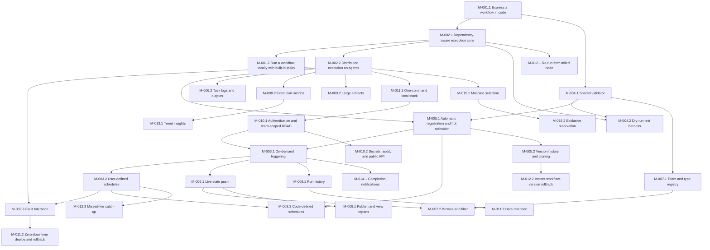

# Azure Task List: Workflow Scheduler (Kardia)

## Overview
- **Goal**: Build the code-first workflow scheduler: C# single-file workflows, a durable leader-elected engine with Windows/Linux agents, triggers and schedules, live UI, reports, team-scoped RBAC, local/cloud parity and machine reservation.
- **PRD**: [2026-10-13_workflow-scheduler_prd.md](../prds/2026-10-13_workflow-scheduler_prd.md) · **Technical design**: [2026-10-13_workflow-scheduler_technical-design.md](2026-10-13_workflow-scheduler_technical-design.md) · **Discovery**: [2026-10-12_workflow-scheduler_discovery.md](2026-10-12_workflow-scheduler_discovery.md)
- **Scope**: REQ-001 to REQ-015 (32 milestones, 88 user stories, 247 work items: 3 Debug, 244 Task).
- **Excluded for now** (user decision: no Bond-based service code): REQ-016 to REQ-024 and every sample/dummy Bond service, hook, codec, transport, request-source, load, perf and parity item. See [Deferred scope](#deferred-scope).
- **First build target**: this single machine (not bare metal): pure local (`aspire run`, `localhost`, no domain) and Docker Compose `dev`/`ppe` (`https://dev.kardia.sonapraneeth.in`, `https://ppe.kardia.sonapraneeth.in`). Self-hosted and Azure PaaS tasks stay in the plan; their code must stay portable.
- **Total Est. Manual**: 698:45 | **Total Est. AI**: 61:45

**Estimation rules**: Task estimates are `hh:mm`. Est. Manual is a developer's hands-on time (1–4 h per item); Est. AI is AI-agent execution plus prompting/review (10–45 min per item). Story = Σ items; Feature = Σ stories; Milestone = Σ features + exit verification (01:00 manual / 00:15 AI); Requirement = Σ milestones. Numbers `R.M.F.S.I` are Requirement.Milestone.Feature.Story.Item within this list; PRD IDs are unchanged.

## Implementation progress

Each completed item is committed separately with its task ID in the commit body.
Items not listed here remain pending. Milestone sign-off and remote CI results
are not implied by local task completion.

| Task | Status | Evidence |
|------|--------|----------|
| 2.3.2.4.4 | Complete | RemoteHttp.RemoteOperationTests adds actual PostgreSQL/Kestrel/agent/package/SDK-child cases for immediate and 202 pending success/failure, result/error outputs, a capacity-one agent remaining occupied across polls, retention expiry and missing status. Real SDK PIDs are killed before POST and after durable RemoteSubmitted; the engine's existing loss classifier dispatches a replacement with the actual saved seed. Before-POST interruption replays the uploaded, journaled checkpoint pointer after the gateway transaction is interrupted. A gated accepted POST followed by a broken HTTP response tests uncertainty: dedup resubmits the same key to one job, lookup-only reattaches to a found job, and lookup miss or no guarantee remains RemoteOutcomeUnknown without another POST. The stub derives lookup identity from the actual business-correlation request body, not preloaded job state. Abort/deadline with no cancel contract emits unknown remote outcome without any cancellation HTTP call; the existing four confirmed/unconfirmed cancellation cases remain in the RemoteOperation filter. Atomic fixture marker publication fixes an observed Windows File.Exists-versus-open-writer race without weakening checkpoint assertions. Final Windows coverage has 25 actual cases including one-MiB resume and secret guard regressions; all 20 remote cases execute successfully on a real Linux .NET 10 runtime with PostgreSQL, Unix host containment and actual child kills. All 42 remote SDK units pass on both OS runtimes, zero skips. Linux NuGet TLS restore was unavailable, so the framework-dependent managed build was copied onto the isolated container's local filesystem and executed via its supported xUnit entrypoint; no native AOT or Linux source-build claim. Bind-mounted Windows storage was too slow for bounded deadlines, while container-local storage passes unchanged cases. Evidence: compose-results/remote-fault-windows-final.trx, remote-fault-sdk-windows.trx, remote-fault-linux-final.xml and remote-fault-sdk-linux.xml. Backend Windows/Linux CI adds an explicit remote HTTP gate and per-OS report artifact; remote CI execution is not claimed. Owned Linux containers/network were removed. README documents the suite and scopes host-loss replacement as simulated machine classification, not an actual machine reboot or agent re-adoption. No runtime authentication, dependency or schema change. |
| 2.3.2.4.3 | Complete | Abort/timeout uses the declared POST/DELETE cancellation with an independent bounded cleanup token, then confirms the configured terminal state in its response or bounded status GETs. HTTP acceptance alone never means remotely cancelled; missing identity, rejected/unconfirmed cancellation and exhausted cleanup produce OutcomeUnknown. Observed remote success/failure during cleanup remains distinct from cancellation, while the local result stays Cancelled/TimedOut. Fixed TaskProgress phases carry only attempt, physical epoch, bounded sequence and microsecond occurrence time through private host protocol 5, the durable agent journal/outbox and existing fenced gateway. Progress ACK requires agent journaling, not engine availability. TaskProgressProjector appends to existing run_events with contiguous per-attempt sequence, exact replay deduplication and conflict/gap rejection; stale session, attempt, machine, expired or closing reservation cannot add events or release capacity. Core and frontend replay only advance the run sequence, preserving graph state, status, timers, placement and attempt scalars. Individual polls remain task logs. Actual abort/deadline x confirmed/unknown cases lock the run row: one job, one cancel request, journaled cleanup/result and physical host exit occur before engine ACK; release replays the exact five phases. Actual concurrent replays, restart, pre-abort occurrence metadata, fences and HTTP live/resync contracts pass. Source-generated REST JSON, MessagePack and shipped Program OpenAPI preserve the same optional attempt/progress shape; generated clients pass live drift checks. All final 109 contracts, 13 core, 77 agent, 411 SDK, 49 live/public-contract units, 119 actual integration regressions and 95 frontend live units pass, zero skips; strict types, scoped lint and production frontend build pass. Evidence: compose-results/remote-progress-final-Wf.*.trx, remote-progress-api.trx and remote-cancel-actual.trx. README documents protocol 5 rebuilds and cancellation/durability semantics. No authentication, dependency or schema change. The separate System Events page and Win/Linux remote fault matrix remain their own pending tasks; no Linux execution claim here. |
| 2.3.2.4.2 | Complete | SDK runner durably acknowledges SubmissionPending before POST, with a stable SHA-256 run/task key and contract/request fingerprint; RemoteSubmitted is acknowledged before status polling. TaskContext.RunId propagates through real task hosts, local execution and task clones. Missing durable publishing/identity fails before networking. Restored submitted attempts never POST; restored pending attempts use authoritative lookup and may only resubmit the identical key within a declared live deduplication guarantee. Lookup miss without dedup, expired guarantees and missing retained status fail nonretryable RemoteOutcomeUnknown. Immediate terminal/synchronous responses complete; declared result/error outputs survive. Polling honors delta/date Retry-After and bounded exponential fallback, task cancellation, per-request timeout and retention deadlines. Shared contract URL validation fences returned references to declared origins; production HTTP redirects are disabled. Bounded JSON reads, duplicate root-field rejection, strict source-generated checkpoints and generic errors avoid raw URL/body/token persistence. Existing agent-resolved bearer references only; no new authentication or dependency. All 399 SDK units, 88 shared-contract units, 51 HTTP-operation validation cases including compiled workflows and 81 selected real agent/host/secret regressions pass. Six actual PostgreSQL/Kestrel/package/agent/SDK checkpoint cases pass, including a locked checkpoint index proving zero POSTs until durable engine ACK, then exactly one POST, two real status GETs, result 31, checkpoint sequence two and physical one-shot host exit. Existing one-MiB replacement resume and secret guard cases remain green. Evidence: compose-results/remote-runner-sdk-full-final.trx, remote-runner-actual-final.trx, remote-runner-contracts.trx, remote-runner-validation.trx and remote-runner-agent.trx. Remote abort/timeout cancellation, System Events and the full cross-platform remote fault suite remain .3/.4; no Linux-run or remote-cancellation claim. README documents durability and offline preflight semantics. |
| 2.3.2.3.4 | Complete | Reuses the existing accessible per-attempt Timeline table rather than introducing an unused AttemptDetails component. A new Resumed from checkpoint (UTC) column renders the exact saved seed time with a semantic time element; non-resumed/historical attribution stays Not recorded. The existing committed fresh-Viewer/no-store timeline API adds required nullable resumedFrom without exposing state, locators, grants or capabilities. Strict frontend validation requires a valid UTC, nonnegative resume instant on attempt two or later and rejects missing/malformed fields rather than inventing attribution. Expand-only atomic 0044 adds a nullable attempt timestamp; historical physical rows and empty/historical partition inheritance survive, with no backfill guesses. The gateway verifies the actual earlier-attempt blob and records its saved time before delivery under existing leader/allocation/session/physical-reservation fences. Identical replays preserve attribution, conflicting timestamps or stale sessions/epochs/terminal attempts fail explicitly, and newer checkpoints cannot replace the old attempt timestamp. Actual SDK replacement proof checks the durable timestamp equals the SDK's ResumedFrom after sequence two overwrites the latest pointer. Actual dispatcher/checkpoint/filesystem/HTTP timeline cases preserve per-attempt agent/time attribution; the browser scenario uses a real published checkpoint rather than a fabricated timestamp. All 69 final actual checkpoint/API/migration cases, 23 API/metrics units and 40 selected frontend units pass; the final changed boundary test rerun has 26 passes. Both actual three-browser and shipped Program/generated-client parity cases pass, covering Chromium/Firefox/WebKit, keyboard operation, desktop light/mobile dark, no horizontal page overflow and no critical/serious accessibility findings. Strict types, scoped lint and production frontend build pass. Initial fixture failures exposed unassigned input command epochs, PostgreSQL partitioned INSERT RETURNING xmin restrictions and test-only 100 ns versus PostgreSQL microsecond expectations; fixtures now read the durable command/leaf row and canonical checkpoint precision without weakening assertions. Evidence: compose-results/checkpoint-resume-api-final.trx, checkpoint-resume-contract-units-final.trx and checkpoint-resume-browser-contract-final.trx. README documents nullable historical semantics and stable attribution. No authentication, dependency or new public endpoint change. |
| 2.3.2.3.3 | Complete | CheckpointMock/MockSpec.WithCheckpoint round-trip cloned, bounded JSON seeds through the existing source-generated dry-run contract. Explicit ExecuteCheckpointed executes only the named real restore branch with TryLoad, Attempt.Number/ResumedFrom and preserved variables, inputs, outputs and task identity; retries receive their own seed and incremented attempt number. Ordinary mocks still never invoke original delegates; defaults, ambiguous outcome/seed/output shapes, invalid sequences/times/attempts and oversized state fail before execution. Resume mocks intentionally have no durable publisher: SaveAsync remains unsupported, and README scopes this virtual-time mode to immediate restore assertions rather than arbitrary asynchronous work. TaskContext attaches all resolved values even to supplied/shared stores. SDK saves reject raw, base64 and JSON-escaped secret patterns in decoded keys, nested objects/arrays, strings and non-string scalars before sequence allocation or persistence, using shared literal expansion with the existing agent masker. Rejection is nonretryable ValidationError without echoing the value; failed validation leaves the loaded state and first valid save sequence unchanged. Actual published C# file-app testing proves the explicit resume branch through the normal subprocess harness. Actual PostgreSQL/Kestrel/agent/SDK-child cases reject raw/base64/escaped state before any HTTP upload, journal pointer or checkpoint index, with a safe-state positive control; existing actual one-MiB replacement-resume and dry-run event replay also pass. All 369 SDK, 315 testing-harness (including published apps), 88 contracts, six actual integration cases and 158 selected agent regressions pass. Three existing Linux-only local-secret ownership/FIFO cases are skipped on Windows, explicitly not claimed. The initial standard-outcome matrix rejected the new opt-in outcome without a seed; its simulation-only selector is corrected and the entire suite rerun green. Evidence: compose-results/checkpoint-secret-sdk-full.trx, checkpoint-mocks-published-full-final.trx, checkpoint-secret-contracts-full.trx, checkpoint-secret-actual-hosts.trx and checkpoint-secret-agent-regressions.trx. No new schema, dependency, login flow, arbitrary-encoding detection or built-in load/parity auto-checkpoint claim. |
| 2.3.2.3.1 | Complete | SDK CheckpointStore implements SaveAsync, source-generated custom state, TryLoad<T>(), serialized saves, exact 1 MiB UTF-8 JSON bounds, cancellable five-second delays and monotonic throttling across wall-clock jumps. Uncertain writes consume their sequence; loaded state changes only after acknowledgement. TaskContext clones preserve Checkpoint and Attempt.Number/ResumedFrom. A purpose-scoped internal blob-only PUT reuses existing HMAC configuration and binds the exact attempt, assigned agent session and physical reservation epoch; fixed-origin validation, no redirects, bounded metadata/body, JSON/digest verification and existing leadership/allocation fences remain mandatory. Engine dispatch embeds the verified latest earlier-attempt seed; missing or corrupt indexed blobs fail closed. Private host readiness protocol 4 streams uploaded pointers to the existing result journal/outbox and confirms SaveAsync only after the durable engine ACK; cancelled waits retain unacknowledged pointers and failed journal ACK writes cannot release the SDK. Actual PostgreSQL/Kestrel/agent/package/SDK-child proof holds the index table locked: the exact 1 MiB blob and journal pointer exist, but the SDK's after-save marker cannot appear until commit and ACK. After stopping that real host/agent and simulating its loss classification, a different real agent receives the full verified seed, exposes attempt 2 and its original checkpoint time, then saves sequence 2 at least five seconds later. Both hosts exit one-shot and the reopened agent journal has no checkpoint left. Fourteen actual HTTP negative cases reject purpose/expiry/tamper/task/session/fence/terminal/size/length/media/JSON/digest/header errors without persistence; blob-only replay cannot create the logical index, and three reader cases cover valid/missing/corrupt state. All final 127 actual checkpoint/hosted/gateway/report/output regressions, 356 SDK, 88 contracts, 97 journal/agent/physical-host and 84 storage/registration/public-contract units pass, zero skips. Evidence: compose-results/checkpoint-producer-regressions-final.trx, checkpoint-sdk-full-final.trx, checkpoint-contracts-producer-full.trx, checkpoint-agent-producer-final.trx and checkpoint-producer-storage-contracts.trx. The actual maximum-size resume exposed and fixed the agent's old 1 MiB receive-envelope ceiling; only dispatch envelopes expand to 4 MiB, not checkpoint or outbound-result limits. README documents API and package rebuild requirements. No new schema, dependency or login flow; dry-run/secret checks and attempt UI remain .3/.4. Simulated loss is not a machine-reboot or agent re-adoption claim. |
| 2.3.2.3.2 | Complete | Engine-side checkpoint foundation precedes the SDK producer so SaveAsync can later wait for a real durable acknowledgement. Expand-only atomic 0043 adds partitioned task_checkpoints keyed by run/task, keeping only the highest positive sequence and its verified immutable blob pointer. Existing and empty historical partition families gain the eighth run table; current/next families include it. CheckpointSaved adds an optional protocol tag and reuses the existing bounded result journal/outbox until cumulative engine ACK. Strict canonical run/task/sequence/digest/size metadata, microsecond timestamps, 1 MiB JSON verification, current assigned session/attempt, leadership and physical reservation fences, exact replay/conflict handling and the five-second save boundary guard projection. Old attempts and expired/closing/fenced reservations cannot regress pointers or cause state events. Current reconnects and active abort cleanup remain supported. Actual PostgreSQL/filesystem/HTTP2 tests prove commit-before-ACK, lost-ACK journal restart/replay, one logical pointer, twelve concurrent replays, lower-sequence non-regression, new-attempt advancement, stale result isolation, missing/corrupt/non-JSON blob rejection, exact 1 MiB acceptance, transaction failure/retry and engine-applier reconstruction. Retention deletes the index before attempts and removes latest, older and upload-only checkpoint blobs while preserving an active run's checkpoint. Two actual 0042-to-0043 DbUp upgrade cases preserve old rows/empty historical families and prove failed migration rollback plus repeatable retry. All 78 contract, 32 journal/outbox and 38 storage/public-contract units pass. The 93-case actual checkpoint/migration/retention/storage regression set had 92 passes and one stale expected partition count; the corrected nine-child hosted case and strengthened checkpoint retention case each pass their final targeted rerun, with no skipped tests. Evidence: compose-results/checkpoint-projection-regressions.trx, checkpoint-hosted-maintenance-final.trx, checkpoint-retention-final.trx, checkpoint-contracts-full.trx, checkpoint-journal-units.trx and checkpoint-storage-contract-units.trx. README explicitly leaves SDK save/upload/resume, dry-run secret checks and attempt UI to tasks .1/.3/.4; no new authentication, public read API or dependency. |
| 2.2.3.1.4 | Complete | New Placement/PlacementSuiteTests.cs drives the actual PostgreSQL run store, hosted planner, dispatcher, registry, loss reconciler and reservation manager with exactly three registered simulated agent sessions per fleet. All 29 suite cases cover six selector forms; three single-slot workers and a fourth waiting task without overbooking or phantom attempts; None/Node/Run/SameMachineAs affinity with dispatcher reconstruction between every task; original queue time and exact ten-minute hard/soft placement failure; worker loss and re-placement under every affinity and unnamed override; stale old-session completion rejection; named overrides and NoAutoRetry refusing relocation; single-machine capacity waits without spillover; foreign reservation exclusion and owner-cohort confinement; and five corrupt/incomplete recovery-history shapes rejected before new events, attempts or outbox entries. Restart testing exposed in-memory-only affinity state: the dispatcher now replays persisted attempt placements in exact dispatch-event sequence before the first recovered decision, restoring moved pins and the initial cursor without rechecking obsolete capacity. New runs skip the history query; core restoration is atomic, run-scoped and invalidates stale proposals while preserving other runs/current rotation. All 138 final actual placement/hosted-execution/dispatch/reservation/agent-loss integration regressions and 60 core placement units pass, zero skips. An initial fixture incorrectly assumed every override candidate had one slot; all three now explicitly have one, preserving the assertion rather than weakening it. README documents recovery and explicit corrupt-history failure. Evidence: compose-results/placement-suite-final.trx and placement-suite-core.trx. Agent results/loss are simulated as required here; no additional physical-kill, cloud, performance, schema, authentication or dependency claim. |
| 2.2.3.1.3 | Complete | Expand-only atomic migration 0042 persists nullable run-level single-machine placement. Trigger/rerun API, actual `wf run --single-machine`, manual trigger/rerun UI, fresh eligible-machine picker, queued override badges and graph/live waiting state share selector validation, naming conflicting nodes and rejecting incompatible counts, missing/stale/draining/reserved machines before submission. Omitted rerun placement inherits; explicit false clears it; idempotency fingerprints preserve old requests and distinguish overrides. Placement, first-dispatch agent pin and WaitingForMachine events survive snapshot/replay and dispatcher reconstruction without resetting queue time or the unchanged ten-minute deadline. Capacity waits stay pinned; unnamed worker loss re-places the cohort, named-worker loss fails with Placement, with existing physical reservation safety preserved. Actual PostgreSQL/Kestrel/agent/SDK integrations cover API/CLI submission, rerun inheritance, dispatch/recovery, machine loss, exact deadline and transactional migration upgrades. Final 289 selected actual integration regressions, 372 core, 62 SDK, 37 CLI, 31 placement/public-contract units, two atomic migration cases and 11 live units pass, zero skips. MessagePack and web JSON match canonical agent UUIDs and WaitingForMachine. Actual Chromium/Firefox/WebKit scenarios exercise trigger and rerun pickers, accepted-response-loss idempotency, durable pinned child runs, Viewer denial and desktop-light/mobile-dark accessibility without critical/serious findings or overflow. All 162 selected frontend units, strict types, scoped lint, production build and generated public API checks pass. Earlier browser regression output includes an unrelated opt-in skip and a now-corrected live-field ordering assertion; final separate selectors resolve that assertion without weakening the field allowlist. Evidence: compose-results/placement-regressions-final.trx, placement-migration-atomic.trx, placement-live-messagepack.trx and placement-regressions-browser-final.trx. README documents API/UI/CLI behavior; no new authentication or dependency. |
| 2.2.2.1.4 | Complete | Actual isolated PostgreSQL 17 with fsync/full_page_writes/synchronous_commit ON and the production renewing leader/fences measures exactly 10,000 sequential durable dispatches after 100 warmups: p95 48.9340 ms, p99 57.9094 ms, satisfying unchanged 50/200 ms gates. Timing starts before Dispatcher.DispatchAsync and ends at the real AgentConnection handler after placement, commit, durable outbox and Kestrel HTTP/2; prior Ready creation is untimed. Synthetic protocol replies drain these delivery fixtures, not SDK execution or workflow-throughput proof. Separately, exactly 100 real Development HTTP triggers after ten warmups reach actual SDK delegates in freshly prewarmed one-shot hosts: p95 842.2918 ms against the unchanged 1,000 ms limit. All 110 real workflows succeed; 110 host starts and all 10,210 persisted runs/attempts, processed real commands and empty outbox are checked. Every raw sample remains, including the 1,184.7569 ms trigger maximum; exact positive/finite counts, unique measured run IDs and nearest-rank percentiles independently match report.json. Earlier 56.2904/52.0075 ms dispatch failures are retained. Production fixes add post-commit bounded gateway wakeups, one fenced pending-control scan, separate-statement protocol batches preserving lock-wait snapshots, current-snapshot empty-tail avoidance and removal of a pre-insert no-op attempt update. All 156 final targeted actual execution/recovery/reservation/placement/metrics/output/group regressions and all 66 benchmark units pass, zero skips. New tests prove current loads do not touch exclusively locked history and older snapshots still replay committed events. One unrelated earlier Recovery test expects ArgumentNullException instead of the existing required-JSON JsonException; it remains untouched and is excluded from the final targeted selector. Windows/Linux CI runs the strict probe and uploads raw reports; remote CI, Linux timing, cold starts, WAN and production authentication performance are unclaimed. Evidence: BenchmarkDotNet.Artifacts/dispatch-latency/a22f8f935fa0436fabeaa5a2a8012481, compose-results/dispatch-latency-live-snapshots.log, dispatch-latency-snapshot-regressions.trx and dispatch-latency-snapshot-gates.trx. No schema, authentication, dependency, lease-duration or threshold change. |
| 6.2.1.2.2 | Complete | Reuses the committed actual protected-provisioning/agent/SDK/gRPC/PostgreSQL/signed-log-upload scenario and leak scanner from completed task 10.2.1.1.3 rather than duplicating its fixture. SecretStoreIntegrationTests executes success, task failure and missing-secret attempts with a generated Unicode secret; raw and UTF-8 base64 output values and errors become `***`, stdout/stderr values split across flushed chunks are masked, and unterminated EOF output is covered. SecretLeakTests scans all 28 root tables, decoded run_events/run_snapshots bytea payloads, node outputs and 26 uploaded gzip/index, local-spool and result-journal files: zero raw, base64 or nested JSON-escaped hits. Real rows, decoded cells, completed upload indices and masked expected log lines prevent vacuous success. Deliberate database/event/snapshot/gzip positive controls are detected, rolled back/removed and followed by clean rescans. Existing evidence is .agent-artifacts/secret-leak-audit.log and secret-leak-results/secret-leak-audit.trx; all 29 associated actual output/secret/log integrations passed. This documentation-only acceptance adds no runtime change, test duplication, authentication or unsupported arbitrary-encoding/report-content claim. System Events here means the durable run_events source; the pending System Events page remains separate. |
| 11.3.1.1.3 | Complete | Actual PostgreSQL 17/filesystem/renewing LeaseManager integration seeds 5,000 expired full-graph runs with a 14-day type override and 20,000 real log/report/resource/artifact objects, 150 retained runs across default/short/long policies and four live runs with genuine RunStore snapshots/events. Four steady signed-Viewer HTTP lanes offer 200 requests/second to production metrics/timeline routes, consume complete bodies and require unchanged committed answers. Final baseline 6,000 samples has p95 33.965 ms; all 132,021 maintenance-overlap samples have p95 28.075 ms (-17.34%), and the independently gated 21,897 row-deletion samples have p95 30.623 ms (-9.84%). Both increases are strictly below the unchanged 10% limit, with no artificial floor, outlier removal, HTTP retries or mocked transport. Every expired FK child, report locator and blob is gone; retained child rows/blobs and active runs survive, durable tombstones drain and leadership remains valid. Earlier runs exposed row-write and continuous-GC contention; production now uses 25-run transactions/250 ms pacing and shared bounded 32-job blob batches/25 ms pacing, preserving 5,000-run sweeps, the one-second engine fence and ten-second hosted ticks. The fixture drains the shared blob batches continuously, more aggressively than the hosted service. A new actual 33-job regression proves exact 32+1 durable batches. All 106 final actual retention/API/blob/metrics regressions and 51 retention/public-contract units pass, zero skips. Dedicated isolated performance steps and TRX upload are wired on both backend CI OS jobs; remote CI is unclaimed. Evidence: compose-results/retention-purge-live-paced-blobs.trx, retention-live-final-regressions.trx and retention-live-final-units.trx. No new authentication or dependency; test JWT duration alone is extended for the long benchmark. |
| 11.3.1.1.2 | Complete | Engine-only leader-fenced retention runs 02:00-04:00 UTC with current policy reads, at most 5,000 runs per sweep, paced 100-run transactions and unchanged one-second lease fences. Creation/completion and upload-recovery grace must expire; active runs/nodes/attempts, unacknowledged physical reservations, queues, dispatches, commands and live grants are protected. Explicit FK-order deletion removes report locators and processed commands, refreshes partial daily/dashboard buckets under existing aggregate locks, and atomically creates durable blob tombstones (0041). Independent 5,000-row audit batches preserve the exact minimum-one-year boundary and longer overrides. Daily partition maintenance pre-creates current/next month; only complete empty monthly families past the global default/type maximum or separate audit cutoff are detached/dropped, with actual bounds/inheritance checks, NOWAIT locking/recheck, one family per transaction and no CASCADE or FK removal. Both filesystem and Azure adapters delete exact run prefixes and canonical artifact hashes; reparse-point protection, shared artifact/grant reference checks, actual-publication hash locks, busy-job deferral, ten-second deletion, sanitized durable backoff and cancellation-safe retry are implemented. Generalized existing orphan sweeping reclaims late run uploads; off-peak artifact inventory finds failed publications. A monolithic DELETE measured 7.52 seconds in FK triggers, so pacing/transaction subdivision fixes the root issue rather than relaxing constraints or fencing. Final 173 actual PostgreSQL/filesystem/Azurite/HTTP/gateway/SDK artifact-resource-log and migration regressions pass, zero skips. New proofs include a real renewing LeaseManager deleting 1,001 runs under its original fence, 5,001-run/audit exact caps, nine physical-work guards, full FK graph/locator/blob cleanup with retained metric observations, shared artifacts surviving until last reference, publication blocked inside its real service while GC defers, twelve GC workers, cancellation/restart retry, atomic DB-failure rollback, active-month/global-max protection and busy-reader nonblocking partition deferral. Actual hosted maintenance pre-creates missing future partitions and removes expired rows/blobs while preserving live data and leadership. All 51 retention/public-contract units and shipped Program/OpenAPI/generated-client byte checks pass. Evidence: compose-results/retention-maintenance-final-regressions.trx, retention-maintenance-final-units.trx and retention-maintenance-program.trx. No new auth or dependency; live API p95 impact remains separately tracked task .3. |
| 11.3.1.1.1 | Complete | Expand-only 0040 seeds 90-day default and independent 365-day audit minimum; exact per-type overrides reuse existing workflow_types.retention_days. Public Admin-only GET/PUT uses existing authentication, including local Development and App Admin, with no new login flow, UI or dependency. Strict complete replacement accepts only default_days/audit_days/per_type, exact registered type IDs, bounded days/256 overrides/64 KiB JSON including chunked bodies, and rejects duplicate/null/unknown/mistyped fields and query parameters. One MVCC statement reads coherent configuration; singleton/type row locking serializes writers, and complete before/after retention.update audit commits atomically with defaults and overrides. Unknown types/short audit return 400 without side effects; missing singleton is explicit 500, database errors sanitized/logged 503. All 27 validation units pass and 111 actual PostgreSQL/signed-JWT/Kestrel retention/subscription/migration regressions pass with zero skips: durable replacement and override removal, existing Admin roles and invalid audit principals, twelve concurrent writers with coherent reads and one linked audit chain, audit-failure rollback/retry, one-connection pool, declared/chunked size limits, persisted guards, storage restoration and fresh/0039 DbUp upgrades preserving prior overrides with repeatable journals. Actual shipped Program reads/writes configuration and exports public-only typed GET/PUT; both generated clients byte-check, frontend strict types pass. Initial prepared multi-statement SQL failure was diagnosed and corrected with separate transaction-owned parameterized updates. Evidence: compose-results/retention-config-units.trx, retention-config-regressions.trx and retention-config-program.trx. Purging and live-load impact remain separate tasks .2/.3; configuration alone deletes nothing. |
| 14.1.1.1.4 | Complete | Shared inline Subscribe panel is wired to workflow history/version pages, type catalogue and schedule details. Existing Viewer authority suffices; exact workflow/type/schedule scopes, personal list/create/delete, all-terminal or failure-only events, three destination channels, explicit refresh and 50-row descending keyset pagination use generated public API operations. Strict typed boundaries reject foreign/malformed/configuration-mismatched receipts, unsafe URL/reference/mailbox shapes, wrong success statuses and inconsistent pages. Existing secret-name validation is reused; Teams URLs and resolved signing values are never accepted. Query enablement uses stable grants while display/create require fresh idle authority/list state, preventing denied-read retry loops. Revalidation hides cached destinations; previously loaded owner IDs/channel names alone permit unsubscribe after denial/revocation. Resource transitions reset drafts/receipts; pending guards prevent duplicate writes, errors preserve drafts and mutations never auto-retry. Existing session cache clearing is reused, with no new auth flow or dependency. All 79 new boundary/component cases and 383 selected frontend regressions pass; strict app/tool/E2E types, scoped lint and production bundling pass. All nine actual PostgreSQL/signed-JWT/MSAL/Vite browser scenarios pass on Chromium, Firefox and WebKit: all four entry pages and three scopes/channels, actual 201 -> reload -> exact persisted DTO -> 204, duplicate 409, unsafe Teams draft rejected before HTTP, other-oid Viewer read/delete isolation, real foreign-JWT 403 cache hiding without a retry loop, owner cleanup, and 51-row real keyset pagination without duplicates. Desktop-light and 375 px dark axe report zero critical/serious and no document overflow. Browser proof exposed 100 ns creation receipts versus stored microseconds; production creation now uses PostgreSQL precision and a deterministic real API regression verifies exact receipt/list equality. Long workflow IDs on schedule details now wrap rather than overflow; thresholds and exact equality were not weakened. All 48 actual subscription API cases and 62 subscription/public-action units pass; existing dashboard/trend API regressions also pass. Every Subscribe action is now required by the generated-public-operation completeness scan. Dedicated CI browser gate added; remote CI unclaimed. Helpers/private caches/databases are cleaned and protected stacks untouched. Evidence: compose-results/subscriptions-ui-browser-responsive.trx, subscriptions-ui-browser-final.trx (48 API passes; earlier browser overflow superseded), subscriptions-ui-contract-units.trx and subscriptions-ui-backend-regressions.trx. |
| 14.1.1.1.3 | Complete | EmailChannel and TeamsChannel use the existing durable outbox, subscription-first locking, strict safe-event validation, bounded ten-second delivery and eight-attempt backoff. Exact operator-approved type/mailbox and type/Teams-reference matching prevents arbitrary destinations; at most 64 entries across all three channels, opt-in by default. SMTP uses a separate standard-library client per attempt, no ambient credentials, externally supplied optional credentials, STARTTLS with normal certificate validation by default, and plaintext only on literal loopback without credentials. UTF-8 plain mail contains safe run facts and a stable run Message-ID; SMTP 4xx/network failures retry, 5xx fail permanently with sanitized codes. Teams uses current Workflows message/Adaptive Card 1.2 format, a private external signed-query URL, and the same extracted IP-pinned, no-proxy/no-redirect/no-cookie/TLS-verifying transport as webhooks. No new dependency, user login/logout or OAuth flow. All 24 new actual SMTP/Kestrel/PostgreSQL cases pass: real signed-user subscriptions -> actual terminal commit -> all three receivers under 30 seconds, independent 503/451 retries and webhook HMAC verification, recipient rejection, permanent SMTP 5xx, restart-stable Message-ID, missing STARTTLS and self-signed certificate rejection without credential or mail downgrade, refused socket, ten-second timeout, cancellation rollback, twelve concurrent dispatchers per new channel, type/recipient/reference/payload rejection before networking, Teams redirect isolation, HTTP retry and untrusted TLS. Existing actual Program subprocess proof now delivers all three channels and excludes private URLs/keys from logs. Final 184 actual notification/subscription/terminal-writer/group/migration/production-contract regressions and 136 signer/config/subscription/public-contract units pass, zero skips; both generated clients byte-check against actual Program. SMTP wire proof exposed normal header folding; assertions now unfold RFC headers without weakening subject verification. Evidence: compose-results/notification-channels-final-regression.trx and notification-channels-final-units.trx. Relay acceptance is not downstream delivery; at-least-once replay and operator secret/IP configuration are documented. Subscribe UI remains .4. |
| 14.1.1.1.2 | Complete | Expand-only 0039 terminal row trigger atomically enqueues exact workflow/schedule/type completion/failure subscriptions, waiting for ended_at on grouped status-first commits. Both production terminal writers, all four outcomes, nine scope/channel combinations, Failed-only filtering, exact replay, foreign workflow/series isolation and outbox-failure rollback of terminal events/snapshot/both rollups pass. Existing terminal history is not backfilled and future partitions inherit the trigger. Structured CloudEvents 1.0 carry safe immutable IDs/status/end time only; strict persisted-payload shape/size/ownership validation rejects expansion or corruption. Engine-host dispatcher is opt-in, with exact operator-approved type/URL/secret tuples, external signing keys and pinned IPs; no DNS rebinding, proxies, redirects, cookies, ambient credentials or TLS bypass. HMAC-SHA256 covers canonical timestamp-dot-exact-wire-bytes, with receiver replay-window/dedup guidance. Subscription-first SKIP LOCKED transactions prevent concurrent sends and unsubscribe deadlocks; bounded ten-second sends, eight-attempt exponential retries for 5xx/408/429/network/timeout, explicit permanent failures, cancellation rollback and at-least-once restart semantics are documented. All 43 new actual PostgreSQL/Kestrel cases pass, including real signed-user API -> terminal -> hosted dispatcher -> 503/204 delivery under 30 seconds, independent HMAC verification, actual Program subprocess configuration/delivery, twelve concurrent dispatchers, real stalled response, refused connection, untrusted TLS rejection, IPv4/IPv6 pins, redirect isolation, failed post-send DB update and same-event replay. IPv6 probing exposed bracketed socket host names; exact guard now handles them without relaxing IP/port pins. Final 160 actual notification/subscription/terminal-writer/group/migration/production-host regressions and 100 signer/config/subscription/public-contract units pass, zero skips; both generated clients byte-check against actual Program. Evidence: compose-results/terminal-notifications-final.trx and terminal-notifications-final-units.trx. Email/Teams dispatch and Subscribe UI remain tasks .3/.4; no new login, dependency, production-stack change or exactly-once claim. |
| 14.1.1.1.1 | Complete | Expand-only 0038 adds user-owned subscriptions and a durable notification outbox with exact configuration deduplication, validated event/scope/channel invariants, due-row index and subscription/partitioned-run cascades. Public GET/POST/DELETE supports workflow, schedule and type scopes using existing fresh Viewer authority and authenticated oid ownership; app-only/Agent/Registrar and foreign-user access are denied, including other-user global Admin. Owners can unsubscribe after revocation. Strict 16 KiB JSON and bounded exact query/keyset validation reject malformed, unknown, duplicate, oversized and unsupported-media requests; safe secret references never accept resolved signing keys or Teams connector URLs. Create/delete and minimal safe audit share one transaction; failures roll back both writes. All 51 new units and 47 actual PostgreSQL/signed-JWT/Kestrel cases pass, including three scopes/channels, revocation, other-user denial, paging during insertion, twelve concurrent duplicate creates, both audit-failure rollbacks, declared/chunked limits, sanitized storage failure and pool recovery, one-connection CRUD, persisted guards, outbox uniqueness and cascades. Final 78-case actual selector includes 30 migration-lint cases and the real Program public-only OpenAPI contract; both generated clients byte-check against that host. All 62 selected subscription/public-operation units and fourteen existing real dashboard API regressions pass; strict frontend types and generated-client lint pass. Evidence: compose-results/subscriptions-final-contract.trx, subscriptions-public-contract.trx and subscriptions-dashboard-regression.trx. No new authentication or delivery claim: terminal outbox production, dispatcher/network policy, channels and Subscribe menu remain their separate approved tasks. |
| 13.1.2.1.3 | Complete | Canonical workflow/schedule/node/machine dashboard route persists 7/30/90-day windows and bounded top-N in the URL, reuses installed uPlot for four rankings and supplies always-visible accessible linked tables with exact metric units, observed-duration counts and separate hard/soft failures. Strict typed public API validation rejects foreign scopes/windows, inconsistent counts/rates/quantiles, unsafe numbers, null ranked metrics, duplicate/reversed/nonordinal rankings, cross-list disagreement and unsafe run links. Workflow/schedule/machine pages provide entry points; rows link to node dashboards, exact latest-contributing runs and workflow runs filtered by the selected UTC creation window. Search is explicitly across schedules/machines, not falsely claimed to reproduce exact-agent or schedule observations. The authoritative scoped read rechecks Viewer access without demanding Admin-only machine inventory; pending revalidation and failed/denied refresh hide cached charts/tables, with explicit retry and no added polling or login/logout. All 56 new frontend boundary/component cases and 191 selected dashboard/series/machine regressions pass; strict app/tool/E2E types, scoped lint, generated routing and production bundling pass. Nine final real PostgreSQL/signed-JWT/MSAL/Vite/production-endpoint scenarios pass on Chromium, Firefox and WebKit: all four scopes, exact rankings and links, window/top persistence and reload, actual filtered-run results after clicking a slow node, empty data, current Viewer machine isolation, real 403 cache hiding without retry loops, and desktop-light/375 px dark axe zero critical/serious with no document overflow. Fourteen existing actual dashboard API cases pass after shared browser-fixture wiring. Dedicated CI acceptance enabled; remote CI unclaimed. Helpers and private fixture caches/databases are cleaned; protected stacks untouched. Evidence: compose-results/dashboard-ui-browser-final.trx and dashboard-ui-backend-regressions.trx. |
| 13.1.2.1.2 | Complete | Exact multi-node answers cover all four dashboard scopes, 7/30/90-day windows, bounded top-N, ordinal ties, null/zero measurements, schedule isolation and contributing-run links. A separate 97-run oracle matches PostgreSQL native interpolation for skewed, duplicate, distinct microsecond, missing and clamped durations in every scope. Raw-query tuning still missed the unchanged 500 ms gate, so expand-only 0037 adds durable daily scope projections with exact source-duration arrays, independent counts, resource maxima and latest-run IDs. Both existing terminal writers atomically refresh daily and dashboard projections under the same ordered bucket lock; concurrent commits, exact replay, both projection failures on both writers, retained-history backfill, pre-upgrade prepared callers and ten new persisted-data guards pass. Rankings read projections without raw history scans, approximate percentiles, request caching or pooled planner-setting changes; fresh authorization remains unchanged. The real signed-JWT HTTP benchmark persists 180,000 runs, 360,000 nodes and 360,000 attempts over 90 days at 2,000 runs/day, with normal constraints/statistics, three warmups and 20 measured requests per scope: p95 workflow 158.78 ms, schedule 326.64 ms, node 89.87 ms, machine 164.29 ms; all exact ranking assertions and strict under-500 ms gates pass. All 149 selected real query/writer/group-commit/metrics/migration regressions, 45 control-plane units and actual Program migration/OpenAPI plus both generated-client byte checks pass, zero skips. A one-connection pool retains identical backend PID/settings and remains usable after success and injected sanitized 503. Evidence: compose-results/dashboard-rollup-performance.trx, dashboard-rollup-regressions.trx, dashboard-rollup-units.trx and dashboard-rollup-contract.trx. |
| 13.1.2.1.1 | Complete | Public GET /api/v1/dashboards/{scope}/{id} supports workflow, schedule, node and machine with strict canonical identities, UTC 7/30/90-day creation windows and bounded top-N. Exact source p95, hard-failure fraction, CPU maxima and RAM MiB maxima rank exact workflow/node identities with stable ordinal ties and latest-contributing-run drill-down links. Missing measurements remain null/excluded from their rankings while true zero remains measured; soft failures, skipped/reused observations and failed retries retain their documented semantics. Machine metrics use only task attempts actually executed on that agent, never whole-node duration or another machine's resources; current Viewer workflow-type filtering prevents cross-team disclosure without exposing Admin-only inventory metadata. Existing fresh Type/Series authorization preserves deleted-schedule history, denies revocation/app-only/foreign/unknown scopes, and adds no login flow. Source-generated DTOs, public-only OpenAPI, actual Program wiring and regenerated public client are verified. All 11 real PostgreSQL/signed-JWT/Kestrel cases and 25 new parser/ranking/JSON units pass, alongside 12 trend units; actual Program export and both generated-client byte checks pass, strict frontend types and scoped lint pass. Sanitized no-store invalid/storage failures covered. CPU/RAM rollup columns already supplied by 13.1.1.1.1. The separate next task owns multi-node known-answer and 180,000-run p95 gates. Evidence: compose-results/dashboard-endpoints.trx, dashboard-units.trx, dashboard-contract.trx. |
| 13.1.1.1.3 | Complete | Series page retains default Run history and adds native accessible Trends navigation with URL-persisted 7/30/90-day selection and unchanged history filters. Typed public API boundary rejects foreign identities/windows, unsafe or inconsistent counts/rates/quantiles/streaks, missing/reordered days and fabricated unknown measurements. Summary counts, observed-duration totals, streak and exact source p50/p95 accompany reused installed uPlot UTC-category daily charts and a complete scrollable table alternative; empty windows remain explicitly unmeasured. One existing current Viewer observer gates reads and hides cached data during permission checking, revocation and failed refresh. Its data-fetch eligibility remains stable during permission revalidation, preventing a denied-read retry loop; explicit 403 invalidates current permissions. All 36 new boundary/component units plus 47 related run-now/fire/history/chart units pass; final 48-case boundary/panel selector includes the revalidation regression. Strict app/tools/E2E types, scoped lint/format and 23 backend parser/public-operation contract cases pass. Six real PostgreSQL/signed-JWT/MSAL/Vite/production-API Chromium/Firefox/WebKit cases verify actual charts and values, 90-row tables, empty/foreign Viewer, history navigation, window changes/reload, real 403 cache hiding, and desktop-light/375 px dark axe zero critical/serious with no document overflow. Browser-native fetch-response-to-two-animation-frame UserTiming verifies full 90-day chart/table paint below 500 ms on all three engines; cached Intl formatters avoid repeated per-cell construction, without relaxing the limit. Dedicated CI step runs the same browser acceptance; remote CI unrun. No new dependency, authentication flow, chart abstraction or protected-stack changes. Evidence: compose-results/trends-browser.trx and trends-ui-contract.trx. |
| 13.1.1.1.2 | Complete | Public GET /api/v1/series/{id}/trends accepts one strict 7d/30d/90d window (default 30d), using UTC creation days including the partial current day and fresh existing Series Viewer authorization. Completed-only totals and gap-filled daily rows include success fraction, success/failure counts and observed-duration count; exact interpolated source p50/p95 never average daily quantiles or fabricate missing observations. Latest creation-ordered contiguous success/failure streak ignores active runs, groups aborted/timed-out with failure, and remains explicitly empty without completed runs. Retained legacy series and deleted schedules work; arbitrary app/client reads follow unchanged role rules, current revocation denies, and no private run data is projected. Strict identity/query guards and sanitized no-store 400/403/500/503 responses are wired with source-generated DTOs and public-only OpenAPI window enum. All 16 actual PostgreSQL/signed-JWT/Kestrel cases pass, including three known-answer windows, gaps, zero/missing/skewed measurements, streaks, retention, denial/revocation and invalid/storage paths. An initial 611.64 ms performance failure led to indexed streak lookups and removal of redundant materialization, not a relaxed threshold: unchanged 180,000-row, 90-day, 20-sample HTTP gate now measures p95 444.29 ms with exact known answers. Twelve new parser/JSON units plus eight rollup units pass. Actual Program export, both generated clients' byte-exact checks and nine existing series-fire API regressions pass; strict frontend types and scoped generated-client lint pass. No new authentication, dependency, index or protected-stack changes. Evidence: compose-results/trends-api.trx, trends-units.trx and trends-contract.trx. |
| 13.1.1.1.1 | Complete | Expand-only 0036 adds daily workflow/node rollups and backfills retained terminal history. Both normal RunStore and group-commit terminal paths refresh in the terminal transaction; grouped tails first project their committed run/node timestamps and snapshot. Ordered transaction-scoped bucket locks prevent lost concurrent updates; recomputation makes exact replay idempotent. Counts distinguish hard and soft failures; exact interpolated source p50/p95 never average prior quantiles. UTC UUIDv7 creation-day buckets, workflow-total sentinel, explicit observed-duration count, null unknown measurements and clamped clock skew are documented. CPU/RAM maxima include failed retry attempts without fabricating unavailable telemetry. All 18 actual PostgreSQL cases pass: known seeded counts/quantiles/resources, all four run outcomes, 24 simultaneous terminal commits, grouped multi-run exact replay, injected rollup failure and successful retry on both terminal paths, old-schema multi-day backfill and seven persisted-data guards. All 65 related group-commit, metrics and migration-lint regressions plus 32 control-plane selector/metrics units pass, zero skips. Historical partial-schema fixtures now include the current RunStore lineage/resource/rollup dependencies. No authentication, endpoint/UI, package or protected-stack change. Evidence: compose-results/rollups-integration.trx and rollups-units.trx. |
| 11.2.2.1.3 | Complete | Existing Vite content-hashed production output reused without retaining stale build-directory files. The actual SPA owner, Caddy, serves current assets first and one preceding release from a private image directory; missing JS/CSS returns 404 instead of index HTML, and errors are never cached immutably. Successful GET/HEAD, byte ranges and 304 responses carry public one-year immutable caching; current index and deep links carry no-cache/no-store. Normal CLI up inspects the environment's existing image under its lock, pins the exact ID to a dev/ppe-specific previous-image tag and passes it only to build/up children; first install falls back to pinned Caddy only on genuine absence. Inspection, malformed replies, daemon and tagging failures remain explicit; inherited overrides cannot bypass selection. New images copy only the predecessor's current /srv, not its retained history, bounding storage to one prior release. All 99 CLI local-command/process units pass with no skips. Actual production Dockerfile builds prove first-install and repeated-image behavior; Chromium, Firefox and WebKit keep old Vite-built tabs open across replacement on one ephemeral loopback port, then fetch their original lazy JS and CSS successfully. Real HEAD/206/304 headers, exact old bytes, current index/deep links, missing assets and history expiry after a further release all pass. Strict frontend app/tools types, scoped lint/format and actual Caddy validation pass. Independent Frontend CI job runs the same acceptance; remote CI is not claimed. All owned images/containers/fixtures clean up; no backend SPA duplicate, new dependency, login or protected dev/ppe stack changes. Evidence: frontend/scripts/gateway-assets-acceptance.ts and compose-results/gateway-assets-cli.trx. |
| 15.1.1.2.3 | Complete | Admin POST /api/v1/machines/{id}/calibrate accepts one strict shared profile and returns a durable 202/Location; Admin GET exposes asynchronous status, reported rate, applied flag and explicit failure. Allocation/row locks reject every unreleased reservation, active dispatched/running/aborting attempt, occupied slot, stale/nonhealthy machine and legacy agent. Accepted requests atomically audit, allocate the shared monotonic machine fence and mark Draining; authoritative PostgreSQL status blocks both dispatch and reservation acquisition despite stale leader caches. Additive 0035 preserves legacy agents with capability false; compatible gRPC commands/results, persistent agent journal and reconnect replay reuse existing transport and leader fencing. Only the exact current session/request/epoch can settle; expiry/disconnect alone never release the machine. Positive Int32 reports before the server deadline update only the requested profile with Calibrated/server UTC time, never overwriting Manual, including mid-flight overrides. Request/completion audit failures roll back job, health and capacity atomically; stale/duplicate reports have no effects. All 33 new actual PostgreSQL/JWT/Kestrel/production-gRPC/migration cases and 19 related registration/manual-capacity/actual-Program regressions pass; unrelated opt-in installer execution is not claimed. Native AgentConnection proves durable Unsupported without starting a host or inventing capacity; simulated positive reports prove protocol/storage, not benchmarking. All 37 profile/protocol, 75 control-plane and 51 native command/journal/telemetry units pass; strict frontend types, generated-client lint and both actual-host byte-exact client checks pass. No new login, dependency or calibration UI; load executor, Wf.Load, Bond profiles and stability measurement remain deferred. Evidence: compose-results/calibration-complete.trx, calibration-controlplane.trx and calibration-agent.trx. |
| 15.1.1.2.2 | Complete | Admin PATCH accepts a strict positive-Int32 manual capacity for the shared canonical transport/codec/payload/load-settings profile. One allocation-locked transaction overrides only that profile, clears calibration time, preserves other profiles/metadata/reservations and writes exact before/after audit; injected audit failure rolls everything back without notification. GET exposes validated persisted capacities in two bulk queries; empty means Unverified. Detail capacity table shows source, calibration time or explicit manual/absent Unverified, with an accessible profile-prefilled editor, retained error/revalidation drafts, no automatic write retries and shared parent authorization. Expand-only 0034 adds commit-only capacity invalidations; fresh and previous-schema PostgreSQL checks preserve rates and cover insert/update/delete, silent no-ops and rollback. Real concurrent reads exposed a double-disposed pooled reader in the new bulk path: lexical disposal fixes it, with 96 parallel-request regression reads failing before and passing after. All 49 actual API/live/migration/production-host contract cases pass, including six signed-JWT/Kestrel/PostgreSQL Chromium/Firefox/WebKit cases verifying real delivered Resync frames, cross-tab capacity updates, calibrated-to-manual override, unchanged other profile, reload, Viewer denial, three exact capacity audits and desktop/375-pixel dark/dialog axe zero critical/serious with no overflow. All 181 affected frontend machine/live/auth units, 67 backend boundaries, strict types and scoped lint pass; both generated clients byte-check against actual Program. No new login, dependency, load generator or protected-stack changes; calibration command remains separate. Evidence: compose-results/machine-capacity-complete.trx, machine-capacity-final-units.trx, machine-capacity-reader-reproduction.trx and machine-capacity-reader-fixed.trx. |
| 15.1.1.1.2 | Complete | `/machines` inventory and `/machines/{id}` detail reuse the public GET/PATCH and existing global Admin permissions, with URL-persisted pool/OS/health/AND-label filters, hardware/task-slot capacity, current resource/heartbeat/version data and unreleased reservations. The accessible label/pool dialog validates server bounds, sends only changed fields, supports explicit label clearing and retains drafts on validation/write failure or permission revalidation; writes fail closed and actual denial hides cached metadata/editor. One shared permission observer avoids stale-query refetch/remount loops. Expand-only 0033 emits commit-only PostgreSQL invalidations for changed agent/reservation rows; no-op/rolled-back writes stay silent. Existing authorized MessagePack machines/* Resync coalesces at 250 ms and refetches authoritative inventory without polling; reconnect/error/stale states are explicit. Six actual signed-JWT/Kestrel/PostgreSQL Chromium/Firefox/WebKit cases verify mixed registered Windows/Linux inventory, real release-pending reservation, filtered reload, audited metadata replacement/clearing, cross-tab push and production registry heartbeat CPU 0->37/slots 0->1, Viewer denial, real 403 cache hiding, 375-pixel/dark/dialog axe zero critical/serious and no overflow. Forty-nine machine boundary/component units plus 87 shared live/permission units, 66 backend machine/hub/public-operation units and 42 actual machine/migration-upgrade/lint/production-host byte-exact contract cases pass with zero selected skips. Three historical reservation regressions exposed missing rerun columns in the shared partial-schema fixture; its existing compatibility migration list now includes 0032, and all three pass. Existing live-list coalescing passes in isolation; one concurrent heavy-build attempt returned sequence 7 before 8, not claimed as a passing timing run. CI enables the actual browser acceptance; no new login, dependency or protected-stack changes, and remote CI unrun. Evidence: compose-results/machines-browser-complete.trx, machines-final-contracts.trx, machines-units.trx and machines-browser-final.trx (isolated live coalescing passes; earlier browser attempt superseded). |
| 10.2.3.1.2 | Complete | Dependency-free .NET contract tests scan every frontend publicApi/uiApi HTTP call against both generated operation sets; unknown/aliased/raw-fetch/computed-call shapes fail instead of being silently skipped. Literal and explicit conditional paths are covered; the internal set must equal exactly six schedule-editor operations including preview, with no such mutation in public v1. Gate requires public permission, run/rerun, report, audit, version activation, schedule list/detail and series fire/history operations. Found and repaired two genuine contract gaps: caller-permission documentation/client now use public v1 with unchanged runtime authorization; public GET /api/v1/schedules now provides exact-workflow current Viewer reads, bounded paging, filter-bound immutable UUID keysets including legacy UUID support, deleted-row exclusion and no SPA restriction. Reuses existing detail DTO, SQL projection and reader, preserving origin, exact code provenance, variables-as-references and all existing edit/concurrency semantics; no migration or new login flow. Actual Code/User list acceptance pages three real registered/created rows, matches each existing detail response exactly, preserves audit counts and checks deletion, arbitrary SPA/app reads, denied/anonymous callers and invalid filters/cursors. Actual CLI help plus twelve schedule mutation invocations reject without any request to an instrumented HTTP host despite a valid Admin token; no token echo or CLI production changes. Sixty-nine backend contract/schedule units, 108 frontend permission/schedule units, 50 actual PostgreSQL/API/CLI/CRUD/host-export cases and a final 12-case current-permission/code-list/CLI/byte-exact drift gate pass, zero selected skips; strict frontend types and scoped lint pass. Frontend CI now runs the source-to-operation scan after actual-host parity. Owned fixtures clean up and protected live stack unchanged; remote CI unrun. Evidence: compose-results/public-api-contract.trx, public-api-contract-final.trx and public-api-contract-units.trx. |
| 10.2.3.1.1 | Complete | Existing authenticated /openapi/v1.json and /openapi/ui.json publication/client generation reused; both exporters now explicitly pin OpenAPI 3.1 instead of inheriting future framework defaults. Actual production Program acceptance asserts both versions, public run/report/audit and schedule/history reads, absence of all six UI-only schedule mutations from v1, their presence only in ui, and no public reads in the internal document. Real generated public/UI clients pass byte-exact bun run api:check against that host. Frontend CI now runs this exact host/check path after backend build, without regenerating drift away; existing API/browser gate also enables the Admin audit browser acceptance. Six real Bun generator-process tests use isolated loopback HTTP documents and private disposable client copies to prove both successful generation/check and nonzero failure for each client's drift, changed server operations, unavailable internal document and missing client files. Check mode leaves both files untouched and does not echo bearer tokens. Two actual PostgreSQL/Program/JWT export cases, six generator process cases, strict app/tools types and scoped lint pass; private fixtures clean up, no new dependency/authentication flow or protected-stack changes. CI wiring is locally verified, not claimed as a remote Actions result. Evidence: compose-results/openapi-contract.trx; frontend/src/lib/api/generation.test.ts. UI-action-to-operation completeness remains task 10.2.3.1.2. |
| 10.2.2.1.2 | Complete | Global Admin-only GET /api/v1/audit reuses the partitioned audit_log and existing authorization, with exact actor/target-kind/target-ID AND filters, strict half-open RFC3339 time bounds, bounded 1-100 page size and filter-bound microsecond timestamp/bigint keysets. Decimal-string IDs retain full Int64 precision; safe projection reads only committed audit metadata, with no variable/storage joins. No-store authorization/error responses fail closed, including team Admin/Viewer denial and sanitized database unavailability. Typed generated public client and /admin/audit route add actor/target/UTC date filters, URL persistence/reload, explicit refresh/load-more and escaped JSON summaries; failed refresh hides cached records. Forty-four audit/snapshot units and 32 audit frontend boundary/component units pass, as do strict types and scoped lint. Actual PostgreSQL/JWT API acceptance covers global roles, anonymous/unsigned callers, exact filters/time boundaries, concurrent insertion while paging tied timestamps, invalid/filter-mismatched cursors, SQL-like text, a real machine mutation's before/after summary, nonmutating reads and Int64 identity. Actual Program exports/generates/checks the public contract. Six Chromium/Firefox/WebKit cases exercise real API/PostgreSQL/MSAL sessions, 50+1 paging, UTC filters, reload, explicit current Viewer 403, direct Viewer denial, desktop-light/375 px dark accessibility with no critical/serious violations or page overflow. Fixtures clean up; no new login/authentication flow. Existing stale RunEventsResync constructor/assertion updated for previously added required lineage. Separate task 10.2.2.1.1 still owns universal mutation coverage and retention maintenance. Evidence: compose-results/audit-api.trx, audit-openapi.trx and audit-browser.trx. |
| 12.1.1.1.4 | Complete | Real production CLI compilation/package upload, public registration/trigger/rerun APIs, AppHost control plane, PostgreSQL, native agent and downloaded out-of-process SDK task hosts execute the complete Scenario A diamond. A per-fixture gate releases the original non-auto-retry US deployment only after EU success is durably observable; its first genuine exception fails the source and skips smoke. One API rerun and three independently confirmed browser reruns keep the source's immutable version and effective PPE/version variables, reuse Build/Deploy-EU without dispatching their tasks, and execute exactly eight fresh attempt-1 tasks each: four lifecycle stages, US and three parallel smoke probes. Actual US inputs and smoke receipts prove consumption of original outputs; database JSON equality proves complete copied outputs/source lineage, with original attempt outputs unchanged and no fabricated reused attempts or child-output fallback. Chromium/Firefox/WebKit show Reused badges, exact pinned graph and source links, inspect live completed smoke output, then navigate to the failed original and display its exact Build/EU JSON. Light desktop/dark 375 px scans have zero critical or serious axe violations or document overflow. The genuine full-execution browser case has a scoped 90-second total budget; the initial generic 30-second budget expired near WebKit's final output selection, and the final browsers pass in 26.3/27.5/30.6 seconds. Both actual native scenarios, new rerun and unchanged original full-success regression, pass with zero skips in 4:48 total; 38 AppHost models, strict frontend tools/E2E typing and scoped lint pass. Reuses AppHost.Tests/RerunFromFailedTests.cs and existing stack helpers instead of duplicating a second production-host harness in Integration.Tests. Owned PostgreSQL/container, database, stack processes and private fixture files clean up; protected live stack and authentication unchanged. Evidence: .agent-artifacts/compose-results/rerun-execution-final.trx, rerun-execution-model.trx and .agent-artifacts/rerun-execution-final.log. |
| 12.1.1.1.3 | Complete | Run detail exposes Re-run from failed only with current exact owning-run Operator permissions and confirmed terminal failed/aborted/timed-out state. Accessible confirmation identifies the immutable source and version, explains retained effective variables/metadata, reused outputs and repeated lifecycle stages, and requires explicit submission. Ref-level deduplication blocks rapid duplicate submissions and closing while pending; uncertain HTTP acceptance retains one key across close/reopen and manual retry, without automatic retries or fabricated execution success. Authoritative 403 refreshes permissions; cached grants fail closed during permission refetch/revocation, disconnected state or foreign resource responses. Typed client validates canonical source/new UUIDv7 receipts and HTTP 202. Existing snapshot API now exposes required nullable parentRunId and reusedNodes consistently before and after leader-fenced materialization, under its repeatable-read transaction; corrupt/missing/extra/self/invalid lineage returns sanitized no-store errors without private outputs. RunLineage and selected graph nodes reuse the shared Reused badge and safe router links to parent/original-output runs, with authorization checked again at destinations and no invented attempts or ancestor-output substitution. Immutable lineage survives live deltas and reconnect tails. All 173 affected frontend boundary/component/live/graph/abort units, strict app/tools/E2E typing and scoped lint pass. Forty-nine actual API/PostgreSQL/recovery/resync/OpenAPI/browser cases pass, zero skips, including six Chromium/Firefox/WebKit cases using signed JWT/MSAL sessions and real SignalR/API reads. Real committed 202 responses are deliberately lost, then retried with the same key; database assertions prove exactly three commands/audits across three browsers, preserved old version/variables/metadata after a new major registration, and no task attempts. Queued reruns display exact parent and Build/Deploy-EU reuse links; desktop-light and 375 px mobile-dark pages/dialogs have zero critical or serious axe violations and no viewport overflow. Owned fixtures clean up; protected live stack and production authentication unchanged. Full remote Scenario A execution remains task 12.1.1.1.4. Evidence: .agent-artifacts/compose-results/rerun-ui-final.trx and .agent-artifacts/rerun-ui-final.log. |
| 12.1.1.1.2 | Complete | Added strict, bounded POST /api/v1/runs/{id}/rerun with fresh owning-run Operator authorization, canonical UUIDv7 identity, optional unique fromNodes and existing 24-hour principal-scoped Idempotency-Key handling. Canonical fingerprints include the source run and sorted node set; concurrent retries, reordered selections and replay return one accepted UUID, while changed source/selection conflicts and revoked permissions are rechecked. Locked committed source state, exact pinned manifest, effective variables, metadata and persisted node outputs feed the existing planner; newer registration and unavailable active cache do not change rerun provenance. Reuses the durable creation command envelope rather than replacing its database check constraint; a dedicated leader-fenced handler atomically writes the new run, additive parent_run_id lineage, Reused node/task states and copied outputs/reused_from_run_id without fabricating attempts. New deadlines and pending-node selector checks preserve execution rules. Queued reruns support existing scoped snapshot/resync and abort paths, including creation and abort sharing one timestamp; audit, command, idempotency response and notification roll back together. All 147 actual HTTP/PostgreSQL/recovery/migration/trigger/selector/abort/pending-read cases pass, including 36 rerun cases sourced from a genuinely failed SDK local workflow, 24 concurrent retries over two hosts, exact old-version pins after a new major registration, preserved changed metadata/default variables and Int64.MaxValue outputs, invalid requests, corrupt source data and injected audit failure. Sixty-four contract/resync/trigger units and 27 frontend history/trigger-badge units pass; Rerun history values remain readable. Actual full-Program OpenAPI exports required path id, typed request, Idempotency-Key and accepted response; official frontend generation/drift check, strict types and scoped lint pass. Zero selected skips, owned fixtures cleaned, protected live stack untouched. Full remote Scenario A execution and interactive rerun/lineage UI remain the next two scoped tasks. Evidence: .agent-artifacts/compose-results/rerun-final-integration.trx, rerun-units.trx and matching logs. |
| 12.2.1.1.2 | Complete | Versions tab exposes Activate only after current exact owning-type Admin permissions succeed; unknown, refreshing, failed, foreign and non-Admin permission states fail closed. One accessible confirmation identifies the exact SemVer and immutable UUID, explains unchanged pinned runs/latest/schedule configuration and source-control rollback, restores keyboard focus, and blocks cancel, Escape and duplicate POSTs while pending, including rapid clicks before React rerenders. Typed bodyless client validates request and response identities; errors remain visible for explicit retry, 403 refreshes permissions, and success invalidates history and team catalogue without changing pinned routes or latest. All 106 version/client/clone units, strict app/tools/E2E types and scoped ESLint pass. Isolated actual signed-JWT/Kestrel/PostgreSQL/Vite fixture passes all nine Chromium/Firefox/WebKit cases: Admin cancel and held real-response pending state, exact activation plus restore, Viewer-hidden actions and actual typed-client 403, and incompatible live schedule 409 with explicit retry. Light/dark/375 px accessibility has zero critical or serious violations or document overflow. Database assertions prove exactly six successful activation audits, unchanged existing run pin/latest, and zero conflict audits or schedule/config writes. Thirty-two activation API/scheduler regressions pass, zero selected skips; owned fixtures clean up, no protected live-stack or production-authentication changes. Evidence: .agent-artifacts/compose-results/version-activation-browser.trx and version-activation-ui-regression.trx with matching logs. |
| 12.2.1.1.1 | Complete | Added Admin-authorized POST /api/v1/workflows/{team}/{type}/{workflow}/versions/{version}/activate with exact canonical UUID, actor, ownership and empty-request checks. Reuses current team/type authorization, registry advisory-lock ordering, workflow row lock, shared variable binder and existing notification-driven active cache. One PostgreSQL CTE/transaction changes only active_version_id, writes before/after workflow.activate audit and emits commit-scoped registry notification; latest baseline, immutable versions, pinned runs, code config, schedule rows/cursors and series remain unchanged. Repeated active UUID is a no-op. Deleted targets conflict, missing/foreign versions return 404, incompatible undeleted unpinned schedule variables return sanitized 409, and pinned schedules retain their own target. Existing registration already requires a genuinely new version above latest; identical re-registration does not undo an intentional rollback. Forty-four actual PostgreSQL/HTTP/cache/scheduler cases pass, including scoped Admin/revocation and denied roles, anonymous/missing actor, malformed/chunked requests, corrupt inactive target, eight simultaneous identical activations, activation racing registration, injected audit failure rolling back pointer and notification, <=5 s cache refresh and a subsequent public run trigger pinned to the activated UUID. Twelve intended scheduled slots, each contested by four concurrent claimers, retain exact fire times, twelve distinct runs, expected old/new version sequence, config, series and cursor across two live activations; no missed/duplicate slots. Twenty-two version/cache/source-generated DTO units pass. Actual full-Program OpenAPI exports the bodyless action and typed response; official frontend generate/drift check, strict types and scoped generated-client lint pass. Zero selected skips; owned test processes/containers clean themselves up, no live stack or production authentication changes. Evidence: .agent-artifacts/compose-results/version-activation-{final,units,contract}.trx and matching logs. |
| 11.2.1.3.2 | Complete | Existing AgentConnection endpoint rotation and NotLeader protocol reused instead of adding another connector. Shared origin validation now applies both to configured endpoints and redirect hints: Uri.Equals alone ignores user-info and fragments, so those hints are explicitly rejected before configured-origin membership. Forty-six endpoint/options/outbox/journal units pass, including canonical deduplication, retained endpoint priority and null/relative rejection. Thirty-six actual gRPC/PostgreSQL integration cases pass with zero skips: a three-endpoint decoy proves a configured leader hint goes directly standby -> leader in exactly one retry rather than accidentally succeeding through normal rotation; seven malformed/unconfigured hint cases reach the configured fallback without contacting the hinted gateway. Real production AgentConnection against two database-fenced AgentGatewayService hosts registers only at the leader after exactly two Hellos, receives durable heartbeat ACKs, then follows actual lease takeover into a fresh session at epoch 2 and rejects epoch-1 control state. Existing result replay, stale epoch, fatal authorization, protocol validation and lease fencing regressions remain green. Test gateways advertise their actual ephemeral origins; owned PostgreSQL containers, sockets and private test journals clean themselves up. No authentication, endpoint allowlist, retry-policy or transport downgrade expansion; native executable opt-in is excluded rather than claimed, remote CI unrun. Evidence: .agent-artifacts/compose-results/leader-connector-units.trx, leader-connector-integration.trx and .agent-artifacts/leader-connector-integration.log. |
| 7.1.1.2.2 | Complete | Existing shared normalization, inclusive two-edit rejection, transactional registry writer and per-team normalized database key reused. WFV016 now names the exact JSON-escaped conflicting type plus its indexed declaration; first actual conflict, punctuation/plural/case equivalence, hostile quoted/HTML names, distance-three acceptance and independent-team names covered. Catalogue links and live-retry labels display `team / type` without changing routes, ordering, subscriptions or permissions; long prefixes wrap at 375 px. Actual production registration HTTP tests reject three conflicting snapshots with identical offline hints and unchanged active version, type/version/snapshot/audit counts, then accept matching names in distinct teams and distance-three siblings. Eighty focused backend units, eighteen actual PostgreSQL/HTTP registry cases, 51 frontend units, strict types and scoped lint pass. The actual JWT catalogue fixture runs nine Chromium/Firefox/WebKit cases: team/type Viewer isolation and an Admin navigating the same `release` name in both teams, with exact prefixed links, distinct workflow rows, light/dark accessibility and no horizontal overflow. The destination's existing history/version links now have 24 px minimum touch targets after the expanded browser path exposed insufficient spacing. Zero selected skips; protected live stack untouched, isolated fixture containers and Vite processes clean themselves up. Evidence: .agent-artifacts/compose-results/near-duplicate-units.trx, near-duplicate-integration.trx (eighteen backend cases pass; earlier browser failure superseded) and near-duplicate-browser-final.trx (all nine browser cases pass inside the actual fixture). |
| 11.2.1.1.1 | Complete | SIGTERM and direct host stop withdraw anonymous /healthz/ready immediately while accepted HTTP work finishes; liveness stays separate. API-only routing propagation defaults to two seconds, engine/combined nodes to zero, with strict zero-to-ten-second configuration. The drain callback precedes SignalR's synchronous framework shutdown, obtains a bounded two-second boolean client-result acknowledgment for the fixed reconnect hint, then closes the raw transport rather than sending allowReconnect=false. Unresponsive clients are logged and cannot hold shutdown indefinitely. Production run-store cursor recovery remains afterSeq-based; strict frontend hint handling clears pending deltas, preserves retained scopes and rejects malformed hints. Caddy proxies readiness rather than returning SPA HTML, checks the API every second, and Compose declares an actually inspected 45-second API termination grace. Actual Windows Kestrel acceptance observes readiness 200 -> 503, ten accepted API reads and a held request all finishing 200, a real MessagePack hint and automatic physical WebSocket reconnect with all twelve offline commits replayed. Chromium, Firefox and WebKit each apply exactly 72 contiguous durable events across graceful API replacement, including concurrent writes, one ordered recovery tail, exact authoritative graph, no polling and no snapshot substitution; the existing abrupt-disconnect/restart three-browser regression still applies 136 events each. Actual native Linux tests pass physical kill -TERM against the real API-only Program (503 while still listening, then clean exit 0), the HTTP/live case and bounded unacknowledged-client shutdown. The real public Compose gateway regression passes leader hard-kill/same-attempt completion, three built-SPA/MessagePack/report-iframe browsers, exact grace inspection and API container SIGTERM -> gateway readiness 503 -> exit 0 in 2:28. Sixty-three lifecycle/live/authentication boundary units, 45 AppHost models, 44 frontend units, six live authorization integrations and three existing lease-handover integrations pass; strict app/tool types, scoped ESLint and actual full-Program OpenAPI generation/drift check (both readiness 200/503 plus LiveReconnect) pass, zero skips in selected runs. Native Linux SIGTERM CI step is configured but hosted CI remains unrun without a push. Owned named Linux driver/DB and Compose containers/networks/allowlisted volumes are cleaned, private CLI state and protected live stack remain unchanged. Whole deploy-under-load/200-client clearance belongs to the later task, not this result. Evidence: .agent-artifacts/compose-results/api-drain-{final-actual,linux-actual,gateway-final,boundaries-final,apphost-final,contract-auth-final,contract-lease-final}.trx and .agent-artifacts/api-drain-{frontend-final,types-final,lint-final}.log. |
| 11.1.1.2.4 | Complete | Dedicated nightly/manual Ubuntu 24.04 lane pins .NET 10.0.402 and SHA-256-verified Aspire 13.6.0, uses the gateway's frozen Bun dependency build, and retains fourteen-day TRX artifacts. Reused AppHost acceptance helpers keep the full production-compiled Scenario A in one place rather than duplicating it in Integration.Tests. Actual Linux-host-network execution invokes the public CLI to start dev, uploads/registers/triggers through 127.2.6.2:80, hard-kills the database-identified engine-b leader during build/compile at epoch 1, starts PPE beside it, and reaches Succeeded on engine-a at epoch 2 while the killed engine stays exited. All eleven original attempt-1 tasks prove four lifecycle stages, series/diamond ordering, variable binding, dependency receipts, real Linux child PIDs and downloaded-package paths. Distinct healthy environment agents and both exact-IP gateway health/leader endpoints return 200. The real Linux test passes in 3:23, the shared-helper Windows native Scenario A regression passes in 1:54, and 45 targeted AppHost models pass; zero skips in these selected runs. Four unrelated opt-in startup skips from an earlier broad discovery run are not counted. Local Linux NuGet TLS restrictions were handled with the verified-TLS official Microsoft mirror and exact cached package versions, with audit disabled only for that isolated validation environment, never the workflow. Test cleanup removes only started projects and allowlisted volumes; owned Linux driver/image and native regression PostgreSQL are removed, private CLI state persists, protected live stack unchanged. Hosted nightly job is configured but unrun: no push or remote green claim. Evidence: .agent-artifacts/compose-results/nightly-linux-actual.trx, nightly-linux-actual-2.log, nightly-native-regression.trx and nightly-model-final.trx. |
| 11.1.1.2.3 | Complete | Synced infra/local/edge/kardia.caddy against the existing clean GrihaSetu platform 589d490 route; normalized-line-ending smoke comparison and git no-index comparison show no content difference. Elevated official regen-cert -SkipPublish regenerated the umbrella certificate with both Kardia SANs while preserving all discovered hosts and avoiding unrelated consumer-repository certificate writes; the existing local mkcert root remains trusted. Official managed-hosts application created a backup and mapped both names to the sole default-route LAN IPv4. Identified the preexisting native platform Caddy and its exact trusted-caller matcher before reloading it through the official script; no shared edge restart, listener takeover or caller-range broadening. Both actual public Compose environments returned HTTPS health 200 and SPA 200 with default .NET hostname/chain validation and exact HTTP/2. Windows Schannel curl additionally needs its per-command ssl-revoke-best-effort for the local CA's missing CRL metadata; chain/hostname validation remains enabled, both responses report TLS verify 0, and no insecure/global bypass was used. A real native Windows process with HTTPS-only engine configuration and AllowInsecureTransport=false registered Healthy through edge TLS, gateway h2c and the leader in isolated edge-validation pool. The persistent opt-in LocalEdgeTests smoke passes 1/1 with zero skips, including real Linux inventories in both environments and the native Windows row. Native registration, not external Windows package execution or a separate physical LAN client, is claimed. Owned native helper and Compose validation containers/networks/allowlisted volumes are cleaned; existing shared edge process, new trusted certificate and managed hosts persist. Stopped application environments normally return edge 502 until wf local up. Evidence: .agent-artifacts/compose-results/edge-actual.trx, edge-regenerate.log, edge-managed-hosts.log, edge-reload.log and edge-native-agent.log. |
| 11.1.1.2.2 | Complete | Nonroot Caddy 2.11.6 gateway image bakes a frozen-dependency Bun 1.4.2 production SPA build without touching the running native UI. Both environments publish only their exact loopback IP on port 80; API/SignalR paths retain their prefixes, ops metrics/OpenAPI/Swagger paths return 404, versioned assets cache immutably and SPA deep links/index use no-store. Security headers preserve the API's enforced sandbox/no-store/iframe exception for report content. One-second leader health checks, first-healthy selection and unbuffered h2c proxying route the Linux agent through its only configured gateway endpoint. The explicit local-compose frontend build allows the two IPs and approved edge hostnames without weakening ordinary production or loopback-Vite authentication guards; CLI now prints the real gateway URL. Actual public CLI/API acceptance compiles and registers an SDK workflow, hard-kills the database-identified leader while its Linux task runs, and observes Succeeded on the higher-epoch standby with the original attempt number and newly dispatched following task. The following task publishes an actual HTML report; HTTP assertions verify security/asset/ops/report headers, and Chromium/Firefox/WebKit load the built login-free SPA, deep-link reload, MessagePack WebSocket and sandboxed report iframe. Real both-environment lifecycle regression repeats scoped down/restart and all persistence assertions with gateway bindings present. CLI 71, native/Compose model 45, auth 19 and two actual acceptance cases pass (137 total, zero skips); final gateway/lifecycle durations are 2:58 and 2:39. Initial OS-description assertion incorrectly expected literal Linux in Ubuntu's descriptive name; corrected to actual OS-platform detection, not a production change. Owned acceptance containers/networks/volumes are cleaned, production auth and protected live stack unchanged. Evidence: .agent-artifacts/compose-results/gateway-final-actual.trx, gateway-lifecycle-actual.trx, gateway-final-model.trx, gateway-auth-tests.log and gateway-image-build.log. |
| 11.1.1.2.1 | Complete | Public `wf local up/down --env dev|ppe` defaults to PPE, publishes through Aspire 13.6 and uses isolated `kardia-dev`/`kardia-ppe` Compose projects. Managed Release containers provide API-only host, two leader-elected engines, PostgreSQL 17, nonroot Linux agent and anonymous dashboard; migrations and health gate startup. Actual Windows socket inventory and Docker bindings prove only 127.2.6.2/.7 ports 5000/5001/5002/18888. Both environments register distinct healthy Linux agents concurrently; each has one engine leader and API never leads. Private, locked, link-safe state retains database password, upload key and UUID; invalid state fails without regeneration. Explicit trusted-local Development container/subnet/package-origin opt-ins retain production authentication and native-loopback guards without adding login/logout. CLI units cover arguments, permissions, persistence, concurrency, redaction, failed publication recovery and real process cancellation. Actual public-CLI acceptance starts both projects, downs/restarts PPE beside healthy dev, proves SQL/blob/agent markers, unchanged runtime-state hash and UUID with fresh session, then downs dev beside healthy PPE. All four volumes survive each down; owned acceptance containers/networks/allowlisted volumes are cleaned. CLI 71, profile/auth 92, AppHost model 45, agent package 50 and real lifecycle 1 cases pass (259 total, zero skips); separate opt-out discovery is not counted. Gateway/SPA, edge operations and nightly remain separate tasks. Evidence: .agent-artifacts/compose-results/*.trx, compose-lifecycle-actual.log, compose-ppe-restart.log and compose-dev-up.log. |
| 11.1.1.1.4 | Complete | Existing backend workflow now includes local-stack Windows/Ubuntu legs with native PostgreSQL on Windows, a PostgreSQL 17 service on Ubuntu, frozen Bun dependencies, normal Debug CLI/AppHost builds and per-OS TRX artifacts. Separate opt-in scenario compiles/packages through the production CLI, uploads/registers through public endpoints, triggers a pinned run and reaches Succeeded without writing run/attempt/output state. Actual Windows and isolated Ubuntu SDK/Bun/PostgreSQL executions pass with zero skips, stack ready in 28.7 and 50.0 seconds respectively; all eleven native-agent attempts prove four lifecycle stages, series/parallel diamond ordering, bound variables, joined dependency outputs and real SDK child PID/downloaded-package paths. This exposed missing hosted orchestration: AppHost now explicitly enables a durable leader-fenced executor while standalone launches retain the executor-off default. Added pinned-manifest placement, purpose-separated short-lived package downloads, transactional author/platform retry handling, soft failure, cancellation draining and abort context for cleanup; old manual fixtures and production authentication guards remain unchanged. Actual concurrent snapshot publication exposed PostgreSQL FOR UPDATE join rechecks dropping a valid recovery row; separate lock-then-fresh-snapshot reads now pass deterministic batch-recovery and stale-append races. Missing dependency outputs fail within the SDK task, not the control plane. Twenty-six hosted/recovery cases, sixteen SDK protocol/input cases and an actual production HTTP/2 durable-cancel case pass; broader agent/registration regressions pass after correcting test fixtures and rerunning two publication cases with stable immutable build inputs. Two unrelated native executable opt-ins remain skipped, not claimed as passing. Package capability/auth boundaries and placement-selector regressions pass. Linux offline validation used exact cached packages plus official verified-TLS Microsoft mirrors; local offline audit was disabled only for that blocked-network validation, not CI. Owned processes, databases, containers, networks and volumes are cleaned; live user stack remains untouched. Remote GitHub Actions legs are configured but unrun because no push is authorized; milestone remote-CI sign-off is not claimed. Evidence: .agent-artifacts/scenario-validation/scenario-a-windows.trx, windows.log, linux-29f373e1c2ff475582d2661106971ad0/scenario-a-linux.trx and actual.log; local-execution-results/hosted-final-targeted.trx, hosted-gateway-cancel.trx and hosted-sdk-protocol.trx. |
| 11.1.1.1.3 | Complete | Explicit --lan/Local:Lan adds an exact raw IPv4 HTTPS listener with HTTP/1.1 and HTTP/2 while API, engine and Vite plain HTTP remain loopback-only. AppHost selects the sole default-route IPv4 address or requires Local:LanAddress, creates an mkcert IP-SAN leaf without installing trust, supports explicit PEM paths/port/isolated CA root, and advertises the TLS leader endpoint. Invalid local addresses, ports, missing certificate pairs, wrong SANs, expired/not-yet-valid certificates and non-Development LAN profiles fail explicitly. Windows certificate import uses an OS-backed Schannel key rather than an unusable ephemeral PEM key; temporary private-key bytes are zeroed. Login-free authentication remains an explicit trusted-network Development opt-in; remote development bypass otherwise requires the exact configured local TLS address. Production signed-token boundaries remain unchanged, no login/logout complexity or automatic firewall/trust changes added. Thirty-eight AppHost model cases, four actual startup/restart cases and 68 LAN/auth units pass (110 total, zero skips). Actual separate Linux curl trusts only the isolated public mkcert root: raw-IP HTTPS health=200 over HTTP/2, inventory=200, wrong-root curl fails with code 60; a real Linux agent registers over verified TLS/gRPC with insecure transport disabled. Socket inventory proves exact LAN TLS and loopback-only API/engine/UI bindings, ready in 48.1 seconds on an isolated test port; default LAN port 5001 is model-checked. Default Docker/native PostgreSQL and mixed three-native-plus-Linux restart regressions retain prior data/identities and remain below 120 seconds per startup. Owned test processes, unique volumes, CA/key files and directories are removed; no machine trust changes, public-network/remote-browser UI or physical second-machine claim. Evidence: .agent-artifacts/lan-unit.log, lan-apphost-final.log and lan-results/lan-apphost-final.trx. |
| 11.1.1.1.2 | Complete | AppHost accepts --agents N and --linux-agent (also Local:Agents/Local:LinuxAgent), retains the original native resource/identity path and creates distinct names, UUIDs, instance/runtime labels and journal/cache/spool paths for additional agents. Corrupt or duplicate identities and invalid count/boolean configuration fail before resources start. Optional Linux agent builds a managed Release .NET 10 image using the verified-TLS Microsoft public package mirror, runs nonroot with owner-only persistent native-filesystem storage and separate local secrets, and reaches the native loopback engine through Aspire's isolated container-to-host tunnel; no external listener or new login/authentication flow. Native protected-secret configuration now uses the actual LocalDirectory key. Twenty-five resource/validation units pass; actual three-native-plus-Linux startup/recreation passes with GET /api/v1/machines reporting four Healthy distinct agents in 47.5 and 41.4 seconds using cached image layers, retained UUIDs/volume data and changed sessions. Docker PG and native PostgreSQL 17 default-mode startup/restart regressions pass in 39.5/36.0 and 28.6/26.2 seconds, preserving existing database/blob/agent identity behavior; all 28 unique tests pass with zero skips. The initial isolated-artifacts startup hit stale default Debug child outputs (404), corrected by building current default Debug outputs without touching the live Release stack. An idle-log-directory assertion was corrected to respect lazy spool creation; configured spool isolation remains checked. Default Docker NuGet TLS failure was resolved using the trusted Microsoft mirror, never disabling verification. Owned test processes, database/Linux volumes and extra image tag are cleaned. This is a local development managed container, not production/AOT deployment or distributed task-execution proof. Evidence: .agent-artifacts/apphost-agents-model.log, apphost-linux-agent-image.log, apphost-agents-startup.log, apphost-agents-regressions.log and apphost-agents-results/*.trx. |
| 15.1.1.1.1 | Complete | GET /api/v1/machines lists immutable-ID-ordered hardware/load/heartbeat metadata and the current unreleased reservation; strict pool, OS, status and repeated label equality filters combine with AND, and stale healthy heartbeats report Unhealthy before sweeping. Expired and pending-physical-fence reservations remain visible. GET/PATCH reuse the existing global Admin boundary; team Admin and Operator cannot mutate or read global inventory, and loopback development remains login-free. Strict partial PATCH replaces labels and/or pool, rejects nulls/duplicates/unknowns and known-length or streamed bodies above 64 KiB, and commits per-field overrides plus before/after actor audit atomically under the allocation lock. Injected audit failure rolls back effective metadata and overrides; concurrent partial edits preserve both fields. Expand-only 0031 preserves old row xmin and legacy writer columns; overrides survive reconnect and registry recreation. Dispatcher refreshes authoritative metadata before placement, including with its old in-memory cache unchanged; actual committed outbox proves next-dispatch selection. Forty-four parser/schema units, eight actual signed-JWT/Kestrel/PostgreSQL API cases, 41 migration/lint/full-production-OpenAPI cases and 98 affected registration/dispatch/reservation/actual-agent regressions pass. Two unrelated native executable/installer opt-ins were skipped, not claimed as passing. Final nine machine/API-drift integrations pass with zero skips. Generated public contracts add 253 lines; strict frontend types pass, UI contract unchanged. Machine pages/live updates remain the following task. Evidence: .agent-artifacts/machine-api-unit.log, machine-api-migrations-contracts.log, machine-api-agent-regressions.log, machine-api-types.log and machine-api-final.log. |
| 10.2.1.1.3 | Complete | Actual protected local provisioning and separate agent/SDK processes execute successful, failing and missing-secret attempts through gRPC, PostgreSQL and signed HTTP log uploads. Dedicated scanner reads all 28 root tables in the isolated schema (65 rows), explicitly decodes 54 bytea cells including run_events/run_snapshots, and scans 26 uploaded gzip/index, local spool and journal files with zero raw, UTF-8 base64 or nested JSON-escaped secret hits. Shared scenario retains reference-only dispatch, masked outputs/errors, launch hygiene and console checks. Deliberate transactional probes in runs, task_attempts, node_runs, run_events and run_snapshots are detected and rolled back; a gzip probe is detected and removed, followed by clean rescans. Four representation-detection cases plus the actual audit pass; all 29 shared output/secret/log-upload integrations pass with zero skips. No live Azure tenant, arbitrary transformation, report/artifact-content or autonomous workflow-orchestration claim. Evidence: .agent-artifacts/secret-leak-integration.log, secret-leak-audit.log and secret-leak-results/secret-leak-audit.trx. |
| 15.2.1.2.2 | Complete | Authorized no-store GET /api/v1/runs/{id}/reservation-queue computes live global FIFO positions and matching unreleased reservation blockers from one repeatable-read snapshot, reusing the core selector filter. Fresh Viewer grants protect the requested run and independently redact both blocker IDs across ungranted scopes; revocation takes effect without JWT renewal. Ended/aborting owners are omitted before pruning; closing reservations remain visible until exact physical fencing acknowledgement. Canonical identity/query validation and explicit inconsistent-data/unavailable errors return no selectors, labels, variables or capabilities. Run-page QueuedBanner polls every two seconds independently of event sequences, displays node/position/count plus visible run/reservation links, hides stale data on failed reads, stops automatic reads on 401/403 and supports retry. Nine actual signed-JWT/Kestrel/PostgreSQL API cases, 43 run-query/production OpenAPI regressions and one actual three-browser integration pass with zero skips; generated public API types and drift check use the full production Program, not a partial fixture document. Twenty-seven frontend cases, strict application/tooling types, scoped lint and isolated production build pass. Chromium, Firefox and WebKit each read actual queue position 2 and blocker IDs, observe position 1 after the head ends, then remove the banner after real reservation grant without page reload or API route mocks. Keyboard links, mobile/desktop light/dark layouts, no horizontal overflow and twelve banner-scoped axe audits pass with zero serious/critical issues. Initial whole-page audit found an existing unrelated Pending status-badge contrast of 3.94:1; that badge is unchanged and full-page axe clearance is not claimed. Owned browsers, Vite, API hosts and isolated databases are cleaned; the existing user stack is untouched. Evidence: .agent-artifacts/reservation-queue-api.log, reservation-queue-api-boundaries.log, reservation-queue-api-drift.log, reservation-queue-ui.log, reservation-queue-browsers.log and reservation-queue-browsers-detail.log. |
| 15.2.1.2.1 | Complete | Per-node WhenUnavailable Queue (default, omitted from legacy manifests) or Reject survives SDK describe, JSON roundtrip and selector binding. Expand-only 0030 persists canonical exact-count intents with immutable FIFO identity/lifetime. Atomic RequestAsync grants, queues with a one-based position, or cancels unfinished state and ends the run Failed with durable ReservationUnavailable reason; injected final-run-write failure rolls back events, snapshots and sibling-node queue intent together. Strict global FIFO deliberately retains head-of-line blocking across selectors; lower-level ReserveAsync cannot jump waiters. Hosted leader-fenced sweeps grant automatically, prune ended owners and preserve pending physical-fence quarantine. Retry cannot resize or change selector/lifetime/policy; fulfilled retries preserve reservation IDs/epochs/expiry. All 367 core cases, 38 affected SDK/manifest cases and 74 actual PostgreSQL/agent/dispatch/recovery integrations pass with zero skips, including nine queue cases, 20 concurrent requests for four machines, exact positions 1-16, rejection rollback, fresh/upgrade migrations and stale-leader request/sweep rejection. Three production-process chaos cases pass: the new hosted-queue case hard-kills a leader with two waiters, preserves both FIFO identities, grants each without request polling after machine registration and exact fence acknowledgement, then leaves zero reservation/queue leaks; two existing reservation adoption/renewal cases also pass. Physical ACK settlement in the queue-specific proofs is at the database boundary; existing actual HTTP2 agent/SDK-host termination regression passes separately. API/live UI queue details remain the dependent task; initial node requests remain explicit engine orchestration, not a hosted DAG loop. Evidence: .agent-artifacts/reservation-queue-core.log, reservation-queue-sdk.log, reservation-queue-regressions.log and reservation-queue-chaos.log. |
| 15.2.1.1.3 | Complete | Existing durable maintenance already adopts reservations under the replacement leader's database fence, so no additional production abstraction or epoch rewrite was needed. New actual PostgreSQL race covers 20 owners contending for four registered machines across five rounds, concurrent renewal/release, reconstructed registry/fence delivery, 20 distinct successful allocation identities and zero unreleased rows. Two real-UTC chaos cases run production control-plane child processes, kill leaders before and after the first lease renewal, and observe the same four reservation UUIDs/machine epochs renewed before their old expiries in 17.56 and 18.05 seconds. Each case kills a second leader while physical fences are pending, reconstructs delivery with unchanged exact fence epochs, then settles all four reservations with zero leaks; this is database/leader adoption proof, not an additional SDK-host physical-termination claim. Shared schedule seed defaults remain 1,000; its existing 130-run recovery-batch regression also passes. Final three chaos/regression cases and the race case pass with zero skips. Child processes, temporary storage and isolated databases are cleaned; failure diagnostics are captured before cleanup. One initial process-exit failure occurred before diagnostic capture, without an established cause; subsequent diagnostic-enabled cold and renewed cases pass. Evidence: .agent-artifacts/reservation-races.log and reservation-failover-final.log. |
| 15.2.1.1.2 | Complete | Expand-only 0029 persists current/confirmed machine fences, assigned attempt epochs and pending release metadata. Hosted one-second ReservationLeaseService renews live owners at half the original lifetime without replacing IDs/epochs; ended, aborted, expired or explicitly released owners cancel unfinished tasks and remove outbox work atomically before requesting a newer per-machine fence. Unreleased rows remain exclusive until the current agent session acknowledges exactly that physical fence; disconnection, transport ACKs, stale sessions, forged epochs and renewal races cannot free or revive them. Agent persists WFJ2 epoch before cancellation, blocks admission during fencing, physically stops hosts before draining execution and journaling confirmation, rejects stale dispatch/fence commands and preserves assigned epochs on results. Windows kill-on-close jobs and Linux subreaper/pidfd supervisors terminate detached descendants; unsupported primitives and uncertain same-boot crashes fail closed. Retain stable agent/journal/lifetime state and reboot the whole machine for uncertain crash recovery; no actual reboot is claimed. Private SDK readiness protocol 3 requires rebuilt workflow packages; legacy wire-zero events remain limited to untouched ordinary epoch-1 attempts. Forty-five PostgreSQL storage cases plus one actual HTTP2 agent/SDK-host expiry-and-reuse integration pass; 110 affected actual dispatch/resource/output/log/report/agent-loss integrations pass across final and corrected fixture runs. Parent agent epoch/journal/command regressions pass 55 cases on Windows and 55 on actual unprivileged Linux, and 18 wire-contract cases pass. Independent physical-host proof passes 101 Windows, 63 actual Linux, 27 SDK cases on each OS and one seccomp-denied-primitives case, all with zero skips; final integrated Windows Native AOT publish passes without analyzer suppression. Proto format/lint/immutable-baseline compatibility and scoped diff checks pass. Fixture corrections retain current schema/resource sinks, WFJ2 empty size, isolated agent lifetime roots and short Windows package paths; no safety guards were weakened. Failover/chaos adoption and workflow-facing allocation policies remain their dependent tasks. Evidence: .agent-artifacts/reservation-lease-storage-final.log, reservation-physical-integration-final.log, reservation-lifecycle-regressions-final.log, reservation-regression-corrections.log, reservation-agent-epoch-final.log, reservation-linux-epochs.log, reservation-protocol-tests.log, reservation-agent-aot-final.log and physical-fence-3adec91f. |
| 10.2.1.1.2 | Complete | Agent resolves existing secret references only at actual task start through ISecretStore. Local provisioning uses bounded UTF-8 stdin, Windows CurrentUser DPAPI plus owner-only ACLs, or Linux owner-only 0700/0600 regular files with ownership/link checks; Linux protection is permissions, not encryption. Explicit HTTPS Key Vault aliases use ManagedIdentityCredential only, with bounded retries and safe nonretryable ValidationError for missing/unavailable secrets. Private task-host protocol 2 exchanges required names, then ephemeral values; SDK TaskContext.Secret reads declared references, and existing masking/output guards protect durable results, errors and streamed logs. Workflow SDK packages require rebuilding; public agent/control-plane dispatch remains names-only. Final Windows agent regressions pass 157 cases with three Linux-only skips, actual isolated Linux passes 62 with zero skips, SDK passes 28, actual managed agent/SDK/gRPC/PostgreSQL/output integrations pass 12 and actual Native AOT agent integration passes one. Native publish passes without trim/AOT analyzer suppression. Official Azure SDK controlled transport tests exercise managed identity and failure mapping; no live Azure tenant is claimed. Broad secret-leak scanning remains task 10.2.1.1.3. Evidence: .agent-artifacts/secret-stores-3adec91f and shared_notes/secret-stores-handoff.txt. |
| 15.2.1.1.1 | Complete | Expand-only 0028 adds UUIDv7 node-bound reservations, monotonically increasing epochs starting above the ordinary-dispatch epoch, strict timestamps/release metadata and one unreleased row per machine. Atomic ReserveAsync reads fresh PostgreSQL health, selectors and in-flight work under the same allocation lock as Dispatcher; exact count or no rows, including rollback after the second insert fails. Equivalent resolved selector/count retries preserve IDs, epochs and expiry; resizing or implicit renewal is rejected. Dispatcher restricts the owner node to its durable cohort, excludes every other node/run, persists actual epochs in attempt/outbox payloads and never treats expired/unreleased or absent/unhealthy owned machines as permission to spill elsewhere. Database orchestration lives in the control plane; core placement stays pure through the shared selector filter. All 356 core cases, 29 new reservation integrations and 68 existing migration/registry/dispatch/actual external-agent/agent-loss regressions pass, zero skips. Two additional full production-migrator cases pass on fresh and previous-0027 schemas, preserving registered-agent xmin and migration journals; their initial fixture-only password-stripping failure was corrected by reusing the original fixture connection string. Concurrent proof includes 20 runs competing for four machines, exactly two complete two-machine winners and 18 empty losers, 12 duplicate retries, plus 12 actual reserve-versus-dispatch races with exactly one winner each. Lease renewal, cancel-before-release, agent epoch fencing and failover adoption remain the following tasks. Evidence: .agent-artifacts/reservation-core.log, reservation-dispatch-regressions.log and reservation-full-migrations.log. |
| 15.1.2.1.3 | Complete | Existing PlacementEngine now intersects explicit immutable machine IDs with OS/pool/names/labels and applies positive requested counts instead of rejecting them. ID/count requests form an exact-size, nonexclusive candidate cohort from matching healthy/non-draining machines available to this run/node; existing affinity is preferred before stable UUID order. Busy slots or RAM shortages wait inside that cohort rather than spilling onto extra agents. Default explicit-ID count includes every selected ID, explicit smaller counts allow a subset, and platform replacement never escapes the allowed IDs. Legacy selectors preserve their warm/load/round-robin and capacity behavior. All 346 core cases and 38 actual PostgreSQL/registry/dispatch/agent-loss integrations pass, zero skips, including six new SDK-described mixed-two-Windows/one-Linux cases. Those prove exact matching identities/OS, count shortage with no event/attempt/outbox mutation, capacity held before heartbeats, no extra-machine spillover, recreation and reuse after an actual committed result. Existing external-agent kill/reclaim/replacement and durable journal replay regressions pass after their fixtures were wired to the current real resource sink/blob store and 0025 schema, rather than disabling protocol validation. Membership can change with health, metadata or ownership; durable exclusive reservations and task fan-out are not claimed. Native installer opt-in was excluded, not represented as passing. Evidence: .agent-artifacts/selector-placement-core-regressions.log and selector-placement-dispatch-regressions.log. |
| 15.1.2.1.2 | Complete | Shared WFV027 selector validator checks effective innermost selectors against fresh registered IDs, OS, pool, names, label presence/value and count. Registration validates the literal superset while symbolic values remain deferred; manual triggers, schedule run-now and scheduled fires validate fully bound values before command/run creation. Unknown IDs and unsatisfiable counts identify the task and missing machine/label key without echoing selector values. Known unhealthy/full agents remain valid configuration; temporary runtime unavailability does not become a configuration error. Failed trigger idempotency claims and scheduled fire claims/cursors roll back. Existing manifests lacking the newly serialized empty machineIds field remain identical on republish through typed canonical comparison, without rewriting immutable JSON/xmin; genuine selector changes still return 409. All 696 offline validator cases, 193 existing actual signed-JWT/Kestrel/PostgreSQL registration/trigger/scheduler regressions and 11 new selector integrations pass, zero skips. Actual cases include fresh inventory edits/deletion, bound schedule variables, innermost override, unhealthy agents, exact unknown-ID and label diagnostics, side-effect-free rejection and legacy stored JSON compatibility. Schema regressions pass from output under the real backend root; broad source-build tests were not used as evidence because concurrent SDK edits invalidate build-input hashes. Runtime count placement and exclusive reservations remain their separate tasks. Evidence: .agent-artifacts/selector-validator-offline-regressions.log, selector-registration-trigger-scheduler-regressions.log and selector-integration.log. |
| 6.2.1.1.4 | Complete | Structured per-attempt outputs committed as 5b8c508. Embedded migration 0027 adds bounded nullable object JSON without backfilling or substituting ancestor outputs. Agent result guarding reuses the existing secret masker before durable journaling, checks the 65,536-byte UTF-8 limit after masking and handles collisions; malformed/oversized/database-incompatible producers become explicit nonretryable ValidationError, not gateway crashes or partial success. Valid failed-attempt outputs are retained, and terminal replay cannot overwrite history. Fresh Viewer-authorized GET /api/v1/runs/{id}/outputs selects an exact task/attempt, returns object/null with no-store, and exposes no variables, capabilities or unrelated outputs. Actual run Outputs tab includes attempt selection, safe lossless JSON, loading/empty/error/revocation states and mobile/keyboard support. All 221 affected .NET cases, 56 frontend cases and three actual Chromium/Firefox/WebKit browser cases pass; twelve responsive/theme axe audits have zero serious/critical violations. Actual agent downloads an SDK package and executes a separate host over gRPC, commits PostgreSQL results and serves authorized HTTP; the retry-history fixture explicitly resets Ready between two real failed attempts, without claiming automatic retry orchestration. Real committed snapshots feed the browser stack, not mocked API routes. Generated API drift/types/scoped lint/format pass, and owned services/containers/logs are cleaned. Secret resolution and broad secret-leak scanning remain their separate tasks. Evidence: .agent-artifacts/task-outputs-3adec91f and shared_notes/task-outputs-handoff.txt. |
| 15.1.2.1.1 | Complete | Reused existing RunsOn/PlacementSelector rather than adding a parallel model: Machines.Ids accepts immutable non-empty UUID alternatives, Machines.Count declares a positive requested count, and both compose with existing OS/pool/labels. IDs are copied/deduplicated; empty IDs, mixed ID/name modes, contradictory counts and counts larger than an explicit ID set fail clearly. Whole-selector innermost precedence and independent affinity inheritance remain unchanged; runtime variable binding preserves IDs/count without re-running callbacks. Safe historical Task Plan API projection, generated schema and backwards-compatible UI decoder/display retain both fields. This is the authoring contract task: distributed placement explicitly rejects these new constraints until its runtime task rather than silently ignoring them; legacy selectors continue unchanged. All 331 SDK cases, 16 Versions projection cases, 30 placement-engine cases and 23 Task Plan frontend cases pass. Five integrations pass, including actual .NET file-app publication and describe through the existing validator, both selector forms, scope overrides, no task execution during describe and verified cache reuse. Typecheck, scoped formatting/lint and worker-generated API drift check pass. Evidence: .agent-artifacts/selector-*.log; generated contract included in 5b8c508. |
| 11.1.1.1.1 | Complete | Local Aspire AppHost launches PostgreSQL 17-alpine with a persistent volume, migration-gated control plane, one local agent, Bun/Vite and filesystem blobs; supplying ConnectionStrings:wf removes all database containers. Existing loopback Development no-login profile remains explicit, with production guards unchanged. Local secret provider/root are configured; protected-file resolution remains task 10.2.1.1.2. Sixteen resource-model/validation units and two actual Aspire startup/restart integrations pass, zero skips. Docker starts reach the real dashboard, /healthz and leader readiness, API-proxied UI and SQL-registered Healthy agent in 73.8 and 38.5 seconds; native PostgreSQL 17.11 starts in 29.7 and 32.8 seconds, each asserted below 120 seconds. Both modes preserve database markers, blob files and agent UUID across recreation while replacing the agent session. Native mode asserts no containers. Persistent upload key and agent disk paths are configured; unique test volumes/directories/processes are cleaned without touching user data. Root quickstart documents prerequisites, external database, configuration and opt-in tests. Evidence: .agent-artifacts/apphost-3adec91f/startup-final.log, 18 cases passed. |
| 5.2.2.1.2 | Complete | Clone CLI and accessible history/pinned-version UI committed as 5a5aac9. wf clone selects the exact immutable source UUID, accepts target name/type and writes the six-file scaffold under teams/team/type/name in an existing repository. Bounded attachment/ZIP validation, strict portable paths and entry allowlist, no linked ancestors, sibling staging and atomic directory publication prevent overwrite, traversal, partial output and races; no downloaded code executes or registers. Existing remote HTTPS/token and local Development no-login behavior preserved. Dialog traps/restores focus, preserves drafts on API failures and downloads the exact historical ZIP. Eighty-one CLI cases (56 clone plus 25 abort), five actual CLI-subprocess/signed-JWT/Kestrel/PostgreSQL/filesystem integrations and 74 frontend version/clone units pass. Fifteen real-browser cases across Chromium/Firefox/WebKit and desktop/mobile light/dark verify actual ZIP entries, source body/UUID/lineage, target identity, unchanged source and 409 behavior; axe has zero serious/critical violations, with keyboard navigation and no horizontal overflow. Generated API drift, strict app/tools types, scoped lint/format and production build pass. Owned stack/processes cleaned; evidence .agent-artifacts/clone-clients-3adec91f. |
| 5.1.2.1.3 | Complete | Release HotActivation integration passes against real PostgreSQL, signed-JWT registration HTTP, filesystem blobs, gRPC gateway, external native agent and two separately SDK-compiled packages. Twenty distinct 1.0.0 task-host processes are simultaneously executing and held at an HTTP barrier, with all twenty durable attempts/runs Running. Registering 1.1.0 updates the hosted active-version cache within the asserted five-second ceiling, without restarting or reconnecting the engine, cache service, PostgreSQL listener or agent/session. A twenty-first run executes the new binary and succeeds while every old task remains held; after release, all twenty old runs succeed with their original immutable UUID and version-specific binary outputs. Old captured manifest/package stays unchanged; each hash downloads exactly once. Lifecycle orchestration is test-driven through RunStore/Dispatcher/StagePlanner and real committed agent results, not a claim of an autonomous hosted DAG loop. Evidence: .agent-artifacts/hot-activation-run7.log; one integration passed, zero skips. |
| 5.2.2.1.1 | Complete | Immutable-version clone ZIP endpoint committed as 4217cb8. Fresh source Viewer and target Author authorization, strict bounded request and canonical source UUID; historical/inactive/deleted source versions supported without active fallback. Syntax-only Roslyn rewriting preserves authored task bodies and directives, resets name/type/version, and records source workflow plus immutable UUID in ClonedFrom metadata. ZIP includes script, empty schedule/schema and runnable tests; unsupported or ambiguous source fails explicitly, existing target returns 409. No server compilation, registration, activation or source mutation. All 71 focused/neighbor units (28 clone) and 30 signed-JWT/Kestrel/PostgreSQL/filesystem integrations (20 clone) pass, including unchanged downloaded scaffold validation with fresh offline SDK/package cache and the generated test. Source/version JSON, hashes and active pointer remain unchanged; published API includes required Roslyn assemblies. Existing local Development no-login profile and production guards unchanged. CLI/UI clients remain their dependent task. Evidence: .agent-artifacts/clone-api-3adec91f. |
| 1.1.1.1.1 | Complete | Backend solution builds without warnings; 11 SDK unit tests and 1 definition/delegate integration test pass; scenario A DAG sample compiles and prints four nodes. Full runtime/sample features follow in their own tasks. |
| 1.1.1.1.2 | Complete | 9 DAG cases pass, including 10,000-node depth, cycles naming all members, unknown dependencies and duplicate keys; integration test confirms invalid definitions cannot execute. |
| 1.1.1.1.3 | Complete | 9 execution-mode cases pass; constructor and builder reject invalid parallelism, preserve task order and reset to series; JSON integration preserves and validates execution contracts. |
| 1.1.1.2.1 | Complete | 8 stage authoring cases pass; reserved nodes, multiple named stage tasks, sync/async handlers and cancellation-context integration covered. Runtime ordering remains task 1.1.1.2.2, after its engine prerequisite. |
| 1.1.2.1.1 | Complete | All nine variable types, defaults, required flags, allowed values, immutability and name-only secret references covered by unit tests; schema JSON round-trip integration passes. |
| 1.1.2.1.2 | Complete | 26 binder cases pass; invalid/unknown/missing-required values rejected by name without value leakage; immutable typed values reach every stage/task through `ctx.Var`. Trigger/local-run call sites follow in their own tasks. |
| 1.1.2.2.1 | Complete | Exactly one explicit type required; immutable ordinal metadata survives manifest JSON and an actual LocalEngine run, including snapshot/event replay. Runtime verification completed with 1.2.2.1.2. |
| 1.1.3.1.1 | Complete | Defaults and all Hard/Soft × dependency-condition combinations pass JSON-contract tests; conflicting duplicate dependencies rejected. Source-generated manifest tests verify both policies and conditions. |
| 1.1.3.2.1 | Complete | Typed outputs, concurrent writes, immutable snapshots and shared task context tested; exactly 65,536 serialized UTF-8 bytes accepted, 65,537 rejected with node/size/artifact hint and no lost output. |
| 1.1.3.2.2 | Complete | 9 output-read cases pass, including all dependency conditions, unknown/unrelated/transitive sources and duplicate bindings; producer-to-consumer typed output integration passes. |
| 2.1.1.1.1 | Complete | Exhaustive run/node/task transition matrices pass; every allowed edge exercised, terminal states absorbing, invalid transitions logged/rejected. Implemented early to unblock stage ordering. |
| 1.1.1.2.2 | Complete | 15 stage-order cases plus SDK/core integration pass; canonical order independent of declaration, cleanup after hard failure/abort/timeout, active-work drain and `always` preservation; stage changes use ordinary node states. |
| 2.1.1.2.1 | Complete | Every dependency condition × execution state tested; diamond/fan-out readiness, all-dependencies-terminal skip safety and stage eligibility covered. `SoftFailed` satisfies `OnSuccess`; `OnFailure` matches `Failed`/`TimedOut`. |
| 1.1.3.1.2 | Complete | 17 failure-policy cases pass, including node/task policy × condition combinations, timeout policy, cancellation of unstarted siblings and draining active siblings; SDK function soft-failure integration continues the next task. |
| 2.1.1.1.2 | Complete | Live/rebuilt/snapshot-tail states match; proposals do not mutate before commit; sequence gaps/duplicates/late events rejected. Monthly-partitioned PG migration and persisted snapshot/event replay pass against Testcontainers and external-server modes. |
| 2.1.2.1.1 | Complete | Innermost-wins timeout/retry/platform-retry resolution tested across workflow/node/task/stages; defaults 0 retries, 1 h attempt, 24 h run, 15 min post stages. Source-generated manifest preserves resolved policies. |
| 1.2.2.2.1 | Complete | Golden JSON snapshot, all contract fields, no eager task execution, stable metadata ordering and manifest-to-core-run integration pass. CLI `--describe` mode dispatch remains task 1.2.2.1.1. |
| 1.2.1.1.1 | Complete | Kestrel tests cover headers/body, expected/unexpected status, plain 202, cancellation, bounded response buffering, source validation and SDK stable-key integration; HTTP response output uses source-generated JSON. |
| 1.2.1.1.2 | Complete | Real command tests cover exit code 3, retryable codes, raw/structured arguments, cwd/env snapshots, pre-start cancellation and process-tree cleanup; same cmd/sh suite wired to Windows/Linux CI. |
| 1.2.1.1.3 | Complete | Stable registry dispatch carries task identity, variables, inputs/outputs, logging, cancellation and publisher ports; absent publishers fail explicitly. SDK/contracts Release build has zero trim/AOT warnings; stage-to-node integration passes. |
| 2.1.2.1.2 | Complete | 19 retry cases plus real command/core integration pass; FsCheck covers jitter bounds, fixed/exponential overflow guards, author/platform budgets, forbidden categories, `NonRetryableException`, cancellation and earliest deadlines. |
| 2.1.2.1.3 | Complete | Virtual-clock timeout suite completes in under 1 s; cancellation/kill grace and retry times survive snapshot restoration, proposals wait for committed apply, stale actions rejected. PG migration persists run/node/attempt deadlines and retry/cancel/kill timestamps. |
| 2.1.2.1.4 | Complete | Task-named errors cover retry/delay limits and node/run timeout bounds, including stages and inherited manifest policies; worst-case warnings include capped maximum jitter and enabled platform retries. Boundary, overflow and manifest integration cases pass. |
| 2.1.2.2.2 | Complete | Queued/running/backoff/post/always abort cases pass; first accepted identity/reason/source survives duplicate requests and replay. Active attempts drain, later cleanup receives `ctx.Abort`, and `EndedAt` records actual stop. Real function cancellation/registry integration passes. |
| 2.1.1.1.3 | Complete | FsCheck-generated DAGs and explicit 200-node boundaries exercise all dependency/failure policies, series/parallel tasks, timeouts and queued/running/backoff/post/duplicate aborts. Every entity has exactly one terminal event, no tasks are lost, and full/snapshot-tail replay matches. Windows passes; Linux execution remains CI verification. |
| 1.2.2.1.2 | Complete | Local channel actor executes the shared core with committed in-memory events, live console states, all variable types, series/parallel/caps, retries/deadlines and abort cleanup. Scenario A runs with `--var env=dev`; real HTTP/command integration and failing exit-code cases pass. SDK line coverage 94.0%, definition/runtime 98.4%. Uncooperative in-process functions fail explicitly after grace; force-kill isolation follows in task-host work. |
| 1.2.2.1.3 | Complete | Scenario A local execution matches all 62 ordered shared-core fixture events and checked-in golden JSON across five repetitions. Parallel branches remain active together; explicit completion barriers remove scheduling noise without sorting, dropping or coalescing events. |
| 1.2.2.2.2 | Complete | Release BenchmarkDotNet measures precompiled 200-node manifest serialization: mean 0.483 ms, p95 0.524 ms on local Windows. Full JSON exported; missing results or p95 >= 1 s fail the command. Unit test verifies all 200 nodes, tasks and dependencies survive without delegate execution. |
| 2.1.1.2.2 | Complete | Actual 200-node no-op chain: mean 58.79 ms, run p95 69.982 ms; 1,000 individual Ready-to-terminal node samples p95 1.236 ms. Bounds <= 3 s / <= 10 ms enforced. Windows/Linux CI runs pinned baseline and head on the same runner and fails either > 10% regression; gate tests, command exit-code checks and workflow lint pass. Remote CI remains unrun until push. |
| 4.2.1.1.1 | Complete | Compiled sample accepts `--dry-run <mocks.json>` and emits JSON only. All five mock outcomes, explicit defaults, variables, retry budgets, Hard/Soft dependencies, outputs and cleanup use the real local/core actor without original delegates. Three hours of timeout/backoff complete in under 1 s; parallel mixed-outcome JSON replays through core. Implemented early to unblock mode dispatch. |
| 2.2.1.1.1 | Complete | Versioned `AgentGateway.Connect` generates shared client/server/message types. Fourteen unit cases cover every payload, oneof, unknown fields, malformed frames and streaming descriptors; real HTTP/2 integration exchanges all variants before request completion. Release build has zero warnings; Buf lint/format and v1 breaking check pass, intentional removal fails. CI gates v1 and PR-base compatibility. |
| 2.2.1.1.2 | Complete | Native AOT Windows/Linux publishes succeed with zero warnings. Both actual native binaries connect to a local HTTP/2 gateway and send real machine Hello/heartbeats; cross-OS unit tests cover options and native/proc telemetry. Connection integration covers cancellation, leader redirect/allowlist, reconnect, duplicate commands, bad epochs/acks, fatal authorization and handler/telemetry failures. Windows Service/systemd lifetimes wired; installation/registry follow in 2.2.1.1.3. |
| 2.2.1.1.3 | Complete | PostgreSQL registry and real gateway register Healthy within 5 s, acknowledge after persistence, fence superseded sessions and exclude expired agents at exactly 15 virtual seconds. Rebuild, duplicate name, invalid metrics and preserved drain tests pass. Both native binaries load installer-layout UUID/configuration and register against the real gateway/database; 25 agent integration cases pass on Windows and Linux. Installer validation passes locally; actual service install/start/remove is wired to disposable Windows/Linux CI, not claimed as a local system installation or remote CI result. |
| 2.2.3.1.1 | Complete | SDK/manifest cover OS, labels, pool, machine names and all four affinity modes at workflow/node/task/stages. Fourteen SDK cases and four local/manifest integration cases cover innermost replacement, independent affinity inheritance, symbolic variables, run-start resolution, immutable templates, bad types/secrets/missing/empty values and affinity deadlocks. Fully overridden outer variables are not evaluated; existing golden manifests and core/local/dry-run parity stay green. Implemented before dispatcher to supply real placement contracts. |
| 2.2.3.1.2 | Complete | Twenty-eight core cases cover every hard filter, reservation owner/node/epoch, exact RAM boundary, warm-run/package preference, fractional load, order-independent round-robin, all affinity modes, moved/recovered pins, NoAutoRetry, stale/foreign decisions and cleanup. Proposals do not mutate before committed apply. PostgreSQL registry integration verifies actual RAM, heartbeat expiry and drain eligibility. Dispatcher must account for committed pending dispatches in its capacity snapshot; timeout/API overrides remain 2.2.3.1.3. |
| 2.2.2.1.2 | Complete | Real workflow IL executes over owner-only UDS on Windows and Linux; warm dispatch proves unchanged process-start count and expected PID. Separate attempts isolate parallel siblings; typed variables/inputs/prior outputs, failure categories, throwing cancellation callbacks, deadlines, forced process-tree cleanup, failed starts and pool disposal covered. AD-012 explicitly changes to warm per-attempt hosts. Native AOT agent publishes on both OSes; package/coordinator wiring, resource limits, durable journal/re-adoption and full LRU/RSS/idle caps remain separate tasks. |
| 3.2.1.1.2 | Complete | Parallel-agent handoff integrated: 43 unit and 7 integration cases cover cron/elapsed intervals, exclusive UTC cursors, immutable preview and JSON-restored parity. Exact expected fires cover New York, London and Sydney spring gaps/fall folds, plus precision/range boundaries. Cronos 0.13.0 supplies explicit DST semantics; timezone IDs require IANA. Database/API/leader scheduling remain their dependent tasks. |
| 4.1.1.1.1 | Complete | Parallel-agent R-5 spike integrated: 26 cache unit/integration cases and existing validator regressions pass; parent separately verifies 14 key cases. Real 20-node workflow plus schedule JSON: raw cold 38.229 s, incremental warm 8.569 s, cache miss 35.523 s, integrity-checked hit 1.050 s (< 10 s). README holds timing evidence pending an explicitly requested PR. Concurrency, manifest/DLL/inventory corruption, compiler/describe failure, source changes and cancellation/process-tree cleanup covered. Full Validator API follows; external dependency closure must be declared. |
| 4.1.1.1.2 | Complete | Parallel-agent handoff integrated: shared sync/async Validator and Wf.Sdk.Testing facade expose immutable file/path/message/hint errors and WFV001-WFV004 catalogue. All 22 Validator cases and 128 validation regressions pass, including real compiled SDK workflow, compiler/definition failures, deterministic diagnostics, corruption and cancellation cleanup. Actual cold 31.119 s, cached 1.027 s. Infrastructure and malformed-contract errors propagate; later manifest/team/schedule/version rules remain separate. |
| 2.2.2.1.1 | Complete | PostgreSQL transaction commits Ready-validated Dispatched event, attempt reservation and replayable outbox before gateway delivery. Five database/real-agent tests cover uncommitted rejection, slot reservation/restart, rollback, result session fencing/idempotence and dependent task Ready/Dispatched/Running/Succeeded on expected warm PIDs; second run uses the same single HTTP download, without compilation or process start on warm binding. Cache integrity/ZIP safety, asynchronous cancellation, duplicate attempts and result reconnect replay covered. Native AOT publishes and 32 agent/protocol integration cases pass on both Windows and Linux. Agent result outbox is memory-only until the journal task; full actor/HA/resource controls remain separate. |
| 1.2.2.1.1 | Complete | Workflow.RunAsync routes all five modes through existing engines/hosts; 41 mode cases pass on Windows/Linux and all 222 SDK regressions pass. Real HTTP stub verifies POST /api/v1/runs, typed overrides, exact version, idempotency key and printed run UUID; redirects, bad statuses, invalid/oversized replies, cancellation and conflicting options fail explicitly. Twenty-seven actual host/package cases pass through the generic entrypoint. File-based sample describe/local/dry-run all succeed, with exact 62-event dry-run output. Full-mode workflows explicitly disable default file-app AOT; standalone SDK primitives remain AOT-compatible. Hosted trigger API/auth remain separate tasks. |
| 4.1.1.1.3 | Complete | Parallel-agent manifest rules integrated with raw preflight before build-cache typed deserialization and all Validator/testing-facade entrypoints. WFV005-WFV009 provide deterministic indexed errors for cycles, unknown dependencies, duplicate keys, variable constraints and required-flag shape. Fifty-eight targeted cases pass: 47 rule units, three cancellation/infrastructure cases, three real compiled-SDK integrations, catalogue and four cache regressions. Constructor invariants remain intact; required definitions without defaults stay valid, while runtime binder enforces supplied values. Team/schedule/version rules remain separate. |
| 4.1.2.1.1 | Complete | Parallel-agent API-baseline handoff integrated: immutable SemVer/variables/nodes contract, ordinal canonical JSON and source-generated strict parse/stream I/O. Ninety unit cases and one real SDK reflection-disabled manifest round-trip pass, including variable contracts, schema/version rejection, sanitized errors, secret-reference-only data and cancellation/infrastructure propagation. Classifier, version-bump enforcement, schedule compatibility and atomic file replacement remain outside this baseline task. |
| 4.1.2.1.2 | Complete | Parallel-agent classifier handoff integrated with shared catalogue WFV010. Seventy-nine classifier cases, catalogue test and reflection-disabled SDK integration spanning 39 changed manifests pass. Removed/renamed/type-changed APIs, incompatible variable constraints/defaults and new required-without-default values require MAJOR; compatible additions/loosening MINOR; implementation-only PATCH. Errors name the required bump in hints; immutable change ordering, unbounded numeric SemVer precedence, prereleases and ignored build metadata covered. Registration and schedule compatibility remain separate. |
| 2.2.2.1.3 | Complete | R-2 event-only synchronous appender spike and six BDN configurations per OS complete; 1,024-event probes verify real PG snapshot-tail recovery. Nine batching/durability/rollback/cancellation tests, five existing dispatch regressions and 13 benchmark-gate cases pass; Windows/Linux PG durability explicitly enabled. TD section 13 records all timings and decision: immediate coalescing by default, optional requested <= 2 ms windows, bounded groups, no early critical ACKs. Local 32-actor requested-2-ms ack p95 42.298 ms Windows / 27.715 ms Linux; persistence target 4 ms remains unmet. Azure HA, NFR-030 sign-off and production actor/outbox integration are not claimed. |
| 3.3.1.1.1 | Complete | Published JSON Schema is generated from strict source-generated ScheduleFile contracts; snapshot parity, checked-in sample, required IDs/timezones, unknown/duplicate fields, enum strings, nullability and default policies covered by 16 cases. Categorised defaults, per-instance overrides, exactly-one expression, version pin and overlap/catch-up represented; expression and variable semantics follow in task 3.3.1.1.2. |
| 3.3.1.1.2 | Complete | Strict parser resolves workflow defaults, categorised file defaults and instance overrides into immutable JSON values/shared expressions. Fifty unit/integration cases cover all nine variable types, missing required values, unknown/invalid/hidden defaults, duplicate categories/IDs/properties, timezone/expression errors, deterministic sanitized file/path/hint diagnostics and cancellation. Actual compiled SDK workflow plus shared Validator/testing-facade integration passes; 67 related schema/catalogue/validator cases green. Registration remains separate. |
| 4.1.2.1.3 | Complete | ScheduleCompatibilityRule reuses shared schedule validation against target API variables only. Eleven cases cover referenced variable removal after valid MAJOR, unreferenced removal, node removal/rename, type and allowed-value changes, new required values/defaults, override paths, exact offline diagnostics and cancellation. Ninety-one compatibility/classifier regressions pass. Pin resolution explicitly belongs to the caller selecting the target API; node APIs never participate in this rule. |
| 3.2.1.1.1 | Complete | Expand-only schedules migration passes 20 PostgreSQL empty/previous-schema cases: code/UI rows, cron/interval exclusivity, timezone/policy/JSON constraints, stable per-workflow code IDs including soft deletion, optimistic edit race and partial next-fire index. Existing run/event data and agent/attempt/outbox tables survive upgrade. Whole-second interval_s follows TD storage; registry/config-version foreign keys, endpoints and leader scheduling remain dependent tasks. |
| 4.1.1.1.4 | Complete | Parallel-agent registry handoff integrated: strict AOT-safe contracts and WFV015-WFV020 cover normalized/near-duplicate types, trusted quota, metadata schemas, unknown workflow types and invalid metadata. Forty-five rule tests plus real compiled workflow/shared Validator/testing-facade discovery and exact-error integration pass; optional nearest team.json lookup is bounded to two parents. Schedule rules already wired; combined registry/schedule errors accumulate. Presentation/role maps and authoritative registration remain separate. |
| 4.2.1.1.2 | Complete | Parallel-agent mock-harness handoff integrated and test project added to solution/CI inventory. Twenty-nine cases pass, including 19 real compiled out-of-process file-app cases covering every mock outcome, outputs/variables, hash-cache hits/input invalidation, custom assembly names/paths, independent retry counters, virtual timeout, invalid responses and process-tree cancellation cleanup. Immutable MockSpec reuses SDK dry-run contracts; WorkflowUnderTest reuses ScriptBuildCache. Trusted execution, declared dependency closure and caller cancellation limits remain explicit. |
| 3.3.2.1.1 | Complete | Expand-only schedule_config_versions migration passes 12 PostgreSQL cases on empty/previous schemas: source/Git/hash attribution, per-workflow content uniqueness, exact SHA-256 length, composite workflow/config ownership, UI-link rejection and referenced provenance protection. Existing code/UI schedule rows survive with nullable config_version_id; 40/64-hex Git object IDs supported. Atomic diff application and workflow-registry foreign keys remain their own dependent tasks. |
| 4.2.1.1.3 | Complete | Parallel-agent assertion handoff integrated: 284 self-tests pass, including 240 policy/dependency combinations and six real published-file-app cases. Framework-independent fluent log assertions check statuses, skipped work, completion-before-start order, persisted attempts/retries, stages and structural/type-sensitive outputs; missing keys/values and mismatches throw RunAssertionException. Every mock outcome covered; template generation remains the next dependent task. |
| 2.3.1.1.1 | Complete | Database-time 3 s renewal/10 s lease and captured-epoch fencing wired across all nine hosted persistence/delivery surfaces. Sixteen PG cases cover concurrent acquisition, renewal/takeover, paused former leaders, same-holder epoch reuse rejection, bounded-transaction rollback, deterministic conflict/hint expiry race and two real gRPC gateways with epoch-2 ACKs/leader readiness. Twelve new options cases and 42 affected integration cases pass; one optional native-installer test skipped in this run. Standalone spike fixtures remain explicitly unfenced; hosted DI always supplies authority. Recovery/outage buffering remain subsequent tasks. |
| 4.1.1.1.5 | Complete | Parallel-agent full-validator benchmark integrated: actual 200-node workflow, 50 cron/interval instances and team registry; warm operation includes dependency hashing, cache integrity and all shared semantic rules. Windows ten-iteration mean 906.736 ms (< 2 s), 5.78 MB allocated; cold publish/describe excluded explicitly. Twenty-four fixture/mean-boundary/existing-gate cases pass. Windows/Linux CI gate and artifact upload added; pinned engine baseline isolates its older-compatible harness. Local Linux/remote CI results not claimed. |
| 2.3.1.1.2 | Complete | Eleven recovery cases pass against PostgreSQL: snapshot plus committed tail matches pre-crash state; active-only recovery restores absolute run/node/attempt/retry and cancel/kill phases, including overdue timers without resetting grace. Durable trigger/abort inbox applies effects and processing markers atomically, retains first abort identity, handles equal-time trigger-before-abort and retries failed commits without duplicate events. Hosted acquisition/new-command/reacquisition and stale-epoch rejection covered; 25 persistence/dispatch and 27 recovery/lease affected cases pass. Readiness requires recovered current epoch. Recovery exposes bootstrap state/due proposals; full actor effects and outage commit buffering remain subsequent work. |
| 2.3.1.1.3 | Complete | Bounded event queue retains transient failures with 100 ms-1 s backoff, original-epoch fencing and no early ACK. Wire proxy drops an actual successful COMMIT response; exact whole-batch replay returns once, mismatches/partial batches roll back. Six new cases plus 20 affected recovery/group-commit cases pass: real leader process killed mid shared-core no-op run, second process acquires/replays/completes within 30 s; real disposable PG stop/start resumes within outage plus 30 s; outage backpressure and bounded explicit-failure shutdown covered. Test container keeps a stable primary endpoint and never restarts shared external PG (restart case skips there). This is event-core failover, not full distributed workflow/agent chaos sign-off. |
| 5.1.1.1.1 | Complete | Parallel-agent CLI/package handoff integrated into the Windows/Linux solution gate; parent reruns all 33 Validate cases successfully. Shared validator errors and compiler output, cancellation/exit codes, path/link/inventory/size safety and atomic replacement covered. Independent cold SDK builds produce byte-identical sorted fixed-metadata ZIPs and actual matching SHA-256; package metadata names the real entry assembly. Actual CLI and agent PackageCache download-once/two warm task-host runs pass. Determinism disables debug symbols and assumes stable SDK/OS/source paths/environment plus complete pinned dependencies. Publish/registration remain separate tasks. |
| 4.2.1.2.1 | Complete | Parallel-agent workflow template integrated into solution/CI; parent reruns isolated package install/list/generate integration successfully. Actual SDK/testing NuGet packages, four generated out-of-process dry-run tests, manifest/API-baseline equality, schedule schema/defaults/overrides and negative cases covered. Exact warm generated dotnet test measured 5.916 s and enforced < 10 s, including restore/build and unchanged workflow cache. Built-in MTP MSBuild integration avoids per-invocation execution-ID cache invalidation; one assembly fixture and independent tests share compilation. Cold empty-package-cache 25.320 s and package/feed preparation 16.547 s reported separately. Local Windows verified; Linux execution belongs to CI. |
| 2.3.2.1.1 | Complete | Eight core cases verify exact 14/15/29/30 s boundaries and no extra recovery grace. Eight new PostgreSQL/real-gateway cases cover persisted AgentLost classification, heartbeat refresh, restored registry, full attempt identity, immediate Hello omissions before ACK, superseded sessions, stale epochs and rollback of attempt/outbox changes. Twenty affected integration cases pass; one optional native-installer smoke test skips without its executable. Hosted sweeper retains attempts through 29 s and classifies at 30 s from the last heartbeat; platform retry/final core-task disposition remains task 2.3.2.1.2. |
| 2.3.2.1.2 | Complete under approved timing decision | Original 39 affected replacement/liveness/leadership/dispatch cases remain verified. Persisted dispatch/policy reconstructs replacement after restart; at most two platform retries, no author budget consumption, NoAutoRetry, exact identity validation, run/node deadline bounds, no-machine waiting, stale fencing, atomic rollback and explicit legacy failure covered. On October 16, 2026 the owner approved [retaining 30 s reclaim grace and separating recovery phases](../decisions/2026-10-16_agent-loss-recovery-timing.md), resolving the contradictory total-completion blocker. New actual process-tree-loss acceptance uses TimeProvider.System, real PostgreSQL/Kestrel/two agents/SDK, genuine spare heartbeats and production hosted sweeper/handler without manual loss/replacement injection. All 19 affected integrations pass independently in the parent Release run; worker also verifies all 27 core/retry cases, zero skips. Recorded worker classification is 30.401146 s from last heartbeat, pre-host agent entry 0.651911 s after expiry and SDK success 2.080749 s after expiry. The short fixture additionally requires success by the start deadline, conservatively proving host/SDK startup within the bound without mislabeling the earlier TaskStarted event as exact SDK entry. Completion also obeys fixture/persisted deadlines. Total heartbeat-to-success 32.080749 s is explicitly not <= 30 s; no host-survival or cross-platform performance claim. |
| 4.2.1.2.2 | Complete | Parallel-agent wf-repo PR-gate handoff integrated into separately rooted template package content. Parent reruns all nine template/gate cases successfully: real valid generated workflow passes; invalid DAG, failing test and restore failure fail; full Git diff selection covers shared changes, no-workflow changes, rename/deletion and special names. Actual tool wf 1.0.0 is pinned; .NET 10/Python 3.9+, readable dependency feeds, no secrets or repository variables required. Actionlint and Python syntax pass. Required check Workflow PR gate is documented; hosted PR execution is not claimed without push permission. Windows MSB3094 directory-name limitation is explicit, not silently treated as success. |
| 15.1.1.2.1 | Complete | Fourteen capacity contract cases and 13 fresh/previous-schema PostgreSQL cases pass; all 28 contract regressions and Release AOT/trim analysis pass. Source-generated profile keys include transport, codec, payload class and ordinally canonical load settings, preserving exact case/escaping. Exact 2,000-byte composite-index key accepted; invalid/oversized keys, duplicate identities, unknown agents, nonpositive rates and inconsistent source/timestamps rejected. Migration after all prior migrations preserves registered agents; independent profiles and cascading agent cleanup covered. No-row means Unverified; manual override/calibration APIs remain separate, with no Bond profile or load executor. |
| 2.3.1.2.1 | Complete | Parallel-agent journal handoff integrated with bounded Hello logical inventory and clamped physical slots. Seventy-eight agent, 13 core and 22 integration cases pass; Windows Native AOT publish passes. Actual task execution, withheld completion ACK, agent process kill/restart, original-sequence replay and one terminal event/output verified. Both process-restart branches additionally pass with MaxTasks=1 and two pending completions, without truncating Hello or losing either result. Twenty registry unit and 13 PostgreSQL registration cases pass; optional native-installer case skips without its executable. Atomic flushed owner-only checksummed journal persists before send/host ACK and removes only valid offered current-leader/session ACKs; corruption, foreign identity, capacity and disk failures fail closed. General reordered/late matrix and live-host re-adoption remain separate tasks. |
| 10.2.1.1.1 | Complete | Existing SecretReference model reused rather than introducing a second SDK representation; qualified secret://store/name and legacy safe local names retain exactly the existing Name-only JSON shape. Thirty-three new reference/SDK-manifest/runtime-binding cases, 217 affected manifest/binder/schedule/API-baseline cases and 43 SDK variable/manifest cases pass. Exact store/name bounds, case, hierarchical names, nulls, traversal, escapes, credentials, queries/fragments and literal/extra value fields covered; WFV008 errors never echo input values. Shared VariableSchema checks apply at authoring, binding and raw-manifest validation. Name-looking values are necessarily treated as references, not detectable resolved secrets; actual resolution/masking remain later tasks. |
| 2.3.2.4.1 | Complete | Parallel-agent HTTP-operation authoring/manifest handoff integrated; parent reruns 44 shared-rule cases and 33 SDK/one-shot HTTP/manifest cases successfully. Agent additionally verifies 99 validation cases including seven real compiled workflows, plus reflection-disabled AOT/trim analysis with zero warnings. Typed operation metadata covers status/cancel/dedup/lookup, retention, safe templates/trusted origins and shared secret references. WFV021-WFV023 enforce zero author retries plus NoAutoRetry without dedup/lookup, and retention covering the run timeout when retryable. Plain HTTP 202 remains exactly one request. Runtime intentionally fails explicitly with nonretryable HttpOperationRuntimeUnsupportedException until durable checkpoint/runner tasks; no unsafe one-shot fallback or DB change. |
| 5.1.2.1.2 | Complete | Parallel-agent package-cache lifecycle handoff integrated; parent reruns all 23 LRU cases successfully. Fifty-four package and 34 host/command cases, real deterministic CLI-package/two-host cache regression and Windows Native AOT publish pass. Persisted warm-touch ordering drives real oldest-unused eviction under 4 GiB/32-package defaults, counting ZIP plus extracted bytes. Caller leases are acquired before Get releases its gate; warm/active host leases survive caller disposal through process exit. Count/byte boundaries, restart, refetch, all-pinned/oversized failures, races, corruption/link/layout safety, Windows locks and cancellation covered. No mandatory registration changes; one owner per cache root. Staging/foreign bytes and persisted host pins across agent restart remain explicitly outside this task. |
| 11.2.2.1.1 | Complete | DbUp PostgreSQL migrator applies embedded scripts with ordinal names, disabled variable substitution, schema-scoped deployment locking and atomic per-script journal/DDL transactions. Thirty-nine lint/migrator cases pass, including actual control-plane --migrate child process, fresh schema, journaled previous-release upgrade, historical missing-default repair, rollback/retry and concurrent deployers; 14 affected capacity/schedule upgrade cases also pass. Release host builds without warnings. All checked-in scripts pass comment/string/dollar-body-aware expand-only lint; DROP/RENAME/TRUNCATE and NOT NULL without a declared non-null default fail. Initial 0003 default and additive 0013 preserve existing deadlines while allowing old writers. Static lint is not a sandbox/dynamic-SQL proof; unjournaled manual schemas require reviewed adoption, and schema-compat/deployment gates remain separate tasks. |
| 2.3.1.2.2 | Complete | Parallel-agent adversarial replay matrix adds 24 core and 22 actual PostgreSQL cases, all passing in Release. Duplicate/concurrent completions, full run/node/task/attempt identity, reordered Started/completion, interleaved independent assignments, persisted-store recreation, terminal runs, replacement attempt ordering, malformed duplicates and superseded/foreign sessions covered. Exact before/after durable evidence includes events, snapshots, attempts, outbox and node outputs/xmin, proving no second terminal event or output UPDATE rather than only cache equality. Invalid new transitions and identities fail without mutation; valid old terminal attempts remain harmless. Existing gateway/journal tests own transport ACK/process-restart coverage; no production defect or implementation change was needed. |
| 10.1.1.1.1 | Complete | Microsoft.Identity.Web 4.16.1 validates Entra JWTs with unmapped exact roles, fixed tenant, HTTPS metadata and normal issuer/audience/signature/lifetime checks. Forty-six authentication cases and all 75 control-plane units pass in Release; nine PostgreSQL migrator regressions including actual --migrate child process pass. Real Kestrel/RSA-token cases cover missing/bad tokens, wrong tenant/issuer/audience/key, expiry/future validity, unsigned tokens, role matrix, delegated users denied on app-only Agent/Registrar policies and explicit anonymous health. Fallback authentication protects new endpoints; actual gateway mapping requires Agent. Explicit --dev/fixed-identity bypass throws outside Development, including Production; Development alone never enables it. Local metadata preserves real validators; live Entra tenant/SSO and MSAL/agent token acquisition are not claimed. |
| 3.2.1.2.1 | Complete | Pure core overlap decision reuses the existing Skip/Queue/Concurrent schedule contract; 22 unit and four source-generated schedule JSON integration cases pass in Release. Idle series start for every policy; other nonterminal runs cause default Skip, Queue or concurrent Start. Count includes queued runs but excludes the candidate; negative counts and unknown policies throw. Exact large-count boundaries, independent series, policy changes, backlog drain and restored/omitted configuration covered. This task makes no durable fire-history, queue-release or hosted scheduler claim; those remain dependent tasks. |
| 7.1.1.2.1 | Complete | Existing registry normalization and banded Levenshtein logic extracted into shared TypeNameSimilarity rather than duplicated. All 76 focused similarity/registry cases pass in Release, including actual compiled workflow/shared Validator/testing-facade integration with Load-Test versus load_tests. Thirty dedicated cases cover invariant culture, punctuation/one trailing plural s, inclusive distance 2 versus 3, insert/delete/substitute/transposition, null/cancellation, empty-string symmetry and 100,000-character prefixes. Exhaustive 3,969 short-string pairs match an independent full-matrix distance implementation. Existing validator paths, sanitized conflict locations and cross-team behavior preserved; separate near-duplicate UI display work remains pending. |
| 11.2.1.1.2 | Complete | Parallel-agent graceful leader handover integrated with sequential reverse hosted-service shutdown: producers stop, GroupCommitAppender closes/drains while renewal remains active, then LeaseManager stops/releases and cannot reacquire. Standbys retry acquisition every second without changing successful 3 s renewal or 10 s TTL. Fourteen unit and 39 real PostgreSQL handover/leadership/appender/recovery cases pass in Release. Three actual two-IHost stop phases hold 16 runs/48 events behind a DB lock to prove flush-before-release, reject stale writes, increment epoch exactly once, recover all states and complete all runs successfully. Worst measured next-leader 992.7 ms and recovery-ready 1,644.3 ms, both <= 3 s. Windows uses actual IHost.StopAsync, not a Unix signal; unavailable-storage drain failure and hard-kill TTL behavior remain explicit, not claimed as <= 3 s. |
| 7.1.1.1.1 | Complete | Existing team/type/metadata models reused and extended with optional team/type-scoped Entra group role bindings. Published Draft 2020-12 team.schema.json and complete demo sample added. All 98 focused registry/similarity cases pass in Release, including 22 new schema/model cases and real compiled workflow/shared Validator integration; installed JSON Schema validator independently accepts the sample and rejects ten missing-name/team/shape/role/UUID cases. Schema property/required-field tests pin runtime-contract parity. Missing maps remain empty; invalid/empty group IDs, unknown roles, null entries and duplicate same-scope pairs return sanitized WFV015 errors. One group may hold multiple roles or appear at both scopes. Actual authorization synchronization remains its dependent task. |
| 7.1.2.1.1 | Complete | Optional immutable team presentation adds type order, grouping keys, metadata list columns, default filters and labels; model, published editor schema and sample stay aligned. All 107 focused presentation/registry/catalogue cases pass in Release, including actual compiled workflow/shared Validator/testing facade with valid presentation and unknown-key failure. Installed JSON Schema validator independently accepts sample/null/empty config and rejects seven malformed shapes. WFV024 names exact indexed/escaped paths without echoing values; unknown/duplicate/case-mismatched refs, invalid allowed values, empty labels, malformed typed collections and cancellation covered. Keys use the union of declared type metadata (not arbitrary free-form keys); filter values must match at least one declaring type, allowing subset defaults. Existing registries keep optional defaults; UI application remains separate. |
| 7.1.1.1.2 | Complete | Parallel-agent CLI quota implementation integrated with shared ValidationOptions and both SDK testing facades. All 29 focused quota and 62 total CLI regression cases pass in Release; six parent shared/facade unit/actual compiled workflow cases also pass. Actual out-of-process wf validate accepts ten types (exit 0), rejects eleven with WFV017/configured quota 10 (exit 1), accepts override 11 and rejects configured quota 9. Strict positive-integer option rejects zero, negative, overflow, missing/duplicate/unknown options; author-controlled quota fields remain invalid. Sync/async/shared/facade paths enforce the same trusted option before file discovery; actual cache-hit, cancellation/no-package and existing deterministic package/safety regressions remain green. |
| 12.1.1.1.1 | Complete | Pure rerun planner preserves pinned version UUID, metadata, cloned variables and parent lineage; unaffected succeeded/reused body nodes/tasks carry Reused/source-run/output objects, while unsuccessful/selected nodes and every conditional downstream reset Pending. Twenty-five core cases and two actual failed-SDK-workflow integrations pass in Release: Build and Deploy-EU outputs preserved after US failure, selected Build invalidates all, planned snapshot runs through real readiness/transitions/replay, 10,000-node graph remains iterative. Exact node/task/version identity, acyclic/known selections, missing or non-object reusable outputs and source nonterminal failures covered. Lifecycle stages run anew; setup invalidation resets implicit body dependents, successful unselected sources fully rerun, and old abort/end/attempt state clears. HTTP handler, durable lineage/output writes and UI remain dependent tasks. |
| 9.2.1.1.1 | Complete | Parallel-agent streamed blob-store foundation integrated; parent verifies all 42 actual filesystem/Docker Azurite cases in Release, with zero skips. Content-addressed generated keys, bounded nonseekable 20 MiB streams, SHA-256/exact-size checks, atomic no-overwrite/concurrent publication, cancellation/cleanup and corrupt-existing rejection covered. Filesystem HMAC bearer grants bind content/limits/expiry and reject tampering; retry-idempotent until expiry. Azure.Storage.Blobs 12.30.1 uses create-only random-staging SAS plus trusted-server CompleteUploadAsync actual-byte/ETag verification before final publication; actual SAS scope/expiry/forged metadata tests pass. Direct SAS ingress cannot enforce byte limits, so completion enforces them or mediated upload is required; partial download output must be discarded on failure. Private roots/containers, external credentials, lifecycle cleanup and single-PUT provider limits documented. HTTP issuance/registration routes, profile DI, live managed identity and 5 GB throughput are not claimed by this adapter task. |
| 12.3.1.1.1 | Complete | Pure CatchUpPolicy and clock-driven SchedulerLoop preserve all ten missed slots and emit exactly one separate CaughtUp run action under default Latest, zero under None, with trigger catch-up and newest missed source identity. Sixteen new core cases, 22 overlap regressions and three actual ScheduleExpression integrations pass: exact grace boundary, UTC normalization, interval phase, one clock snapshot, restart cursor, exhaustion, fall-fold distinct occurrences, invalid/nonadvancing input, cancellation and expression failure covered. Catch-up is a separate run action, never a second row with the same schedule/fire primary key. Atomic persistence, overlap enforcement and hosted leader execution remain dependent scheduler tasks; this pure planning task does not claim outage recovery in a deployed scheduler. |
| 3.2.2.1.1 | Complete | Expand-only 0014 adds schedule_fires with exact (schedule_id, fire_at) primary key, finite timestamp, stable Started/Skipped/Missed/CaughtUp values, optional run/reason and indexed run lookup. Sixteen new actual PostgreSQL empty/previous-release cases plus all 39 migrator/lint regressions and three real catch-up integrations pass in Release, zero skips. Sixteen concurrent claims yield one winner; offset-equivalent duplicates leave original outcome unchanged; independent schedules/microsecond slots, rollback/retry, invalid outcomes/timestamps, schedule foreign keys and soft deletion covered. Existing schedule/run/event data survive upgrade. Run IDs deliberately remain historical references after run retention, not partition-pinning foreign keys. Atomic run creation/cursor advance and hosted leader scheduling remain task 3.2.2.1.2. |
| 6.2.1.2.1 | Complete | Agent SecretMasker supplies complete-text, independent chunk-stream and structured-output JSON masking of resolved values and standard UTF-8 base64 forms (TD section 8). Twenty-one focused cases pass in Release, including all 512 partitions of a multi-secret overlapping stream, encoded values split one character at a time, Unicode/surrogate splits, newlines, literal regex characters, prefix/overlap unions, exact case, EOF, stream isolation, immutable configuration, decoded JSON keys/values, non-string scalars and fail-closed key collisions. Streaming holds bounded lookahead and never publishes a split matching value; overlapping/adjacent spans collapse to three asterisks. Decoder state is caller-owned; arbitrary transformations/URL encoding/base64url are not detected. Production secret resolution/log-output transport wiring and stored-data integration verification remain their dependent tasks, not claimed as protected by this helper alone. |
| 2.2.2.2.3 | Complete; accepted footprint variance | Global four-process/200 MB sampled-RSS LRU warm pool and exact five-minute monotonic idle eviction implemented, with process-exit-before-admission, startup/shutdown safety and package pins through actual exit. Parent verifies 111 affected agent cases plus 21 secret-masker regressions and four SDK host cases in Release; all 24 updated footprint units pass after pinning decimal MB constants. Real allocation fixes reuse one bounded copy buffer per package operation, avoid duplicate file buffers and narrow SDK IPC startup; Native AOT Size publish succeeds. Final same-package strict cold combined agent-growth-plus-host RSS is 53,555,200 bytes/task at MaxTasks=1 and 51,558,400 at MaxTasks=2. On October 16, 2026 the user explicitly accepted this measured variance as non-blocking: task complete under the [recorded temporary acceptance](../decisions/2026-10-16_warm-host-footprint-acceptance.md), with the original 50 MB optimization target and strict opt-in benchmark unchanged for later review. Native idle is 0.0244% normalized CPU over 20 s and approximately 26 MB RSS, below 1%/100 MB. No runtime subtraction, artificial GC, working-set purge or weakened separate-host metric; Linux not measured locally. |
| 7.1.1.1.3 | Complete | Expand-only teams/workflow_types migration and shared-validator-backed RegistryWriter atomically persist complete team/type snapshots in caller-owned registration transactions. Fifteen actual PostgreSQL/HTTP cases plus 39 migrator/lint regressions and 74 shared registry/schema/identifier cases pass in Release; independent JSON Schema validator accepts the sample and checks 14 identifier mutations/boundaries. Tests prove old HTTP snapshot before commit/new after, rollback with later registration failure, unchanged xmin on idempotence, serialized concurrent full replacements, normalized unique/FK backstops, same-normalization rename, removed types, cross-team names and after-commit NOTIFY. Exact names remain IDs; shared/editor/DB identifiers are bounded to 128 code points without separators/control characters. Program wires bootstrap GET /api/v1/teams for global Admins only; full workflow registration caller, role binding sync and scope-filtered catalogue remain their separate tasks. |
| 10.1.2.1.1 | Complete | Expand-only role_bindings migration and RoleBindingSync reconcile team/type Entra group maps inside the same RegistryWriter transaction, preserving global grants, explicit-user grants and unrelated teams. Eighteen new actual PostgreSQL cases, 15 registry/HTTP regressions and all 39 migrator/lint cases pass in Release, zero skips. Removed groups/types disappear only at commit; rollback retains prior bindings, concurrent registrations leave exactly the final snapshot's groups, unchanged grants preserve UUID/xmin, and unchanged JSON backfills missing bindings after migration. Stable scope/role/principal enums, UUIDv7 row IDs, nonempty principal IDs, exact scope shapes and unique/index constraints covered. Full registration HTTP caller and scope-aware authorization consumption remain separate tasks; this task proves persisted permission-map replacement, not yet all-endpoint enforcement. |
| 10.1.2.1.2 | Complete | DB-backed TeamRoleHandler, explicit HTTP resource-policy adapter and initial production SignalR subscribe authorization are wired. All 61 signed-JWT/PostgreSQL/actual-WebSocket matrix cases pass across targeted Release runs, alongside 32 binding/registry and 46 authentication regressions, zero skips. Tests cover every role pair and team/type grant boundary across team/type/run/series resources, scoped versus global Admin, independent Author/Operator with Viewer inheritance, exact stored ownership, app/user/group separation, overage/malformed/unsigned tokens, cross-team/ambiguous series, forged metadata, maximum Unicode IDs, request cancellation and grant revocation on the next request/subscribe without reconnect. HTTP denials are 403 Problem Details with reason; hub invocations return the equivalent status-bearing object, never join denied groups and remove denied re-subscriptions. JWT query tokens are hub-path-only with header precedence; UUID groups are canonical. Existing bootstrap teams read remains global-Admin-only. MessagePack, coalescing/fan-out, proactive existing-subscription revocation, logs and browser-facing hosting remain their live/hosting tasks; this does not claim future endpoints or the full live feature are implemented. |
| 5.1.1.1.2 | Complete | Actual host now serves app-only Registrar upload grants and workflow/registry registrations over a separate loopback HTTP/1.1 API listener while preserving HTTP/2 engine traffic. Fifty-two PostgreSQL/signed-JWT/actual-HTTP/process-startup cases, three fail-fast key configuration units, 42 filesystem/Azurite blob regressions and 39 migrator/lint regressions pass in Release, zero skips. Tests cover exact source/package bytes and provenance, changed-parts-only 201, immutable/no-rewrite 200, independent registry changes, shared WFV010 bump diagnostics, pinned old runs, active rollback versus latest registration, missing/forged input, strict manifest/JSON/media/byte boundaries, replay/expiry/checksum/chunked uploads, 13 UTC audit partitions, cross-workflow pointer FKs and all-or-nothing audit/registry failures. Eight rounds of 12 concurrent identical requests each produce exactly one version/history/audit; Windows immutable-blob verification now shares delete/rename handles to avoid duplicate-publication races. Expand-only 0017 stores full SemVer text with a 256-character bound and build-independent identity, source hash pointers and transactional registry/audit history. Stable externally supplied HMAC keys required; mediated grants work with IBlobStore, default host uses private filesystem storage. Schedule registration/application, CLI publish/merge automation, active caches, general audit coverage/maintenance and Azure profile wiring remain their own dependent tasks; unsupported schedule fields are not silently accepted. |

| 3.3.2.1.2 | Complete | Atomic ScheduleFileApplier extends the existing Registrar endpoint with raw UTF-8 schedule files, bounded logical source paths and changed-parts-only scheduleConfigVersion responses without workflow version bumps. Expand-only 0018 retains hash-checked exact content, same-workflow active config pointers and permanent run_series identities, including legacy backfill. Release runs pass 111 actual PostgreSQL/HTTP/host/migration cases, 14 boundary/config units, 86 shared file/schema/compatibility cases and 62 HTTP/WebSocket authorization matrix cases, zero skips. Edits/removal/re-addition preserve schedule UUIDs, series, fires and historical runs; UI rows untouched. Unchanged expressions retain due cursors and pauses; changed/revived expressions recompute from one clock. Exact-content retries preserve xmin/history/audit; known-content reverts reuse historical config IDs. Twelve concurrent identical requests produce one mutation; twelve distinct replacements leave one whole active snapshot. New workflow defaults rebind retained files without a config bump; incompatible files and forced audit failures roll back all registry/version/config/schedule/series writes. Whole-second interval bounds align offline/API/storage/editor/template validation; permanent series authorize before first fire and after removal while ambiguous legacy ownership fails closed. Version pins/policies are persisted, not yet executed; apply-under-load firing verification remains 3.3.2.1.3. |

| 5.1.2.1.1 | Complete | Hosted ActiveVersionCache atomically publishes immutable active version UUID/manifest/package snapshots after PostgreSQL registry notifications, with LISTEN-before-read startup and complete reconnect resynchronization. Four guard units and ten actual PostgreSQL/HTTP/process-host cases pass in Release, zero skips. Tests cover empty/existing databases, registration activation within five seconds without restart, two simultaneous cache instances, transaction commit/rollback visibility, manual rollback versus latest pointer, null/deleted active workflows, schedule-only changes, listener termination with explicit logged unavailability and missed-commit recovery, and corrupt identity failing the service without stale/partial results. Captured versions remain unchanged through activation; command payloads and real RunStore rows retain the selected old version while subsequent rows use the new version. Program wires the hosted singleton and includes cache readiness in leader health. Trigger HTTP integration and the full twenty-in-flight-run execution scenario remain their dependent tasks; no claim of those endpoints or that milestone exit test. |
| 3.1.1.1.1 | Complete | POST /api/v1/runs accepts a strict shared SDK/API contract, scoped Operator or Admin authorization and authenticated oid actor, resolves all nine JSON variable types/defaults through Wf.Validation with stable WFV025 paths/hints, and returns 202 with a preallocated UUIDv7 after one atomic command INSERT + commands NOTIFY statement. Active cache or exact same-workflow SemVer/UUID selections remain pinned after activation; unavailable cache returns 503. Actual HTTP tests cover author/viewer/app/registrar/cross-team denial, global/scoped Admin, malformed/null/duplicate/unknown fields, secret-value non-disclosure, Unicode identities, wrong-workflow/deleted/missing versions, media type, streamed oversize and exact 1,048,576-byte acceptance versus 1,048,577-byte rejection. Release: 26 trigger units, 23 actual HTTP/PostgreSQL trigger cases within 123 affected registration/recovery/migration cases, 41 SDK mode cases and 88 shared variable/schedule/catalogue cases pass, zero skips. Real fenced leader recovery creates the selected run exactly once; API acceptance alone creates no run row. Program maps the endpoint. Idempotency, placement overrides and pending-run reads remain their own tasks. |
| 3.1.1.1.2 | Complete | Expand-only 0019 stores per-principal/route/key request fingerprints and original responses with exact 24-hour expiry. Authorization-first endpoint filtering returns original 202/runId on retry, 409 on changed canonical requests and 400 for invalid keys; JSON object order/whitespace/omitted request defaults normalize while array order and supplied values remain significant. Reservation, command, stored response and NOTIFY share one transaction; failures roll back without consuming a key. Release: 35 trigger/filter units and 137 actual registration/recovery/migration HTTP/PostgreSQL cases pass, zero skips, including 48 concurrent requests across two hosts plus restart, principal isolation, revoked-access denial, activation/cache-outage replay, exact TTL/key-length boundaries, response-persistence failure with no orphan command/notification, and one actual fenced run row. Real TriggerApiBench: 500 fresh-key requests at open-loop 50 req/s, p50/p95/p99 16.318/26.160/38.279 ms, achieved 49.995 req/s; strict p95 < 100 ms passes. PostgreSQL 17.11 fsync/full_page_writes/synchronous_commit ON; all 552 commands and 551 keys verified including replay, warmup and unkeyed probes; host/container/blob cleanup verified. Benchmark build used a command-local NU1902/NU1903 warning downgrade for pre-existing transitive cryptography advisories; compiler checks stayed strict, diagnostics visible, dependency versions and repository audit policy unchanged. General physical expired-row purging remains maintenance work. |
| 3.1.1.2.1 | Complete | Public POST /api/v1/schedules/{id}/run-now reuses scoped Operator/Admin authorization, immutable trigger acceptance and atomic idempotency, capturing the instance's effective variables and permanent series. Active, exact UUID/SemVer and highest-matching comparison/wildcard range pins resolve only within the same undeleted workflow; shared WFV026 validates bounded range syntax offline/at registration, preserves unlimited numeric components and explicit prerelease eligibility, and updates editor/template schemas. Commands preserve optional series UUIDs across legacy payloads and fenced recovery into runs.series_id with Manual trigger. Paused code/UI schedules can run manually without cursor/pause/fire-row mutation; new deleted/unknown instances return 404. Keyed retries retain original values/version after edits/removal, while another instance under the same route/key conflicts. Release: 2 new RunNow units within 37 trigger/filter units, 16 actual RunNow HTTP/PostgreSQL cases and 206 affected shared validation/schema/compatibility cases pass, zero skips. All 225 affected registration/recovery/dispatch/lease/event cases pass across focused executions; one initial parallel lease-handover sample exceeded its unchanged 3-second bound at 3.392 seconds, then all three isolated phases passed without code or threshold changes. Exact 4096-byte body acceptance/4097 rejection, streamed limits, auth matrix, unsupported body overrides, foreign/missing pins, invalid values, concurrent retries and real one-row fenced recovery covered. Existing NuGet audit warnings remain visible via command-local downgrade only; no dependency versions changed. |

| 3.2.2.1.2 | Complete | Hosted ScheduleFireService and UTC timer heap fence each transaction, lock/recheck the latest schedule, claim the exact slot, evaluate overlap, create complete initial run/snapshot/node rows and advance the intended cursor atomically. Permanent series, Schedule trigger, selected version, metadata and validated effective variables persist; replay never rewrites history or duplicates runs. Shared version resolver replaces duplicated API logic and reads the active pointer inside scheduled transactions, avoiding cache-notification ordering races. LISTEN-before-snapshot registry/schedules notifications, five-second refresh, reconnect/takeover reload and scheduler readiness are wired into Program/leader health; recovery discovers scheduled rows without commands. Release: six new heap units within 34 trigger units, 22 actual PostgreSQL scheduler cases, production-process startup/leader-health case and 64 affected HTTP/idempotency/run-now/recovery cases pass, zero skips. Covers 16 concurrent claims plus standby, edits/pins/variables, IANA fall fold, forced run/cursor failure and cancellation rollback/retry, stale entries/history, all overlap choices, stale-epoch fence, two hosted engines, commit/rollback NOTIFY, failover, listener termination/missed-commit resync and invalid-schedule nonstarvation. Beyond-grace catch-up, queued FIFO release, skipped-fire UI and long chaos gate remain dependent tasks. Existing transitive NuGet advisories stay visible through command-local warning downgrade only; no dependency changes. |

| 3.2.2.1.3 | Complete | ScheduleCatchUp applies the shared one-clock Planner to every due slot within the fenced schedule transaction: every beyond-grace slot remains Missed, default Latest creates one CatchUp-trigger run only from its newly claimed newest missed source, and None preserves identical history without that action. No duplicate fire row or overwritten missed outcome; linked run/reason identify catch-up. Catch-up admission precedes recent ordinary fires and obeys all overlap policies; overlap suppression retains missed history. Program accepts nonnegative Scheduler:FireGrace, default two seconds aligned with NFR-002; exact boundary is ordinary, one microsecond beyond is missed. Shared RunTrigger fixes stable Manual/Schedule/CatchUp values 0/1/2 without changing existing schema. Release: ten new catch-up units within 16 scheduler units, 15 new actual PostgreSQL catch-up cases within 38 scheduler/actual-host cases and 13 manual-trigger/recovery regressions pass, zero skips. Covers ten-slot Latest/None, mixed recent/missed slots, existing active runs, stale/preclaimed source deduplication, all-miss validation rollback/retry, DST identity and virtual-clock ten-minute hosted outage with three successive leaders and exactly one catch-up. Existing catchup_policy is reused, not duplicated. Full one-hour chaos timing gate and missed-fire UI remain their separate tasks. |

| 3.3.2.1.3 | Complete | Parallel-agent handoff integrated: actual PostgreSQL/HTTP Registrar and continuously hosted renewing-lease scheduler pass fifty schedule-only replacement commits, each proved to overlap a blocked in-flight fire and a waiting registration upsert. Independent interval/cursor model and exact set equality verify 346 normal intended slots and distinct complete runs over 262 controlled UTC seconds: anchor 262, blue 44, green 40; zero missing/duplicate/unexpected slots, no missed/skipped/catch-up substitution. Add/edit/remove/re-add, three permanent schedule/series identities, per-generation effective variables, unchanged workflow version, all 51 retained file hashes/content snapshots, at least 150 coherent whole-file observations, obsolete removed-cursor silence and final eight-second tail are asserted. Real persisted snapshots/node rows and historical metadata/variables/version/series are checked, zero commands and empty server failures. Targeted Release 1/1 passes in 45 seconds (58.15 seconds total), zero skips; PostgreSQL durability settings asserted ON. Startup recovery runs once to isolate firing/application from continuous recovery rescans; this test does not claim orchestration, full recovery-load performance or the separate one-hour chaos gate. Existing crypto audit warnings remain visible through command-local downgrade only. |

| 3.2.1.1.3 | Complete | Production-mapped UI-only create/edit/pause/resume/delete/next-five-preview routes require a signed delegated user token with exact configured SPA azp, scp and actor UUID plus fresh team/type Operator/Admin authorization; app-only/other-client tokens fail even for global Admin. Code-origin mutations return 409; public Viewer detail reads and run-now retain no SPA restriction. Strong numeric ETag/If-Match is mandatory for every mutation: missing 428, malformed/weak/wildcard/multiple 400, stale/racing edits 412. Sixteen concurrent edits yield one winner. Workflow ownership is immutable; effective selected-version defaults, permanent series, soft deletion, configuration versions, sanitized User audit and scheduler NOTIFY are atomic. Pauses clear cursors; resume starts after now without catch-up; unchanged expressions/no-op edits preserve due cursors and no-op ETag/xmin/audit. Strict bounded JSON, whole-second intervals, name limits, pinned schema validation and IANA/DST preview reuse shared validation. Real OpenAPI 3.1 public/internal documents exclude/include mutations respectively; control-plane-only request types do not enter SDK/CLI. Microsoft.AspNetCore.OpenApi 10.0.13 added centrally; full TS client/drift task remains separate. Release: 58 focused units, 45 actual JWT/HTTP/PostgreSQL cases, 48 selected authentication cases and 54 existing trigger/idempotency/run-now/process-startup cases pass, zero skips. Actual Program --dev proves local delegated UI creation, preserved app-only registration, leader health, document separation and HTTP/2 engine traffic. Audit-failure rollback, exact/streamed 1 MiB limits, null/malformed/secret-safe errors, scoped role revocation, code immutability, selected-old-version variables and hosted edit/pause/resume firing are covered. Missing production SpaClientId disables only management; invalid configured IDs fail startup. Existing transitive cryptography version/policy unchanged. |

| 3.2.1.1.4 | Complete | React 19/TypeScript 5/Bun/Vite SPA foundation uses typed file routes, TanStack Query, Tailwind 4 and owned Radix/shadcn primitives. Create and direct UUID detail routes support IANA timezone selection, exclusive cron/whole-second intervals, selected-version variable overrides, all overlap/catch-up choices and server-validated next-five-fire previews with DST offset labels. Separate generated public/internal OpenAPI clients have runtime response/ETag checks; live drift and deliberately changed-client failure are verified. Mutations send strong If-Match: actual 412 preserves unsaved edits until explicit reload, pause/resume preserve drafts, delete confirms and retains history. Native lossless JSON preserves both Int64 limits through defaults, preview, writes, response validation and reload, without a numeric dependency. Strict app/tools/E2E typing, lint, production build and 70 units pass. All 15 actual HTTP/PostgreSQL browser cases pass on Chromium, Firefox and WebKit in 2.6 minutes, including CRUD, validation, concurrent edits, offline recovery, exact Int64 data, light/dark/mobile layouts and keyboard modal cancellation/focus restoration. Axe has zero critical/serious violations; semantic destructive tokens fix measured default-theme contrast failures rather than relaxing checks. The isolated fixture migrates PostgreSQL 17, registers a workflow through the real host, checks live contracts, and cleans host/Vite/container/storage explicitly on Windows; TCP readiness excludes PostgreSQL's temporary initialization socket. Entra/MSAL configuration fails closed; explicit development mode is loopback/Vite-development-only and covered by units. Linux frontend CI is wired but remote execution is not claimed. Production static hosting, shared permission-aware actions, schema-driven common variable forms and richer code-origin badges remain their own tasks; live Entra sign-in requires a configured tenant and is not claimed by local browser checks. |

| 3.2.1.2.2 | Complete | Reuses atomic persisted overlap decisions: an active Skip instance records exactly one Skipped fire with reason overlap, null run reference and no additional run. Public GET /api/v1/series/{id}/fires uses fresh series-scoped Viewer authorization, never SPA-client restrictions, with source-generated responses, explicit malformed-input errors, no-store and bounded 1-100 newest-first keyset pages using opaque exact-microsecond cursors. Newer inserts cannot duplicate or omit older-page records; unknown/foreign series and revoked grants fail closed. Permanent-series history remains readable after schedule removal. Typed generated public client plus runtime validation drives /series/$id and accessible SeriesFiresTable, linked from schedule detail: UTC times, outcomes/reasons/run IDs, no-run records, loading/empty/error states, explicit refresh and older-page loading; failed older reads preserve existing rows. Ten targeted actual PostgreSQL/JWT/HTTP cases and all 154 affected scheduler/schedule/auth cases pass in Release, zero skips; 80 frontend units, strict app/tool/E2E types, lint, build and formatting pass. Six new real-API browser cases pass across Chromium/Firefox/WebKit, covering 60 persisted skips, exact paging, direct reload, light/dark/mobile axe and actual hosted one-second overlap with retained post-deletion history. All 15 existing browser regressions are green; Firefox CRUD was rerun without concurrent Vite-watched documentation edits after an induced dev-server reload. Fixture and temporary host/container/storage cleanup are explicit. Full run history, trends and catch-up trigger badges remain their own tasks. |

| 12.3.1.1.2 | Complete | Reuses canonical 0007 schedules.catchup_policy (None=0, Latest=1 default); no duplicate catch_up_policy column/migration. New actual hosted seven-schedule integration runs an initial fire, persists terminal runs, stops services, advances the injected clock ten minutes plus three seconds beyond grace, and restarts across three leaders. Each of three Latest instances retains all ten exact Missed slots and links exactly one newest-source CatchUp run with pinned version/effective variables; two None instances retain the same slots without catch-up. Paused and removed controls keep only their original fire/run. Exact next cursors, recovery of catch-up runs, stale-timer retry and repeated takeover verify no rewritten/duplicate/missing work. The targeted outage case and all 48 scheduler/catch-up/overlap/history integrations pass in Release, zero skips. Shared TriggerBadge supports Manual/Scheduled/Catch-up; series fire history badges only a linked durable catch-up source while preserving its Missed outcome. All 84 frontend units, strict app/tools/E2E types, build and lint pass. Nine actual API/host/PostgreSQL browser cases pass across Chromium, Firefox and WebKit in two minutes, including three live scheduler catch-up badge cases and six paging/overlap regressions; light/dark/mobile axe has zero critical/serious violations. The browser fixture advances a real stored cursor and notifies the actual scheduler, never mocks a catch-up API response. |

| 3.2.2.1.4 | Complete | Parallel-agent handoff f697b15 integrated; parent verified committed file scope and persistent result.json. Actual real-clock one-hour gate spans October 15, 2026 16:10:44-17:10:44 Pacific: 1,000 minutely schedules uniformly phased 60 ms apart, exactly 60,000 intended/persisted slots and runs, zero duplicate/invalid runs, zero extra slots and zero silent misses. Intended-fire to durable PostgreSQL commit p99 is 0.274046 s against the unchanged 2 s threshold, measured from pg_xact_commit_timestamp rather than run creation timestamps. Two hard leader kills occur during firing with epochs 1 -> 2 -> 3; 428 late slots recover, maximum delay 15.887371 s. PostgreSQL 17.11 fsync/full_page_writes/synchronous_commit/track_commit_timestamp are ON. Bounded parallel fire transactions and fenced batched incremental recovery remove repeated full-history reloads while retaining per-slot atomicity. New 130-run batch/event-tail/command regression, separate real three-minute 3,000-run smoke and 65 affected lease/recovery/scheduler integrations pass, zero skips. Dedicated 90-minute nightly/manual Linux lane preserves full one-hour/1,000-schedule/two-kill/2-second gate and always uploads 14-day artifacts; ordinary CI excludes long chaos/smoke traits. All helpers/container/processes cleaned; no push or hosted CI claimed. Final evidence: TestResults/schedule-chaos-final/20261015T231018-0c3a2927fbc94ab282dd4b852c47c4f9/result.json plus TRX/logs. Uniform phasing is explicit: synchronized 1,000-at-once development bursts still measured p99 5-6 s and are not claimed to satisfy this result. |

| 3.3.1.2.1 | Complete | Public Viewer schedule reads expose nullable sourcePath/gitCommit alongside origin, joined to the instance's exact applied schedule_config_versions row with workflow ownership enforced. User schedules and legacy code rows without a config retain explicit null provenance. Schedule-only content/path/40- or 64-character commit changes update provenance without a workflow-version or series change; identical-content registration retries keep their original applied provenance and ETag. Existing authorization-first 409 guards cover all code PUT/delete/pause/resume routes before If-Match validation and leave configuration xmin/series unchanged. Three new source-generated contract cases plus all 61 affected control-plane units pass; six targeted actual CodeScheduleReadOnly HTTP/PostgreSQL cases and all 47 affected schedule/registration integrations pass in Release, zero skips. Includes real non-SPA Viewer reads, fresh scoped access and forbidden responses without source-path leakage. Both public/internal clients regenerated from the live host; normal bootstrap and explicit correct-port drift checks pass, as do strict frontend build/lint and all 84 units. Rich origin badge/path/commit-link rendering remains the next task. |

| 3.3.1.2.2 | Complete | OriginBadge shows Code/UI origin, exact applied source path and full 40/64-character commit; code schedules retain read-only details with no variable-edit form or edit/delete/pause/resume controls. Legacy missing provenance is explicit. Because registration has no repository URL, commit browsing uses an explicit deployment VITE_COMMIT_URL_TEMPLATE, never the application's assumed repository: exactly one commit placeholder, absolute HTTPS, no embedded credentials, safe new-tab rel. Missing configuration keeps the SHA with a notice; invalid templates surface an error rather than an unsafe or invented link. Eleven origin/link boundary units join all 95 passing frontend units; strict app/tools/E2E typing, lint, production build and formatting pass. Full 27-case actual HTTP/host/PostgreSQL browser suite passes on Chromium, Firefox and WebKit in 3.6 minutes, including three new code-read-only cases. Those verify path/commit/link, absence of forms/mutation controls, all four actual API 409 responses with unchanged ETag/configuration/series, direct reload and light/dark/mobile axe with zero critical/serious violations. Per-workflow repository mappings remain outside the existing registration contract; a deployment template must correctly identify its registered workflow repository. |

| 10.1.2.1.3 | Complete | Authenticated internal caller-permissions endpoint reuses stored-resource TeamRoleHandler policies, echoes exact scope/id and four independent role booleans, never caches, and returns explicit 400/403 errors without permission leakage. Shared usePermissions/Can fail closed during initial load, refresh, offline pause, errors and scope changes; 30-second/focus refresh preserves mounted unsaved drafts. Existing schedule preview/create/edit/pause/resume/delete controls require Operator, not Author, with guarded mutation functions as well as hidden buttons. Viewer Trigger/Abort exclusion is covered through the reusable Can action fixture; those full run UI surfaces remain their own tasks. All 111 frontend units, strict app/tools/E2E typing, production build, lint and formatting pass. The 71 actual JWT/PostgreSQL/SignalR matrix cases pass, including permission-role/scope/identity/revocation checks and no delivery to unjoined out-of-scope groups. A separate actual signed-JWT Kestrel/PostgreSQL/Vite browser case passes on Chromium, Firefox and WebKit with Operator -> Viewer -> denied-scope transitions, preserved draft, no preview/mutation requests and zero critical/serious mobile/dark axe violations; no API mocks or development API identity. All 27 existing real-host CRUD/history/read-only browser regressions pass in 4.2 minutes. Frontend CI explicitly enables the signed-JWT browser lane; local-only .NET runs skip that browser dependency unless opted in. Public generated log-route additions from concurrent task 6.2.1.1.1 are deliberately excluded from this commit. Proactive removal of previously permitted live subscriptions remains live fan-out work, not a claim of this task. |

| 7.2.1.1.1 | Complete | Public teams/types/workflows catalogue endpoints reuse current scope authorization and never cache. Global Admin retains the prior complete registry snapshot; other callers receive permitted types without role/group maps, and type-only grants omit team-wide presentation. Type rows expose metadata schemas and latest-run status counts, including NeverRun; deleted workflows are excluded. Default-50/max-100 workflow pages expose independent active/latest version identities, active metadata and deterministic latest durable-run summaries, never variables, manifests or blob capabilities. Exact team/type filters and canonical UTF-8 identity keyset cursors are validated; malformed, duplicate and unsupported filters return explicit Problem Details. All 24 query/schema-export units and 35 actual signed-JWT HTTP/PostgreSQL catalogue/registry cases pass across targeted runs, zero skips; the existing 72 authorization/live/browser cases also pass. Cases cover every scoped role, cross-team/type boundaries, workload/overage denial, same-token revocation, inserts during paging, presentation/map isolation, atomic Admin registry reads, version pinning and timestamp ties. Required wire-compatible API DTOs fix the actual OpenAPI exporter failure on optional ImmutableArray constructor defaults. Actual Program catalogue smoke, schema-export regressions, typed query-parameter OpenAPI checks and both regenerated-client drift checks pass; strict frontend build/types/lint and all 111 units remain green. UI/live catalogue views, broader search and the 100k-run performance gate remain separate tasks. |

| 6.2.1.1.1 | Complete | Parallel-agent handoff 4c13776 implements durable per-attempt masked NDJSON capture, exact 8 MiB uncompressed / 10-second gzip rotation, atomic fsynced recovery metadata, indexed record-aligned head/tail retention and idempotent signed UploadGrant uploads. Final index publishes only after retained chunks are acknowledged; failures retain local data and surface explicit health errors without rewriting task outcomes. Bodies never enter PostgreSQL or the engine. Agent-owned validation: 113 affected units, 11 grant cases and 134 actual host/gRPC/HTTP/filesystem/Azurite storage/registration integrations pass; final Windows Native AOT publish plus two actual native Unicode and hard-kill completed-task pending-upload replay cases pass. Parent verifies scoped commit/handoff and actual Program upload-route schema generation/drift, strict frontend types/build and preserved package registration. Generated public upload routes are integrated separately from the concurrent live schemas. Linux native remains the existing CI matrix's gate, not a local claim. Uninterrupted capture across agent death still depends on host lifetime/re-adoption/spooling tasks 2.3.2.2.1-.3; interrupted recovery is explicitly marked, never reported as lossless adoption. |

| 6.1.1.1.1 | Complete | /hubs/live/v1 supports real MessagePack WebSockets with matching camel-case map/ISO timestamp contracts and seven generated public OpenAPI message schemas, including nullable abort records. Subscribe validates/canonicalizes IDs, checks fresh stored-resource Viewer authorization, caps connection scopes and preserves run/type/series/team groups. Disconnect/unsubscribe remove memberships; each publication rechecks current authority, and committed registry changes proactively revoke existing subscriptions without token renewal. Additive partition-inherited transactional PostgreSQL notifications cover every run writer; fan-out reads only committed contiguous durable tails in bounded 512-event batches, suppresses overlapping-tail duplicates and never polls UI state. List summaries coalesce each run at least 250 ms without exposing variables, manifests or blob grants; transport interruption explicitly requests scoped resync. Ten live units and all 254 control-plane units pass. Actual signed-JWT Kestrel/MessagePack/PostgreSQL cases cover all four scopes, foreign denial, uncommitted/rolled-back isolation, failed writes, unsubscribe, same-token revocation, forced listener termination/reconnect, schema nullability, new-run creation and a complete ordered 600-event overlapping tail. The 217 affected authorization/commit/migration/trigger/abort integrations pass, plus the additional creation/tail case; one existing opt-in permission-browser case is explicitly not run in that .NET-only regression. Actual Program migration/bootstrap, both generated-client drift checks, strict frontend types/lint and production build pass; helpers cleanly stopped. Client stores, REST resync/history, live-feed transport profiles and the separate 500-client/10k-event performance gate remain later tasks, not performance claims here. |

| 6.1.1.1.2 | Complete | Lazy official SignalR/MessagePack 10.0.11 clients share one WebSocket per tab through a singleton, canonical reference-counted run/type/series/team/machines subscriptions and immutable per-scope external stores. useLive acquires only during subscription, not render, preserving React StrictMode and route-change isolation. Serialized start/subscribe/unsubscribe/stop handles released in-flight acknowledgements, late callbacks and account changes; reconnect reauthorizes retained scopes and explicitly signals resync. Fresh accessTokenFactory uses existing MSAL/strict development guards; sign-in account switches and sign-out clear live data before changing identity. Structured subscription denial and malformed data fail visibly, clear stale data and require authoritative retry; no token-bearing transport URLs are logged. Animation-frame batches retain every received run event within a frame and coalesce list items; bounded suspended-tab queues request explicit resync instead of silently losing or retaining unbounded data. Vite proxies WebSockets. All 133 frontend units, strict app/tools/E2E types, lint, production build and formatting pass. The actual signed-JWT Kestrel/PostgreSQL/Vite browser integration passes on Chromium, Firefox and WebKit: one negotiated binary MessagePack socket shared by two run views plus a type view, complete ordered live events, isolated fresh 403, frame batching, independent release, final connection cleanup and zero REST polling. Fixture supplies a real signed token through the official token factory, not an API mock or API development bypass; live Entra sign-in is not claimed. Frontend CI enables that browser lane. Durable gap filling/snapshot reload and full run pages remain subsequent tasks. |

| 6.2.1.1.2 | Complete | Parallel-agent commits 32fce08 and 8baaf92 add fresh Viewer-authorized per-attempt indexed record ranges, bounded regex search (10-second total deadline, 1,000 matches and exact continuation), and streamed NDJSON downloads. Blob reads validate retained slices, identity, hashes, gzip and bounded sizes; corruption, interrupted capture, deadline and missing-data errors remain explicit. Download retains original masked records without whole-log buffering, including truncation metadata and cancellation/disposal. Agent validation: 25 endpoint/reader units and 35 actual PostgreSQL/JWT/Kestrel/filesystem/Azurite integrations pass, including 26 MB streaming, partial response cancellation, exact cross-scope denial and actual OpenAPI export. Parent wires the actual Program route and generated JSON resolver, verifies both JSON page and NDJSON stream response schemas plus unknown-run denial through the real host, regenerates public TypeScript contracts and passes both client drift checks. Helper processes/container cleanly stopped. Live mirroring/viewer and structured-output presentation remain separate tasks. |

| 6.1.1.2.1 | Complete | Parallel-agent commits f3605c8 and a4f1561 add fresh Viewer-authorized durable run resync and safe authoritative graph snapshots with exact lastSeq. Repeatable-read transactions prevent mixed header/tail/snapshot versions; contiguous committed tails up to 5,000 return completely, 5,001 require snapshot reload via 409, and malformed/future cursors or corrupt durable data fail explicitly. Int64 cursor query uses exact decimal strings; no variables, raw snapshots, outputs or blob capabilities are exposed. Actual host integration found accepted trigger commands precede run materialization: pending command ownership now authorizes the same safe queued initial graph/empty sequence without changing asynchronous 202 acceptance or polling to hide the race. Unknown, foreign, revoked or invalid processed commands remain denied. Agent validation: 27 units and 82 actual PostgreSQL/JWT/Kestrel authorization/trigger/resync cases pass, including withheld recovery, Pacific/UTC day boundary, concurrent recovery and commit visibility. Parent wires source-generated JSON and both routes, regenerates actual public contracts, verifies ten immediate POST 202 to snapshot/events sequences, required exact-string afterSeq and future-sequence rejection through the real Program host, and passes both client drift checks plus strict frontend typing. Helpers cleanly stopped. Client recovery and physical disconnect/restart tests remain separate tasks. |

| 7.2.1.1.2 | Complete | Home to team to type workflow list takes two clicks through generated typed routes. Authorized teams/types show descriptions and latest-status counts; workflow rows distinguish active/latest versions and NeverRun from actual latest-run IDs/status. Strict response validation rejects cross-scope identities, malformed counts/statuses and unbounded pages; 50-row continuation, loading/empty/error/refresh states are explicit. Denied reads hide cached rows while transient failures preserve useful loaded data. Shared MessagePack type subscriptions update the affected team counts and workflow list without timer polling or requiring a broader team grant; reconnect resync and live retry refresh authoritative queries. All 38 catalogue API/component cases pass, with the combined 213 frontend units, strict typing, lint and production build green. Actual Program/PostgreSQL/SignalR Playwright scenarios pass on Chromium, Firefox and WebKit: two-click navigation, committed-run updates on both views, idle zero polling, desktop light/mobile dark accessibility with zero critical/serious axe violations, and no viewport overflow. Existing schedule entry point remains available; helpers/container cleanly stopped. Presentation configuration, search/filter/grouping, large-list performance and scoped UI isolation remain separate tasks. |

| 6.1.1.2.2 | Complete | useRun and the event-driven RunStore subscribe before authoritative graph reads, apply immutable live frame batches once per notification, deduplicate overlap, fill ordered gaps from the exact last applied sequence, and reload a fresh snapshot on HTTP 409. Bounded pending buffers force explicit snapshot recovery on overflow; racing REST/live responses remain ordered, nonadvancing tails fail visibly, and released/authentication-reset generations cannot apply stale responses. Fresh authorization precedes retry; denied or malformed data clears cached graph state. ReconnectingIndicator exposes loading/recovery/error/retry without REST timer polling. Shared runtime schemas validate graph identity, complete bounded event tails and safe integer sequences; unsafe Int64 values are rejected rather than rounded into cursors. All 42 new client/API/indicator cases and the combined 213 frontend units, strict typing, lint and production build pass. The actual signed-JWT PostgreSQL/Kestrel/MessagePack browser fixture passes Chromium, Firefox and WebKit: deliberately dropped frames produce an ordered exact-cursor gap fill; a 6,001-event gap produces real HTTP 409 and authoritative snapshot reload; final graph equals the real API, one WebSocket is shared and live idle adds zero REST reads. All 101 affected authorization/catalogue/live/browser integrations pass with no skips, including existing permission and connection browser lanes. Fixture controls exist only in test hosts; no API responses are mocked. Physical connection-drop/API-restart acceptance and full run-page/graph rendering remain separate tasks. |
| 6.1.1.2.3 | Complete | Parallel-agent physical-fault fixture committed and parent independently reran all 50 affected Release integrations with zero skips. Actual production RunStore, MessagePack connection/subscriptions, signed JWT/MSAL and PostgreSQL are exercised on Chromium, Firefox and WebKit. Each engine physically loses its WebSocket/TCP connection, then separately experiences complete API-host stop/disposal and fresh startup at the same URL while an independent writer continues durable commits. Six real ordered HTTP recovery tails apply 408 exact contiguous durable events overall, with no missed, duplicate or reordered applies; recovered graphs equal the real authoritative API, initial/final snapshots only, and 700 ms idle plus post-recovery push proves no REST polling. Barrier-controlled writes occur both before and after recovery. Existing real 409/snapshot and resync/corruption/concurrency cases remain green; 37 backend and 34 frontend live regressions also pass. Frontend CI enables the new fixture alongside its existing authorization/browser lane. Helpers, hosts, browsers, database fixture and private Vite caches are cleaned. This is a complete API application/DI/listener/fan-out restart, not an OS-process kill or production deployment failover claim. |
| 7.1.2.1.2 | Complete | Team/type views apply only their permitted team's type order, metadata grouping, extra columns, default filters and labels. Stable unlisted-type ordering, exact tuple group identity, own-property metadata/label reads and explicit missing values prevent accidental collisions or inherited values. Presentation loading/errors and revoked cached access fail visibly; type-only grants receive null configuration and cannot apply hidden team defaults. Server-side opt-in defaults are applied before workflow paging and type status counts, with explicit meta.<key> overrides; valid stored configurations exceeding manual query count/key/value limits remain supported without copying them into URLs. First live subscription acknowledgment closes the initial read/subscribe gap. All 36 catalogue control-plane units, 31 actual signed-JWT/PostgreSQL catalogue integrations, 50 catalogue frontend cases and the combined 225 frontend units pass, with strict typing, lint, production build and regenerated OpenAPI drift checks green. Six actual Chromium/Firefox/WebKit scenarios prove configured team A ordering/grouping/columns/filtering/labels leave unconfigured team B unchanged, preserve two-click navigation and live updates without polling, and have zero critical/serious axe violations or viewport overflow in desktop light/mobile dark. Interactive URL search/filter/grouping and broader scoped UI isolation remain separate tasks. |
| 7.2.1.1.3 | Complete | Actual JWT-authenticated Kestrel/PostgreSQL fixture provisions independent team-Viewer and type-only-Viewer callers and complete durable own/foreign run snapshots. All six Playwright scenarios pass across Chromium, Firefox and WebKit using the production Entra session/token client with MSAL public cache hydration, no development bypass, injected authorization headers or mocked API responses. Permitted home/team/type navigation and latest run are positive controls; foreign teams/types/workflows/run IDs are absent, guessed foreign UI routes expose no rows, real type reads return 404, workflow reads are empty, and run/sequence-tail reads return 403. Type-only users cannot see sibling types or team presentation. Desktop-light/mobile-dark own and denied views have zero critical/serious axe violations and no 375 px viewport overflow; discovered long-identifier flex minimum-width overflow is fixed without clipping page content. The isolated ephemeral fixture cannot stop the normal schedule stack and is enabled by the existing frontend CI authorization lane; all six normal catalogue/live/presentation browser regressions also pass. Strict typing, lint, build and all 50 affected frontend cases pass. This provisions signed test credentials, not a live Entra sign-in flow; helper hosts/cache/database are cleaned. |

| 7.2.2.1.3 | Complete | Shared seeder persists exactly 100,000 historical run summaries across four teams, 20 types, 200 workflows/series and approximately 28 hours with PostgreSQL durability ON, normal statistics and no forced query plans. Real signed-JWT Kestrel requests use production authentication and fresh scoped Viewer grants, exposing only 25,000 authorized rows. Ten scenarios each verify exact oracle identities/order/values/page boundaries across ten warmups and 100 measured complete-body/deserialization/validation requests: unscoped, team, type, status, AND metadata, time range, combined, workflow, series and keyset after 5,000 rows. Every nearest-rank p95 is strictly below 300 ms: worst 126.3951 ms unscoped, team 33.693 ms, combined 21.2728 ms, deep keyset 38.0153 ms. All ten benchmark tests, including the actual 100k-row fixture and nine strict finite/positive/300-ms boundary cases, pass; all 41 existing actual PostgreSQL run-query cases pass after shared-server extraction, zero skips. CLI independently passes and writes full environment/dataset/durability/percentile JSON under ignored benchmark artifacts. Windows/Linux benchmark CI runs both fixture and CLI; ordinary tests exclude Performance. No production query/index change needed. Sequential warm loopback and summary-only history are explicit limits, not cold/concurrent/UI/remote-network guarantees; remote CI remains unclaimed. |

| 8.2.1.1.2 | Complete | Parallel-agent classifier handoff f917b82 reuses the existing eight-category enum without ABI changes. Pure validated classification preserves typed category/nonretryable metadata, then TimeoutException, explicit cancellation cause for null/cancellation errors, then caller domain; unknown origins default PlatformError, task execution explicitly uses TaskError. Bare/self cancellation no longer masquerades as Aborted or suppresses configured author retries, and concurrent timeout/abort does not overwrite an ordinary author failure. LocalEngine and SDK child-host consumption preserve lifecycle status, NoAutoRetry and author/platform budgets. Worker verifies 192 distinct cases: 91 core, 42 SDK, 39 actual child-host/UDS, 18 actual local integration and two real PostgreSQL/gateway/package/agent/SDK roundtrips, zero skips. Parent independently verifies 16 actual local/gateway integrations in isolated Release artifacts, zero skips. All eight categories are produced by scripted typed facts; real timeout/abort and ordinary exceptions are independently exercised, not a claim that every OS/external fault producer exists. Existing gateway category persistence and metrics storage remain separate work; no schema/RunStore change or Linux/remote execution claimed. |

| 2.1.2.2.1 | Complete | Production public POST /api/v1/runs/{id}/abort uses fresh stored-resource Operator/Admin authority and authenticated principal UUID/name, independent of SPA client identity. Strict nonblank 1-500-character reason, UI/API/CLI source, unknown/duplicate/null/malformed JSON and both declared/streamed 16 KiB limits are enforced without value leakage. One transaction inserts the first immutable Abort command, matching run.abort audit and after-commit notification; the API never writes run state/events. Twenty-four concurrent callers across two real hosts return exactly one record/command/audit. Run-row locks serialize terminal races; all four terminal statuses return 409 Problem Details with numeric status and separate runStatus, never duplicate JSON keys. Repeats while pending/Aborting preserve identity/time/reason/source and do not wait on a recovery-held command row. Accepted unmaterialized triggers use compatible trigger-first locking and actual recovery applies both queued/running aborts once. Audit failure rolls back command and notification; retry succeeds. All 42 new actual signed-JWT Kestrel/PostgreSQL cases and 105 selected trigger/idempotency/recovery/run-query regressions pass in Release, zero skips. Actual Program bootstrap/OpenAPI export, both regenerated-client drift checks, strict frontend types/lint/build and all 225 frontend units pass. Public generated client adds only the abort route/contracts; internal UI document remains unchanged. Existing canonical commands/audit schema is reused, no migration or alternate state writer. CLI, browser confirm/banner and dedicated post-failover acceptance remain their separate tasks. |

| 8.2.1.1.1 | Complete | Parallel-agent handoff 1c14841 adds immutable run/stage/node/task/attempt metrics only through committed RunState.Apply, preserving original constructor/event ABI and omitting absent optional metadata from legacy event bytes. Queue wait is separate from execution; task duration sums actual running intervals, excluding retries/placement/recovery delay, while retry counts reflect actual extra dispatches rather than cancelled proposals. Every Dispatcher attempt records nonnull queue_wait_ms with durable attempt identity; prestart abort/loss and reused/skipped entities are covered. Loss sweeper/replacement preserve actual previous end times and author/platform budgets. Failed PostgreSQL transactions do not mutate caller-visible state. Creation/event baselines produce identical full replay, serialized snapshot-tail and legacy metric-free single/batched leader recovery; missing original retained history fails explicitly. Worker verifies all 32 metric units within 334 Core cases, 41 integration cases including 14 new actual PostgreSQL/gRPC/HTTP/loss/retry/rollback/legacy cases and two real warm-agent/SDK-host executions, 65 SDK regressions and 284 harness cases including six actual file-app executions, zero skips. Parent independently verifies all 14 new actual metric integrations in isolated Release outputs, zero skips. Lifecycle stages reuse existing node identities; no migration, resource sampler, metrics API or new stored-category claim. Signalled loss-service cases are distinct from physically killed-agent acceptance. |

| 7.2.2.1.1 | Complete | Parallel-agent e56c5b0 adds authenticated no-store run search with exact team/type/workflow/series scope, named status, historical copied metadata equality, inclusive/exclusive timestamp range and bounded keyset paging. Fresh per-type Viewer authorization filters general results; explicit workflow/series scopes retain authoritative denial and same-token revocation. Descending UUIDv7 identity ordering follows the approved technical design; canonical cursors bind normalized filters, page size and currently authorized scopes, remaining stable across newer inserts. Safe rows expose identities/status/times only, never variables, metadata values, payloads or blob capabilities. Migration 0021 adds five inherited run-query indexes and reuses existing workflow/series and metadata GIN indexes. Agent validation: 31 query units, 41 actual PostgreSQL/signed-JWT/Kestrel cases and 30 migration-lint cases pass with no skips, including real persisted PascalCase metadata, role boundaries, inserts/ties, cursor mismatch, deleted-workflow history, strict invalid inputs, actual OpenAPI and indexed query plans. Parent wires Program/source-generated JSON, migrates the actual host, verifies bounded nonoverlapping descending pages, cross-filter cursor denial, metadata/status filters and ten actual query descriptors, regenerates public TypeScript and passes both client drift checks plus strict typing. Helpers cleanly stopped. UI filters/grouping, aborted-by history and the 100k-run p95 performance gate remain separate tasks. |

| 2.1.2.2.3 | Complete | wf abort validates exact UUIDv7/reason/unique options and HTTPS-origin or loopback-HTTP targeting; engine comes from --engine/WF_ENGINE_URL and bearer credentials only from WF_ACCESS_TOKEN, required outside loopback and never printed or accepted as arguments. Official pinned SignalR JSON/WebSocket client subscribes before the single source-CLI POST and prints actual Aborting/Aborted transitions plus the immutable accepted record; exit 0 requires observed Aborted, with explicit denial/non-Aborted, transport/contract and cancellation codes. Redirects, automatic retries and REST polling are absent; live gaps/resync/closure cannot masquerade as successful cancellation or revoked durable acceptance. All 25 new boundary/auth/secret-redaction/help/cancellation cases and all 62 existing validation/package CLI regressions pass in Release, zero skips. Four actual executable/signed-JWT/HTTP/PostgreSQL/SignalR cases pass: normal abort, hard leader-process kill after observed Aborting with still-running controlled task, Viewer live-read but abort 403, and transport loss preserving the accepted durable abort with explicit failure. Failover acquires epoch 2 and ends Aborted with cancelled task/node and identical actor/time/reason/source, exactly one processed command, audit and abort-bearing event. All 99 affected abort/query/recovery/original physical-failover integrations pass together, zero skips. Source-generated nullable subscription-result metadata and non-redacted child reconnect configuration are exercised through real processes. Helpers are stopped; TRX retained under .agent-artifacts/abort-cli-final. Controlled engine-fixture tasks prove durable lease/command/event recovery, not arbitrary external task-process survival or side-effect rollback; token acquisition and browser confirmation remain separate. |

| 6.1.2.1.3 | Complete | Fresh Viewer-scoped immutable-version API returns an explicit safe Task Plan projection with ordered nodes/tasks, dependency conditions, lifecycle stages, effective placement and retry/timeouts; no variable values/defaults, input bindings, captured command arguments/environment, HTTP credentials/query/headers/bodies or package/source capabilities. SDK manifests add optional actual delegate/executable/sanitized HTTP declarations without executing or inspecting captures; original synchronous methods survive wrapping and historical missing declarations remain explicitly unknown. Run links use the committed pinned version UUID after a newer publish; selected-task deep links reload correctly. All 244 SDK regressions, safe projection unit, 11 real signed-JWT/Kestrel/PostgreSQL cases and 40 affected frontend cases pass, zero skips. Actual upload/registration/trigger/newer-registration browser flow passes Chromium, Firefox and WebKit, including exact historical version/action contents, excluded private values, read-only requests, missing selected task and zero critical/serious axe violations or mobile dark-theme overflow. TypeScript, lint, production bundling and actual host-generated public/internal schema drift checks pass. Historical versions survive workflow soft deletion; revoked refreshes remove cached plans and inconsistent data fails explicitly. Public models use required arrays rather than exposing optional default ImmutableArray constructors, keeping actual OpenAPI export functional. Live DAG rendering and full run history remain separate tasks. |

| 8.2.1.1.3 | Complete | Parallel-agent ff7c7fe adds the canonical Viewer-scoped no-store run metrics endpoint and explicit safe source-generated contracts/OpenAPI. Repeatable-read restoration exposes only committed authoritative sequence/status, run/stage/node/task/attempt queue/execution timing, actual retries and known typed categories; active values do not use a ticking read-time clock, pending runs use their accepted queued baseline, and nonstarted/skipped/reused work receives no invented attempts. Runtime and gateway categories persist through task_attempts, events, snapshots and replay with the existing enum and author/platform budgets unchanged. Unknown/absent/numeric/noncanonical categories remain unknown; parent causes require explicit provenance or one unambiguous known terminal-child cause, never message/status guessing. Legacy missing metrics rebuild from original retained history; malformed/missing recorded fields fail sanitized 500 rather than invented zeros. Worker verifies 151 actual PostgreSQL/Kestrel/JWT/gRPC/SDK integrations, 133 backend units and 19 client cases, zero skips, including real Scenario A with four stages and HTTP 503-to-200 retry, all eight scripted typed/wire categories, actual node/run deadlines and abort, replay, old snapshots, scoped roles/revocation/denial and corrupt/unavailable data. Parent independently verifies all 40 exact metrics API acceptance cases in isolated Release outputs, zero skips; TRX retained under .agent-artifacts/metrics-api-parent. Actual host public/internal schema drift and frontend strict types pass. Resource sampling, metrics charts and externally injected OS/OOM/placement faults remain separate work; signed fixture credentials are not live Entra sign-in. Helpers and owned storage/containers are cleaned. |

| 6.1.2.1.1 | Complete (uncapped rendering capacity) | Pinned safe manifests render 200 ordered memoized HTML nodes and 361 cached SVG paths; iterative layout rejects malformed graphs without depth recursion, and historical task links preserve the run version. Immutable production RunStore batches update once per animation frame without layout recomputation or node/edge DOM replacement. All 267 frontend units, strict typing, lint and normal production build pass. Actual signed-JWT/MSAL/Kestrel/PostgreSQL/MessagePack Chrome fixture streams 1,000 ordered canonical group-committed transitions at 123.641 events/s while continuously panning both axes; final UI equals the authoritative API, geometry is unchanged and no REST polling occurs. Chrome 145 page-specific deduplicated DrawFrame trace measures 169.781 fps and actual panning callbacks measure 170.005/s; p95 interval 9.399 ms, maximum 40.903 ms. Both raw >= 60 fps and actual >= 100 events/s gates pass without rounding, frame-owner ambiguity or trace data loss. This explicitly uses --disable-frame-rate-limit to measure uncapped capacity, not display refresh or every-frame 16.67 ms delivery; earlier default-vsync traces at 59.315 and 51.839 fps failed and are not claimed as passes. Private production build/auth fixture entry is excluded from normal dist, with owned preview/cache cleanup. CI enables the fixture and retains traces/reports even on success; local evidence .agent-artifacts/run-graph-f0506b4b17a84901aa924460417c9979 and graph-production/graph-final.trx. Keyboard navigation and icon/text status remain task 6.1.2.1.2. |

| 6.1.2.1.2 | Complete | GraphNode uses one roving tab stop, geometric four-arrow navigation, Home/End, native Enter/Space selection and unrestricted Tab exit. Browser focus automatically scrolls offscreen nodes into view; focus and selection survive live status updates. Shared typed StatusBadge moves to components and adds decorative nonfocusable icons to all 12 execution states and catalogue run statuses, retaining readable text and existing labels/colors. Native expandable ordered Node list exposes names, current statuses and dependency conditions with equivalent selection and pinned historical task links; its closed tree does not consume live render work. All 281 frontend units, strict app/tools/E2E typing, lint and normal production build pass; 116 targeted graph/catalogue/API cases include every execution status, boundary navigation, focus persistence, list behavior and historical identity. Actual signed-JWT/MSAL/Kestrel/PostgreSQL private production-build fixture passes all three browser keyboard scenarios plus Chromium capacity regression, zero skips: 200 real nodes, four arrows/Home/End, horizontal/vertical autoscroll, Enter/Space, Tab exit, list selection and exact historical task links. Desktop-light and 375 px mobile-dark run pages have zero critical/serious WCAG axe violations and no viewport overflow on Chromium, Firefox and WebKit. Updated actual Chrome trace retains 130.650 drawn fps and 130.885 panning callbacks/s at 124.475 durably committed events/s, with the previously documented explicit uncapped-capacity mode. Evidence .agent-artifacts/run-graph-37499c6bab0046a59a3cafdd2a7ce856 and graph-production/graph-accessibility.trx; owned hosts/cache/database cleanly stop. |

| 8.1.1.1.1 | Complete | Parallel-agent 8935d2b adds authorized durable workflow/series history combining real runs and retained skipped/missed fires, exact reasons and schedule-config identity, deterministic bidirectional keyset paging, copied historical metadata, status Aborted and committed abortedBy filtering. Abort attribution comes from the first persisted Abort event, not acceptance or current actor. Variable descriptors expose only schema-backed set keys/types and Secret redaction markers, never values/defaults/capabilities. Required nullable currentScheduleId follows the freshly authorized live series-to-schedule relation, including empty filtered pages, and becomes null after schedule deletion. Migration 0022 preserves legacy unknown facts and adds history indexes; scheduler captures actual fire config and missed-grace reasons. Worker verifies 54 affected units, 24 actual signed-JWT/Kestrel/PostgreSQL history cases, 131 related regressions and actual Program OpenAPI; actual 100,000-run database traverses all 500 owned workflow runs in both orders and checks exact filters, committed abort attribution, retained deleted resources and real scheduler fire outcomes. Parent independently passes all 24 RunHistory integrations with zero skips, regenerates both clients from the actual migrated host and passes client drift/strict types. Evidence .agent-artifacts/wf-run-history-3adec91f/evidence and run-history-parent/run-history-parent.trx. Helpers and owned databases stop; history tables and Run now UI remain separate tasks. |

| 7.2.2.1.2 | Complete | Typed run-search URLs validate exact team/type/workflow/series scope, status, explicit-offset microsecond time bounds, bounded exact metadata filters and loaded-result grouping. Native keyboard-accessible filter form restores a copied URL; grouping uses the run's required nullable copied historical metadata added by 8935d2b, never the current workflow manifest. Authorized typed search validates response scope, ordering and cursor progress; revoked access removes cached results. Explicit refresh/load-more uses nonoverlapping 50-row pages with no polling. Fixed 128 px rows mount at most 10 items; logical list positions, native scroll keyboard navigation and an accessible full-loaded-list toggle preserve sequential browsing. Grouping applies only to loaded pages, with legacy unknowns explicit. All 321 frontend units, strict app/tools/E2E types, lint and production build pass. Actual HTTP registration/trigger/PostgreSQL/Kestrel browser flow creates 55 matching runs and an excluded foreign-metadata run per engine; Chromium, Firefox and WebKit pass keyboard-only filters, copied-URL reload, exact metadata grouping, 50-to-55 paging, bounded DOM, oldest-run scrolling, no background polling and keyboard run navigation. Desktop-light and 375 px mobile-dark views have zero critical/serious axe violations and no overflow. Six existing actual catalogue/live/presentation regressions also pass. |

| 8.1.1.1.2 | Complete | Unified workflow/series HistoryTable replaces the series route's fire-only view without losing retained fire reasons, no-run facts, catch-up source outcomes or older-page loading. Safe typed client validates required context, exact resource/filter matches, microsecond timestamp/UUID/kind ordering in both directions, duplicate/cursor progress, variable descriptors, null facts and recorded duration consistency. Accessible table shows named status, recorded duration/trigger, variables as names/types only with Secret redaction, immutable executed-version Task Plan links and first committed abort actor/name/time/reason/source; legacy absent attribution remains explicit. Typed URL status/abortedBy/outcome/order filters restore copied URLs; canonical principal GUIDs follow backend identity rules without run UUID variant restrictions. Catalogue rows link to workflow history. Thirty-one new boundary/table cases pass alongside all 321 prior frontend units; strict app/tools/E2E types, lint and production build pass. Nine actual three-browser retained-fire/catch-up/scheduler/page/accessibility regressions pass; three new real HTTP manual-trigger/committed-abort flows pass Chromium, Firefox and WebKit with exact actor/time/reason, secret/value omission, URL reload, historical Task Plan navigation and zero critical/serious desktop-light/mobile-dark axe or overflow issues. Denied refreshes hide cached history; explicit transient/page errors retain already loaded evidence. Run now buttons and browser abort confirmation remain separate tasks. |

| 3.1.1.2.2 | Complete | Shared Operator-gated RunNowButton appears on schedule details and series history, including paused and Code-origin schedules without unlocking their edit controls. Series history uses only the freshly read authoritative currentScheduleId, including empty filtered pages; deleted/unlinked series hide the action. Typed no-body POST sends no variable/version/series overrides and requires HTTP 202 plus a valid run ID. Pending schedule writes prevent duplicate clicks; automatic mutation retries are disabled; ambiguous/lost-response retries reuse the same idempotency key and only acceptance creates a fresh intent. Explicit Manual receipt distinguishes acceptance from asynchronous engine creation, links the run, refreshes run-query caches and preserves unsaved schedule edits. Endpoint metadata now binds the real schedule path and publishes its accepted contract; a required-property schema DTO avoids the .NET optional-Guid exporter failure without changing the existing tolerant SDK response. Sixteen actual backend RunNow regressions and the actual Program OpenAPI guard pass, zero skips; both generated clients pass actual-host drift checks. All 374 frontend units, strict app/tools/E2E types, lint and production build pass. Six actual Chromium/Firefox/WebKit browser scenarios pass: paused user schedule and series buttons create exactly two same-series Manual runs, real idempotency replay creates no third, saved schedule/next-fire/variables and fire history remain byte-for-byte unchanged, drafts survive, deleted schedules retain history without a Run now action, and Code schedules permit Run now but no edits. Desktop-light/mobile-dark axe has zero critical/serious violations and no overflow. Evidence .agent-artifacts/run-now-ui; owned hosts/databases stop. |

| 8.1.1.1.3 | Complete | Live run pages add Operator/Admin-only Abort run, a required nonblank 1-500-character reason confirmation and explicit run status/abort banner. Submit rechecks fresh permissions and live queued/running state, preserves exact reason with source UI, blocks duplicate pending requests and never retries automatically. Failed requests preserve the dialog draft; state/permission changes fail closed. API acceptance never fabricates Aborting/Aborted: receipt waits for committed state, recorded Aborting explains cleanup, and only authoritative Aborted says work stopped. Immutable first-wins actor/name/time/reason/source survives reload and links to series/workflow history; missing legacy details remain unknown. Focus returns to the trigger or the named controls region when the trigger disappears. Primitive-prop memoization avoids control rerenders on unrelated graph events. All 403 frontend units, strict app/tools/E2E types, lint and production build pass, including 29 new API/dialog boundary/state/role/focus cases. Actual Chromium/Firefox/WebKit run-abort flows pass nonblank validation with no premature POST, keyboard confirmation, one accepted request, MessagePack terminal update with only one initial snapshot/no polling, exact live/reloaded banner and history attribution, unchanged schedule, accessible dialog and zero critical/serious desktop-light/mobile-dark axe or overflow. Extended real signed-JWT/PostgreSQL/Kestrel/manifest/RunStore/MSAL permission fixture passes all three browser engines: Viewer sees no Abort and issues no mutation, direct API returns 403; prior Operator-to-Viewer/denied-scope draft checks remain intact. Development HTTP headers alone did not establish live authentication; fixture now reuses the existing signed MSAL hydration instead. Evidence .agent-artifacts/run-abort-ui/run-abort-viewer-authenticated.trx; owned hosts/databases stop. |

| 8.1.1.2.1 | Complete | Parallel-agent 0434ad9 adds Viewer-scoped no-store GET /api/v1/runs/{id}/timeline with one row per actual committed dispatched attempt: exact node/full-task key, original attempt number, queue/dispatch/start/end, recorded queue/execution duration, terminal outcome/category and nullable historical agent identity. Existing authoritative metrics validation/replay and repeatable-read snapshot/Pending loader are reused without changing metrics API semantics. Agent IDs come from the exact partitioned task_attempts row in the same transaction, never current assignment or an agents-table guess. Original immutable manifest order is preserved, with snapshot enumeration only when historical declaration is unavailable. Undispatched/skipped/reused tasks invent no attempts; active ends and legacy attribution remain null. Existing recorded zero-clamped clock semantics are retained, not reordered or replaced with a live clock. Fresh canonical identity/Viewer/revocation checks, sanitized errors, safe projection and actual Program/source-generated OpenAPI are covered. Worker passes 36 affected units and 60 actual signed-JWT/Kestrel/PostgreSQL integrations, with one explicitly optional browser hook not yet run; real SDK retry/stages and dispatcher/agent-loss replacement retain distinct original/retry agents. Parent independently passes all 20 Timeline integrations with zero skips, regenerates both clients from the actual migrated host and passes drift plus strict app/tools/E2E typing. Evidence .agent-artifacts/wf-run-timeline-3adec91f and run-timeline-parent/timeline-parent.trx. Owned helpers/databases stop; Timeline tab browser acceptance remains task 8.1.1.2.2. |

| 8.1.1.2.2 | Complete | Run pages add native keyboard-accessible Graph/Timeline tabs while preserving the mounted graph. Memoized Timeline fetches only on selection or explicit refresh, never on graph events or a polling clock. Strict typed boundary checks required nullable facts, canonical run/task/attempt identities, chronological attempt order, exact 100 ns timestamp arithmetic, recorded clamped metrics and safe projection. Queue-wait and completed-execution bars are separate; active attempts invent no end/duration. Recorded clock inversions retain exact facts with explicit warnings and no inverted quantitative bar. Initially open native details exposes every actual attempt, full task key, original attempt number, exact UTC times, queue/execution metrics, terminal outcome/category and nullable historical agent, independent of chart interpretation. Twenty-eight new boundary/component cases pass within all 431 frontend units, with strict app/tools/E2E types, lint and production build passing. Actual backend browser hook executes with zero skips and all three Chromium/Firefox/WebKit cases pass against real Dispatcher/AgentLossSweeper retries, distinct original/retry agents, committed RunStore, immutable manifest, repeatable-read API, PostgreSQL/Kestrel and signed MSAL/MessagePack session. Full table rows/order/timestamps/metrics/outcomes/agents exactly match the authoritative API; queue/execution counts, keyboard tabs/native table collapse, explicit refresh/no polling/no mutation and desktop-light/375 px mobile-dark axe zero critical/serious plus no page overflow pass. No API/transport mocks or live Entra sign-in claim. Parent's 20 actual Timeline API integrations also pass; evidence .agent-artifacts/run-timeline-parent/timeline-parent.trx and timeline-browser.trx. Browser acceptance deferred in the preceding backend row is now satisfied; owned Vite/Kestrel/PostgreSQL fixtures clean up. |

| 9.1.1.1.1 | Complete | Existing IReports publishing signature remains compatible; new ReportPublisher binds immutable exact registry source keys through TaskContext.ForTask and emits ReportPublication with kind/title/tags/payload. All lifecycle stages and ordinary node tasks use the same context, including named post-stage source $post/summary. Parallel contexts never mutate shared source identity. Payload and tags snapshot before awaiting the sink; unknown kinds, exact author metadata, empty payloads and absent tags remain valid. Null/blank kind/title/tag, missing configuration and unbound root publishing fail explicitly; cancellation and original sink failures propagate without automatic publisher retries and follow existing Hard/Soft task policy. Eighteen new boundary/actual embedded-engine cases cover all four stages, node tasks, concurrent contexts, exact post source, caller mutation, cancellation and failure cleanup. All 262 SDK cases pass with zero skips, including real local HTTP/command/task-host regressions; affected 29-case subset also passes. Evidence .agent-artifacts/report-publisher/report-publisher.trx and report-publisher-sdk-regressions.trx. This task implements the injectable SDK publishing port, not remote blob transport, report storage or quotas, which remain subsequent tasks. |

| 9.1.1.1.2 | Complete | ReportPublisher enforces default 10 successful/in-flight reports per local run and exact decimal 10,000,000-byte per-report maximum before payload copy/storage. Shared immutable ReportLimits and nonretryable ReportLimitExceededException live in Wf.Contracts for reuse by SDK and the subsequent authoritative store, avoiding duplicated server/client policy. Validated per-type limits JSON shape reports.maxCount/maxBytes supports partial/default overrides, rejects nonpositive/nonintegral/overflow/nonnumeric/duplicate/unknown report settings and leaves other limit sections independent. Immutable source scopes share an atomic reservation budget; rejected size/count never invokes the sink, failed/cancelled sinks release reservations and propagate original errors, and separate LocalEngine runs reset their budget even when the publisher is reused. Limits follow ordinary Hard/Soft failure policy without futile configured author retries; post-stage cleanup continues. Thirty-three new cases include exact 10 MB and +1-byte boundary, 10th/11th count, 32 concurrent publishers with exactly ten admissions, cancellation/error rollback, all-stage shared quota, separate runs and actual embedded-engine failure/cleanup. All 295 SDK cases pass with zero skips; affected publishing/limit subset 51 passes. Evidence .agent-artifacts/report-limits/report-limits.trx and report-limits-sdk-regressions.trx. Database type-policy loading, remote host transport and durable cross-process/lost-response enforcement remain report-store task 9.1.1.1.3; the local counter is not represented as an authoritative persisted count. |

| 9.1.1.1.3 | Complete | Actual gateway-issued attempt capability, trusted agent-origin binding and SDK task-host HTTP/2 transport now stream reports to verified immutable reports/{runId}/{reportId} blob objects before committing pointer-only metadata. Optional protobuf bearer_token field 5 keeps legacy grants wire-compatible and credentials out of request URLs; Authorization is required, redirects/foreign origins/userinfo/query/fragment/duplicate grants fail closed, and receipts are bounded and identity-checked. Shared UTF-8 metadata limits and source-generated contracts validate exact kind/title/tags/hash/size; the server derives source/run/attempt only from the signed capability, checks actual durable Dispatched/Running attempt and Running/Aborting run, and reads the real workflow type's report policy. Stable PostgreSQL advisory locks serialize global report IDs and per-run quotas across independent hosts without holding engine run-state rows through upload. Monthly report rows retain exact source/attempt, safe metadata, size/hash/blob pointer and creation time; global report_ids prevents cross-run/month UUID reuse. Exact committed retries remain idempotent after task completion, consume no extra quota and emit no extra notification; changed content conflicts. Transactional ReportAdded ID notification occurs only after report INSERT commits; report state is not fabricated as a lifecycle transition. Interrupted/hash/size-invalid streams leave no row/final object; blob-success/database-failure can leave an unreferenced immutable object, with exact retry repair and explicit future retention cleanup documented. All 84 affected actual integrations pass with zero skips: 37 new report/real filesystem/Azurite cases plus existing blob/grant/security, named-log and real legacy warm-agent/log flows. Actual PostgreSQL/Kestrel/Gateway/AgentConnection/TaskCommands/package-cache/child-SDK post-stage publishing verifies exact source and blob bytes, default burst stops at ten with nonretryable failure, and database type override permits twelve. Boundary tests cover exact 10 MB/+1, tenth/eleventh, concurrent independent server quotas, invalid stored policy, global IDs, empty/corrupt payloads, cap/header denial, stream rollback/repair, terminal/new-host receipt replay, committed notification once and no payload in PostgreSQL. All 307 SDK, 14 agent-command and 15 protocol cases pass; pinned Buf 1.73.0 lint/format/original-v1 breaking gates pass. Actual Program exports binary body, required metadata header and required receipt identities; both generated clients pass live drift and strict app/tools/E2E typing. Evidence .agent-artifacts/report-publish. Owned servers/storage/containers clean up. SignalR report-index push and viewer content endpoints remain their separate approved tasks. |

| 9.1.2.2.1 | Complete | Viewer-authorized content endpoint streams verified immutable report bytes without whole-report buffering. Canonical report/run identities and fresh historical owning-type roles protect every read, including deleted workflows; missing and denied reports are indistinguishable. Success uses sandbox allow-scripts, same-origin frame ancestors, default-deny resource policy, inline-only scripts/styles, data/blob images, no connections/forms/base overrides, nosniff and no-store. Only successful content omits X-Frame-Options DENY; malformed/denied/failed content and all other responses retain it. MIME/disposition use an explicit kind allowlist and generated ID-only filenames; generic image/unknown kinds download as octet-stream. Hash/size/storage failures are sanitized, late streaming integrity faults abort rather than returning a success-shaped partial object. Delegated commits bf9969b and approved source-restriction follow-up 6f5c2b1; combined backend read acceptance has 32 units and 56 actual PostgreSQL/Kestrel/signed-auth/filesystem/Azurite/MessagePack integration cases passing with zero skips. Parent actual Program regeneration exports raw binary content, not a Stream object, and live generated-client drift check passes. Frontend iframe escape coverage remains its separate task. |
| 9.1.3.1.1 | Complete | Fresh Viewer-scoped report index exposes only required safe metadata with exact historical source, attempt, author kind/title/ordered tags, byte size and committed creation time. Exact single kind/tag filters combine with AND; duplicate, unknown, blank, malformed and over-limit inputs fail explicitly. Stable creation-time/ID order and canonical historical run ownership survive workflow deletion. PostgreSQL committed report notification fans out a separate authorized MessagePack ReportAdded message containing run/report IDs, not fabricated lifecycle sequence/entity state. Revocation and denied subscriptions fail closed; consumers must explicitly refetch durable index rows on reconnect/resync. Delegated commit 0ca0a1c; combined 32-unit/56-actual-integration acceptance passes with zero skips, including real publish/rollback/replay, source metadata, authorization/revocation, filters, safe payload projection, filesystem/Azurite and MessagePack delivery. Actual 100-read index p95 19.000 ms (<300 ms); six real publish-to-push samples maximum 188.493 ms (<1 s). Owned fixture processes/storage/containers cleaned; Reports tab client/live insertion remains task 9.1.3.1.2. |

| 9.1.2.1.1 | Complete | Exact-kind module-scoped lazy registry dispatches safe Markdown, text, expandable JSON and raster-image components through isolated error/loading boundaries. The real direct report route first reads Viewer-scoped committed run metadata, rejects foreign/duplicate/malformed identities and unsafe metadata, then fetches authenticated raw Blob content with exact stored-size verification. UTF-8 decoding is fatal; stale/late work cannot replace current content. Markdown uses pinned react-markdown 10.1.0 with raw HTML disabled, no inline image requests and isolated validated links. JSON preserves primitive types and special own keys, mounts descendants only when expanded and reveals 100 children per step. Raster headers exclude HTML/SVG regardless of MIME; native image.decode must succeed before display, and owned URLs are revoked on change/unmount. Native corrupt-PNG behavior found during actual Firefox integration is handled explicitly rather than leaving a broken image. Forty-seven renderer and 29 API/view units pass, within all 514 current frontend regressions; strict app/tools/E2E typing, focused lint and live API drift pass. Production build emits independent Markdown/text/JSON/image chunks, with Markdown absent from initial route code. Actual Chromium/Firefox/WebKit tests pass against real PostgreSQL historical report/attempt rows, SHA-verified immutable filesystem blobs and the production HTTP content endpoint: exact browser Blob sizes, safe Markdown/text, keyboard JSON expansion, native one-pixel decoding, unsupported SVG/truncated PNG/invalid JSON errors, zero script/external-image requests, desktop-light/mobile-dark axe zero critical/serious and no page overflow. Theme checks await actual CSS transitions instead of scanning intermediate colors. Browser fixture seeds retained reports and does not claim SDK publication coverage; separate backend integration covers real publishing. Unknown download fallback and renderer registration documentation remain separate tasks. |

| 9.1.2.3.1 | Complete | Renderer registration is a single exact-kind lazy entry in registry.ts after creating the kind's component. Extension guide documents the shared Blob/title contract, dynamic import/chunk boundary, sample component/entry, local verification commands and untrusted-content rules. No backend enum, route, SDK signature or database migration is necessary. Two registry extension cases pass: a copy of the real registry gains one example entry and renders through the actual production dispatcher with exact title/byte count, while all existing kinds retain stable identities and inherited/case-mismatched keys remain absent. All 514 current frontend cases, strict types, focused lint and production lazy chunks pass; the prior actual three-browser known-kind fixture confirms registry-to-component integration with real report bytes. |

| 9.1.2.3.2 | Complete | Unknown and inherited-looking kinds now select the download fallback without interpreting payload bytes. The committed title and exact byte count remain visible; only the download filename is sanitized for controls/path characters/trailing dots, and an owned application/octet-stream Blob URL prevents unknown HTML/SVG from entering an executable renderer. URL allocation happens after commit, errors are explicit, title-only changes do not recreate URLs, and replacement/unmount/StrictMode release every allocation. Five focused fallback cases plus the real dispatcher unknown-key case pass within 54 renderer regressions; strict types, lint and production build pass while known renderers stay separately chunked. Actual Chromium/Firefox/WebKit browser downloads of the retained unknown HTML payload match every original byte and exact suggested title, with no script execution, correct size, desktop-light/mobile-dark axe zero critical/serious and no page overflow. Fixture uses real PostgreSQL metadata, immutable filesystem bytes and authenticated content HTTP, not API/transport mocks. |

| 8.2.1.2.1 | Complete | Agent samples active task processes and machine CPU/RAM/network on a one-second hosted cadence (configurable positive interval <=5 s), with monotonic deltas, explicit first/reset/unavailable values and per-dispatch baselines excluding warm-idle time. Opt-in native Windows uses owned JobObject CPU/working-set accounting including descendants and task-host-process-only TCP/UDP IPv4/IPv6 Kernel-Network ETW bytes; child networking is explicitly excluded, never mislabeled as full-tree traffic. Linux uses owned cgroup-v2 CPU/memory and descendant-inclusive cgroup_skb BPF L3 ingress/egress counters. Scope/layer differences, loopback, UDP payload versus +28/+48-byte L3 overhead, shared-page/cache charges, machine interface aggregation and unsupported Windows multi-processor-group CPU are documented. Missing rights preserve execution and available CPU/RAM while reporting network null with reason, never substituting machine traffic or generic I/O. Service configuration is opt-in; Linux delegation exposes only BPF/NET_ADMIN and clears task capabilities with no-new-privileges. Delegated scoped commits 0e9660e and 4536822; actual Windows 19 sampler/60 related cases and actual Linux 19 root/60 non-root/1 real missing-BPF-rights case pass with zero skips, including concurrent asymmetric IPv4/IPv6 traffic, exact direction/bytes/rates, child scope, dispatch/completion/cancellation and owned-resource cleanup. Actual Windows and Linux Release NativeAOT publishes pass with zero AOT/trim warnings; both native binaries run sampling-enabled five seconds and exit gracefully 0. Native startup smoke covers machine sampling, not native task ETW/BPF traffic; installed LocalService/systemd identities remain deployment validation, not claimed as executed on this shared workstation. Evidence .agent-artifacts/wf-resource-sampler-3adec91f* TRX/native binaries/smoke logs. Shipping/storage/UI remain dependent tasks. |

| 9.1.3.1.2 | Complete | Run pages add a Reports tab grouped by exact retained lifecycle stage or ordinary node and task, with immutable viewer/download links, exact title/kind/tags/attempt/size/publication facts and distinct empty-run versus no-filter-match states. Exact case-sensitive kind/tag filters combine with AND over the authorized metadata index without extra filter requests. Reports share the mounted graph's reference-counted run subscription and one WebSocket. A separately validated MessagePack ReportAdded advances a frame-batched report version only; it neither invents lifecycle events/sequences nor refetches run snapshots/tails. Initial join, reconnect/resync and report notifications explicitly cancel/restart even an in-flight stale metadata read, preventing a notification/read race from losing an addition. Denied/failed REST or live scopes hide cached rows and expose manual refresh/retry; no timer polling. Seventeen new source/protocol/store/index cases cover filters, retained source grouping and special keys, live insertion/reconnect, malformed notifications, no lifecycle reread, late stale replies, authorization/error hiding and empty states. All 531 frontend units, strict app/tools/E2E typing, focused lint, live API drift and production build pass. Actual Chromium/Firefox/WebKit E2E passes: independent real run per browser, retained immutable FS/PostgreSQL reports, subsequent real SQL commit -> database trigger/LISTEN -> authorized MessagePack -> visible insertion all <=1,000 ms including fixture blob write/commit overhead, no page reload, one shared WebSocket, no 600 ms polling, exact kind/tag AND/clear, stage/node/task headings, real text-renderer link, desktop-light/mobile-dark axe zero critical/serious and no page overflow. Fixture seeding is explicitly not represented as SDK publication; separate actual backend publishing/push tests cover that path. |

| 9.1.3.2.1 | Complete | Read-only series comparison endpoint matches exact sourceKey + title for any two distinct stored member runs and returns required safe ReportIndexItem metadata for both sides, never payload/hash/blob URI/capabilities. Fresh Viewer checks cover the series and both actual run scopes before any report metadata can be returned; missing/denied/foreign ownership is uniformly forbidden, including historical/inactive/deleted-workflow contexts. Strict canonical IDs, exactly-once known query keys, bounded valid UTF-8 and exact case/whitespace/Unicode matching fail explicitly. Authorized missing either/both report matches returns safe 404 report_match_not_found; multiple exact matches on either side return 409 report_match_ambiguous rather than selecting arbitrary/latest attempt or kind. Absence takes precedence over ambiguity, and neither error echoes one side's metadata. Partition-bounded two-match metadata lookup needs no migration or writes; failures retain no-store/nosniff/DENY. Delegated commit b5ff82a; eight exact query units and twelve actual comparison cases pass within final 30 report units and 32 actual PostgreSQL17/signed-auth/Kestrel/production-HTTP-publish comparison/index/content/blob regressions, zero failures/skips. Coverage includes arbitrary two of three real runs, previous-month partitions, stage/Unicode and byte boundaries, absence/ambiguity directions, unchanged counts, all role/grant kinds, revocation, malicious/expired/app identities, three-resource authorization probing, foreign series, inactive/historical/deleted ownership, raw URI/query rejection, DB503 and safe metadata/headers. Parent actual Program rebuild/OpenAPI generation and both frontend TypeScript projects/live client drift pass. Evidence .agent-artifacts/report-compare-api-3adec91f/test-results; owned fixtures cleaned. Side-by-side client remains task 9.1.3.2.2. |

| 9.1.3.2.2 | Complete | Series history links to an independently routed side-by-side comparison. Run pickers continue the full authorized history with cursor paging, not an initial-50 cap; selection requires two distinct runs and a committed left report. Exact source key/title preserve case, whitespace and Unicode; kind and attempt do not change matching. The client validates series/both run/report identities and matching metadata before parallel authenticated raw Blob reads with committed byte-size checks, reusing each side's own lazy renderer. Inputs clear old comparisons; loading/empty states, index/history retries and comparison refresh remain explicit. Missing/ambiguous matches and authorization/infra failures never fabricate empty panes or retain stale content. WebKit native option overflow is contained at labels with inset keyboard focus rather than hiding page overflow. API/UI units cover older pages, distinct runs, independent kinds, exact matching, malformed/mismatched metadata, invalid input, truncated/refused content, all error statuses, stale hiding, empty/loading and refresh recovery; 112 report/history regressions pass. App and E2E/tools TypeScript, lint, live API drift and production build pass with a separate 5.27 kB compare-route chunk and independent renderers. Actual Chromium/Firefox/WebKit retained-FS/PostgreSQL/authenticated-HTTP integration exercises arbitrary pairs of three real manually triggered series runs, text/Markdown panes, exact Unicode/whitespace, missing and duplicate matches and successful recovery; dedicated E2E fixture accepted separately in task 9.1.3.2.3. |

| 9.1.3.2.3 | Complete | New Playwright fixture passes on Chromium, Firefox and WebKit, zero skips. Each browser creates a new persisted series and three real Manual runs through the production schedule/run-now endpoints, then retains report metadata and exact filesystem bytes. Navigating from series history selects arbitrary pairs (first/third, first/second), verifies text versus Markdown renderer reuse and exact source/whitespace/Unicode in the real HTTP lookup. A title present under the wrong source returns actual 404; adding a second exact match makes refresh return actual 409 and hides both panes rather than choosing arbitrarily. Selecting an unambiguous pair recovers; direct-route reload resets input safely. Desktop-light and 375px mobile-dark WCAG2 A/AA, WCAG2.1/2.2 AA axe checks report zero critical/serious violations; document scroll width stays within viewport on all three engines. Awaiting complete content reads avoids mistaking a cached in-flight response for a subsequent ambiguity check; canceled native animations settle explicitly before theme audits. Schedules are deleted with current ETags, other owned fixture data is contained in the isolated disposable stack. No network/API/transport mocks; retained-report SQL/FS seeding is explicitly distinguished from SDK publishing. Final three-browser run 1646 passes, 112 related unit regressions, strict app/tools types, lint and production build pass. |

| 9.1.2.2.2 | Complete | Lazy renderer handles `html`, `text/html`, `svg` and `image/svg+xml` through fatal UTF-8 decoding and a titled no-referrer iframe with exactly sandbox=allow-scripts. Restrictive CSP precedes untrusted srcDoc; later policies cannot relax it. No same-origin, forms, popups or top-navigation permissions, external resources, base overrides or parent message handling. Actual probing proved top-level CSP sandbox cannot block self-navigation to API URLs: the server therefore serves executable documents as attachments while preserving exact bytes/MIME/CSP/nosniff/no-store and successful-content XFO exemption. Authenticated fetch and sandboxed inline viewing remain available; existing READMEs document this stronger direct-download decision. All 141 report/renderer units, 19 header units and 25 actual PostgreSQL/signed-auth/Kestrel/filesystem/Azurite content/index/compare cases pass, zero skips; lint/types/live API drift/build pass, with separate 0.63 kB HTML chunk. Six actual Chromium/Firefox/WebKit HTML/SVG escape cases pass: scripts run under opaque origin but cannot read seeded app cookies/local/session storage/parent DOM, create popups, fetch/XHR API, submit forms or navigate top through real clicks. Actual connect-src violations, blocked outcomes and no API responses prove enforcement, accounting for cross-engine blocked-request event/error differences. Direct browser navigation downloads byte-identical payloads with generated filenames without opening an executable document. Desktop-light/mobile-dark axe has zero critical/serious violations and no outer overflow. Owned disposable stack/fixtures cleaned; retained fixture insertion is explicitly not SDK publishing. |

| 9.2.1.1.2 | Complete | Delegated scoped commit 7fec59a wires real gateway/agent/package/SDK `ctx.Artifacts` to streamed checksum-verified publication using existing filesystem/Azure stores. Seekable input hashes from current position then rewinds; nonseekable input uses private delete-on-close spooling and bounded 128 KiB buffers, preserving caller stream ownership. Durable PostgreSQL grants reserve exact decimal 5,000,000,000-byte per-run capacity across replicas before bytes; idempotent publication, expiry/cancellation release, active-upload budget locking, current session/attempt/assignment/epoch fencing and completion rechecks prevent oversubscription or foreign uploads. Metadata stores SHA/source/name/type/size/blob pointer only. Five strict grant/PUT/release/index/content operations use attempt capabilities for uploads and fresh run Viewer authorization for reads; downloads are always attachment/no-store/nosniff with verified integrity. Worker verifies 144 actual PostgreSQL/authenticated HTTP/FS/Azurite/runtime integrations including 31 artifact cases, 324 full SDK and 21 affected agent cases, zero skips; fixtures cleaned. Coverage includes exact 5 GB/+1 synthetic reservation arithmetic, concurrency, terminal replay, expiry during upload, interrupted/fenced bytes, checksum/length failures, all actor boundaries, RBAC revocation and executable download safety. Actual small payloads, not 5 GB transfer, exercise the production gateway-agent-SDK child. Parent rebuilds actual Program, embeds/applies migration 0024 in a fresh disposable stack, exports final generated public client, verifies live drift/app/tools types/lint, and receives production GET artifacts 200 empty committed index with no-store. Existing configuration/registration wiring reused; no extra environment variables. Five-GB cross-OS RAM/throughput remains task 9.2.1.1.3. |

| 9.1.2.1.2 | Complete | Exact lazy registry adds table/CSV aliases, line/grouped-bar charts, read-only Monaco diffs and PDF/PDF-MIME aliases. Owned module worker performs fatal UTF-8, Papa Parse CSV and strict scalar JSON-table parsing; preserves own special keys, validates widths/128-column limit and feeds a sortable/filterable 24-mounted-row accessible table. Charts validate 1-16 aligned finite series, line X order and grouped categorical bars; responsive themed canvases retain a named legend/data-table alternative. Monaco uses immutable plaintext models, native read-only textareas, disposed resources and a guarded per-editor label restoration after an actual 0.57 responsive-layout accessibility regression. PDF.js reads authenticated bytes only, renders one bounded raster page with text/previous/next controls and bundles versioned worker/fonts/CMaps/WASM/profiles locally. An actual WebKit stream-async-iteration failure is fixed with explicit typed reader consumption, not a global polyfill. All 192 report/view/renderer units, strict app/tools/E2E types and lint pass. Actual Chromium/Firefox/WebKit retained-report flows cover CSV virtualization/scroll/sort/filter, JSON special keys, nonblank line/bar canvases, immutable diff text, two PDF pages, all six malformed families and recovery; desktop-light/mobile-dark axe has zero serious/critical violations and no page overflow. Normal production build emits separate renderer/worker chunks; a native production module worker parses exact CSV and all four PDF dependency families serve nonempty local bytes. Full production SPA fixture auth remains intentionally guarded; no development-auth bypass is added. Payload contracts/examples documented. Five/ten-MB progressive throughput remains task 9.1.2.1.3. |

| 9.1.2.1.3 | Complete | Reports over decimal 5,000,000 bytes use bounded progressive viewing without bypassing the existing authenticated full-Blob/exact-size check. CSV is fatal-UTF-8 decoded off-thread, then Papa Parse consumes 131,072-code-unit chunks with pause/resume backpressure; cached pages stay in the owned worker, one page crosses into React and only 24 data rows mount. Strict JSON tables validate off-thread before 1,000-row pages. Large text uses 64 KiB byte slices, a streaming fatal decoder, exact multibyte boundary handling and cached previous/next pages with bounded DOM. Page-scoped sorting/filtering and incomplete CSV validation are explicit; malformed later rows clear the preview. Smaller reports retain whole-table operations. Typed standard-library shape guards remove unnecessary worker Zod imports without weakening finite/scalar/strict-field/width/own-key checks; production worker shrinks from 109.93 to 22.32 kB. All 206 report/renderer/view units, strict app/tools/E2E types, lint and production build pass. Nine actual Chromium/Firefox/WebKit heavy/progressive browser flows pass against retained exact 5 MB/10 MB files and production HTTP, with no mocks: all-page traversal/exact final row count, backpressure, cached previous pages, bounded text, malformed recovery, native workers/canvases and existing accessibility checks. Final five-MB real Reports-tab click-to-visible times, including uncached metadata/content HTTP, are Chromium 609.6 ms, Firefox 997 ms, WebKit 820 ms. Chromium strict performance gate measures 60.002 average fps over 120 scrolling frames, 16.7 ms median/16.8 ms p95. Firefox/WebKit parity records raw idle/scroll clocks, not a false 60-fps claim: local headless idle is about 32 fps and scrolling about 32/23 fps respectively; cross-engine headless cadence is an explicitly recorded limitation, not a relaxed Chromium threshold. Persisted JSON attachments plus .agent-artifacts/report-progressive-e2e.log and report-progressive-build.log contain evidence. |

| 8.2.1.2.2 | Complete | Durable ResourceSample transport carries strict bounded numeric observations through the agent journal/outbox and authenticated gRPC gateway into immutable linked resources/ blobs. Leader/session/assignment/attempt/reservation fencing, contiguous sequence, idempotent replay, conflicting replay rejection and transactional scalar CPU/RAM/network aggregates preserve exact deltas and honest null coverage. Migration 0025 stores only summaries and blob head metadata; retention deletes only authoritatively absent runs and fails closed on database errors. Fresh Viewer summary and bounded cursor-series endpoints omit storage capabilities. Backend commit 9d3cc28; actual external Windows/Linux managed and NativeAOT SDK workload pipelines each pass 8/8, including real CPU, allocated RAM and exact UDP byte totals. Additional agent regressions 100/100, artifact/gateway regressions 32/32 and actual filesystem/Azurite cases 2/2 pass. Windows native collector cleanup and non-root Linux BPF operation verified; installed-service identities, sampler overhead and resource charts remain separate tasks. Evidence: .agent-artifacts/resource-shipping-3adec91f/results and linux/results TRX files, native-resource-proof.json. |

| 3.1.1.1.3 | Complete | Operator-only native trigger dialogs on workflow history and immutable Task Plan pages capture an exact workflow version UUID before editing. A minimal fresh-authorized schema endpoint exposes only the nine typed variable definitions/defaults, never a full manifest or resolved secret; generated OpenAPI includes the real POST run body, 202 receipt and idempotency header. Shared VariablesForm prefills defaults, distinguishes omitted optional overrides from empty strings/false, validates Int32/Int64 bounds without rounding, finite doubles, exact allowed values, JSON string lists, actual .NET constant-duration grammar/TimeSpan limits and safe name-only secret references. Inline errors and the exact 1 MiB UTF-8 request limit disable acceptance. No automatic retries; ambiguous acceptance freezes the exact payload, UUID and request key across modal close/reopen, while definite rejection permits correction. Revoked permissions hide cached defaults without losing the draft; accepted receipts link the asynchronously created run. Native WebKit pointer focus restoration is explicit. Backend fc5e1c0: 36 focused units and 94 actual PostgreSQL/HTTP schema/trigger/plan cases pass. Frontend: 115 focused variable/dialog/API/lossless JSON/Run-now cases, strict types, lint, current API drift check and production build pass. Twelve actual Chromium/Firefox/WebKit trigger, schedule Run-now and historical Task Plan flows pass, including all nine defaults, invalid inline fields/disabled submit, activation changes after capture, exact Int64 request plus persisted DB values, idempotent replay, keyboard submit/Escape/focus restoration, desktop-light/mobile-dark axe with zero serious/critical violations and no overflow. The existing Task Plan browser observer now counts page reads after the separate graph's legitimate initial plan read. Evidence: .agent-artifacts/trigger-schema-3adec91f/results, trigger-run-e2e.log and trigger-run-build.log. |

| 4.1.1.2.1 | Complete | Registration invokes a shared non-compiling typed Validator backstop after raw-manifest preflight and strict envelope/contract checks. Supplied schedule and registry errors accumulate in offline order instead of an invalid registry hiding schedule diagnostics; invalid raw or typed manifest semantics return first, before unsafe contract/schema construction. 400 application/problem+json preserves exact rule ID, logical file, path, message and hint. Missing companions remain absent rather than empty UTF-8 files; registry-only requests, cancellation, trusted quota and custom schedule paths remain explicit. Package/provenance/identity/policy gates and authoritative stored registry, retained schedule and SemVer checks under the existing atomic transaction are preserved. Nineteen focused backstop/envelope cases, 101 offline validation/discovery/actual compiled-SDK regressions and 233 real PostgreSQL/signed-HTTP/hosted registration/schedule regressions pass, zero skips. Two new real file-app integrations compare offline errors with actual HTTP errors field-for-field, including combined malformed/unknown registry plus schedule errors and raw invalid defaults; rejection leaves version pointers, registry history, audit, configs and schedules unchanged, and corrected files register successfully. Source is compiled only in trusted offline tests, never by the registration server. Evidence: .agent-artifacts/registration-validation-3adec91f/units.log and registration-validation-{offline,http}-3adec91f/regression.log. |

| 8.2.1.2.3 | Complete | Run Metrics renders bounded per-attempt task and machine CPU/RAM/network series through the shared lazy chart component, with exact unsigned-64-bit counter tables, nullable coverage reasons, collector scope/layer labels and explicit baseline/missing-rights states. Cursor reads are capped at 60 pages; sample order, not potentially corrected wall-clock time, defines chart X coordinates. Fresh denials hide retained data, stale requests abort and manual refresh does not imply live polling. Frontend commit 1ea8c64: 51 chart/timeline/API units, strict types/lint/build and actual Chromium/Firefox/WebKit production-HTTP/PostgreSQL/immutable-blob flows pass, including nonblank canvases, 65 retained observations across linked pages, exact large counters, corruption failure/recovery, desktop-light/mobile-dark accessibility and no overflow. Retained browser fixtures are not claimed as native sampling proof. Backend 717979a: five actual alternating-order enabled/disabled 30-second pairs per Windows/Linux OS, one task at real 1 Hz with real native task and machine counters, JSON validation and protobuf encoding. After an explicit 90-second native global warmup and per-member warmup, every measured signed added one-core CPU delta is <=1 percentage point: Windows maximum 0.572742, Linux 0.329971, with no core-count normalization. This is a steady-state sampler bound, not cold-start, journal/transport, arbitrary concurrency or whole-system kernel overhead; retained cold probes exceeded 1 point and remain documented. Necessary Windows native NIC-table and per-job-member working-set reads preserve cadence/scope and pass equivalence tests. Final math units pass 16/16 on each OS, real Windows native sampler regressions 21/21, actual managed external agent-to-SDK/gRPC/PostgreSQL/blob/Viewer pipeline 8/8 and Windows NativeAOT functional pipeline 1/1; native functional proof is not a native-overhead claim. Owned benchmark fixtures cleaned. Raw CPU/wall observations, rejected probes and independently recomputed deltas: .agent-artifacts/sampler-overhead-3adec91f/evidence-summary.json and committed backend/tests/Wf.Benchmarks/SamplerOverhead.md. |

| 4.1.1.2.2 | Complete | Repeatable RuleCoverage markers connect existing executable offline xUnit cases to positive and negative evidence for all 26 shared WFV catalogue entries, including build/input-only rules and trigger variable resolution. The reflection gate rejects missing directions, unknown/orphaned markers, skipped/non-xUnit methods and data-less marked theories; descriptor creation alone is not coverage. Three removal mutations plus synthetic newly catalogued/orphan marker mutations prove the gate fails closed. Five new VariableBinder.Resolve cases add actual offline WFV025 acceptance/default/override and missing/type/null/unknown rejection with exact sanitized diagnostics and no partial values. No runtime behavior, dependency or server envelope REG001 policy is changed. Thirty-six initial guard/binder cases and 359 combined guard/manifest/version/schedule/registry/HTTP/presentation/binder regressions pass, zero skips. The RuleCatalogCoverage integration also executes the marked real SDK publish/describe success, compiler failure and definition failure paths through the existing production Validator/testing facade, not a descriptor or process mock. Contributor command and marker contract documented in README. Evidence: .agent-artifacts/registration-validation-offline-3adec91f/coverage-{units,regression}.log. |

| 5.2.1.1.1 | Complete | Fresh Viewer-authorized version history lists exact SemVer, immutable Git author/commit, registering identity, nullable note, SDK version and UTC registration time. Existing UUID Task Plan details gain the same optional safe registration projection without exposing source, raw manifests, variable values, package hashes or storage capabilities; old plan-only constructors and clients remain compatible. Strict exactly-once limit/cursor parsing accepts 1-100 rows and canonical UTF-8/base64 timestamp-plus-v7-UUID keysets bound to the exact workflow and limit. A single lateral SQL snapshot returns newest registration first, stable UUID ties and active/latest pointers, including inactive/soft-deleted history; existing empty workflows return 200 empty, authorized missing workflows 404, denial 403 and storage failure explicit 503. Migration 0026 adds the matching workflow/timestamp/UUID index. Sixteen focused query/projection units pass, plus four incidental ETag cases. All 62 actual signed-auth/Kestrel/PostgreSQL history/immutable-plan/migrator/lint regressions pass, zero skips: all eight role/grant combinations, immutable provenance, null notes, equal-timestamp paging, insertion during traversal, rollback versus latest, retained deletion, cross-scope denial, revocation, cursor transplants, malformed queries, empty/missing resources, DB outage and typed bounded OpenAPI. Sixteen Task Plan client cases, strict app/tools types, focused lint and live API drift pass with regenerated public types. Owned replacement local stack serves UI/API 200 with the new contract after one fully cleaned transient Vite startup timeout; Versions UI remains task 5.2.1.1.3. Evidence: .agent-artifacts/registration-validation-3adec91f/versions-units.log and registration-validation-http-3adec91f/versions-regression.log. |

| 5.2.1.1.2 | Complete | Fresh Viewer-authorized GET /api/v1/workflows/{team}/{type}/{workflow}/diff requires exactly one canonical from/to immutable UUID and checks both versions belong to the exact workflow, without active-version fallback. Ordinal-keyed Added/Removed/Changed entries retain before/after node, variable, workflow timeout/placement and SDK/metadata/stage declarations; version-label-only changes are not manifest changes. Source returns exact retained UTF-8 workflow.cs before/after texts and changed state for the lazy client diff editor. Approved Viewer source access intentionally includes authored literal source/configuration, unlike the safe Task Plan projection; secrets are never resolved and storage capabilities never returned. Uses existing content-addressed sources/<sha256>, not the stale version-ID ZIP example. Downloads verify SHA-256 and length; archives are bounded, contain one fixed entry and expand to at most 1 MiB with strict UTF-8. Historical/inactive/soft-deleted versions remain readable; denial, missing pairs, corruption and storage outage fail explicitly with uncached sanitized problems and no partial source. Twenty-seven focused diff units plus sixteen version regressions pass, including add/remove/change, reversal, exact serialization, same-version comparison, query ambiguity, malformed ZIP/layout/UTF-8, expansion limits, exact 1 MiB acceptance and cancellation. All 68 real signed-auth/Kestrel/PostgreSQL/filesystem version/diff integrations pass with zero skips: all eight role/grant combinations, exact/reverse/same pairs, immutable rollback/deleted history, cross-workflow denial, revocation, app-role restrictions, bad queries, hash/size corruption, unavailable blobs, malformed archives/manifests, DB path constraints, DB outage and typed OpenAPI. Regenerated public API types, live API drift and strict app/tools types pass; replacement local UI/API both serve 200. Evidence: .agent-artifacts/version-diff-3adec91f/{units,integration}.log. |

| 5.1.1.2.1 | Complete | CLI commit 3c89830 adds wf publish using the same offline Validator and deterministic PackageBuilder as CI, explicit Git provenance, nearest owned team registry, declared external inputs and explicit repository-relative schedule provenance. The bounded grant/upload/register flow uses an explicit bearer for grant and registration only, never for capability upload; verifies exact upload size/expiry and strict UUIDv7/status/receipt contracts, handles existing packages, disables redirects and automatic retries, and reports uncertain post-registration failures as potentially durable rather than claiming failure was atomic. No inferred login, identity, source execution on the server or production authorization bypass. WF_ACCESS_TOKEN is explicitly required even on loopback; existing isolated Development backend authentication remains separate. Invalid local workflows produce the same structured offline diagnostics before network publication. Independent worker verified 58 existing Validate/Abort regressions, 132 focused Publish cases and actual out-of-process CLI against signed-JWT/Kestrel/PostgreSQL registration, not a simulated HTTP handler. Root CLI usage documented; final AppHost/Compose orchestration remains its separate deployment work. Worker handoff: shared_notes/cli-publish-handoff.txt; retained evidence .agent-artifacts/cli-publish-3adec91f/results/. |

| 5.1.1.2.2 | Complete | CLI test/hardening commit d7c41e9 covers 132 Publish cases with zero skips: argument/UTF-8/path/input/provenance limits, shared baseline validation, exact CI diagnostics, transport/origin/redirect and token boundaries, capability-only uploads, malformed/oversized JSON and responses, status/size/expiry/receipt validation, cancellation and explicit durability uncertainty, token sanitization and no success-shaped fallback. All 58 Validate/Abort regressions also pass. The final actual signed-JWT/Kestrel/PostgreSQL out-of-process publish integration passes 1/1, proving exact package SHA and bytes against an independently built CI package, registration provenance, audit, activation, unchanged replay and identical invalid-workflow diagnostics. Private test fixtures pin SourceRevisionId only to prevent concurrent parent commits changing compiler informational-version metadata between independent builds; production compiler/cache behavior is unchanged. Completed private fixtures self-clean; optional extra command 1934 was user-backgrounded and is neither inspected nor relied on for acceptance. Evidence: publish-task1-regressions.trx, publish-task2-final.trx and publish-task2-actual-revision-pinned.trx under .agent-artifacts/cli-publish-3adec91f/results/. |

| 5.2.1.1.3 | Complete | Workflow lists/history link to a Versions route with 50-row manual cursor continuation, exact immutable UUID/SemVer detail links, Git author/commit, registering identity, nullable note, SDK/UTC registration time and distinct active/latest pointers. The parent route uses Outlet plus an index route so existing immutable Task Plan and selected-task links continue working; detail shows validated safe registration provenance and defaults comparison from its pinned UUID, including outside loaded history pages. Explicit from/to submission requests the exact pair; manifest node/variable/policy/settings entries expand as escaped before/after text. Text-response parsing preserves Int64 defaults without numeric rounding, or explicitly rejects unsupported browsers. Existing lazy ReportRenderer/Monaco is reused without another editor implementation or dependency: no source/editor request before comparison, read-only models, theme/responsive layout, safe literal text, disposal and plain-text alternatives. Failed/refused reads hide cached history or comparison content, retry remains explicit, requests abort on pair changes and a selected UUID remains visibly selected if it falls outside refreshed pages. Eighty-four focused API/UI/Task Plan/catalogue/shared-diff units pass, along with strict app/tools types, targeted lint, production build and live API drift. All nine actual signed-host/PostgreSQL/blob Chromium/Firefox/WebKit version/history/pinned-Task-Plan flows pass: real registration and upload, exact source and Int64 values, add/remove/change/reverse/same pairs, real blob corruption with no stale diff and successful restoration, no browser mutations, 51-version keyset continuation across a newer registration, immutable run links, literal HTML safety and zero serious/critical axe findings. Final comparison checks also pass on all three browsers with Monaco mounted in mobile dark mode, no document overflow and visible keyboard focus inside bounded native selects. A measured Safari select-paint overflow is contained without hiding focus; Firefox checks the visible editor rather than Monaco's legitimately zero-width internal textarea. Evidence: .agent-artifacts/version-diff-3adec91f/versions-ui-units-final.log, versions-browser-all.log, versions-browser-final-mobile.log and versions-ui-build.log. |

## Summary Rollup

| Requirement | Milestone | Est. Manual | Est. AI | Savings (%) |
|-------------|-----------|-------------|---------|-------------|
| REQ-001 (Must) | M-001.1 Express a workflow in code | 26:45 | 03:30 | ~87% |
| REQ-001 (Must) | M-001.2 Run a workflow locally with built-in tasks | 20:30 | 02:05 | ~90% |
| REQ-002 (Must) | M-002.1 Dependency-aware execution core | 33:00 | 03:10 | ~90% |
| REQ-002 (Must) | M-002.2 Distributed execution on agents | 43:00 | 03:30 | ~92% |
| REQ-002 (Must) | M-002.3 Fault tolerance | 58:00 | 05:05 | ~91% |
| REQ-003 (Must) | M-003.1 On-demand triggering | 12:30 | 01:15 | ~90% |
| REQ-003 (Must) | M-003.2 User-defined schedules | 29:00 | 02:15 | ~92% |
| REQ-003 (Must) | M-003.3 Code-defined schedules | 17:00 | 01:55 | ~89% |
| REQ-004 (Must) | M-004.1 Shared validator | 22:30 | 02:10 | ~90% |
| REQ-004 (Must) | M-004.2 Dry-run test harness | 15:00 | 01:25 | ~91% |
| REQ-005 (Must) | M-005.1 Automatic registration and hot activation | 24:30 | 02:00 | ~92% |
| REQ-005 (Must) | M-005.2 Version history and cloning | 15:00 | 01:25 | ~91% |
| REQ-006 (Must) | M-006.1 Live state push | 31:00 | 02:25 | ~92% |
| REQ-006 (Must) | M-006.2 Task logs and outputs | 17:30 | 01:20 | ~92% |
| REQ-007 (Must) | M-007.1 Team and type registry | 19:30 | 01:50 | ~91% |
| REQ-007 (Must) | M-007.2 Browse and filter | 19:30 | 01:35 | ~92% |
| REQ-008 (Must) | M-008.1 Run history | 16:30 | 01:25 | ~91% |
| REQ-008 (Must) | M-008.2 Execution metrics | 24:30 | 02:05 | ~91% |
| REQ-009 (Must) | M-009.1 Publish and view reports | 39:30 | 03:20 | ~92% |
| REQ-009 (Must) | M-009.2 Large artifacts | 10:30 | 00:55 | ~91% |
| REQ-010 (Must) | M-010.1 Authentication and team-scoped RBAC | 16:30 | 01:30 | ~91% |
| REQ-010 (Must) | M-010.2 Secrets, audit, and public API | 19:30 | 01:50 | ~91% |
| REQ-011 (Must) | M-011.1 One-command local stack | 21:30 | 01:50 | ~91% |
| REQ-011 (Must) | M-011.2 Zero-downtime deploy and rollback | 38:00 | 02:45 | ~93% |
| REQ-011 (Must) | M-011.3 Data retention | 10:00 | 00:50 | ~92% |
| REQ-012 (Should) | M-012.1 Re-run from failed node | 11:30 | 01:00 | ~91% |
| REQ-012 (Should) | M-012.2 Instant workflow-version rollback | 06:00 | 00:40 | ~89% |
| REQ-012 (Should) | M-012.3 Missed-fire catch-up | 06:30 | 00:45 | ~88% |
| REQ-013 (Should) | M-013.1 Trend insights | 19:30 | 01:30 | ~92% |
| REQ-014 (Should) | M-014.1 Completion notifications | 13:00 | 01:00 | ~92% |
| REQ-015 (Must) | M-015.1 Machine selection | 23:30 | 02:00 | ~91% |
| REQ-015 (Must) | M-015.2 Exclusive reservation | 18:00 | 01:25 | ~92% |
| **Total** | | **698:45** | **61:45** | **~91%** |

### By requirement

| Requirement | Priority | Milestones | Stories | Est. Manual | Est. AI |
|-------------|----------|------------|---------|-------------|---------|
| REQ-001 Workflows as single-file C# scripts | Must Have | 2 | 9 | 47:15 | 05:35 |
| REQ-002 Durable, fast, fault-tolerant execution engine | Must Have | 3 | 16 | 134:00 | 11:45 |
| REQ-003 On-demand and recurring triggers | Must Have | 3 | 8 | 58:30 | 05:25 |
| REQ-004 Pre-check-in validation and testability | Must Have | 2 | 5 | 37:30 | 03:35 |
| REQ-005 Versioning, registration, instant activation, cloning | Must Have | 2 | 5 | 39:30 | 03:25 |
| REQ-006 Live status and logs | Must Have | 2 | 5 | 48:30 | 03:45 |
| REQ-007 Team-isolated catalogue organised by type and metadata | Must Have | 2 | 5 | 39:00 | 03:25 |
| REQ-008 Run history and execution metrics | Must Have | 2 | 5 | 41:00 | 03:30 |
| REQ-009 Multiple reports per run and large artifacts | Must Have | 2 | 7 | 50:00 | 04:15 |
| REQ-010 SSO, team-scoped RBAC, secrets, audit, public API | Must Have | 2 | 5 | 36:00 | 03:20 |
| REQ-011 Zero-downtime operations, local/cloud parity, retention | Must Have | 3 | 7 | 69:30 | 05:25 |
| REQ-012 Recovery | Should Have | 3 | 3 | 24:00 | 02:25 |
| REQ-013 Trends and metric dashboards | Should Have | 1 | 2 | 19:30 | 01:30 |
| REQ-014 Run completion notifications | Should Have | 1 | 1 | 13:00 | 01:00 |
| REQ-015 Machine registry, capacity, selection, exclusive reservation | Must Have — phase 2 | 2 | 5 | 41:30 | 03:25 |
| **Total** | | **32** | **88** | **698:45** | **61:45** |

## Requirement 1 (REQ-001): Workflows as single-file C# scripts — Must Have
- **Outcome**: An author writes one `.cs` file importing the SDK that declares type, metadata, typed variables, lifecycle stages, and a node DAG with series/parallel tasks and failure policies, and runs it locally with identical behaviour to the hosted engine.
- **Est. Manual**: 47:15 | **Est. AI**: 05:35

### Milestone 1.1 (M-001.1): Express a workflow in code
- **Problem solved**: Authors have no API to declare a dependency-aware, parameterised workflow.
- **Depends on**: none
- **Est. Manual**: 26:45 | **Est. AI**: 03:30 (includes exit verification)

#### Feature 1.1.1 (FEAT-001.1.1): Workflow definition API
- **Est. Manual**: 11:00 | **Est. AI**: 01:15

##### User Story 1.1.1.1 (US-001): Declare nodes, dependencies, and tasks (series or parallel) in C#
- **Est. Manual**: 06:30 | **Est. AI**: 00:45

| # | Type | Item | Est. Manual | Est. AI | Verification | Notes |
|---|------|------|-------------|---------|--------------|-------|
| 1.1.1.1.1 | Task | Implement `Workflow.Define` fluent builder with `Node`, `DependsOn`, `Task`, `Series`/`Parallel(maxParallel)` producing an immutable definition - `backend/src/Wf.Sdk/Definition/WorkflowBuilder.cs`, `NodeBuilder.cs` | 03:00 | 00:20 | `dotnet build backend/Wf.slnx` clean; scenario A definition from TD 6.1 compiles under `backend/samples/workflows` | FR-001, FR-002; first SDK task, unblocks every REQ-001 story |
| 1.1.1.1.2 | Task | Implement `DagValidator` cycle, unknown-dependency and duplicate node/task key detection - `backend/src/Wf.Sdk/Definition/DagValidator.cs`, tests `backend/tests/Wf.Sdk.Tests/DagValidatorTests.cs` | 02:00 | 00:15 | `dotnet test backend/tests/Wf.Sdk.Tests --filter DagValidator` green; cycle error names all cycle nodes; duplicate error names the key | after US-001 task 1 |
| 1.1.1.1.3 | Task | Model node execution mode (`Series`, `Parallel` with optional `maxParallel`) in `backend/src/Wf.Contracts/Definition/NodeDefinition.cs` with tests `backend/tests/Wf.Sdk.Tests/NodeExecutionModeTests.cs` | 01:30 | 00:10 | `dotnet test backend/tests/Wf.Sdk.Tests --filter NodeExecutionMode` green; `maxParallel` < 1 rejected; declared task order preserved | runtime ordering enforced by engine core in US-011 |

##### User Story 1.1.1.2 (US-002): Lifecycle stages (system init → pre-setup → tasks → post-process → system post-process)
- **Est. Manual**: 04:30 | **Est. AI**: 00:30

| # | Type | Item | Est. Manual | Est. AI | Verification | Notes |
|---|------|------|-------------|---------|--------------|-------|
| 1.1.1.2.1 | Task | Add stage builders `SystemInit`, `PreSetup`, `PostProcess`, `SystemPostProcess` mapped to reserved nodes `$init`, `$pre`, `$post`, `$sys-post` - `backend/src/Wf.Sdk/Definition/StageBuilder.cs` | 02:00 | 00:15 | `dotnet test backend/tests/Wf.Sdk.Tests --filter Stages` green; user node keys starting with `$` are rejected | after US-001 task 1 |
| 1.1.1.2.2 | Task | Implement stage ordering and always-run post stages on failure or abort in `backend/src/Wf.Engine.Core/Stages/StagePlanner.cs`, tests `backend/tests/Wf.Engine.Core.Tests/StageOrderTests.cs` | 02:30 | 00:15 | tests green: order init, pre, nodes, post, sys-post; post stages run after hard failure and abort; stage states emitted as node events | FR-033; after US-010 task 1 |

#### Feature 1.1.2 (FEAT-001.1.2): Variables, metadata, and type
- **Est. Manual**: 06:00 | **Est. AI**: 00:50

##### User Story 1.1.2.1 (US-003): Typed variables with defaults and required flags
- **Est. Manual**: 04:30 | **Est. AI**: 00:30

| # | Type | Item | Est. Manual | Est. AI | Verification | Notes |
|---|------|------|-------------|---------|--------------|-------|
| 1.1.2.1.1 | Task | Implement `Variables(...)` builder (string, int, long, double, bool, enum, string list, duration, secret; defaults, required) - `Wf.Sdk/Definition/VariablesBuilder.cs`, `Wf.Contracts/Definition/VariableSchema.cs` | 02:30 | 00:15 | `dotnet test backend/tests/Wf.Sdk.Tests --filter Variables` green for every type, default and allowed-values case | secret refs hold names only, never values |
| 1.1.2.1.2 | Task | Implement `VariableBinder` validating trigger values pre-run and exposing `ctx.Var(...)` everywhere - `backend/src/Wf.Validation/VariableBinder.cs`, tests `backend/tests/Wf.Validation.Tests/VariableBinderTests.cs` | 02:00 | 00:15 | tests green; missing required or wrong type rejected with the variable name; no run created on reject | used by trigger API (REQ-003) and local runner US-008 |

##### User Story 1.1.2.2 (US-004): Declare the workflow's type and metadata
- **Est. Manual**: 01:30 | **Est. AI**: 00:20

| # | Type | Item | Est. Manual | Est. AI | Verification | Notes |
|---|------|------|-------------|---------|--------------|-------|
| 1.1.2.2.1 | Task | Enforce exactly one workflow type and add `Metadata(key, value)` copied to manifest and every run - `backend/src/Wf.Sdk/Definition/WorkflowBuilder.cs`, `Wf.Contracts/Definition/WorkflowMetadata.cs` | 01:30 | 00:20 | `dotnet test backend/tests/Wf.Sdk.Tests --filter Metadata` green; missing type fails; metadata present on a run created by the local engine | after US-001 task 1 |

#### Feature 1.1.3 (FEAT-001.1.3): Failure policies and node outputs
- **Est. Manual**: 08:45 | **Est. AI**: 01:10

##### User Story 1.1.3.1 (US-005): Mark a task or node failure as hard or soft
- **Est. Manual**: 05:00 | **Est. AI**: 00:40

| # | Type | Item | Est. Manual | Est. AI | Verification | Notes |
|---|------|------|-------------|---------|--------------|-------|
| 1.1.3.1.1 | Task | Add `Failure.Hard`/`Failure.Soft` on task and node and `DependsOn(..., when: OnSuccess, OnFailure, Always)` - `backend/src/Wf.Sdk/Definition/FailurePolicy.cs`, `DependencyCondition.cs` | 02:00 | 00:15 | `dotnet test backend/tests/Wf.Sdk.Tests --filter FailurePolicy` green; Hard and OnSuccess are defaults; manifest carries both | FR-013; after US-001 task 1 |
| 1.1.3.1.2 | Task | Implement hard/soft failure propagation (hard: Failed, dependents Skipped, unstarted siblings Cancelled; soft: SoftFailed, run succeeds with warnings) - `backend/src/Wf.Engine.Core/Transitions/FailurePropagation.cs` | 03:00 | 00:25 | `backend/tests/Wf.Engine.Core.Tests/FailurePolicyTests.cs` green for every policy x condition combination | FR-013; after US-010 task 1, US-011 task 1 |

##### User Story 1.1.3.2 (US-006): A node's outputs to be inputs of dependent nodes
- **Est. Manual**: 03:45 | **Est. AI**: 00:30

| # | Type | Item | Est. Manual | Est. AI | Verification | Notes |
|---|------|------|-------------|---------|--------------|-------|
| 1.1.3.2.1 | Task | Implement typed node outputs `ctx.Outputs[...]` with 64 KB per-node limit and artifact hint on overflow - `backend/src/Wf.Sdk/Runtime/NodeOutputs.cs`, tests `backend/tests/Wf.Sdk.Tests/NodeOutputsTests.cs` | 02:00 | 00:15 | `dotnet test backend/tests/Wf.Sdk.Tests --filter NodeOutputs` green; 64 KB + 1 byte fails naming node and size | FR-020 |
| 1.1.3.2.2 | Task | Add declared input bindings `Input(node, key)` and a `DagValidator` rule rejecting reads from non-dependency nodes - `backend/src/Wf.Sdk/Definition/DagValidator.cs` | 01:45 | 00:15 | `dotnet test backend/tests/Wf.Sdk.Tests --filter OutputReads` green; error names reader and source node | after US-001 task 2 |

**Milestone Exit Criteria** (from the PRD):
- [ ] **Unit tests**: FEAT-001.1.1–001.1.3 tests green (US-001–US-006 criteria, including cycles, duplicate keys, all policy combinations); ≥ 90% line coverage on the definition API.
- [ ] **Unit tests (cross-OS)**: same suite green on Windows and Linux CI runners.
- [ ] **Manual / UAT**: Author writes scenario A (discovery §6) as a script with no SDK workaround; sign-off from tech lead.

### Milestone 1.2 (M-001.2): Run a workflow locally with built-in tasks
- **Problem solved**: Authors cannot execute their workflow without a hosted environment.
- **Depends on**: M-002.1
- **Est. Manual**: 20:30 | **Est. AI**: 02:05 (includes exit verification)

#### Feature 1.2.1 (FEAT-001.2.1): Built-in task types
- **Est. Manual**: 08:30 | **Est. AI**: 00:45

##### User Story 1.2.1.1 (US-007): Built-in HTTP-call, command/script, and SDK-function tasks
- **Est. Manual**: 08:30 | **Est. AI**: 00:45

| # | Type | Item | Est. Manual | Est. AI | Verification | Notes |
|---|------|------|-------------|---------|--------------|-------|
| 1.2.1.1.1 | Task | Implement `Tasks.Http(method, url)` with headers, body, expected status, response as output - `backend/src/Wf.Sdk/Tasks/HttpTask.cs`, tests vs in-process Kestrel `backend/tests/Wf.Sdk.Tests/Tasks/HttpTaskTests.cs` | 03:00 | 00:15 | `dotnet test backend/tests/Wf.Sdk.Tests --filter HttpTask` green; unexpected status fails; 202 treated as plain response | synchronous only; remote-operation mode is US-112; FR-003 |
| 1.2.1.1.2 | Task | Implement `Tasks.Command(exe, args)` with working dir, env, retryable exit codes; non-zero exit fails - `backend/src/Wf.Sdk/Tasks/CommandTask.cs`, tests `backend/tests/Wf.Sdk.Tests/Tasks/CommandTaskTests.cs` | 03:00 | 00:15 | tests green on windows-latest and ubuntu-latest CI matrix; exit code 3 fails with code in error | cross-OS gate of M-001.2 |
| 1.2.1.1.3 | Task | Implement SDK-function tasks and `TaskContext` (vars, outputs, logger, CancellationToken, report/artifact publisher) resolved by stable `node/task` key - `backend/src/Wf.Sdk/Runtime/TaskContext.cs`, `TaskRegistry.cs` | 02:30 | 00:15 | `dotnet test backend/tests/Wf.Sdk.Tests --filter TaskContext` green; cancel fires token; trim/AOT analyzer warnings 0 | no reflection over the assembly (AOT-safe) |

#### Feature 1.2.2 (FEAT-001.2.2): Local run and describe mode
- **Est. Manual**: 11:00 | **Est. AI**: 01:05

##### User Story 1.2.2.1 (US-008): `dotnet run workflow.cs -- --var env=dev` to execute my workflow locally
- **Est. Manual**: 07:00 | **Est. AI**: 00:40

| # | Type | Item | Est. Manual | Est. AI | Verification | Notes |
|---|------|------|-------------|---------|--------------|-------|
| 1.2.2.1.1 | Task | Implement `RunAsync(args)` mode dispatch (local, `--engine <url>` submit via `POST /api/v1/runs`, `--describe`, `--task-host`, `--dry-run`) and `--var k=v` parsing - `backend/src/Wf.Sdk/Hosting/RunModeDispatcher.cs` | 02:00 | 00:10 | `dotnet test backend/tests/Wf.Sdk.Tests --filter RunMode` green; `--engine` posts to a WireMock stub and prints the run id | FR-036 |
| 1.2.2.1.2 | Task | Implement in-process `LocalEngine` hosting `Wf.Engine.Core` with in-memory event store and live console renderer; exit code 0 only on Succeeded - `backend/src/Wf.Sdk/Local/LocalEngine.cs`, `ConsoleRunRenderer.cs` | 03:30 | 00:20 | `dotnet run workflow.cs -- --var env=dev` on scenario A prints node/task states and final status; failing node gives exit code 1 | after US-010, US-011; same engine core as hosted |
| 1.2.2.1.3 | Task | Add golden-file test comparing local run of scenario A to the engine core fixture - `backend/tests/Wf.Integration.Tests/LocalRun/ScenarioAGoldenTests.cs`, `scenario-a.events.json` | 01:30 | 00:10 | `dotnet test backend/tests/Wf.Integration.Tests --filter ScenarioAGolden` green; event sequences identical | M-001.2 integration exit criterion |

##### User Story 1.2.2.2 (US-009): `--describe` to emit the workflow manifest as JSON without running tasks
- **Est. Manual**: 04:00 | **Est. AI**: 00:25

| # | Type | Item | Est. Manual | Est. AI | Verification | Notes |
|---|------|------|-------------|---------|--------------|-------|
| 1.2.2.2.1 | Task | Implement `--describe` manifest writer (SDK version, type, metadata, variables, stages, nodes, tasks, deps, resolved policies) - `Wf.Sdk/Manifest/ManifestWriter.cs`, `Wf.Contracts/Manifest/WorkflowManifest.cs` | 02:30 | 00:15 | `backend/tests/Wf.Sdk.Tests/ManifestSnapshotTests.cs` snapshot green; no task executes during describe | manifest consumed by validator and registration |
| 1.2.2.2.2 | Task | Add 200-node describe benchmark - `backend/tests/Wf.Benchmarks/DescribeBenchmarks.cs` | 01:30 | 00:10 | `dotnet run -c Release --project backend/tests/Wf.Benchmarks -- --filter *Describe*` reports < 1 s for 200 nodes pre-compiled | M-001.2 performance exit criterion |

**Milestone Exit Criteria** (from the PRD):
- [ ] **Unit tests**: FEAT-001.2.1 task types green on Windows and Linux (HTTP against an in-process test server; command with exit codes).
- [ ] **Integration tests**: US-008 local run of scenario A produces the same event sequence as the engine core test fixture (golden file).
- [ ] **Performance**: US-009 describe on a 200-node workflow < 1 s.

## Requirement 2 (REQ-002): Durable, fast, fault-tolerant execution engine — Must Have
- **Outcome**: Runs execute their DAG on Windows and Linux agents with dispatch p95 ≤ 50 ms, survive the loss of any single component, and always reach exactly one terminal status.
- **Est. Manual**: 134:00 | **Est. AI**: 11:45

### Milestone 2.1 (M-002.1): Dependency-aware execution core
- **Problem solved**: No deterministic engine executes a DAG with policies, retries, timeouts, and abort.
- **Depends on**: M-001.1
- **Est. Manual**: 33:00 | **Est. AI**: 03:10 (includes exit verification)

#### Feature 2.1.1 (FEAT-002.1.1): Event-sourced run state machine
- **Est. Manual**: 13:00 | **Est. AI**: 01:20

##### User Story 2.1.1.1 (US-010): Every run to end in exactly one of Succeeded, Failed, Aborted, TimedOut
- **Est. Manual**: 07:30 | **Est. AI**: 00:40

| # | Type | Item | Est. Manual | Est. AI | Verification | Notes |
|---|------|------|-------------|---------|--------------|-------|
| 2.1.1.1.1 | Task | Define run/node/task states and the transition table as single source of truth; invalid transitions rejected and logged - `backend/src/Wf.Engine.Core/StateMachine/TransitionTable.cs`, `backend/src/Wf.Contracts/States.cs` | 02:30 | 00:15 | `dotnet test backend/tests/Wf.Engine.Core.Tests --filter TransitionTable` green; 100% of transitions covered; terminal states absorbing | pure core, no I/O |
| 2.1.1.1.2 | Task | Implement event-sourced `RunState` (append with per-run seq, rebuild from events) and PG schema for runs, events, snapshots - `backend/src/Wf.Engine.Core/RunState.cs`, `backend/db/migrations/0002_runs_events.sql` | 03:00 | 00:15 | unit test: rebuild from events equals live state; migration applies on Testcontainers PG | after US-010 task 1 |
| 2.1.1.1.3 | Task | Add FsCheck property tests over random DAGs up to 200 nodes: exactly one terminal state, no lost tasks, random aborts end Aborted once - `backend/tests/Wf.Engine.Core.Tests/StateMachinePropertyTests.cs` | 02:00 | 00:10 | `dotnet test backend/tests/Wf.Engine.Core.Tests --filter StateMachineProperty` green on Windows and Linux | M-002.1 exit criterion |

##### User Story 2.1.1.2 (US-011): Nodes to start only when their dependencies satisfy the dependency condition
- **Est. Manual**: 05:30 | **Est. AI**: 00:40

| # | Type | Item | Est. Manual | Est. AI | Verification | Notes |
|---|------|------|-------------|---------|--------------|-------|
| 2.1.1.2.1 | Task | Implement `ReadinessEvaluator`: node Ready when deps meet condition, branches concurrent, downstream of hard failure Skipped, `always` runs - `backend/src/Wf.Engine.Core/Scheduling/ReadinessEvaluator.cs` | 03:00 | 00:25 | `backend/tests/Wf.Engine.Core.Tests/ReadinessEvaluatorTests.cs` green incl. diamond, fan-out and `always` cases | FR-013; after US-010 task 1 |
| 2.1.1.2.2 | Task | Add BenchmarkDotNet engine-core benchmark (200-node no-op, per-node overhead) with CI baseline and 10% regression gate - `backend/tests/Wf.Benchmarks/EngineCoreBenchmarks.cs`, `.github/workflows/benchmarks.yml` | 02:30 | 00:15 | 200-node no-op <= 3 s, per-node p95 <= 10 ms; CI fails when slower than baseline by > 10% | NFR-030; R-6 runner noise |

#### Feature 2.1.2 (FEAT-002.1.2): Retries, timeouts, abort
- **Est. Manual**: 19:00 | **Est. AI**: 01:35

##### User Story 2.1.2.1 (US-012): Retries and timeouts on every task, with workflow and node defaults
- **Est. Manual**: 11:00 | **Est. AI**: 00:50

| # | Type | Item | Est. Manual | Est. AI | Verification | Notes |
|---|------|------|-------------|---------|--------------|-------|
| 2.1.2.1.1 | Task | Implement `.Defaults`, node and task `Retry`/`Timeout`/`NoAutoRetry` with innermost-wins resolution written to the manifest - `backend/src/Wf.Sdk/Definition/PolicyResolver.cs` | 02:30 | 00:10 | `dotnet test backend/tests/Wf.Sdk.Tests --filter PolicyResolver` green; defaults 0 retries, 1 h attempt, 24 h run, 15 min post stages | FR-014 |
| 2.1.2.1.2 | Task | Implement retry decision: retry-on kinds, never-retried categories, fixed or exponential backoff +-20% jitter capped at max delay, platform budget 2 - `backend/src/Wf.Engine.Core/Retries/RetryPolicyEvaluator.cs` | 03:00 | 00:15 | `backend/tests/Wf.Engine.Core.Tests/RetryPolicyTests.cs` green; jitter bounds property-tested; NonRetryableException never retried | FR-014; after US-010 |
| 2.1.2.1.3 | Task | Implement attempt, node, run deadlines (`deadline_at`, `retry_at` stored; Cancel then kill after grace; `IClock`) - `backend/src/Wf.Engine.Core/Timers/DeadlineTracker.cs`, `backend/db/migrations/0003_attempt_timers.sql` | 03:30 | 00:15 | `backend/tests/Wf.Engine.Core.Tests/RetryTimeoutTests.cs` green in < 1 s real time; timers restored after simulated failover | UI attempt 2/4 display ships with live view stories |
| 2.1.2.1.4 | Task | Add validator rules rejecting retries > 10, max delay > 10 min, task timeout above node/run timeout; worst-case warning - `Wf.Validation/PolicyRules.cs`, tests `backend/tests/Wf.Validation.Tests/PolicyRulesTests.cs` | 02:00 | 00:10 | `dotnet test backend/tests/Wf.Validation.Tests --filter PolicyRules` green; each error names the task and limit |  |

##### User Story 2.1.2.2 (US-013): Abort a queued or running run with a reason
- **Est. Manual**: 08:00 | **Est. AI**: 00:45

| # | Type | Item | Est. Manual | Est. AI | Verification | Notes |
|---|------|------|-------------|---------|--------------|-------|
| 2.1.2.2.1 | Task | Implement `POST /api/v1/runs/{id}/abort` (role check, reason 1-500, 409 terminal, `Abort` command + `audit_log` in one tx) - `Wf.ControlPlane/Api/Runs/AbortEndpoint.cs`, `backend/db/migrations/0004_commands.sql` | 03:00 | 00:15 | WebApplicationFactory tests: 403 without role, 400 on empty reason, second abort 202 with original record, terminal 409 | FR-015 |
| 2.1.2.2.2 | Task | Implement engine abort: Queued to Aborted; Running to Aborting, Cancel running attempts, Skip unstarted, post stages and `always` see `ctx.Abort`, then Aborted - `backend/src/Wf.Engine.Core/Abort/AbortHandler.cs` | 03:00 | 00:15 | `backend/tests/Wf.Engine.Core.Tests/AbortTests.cs` green incl. abort during backoff, twice, and during post-process; `ended_at` = stop time | after US-002 task 2, US-012 task 3 |
| 2.1.2.2.3 | Task | Add `wf abort <runId> --reason` CLI and abort-after-failover integration test - `backend/src/Wf.Cli/Commands/AbortCommand.cs`, `backend/tests/Wf.Integration.Tests/Runs/AbortTests.cs` | 02:00 | 00:15 | CLI abort shows Aborting live; leader killed mid-abort still ends Aborted with one record; source recorded as CLI | UI confirm dialog ships with run page stories; after US-018 |

**Milestone Exit Criteria** (from the PRD):
- [ ] **Unit tests**: state machine transition table fully covered (100% of transitions, property-based tests over random DAGs ≤ 200 nodes: every run reaches one terminal state; aborts injected at random points (queued, mid-task, during post-process, twice) always end `Aborted` with exactly one abort record).
- [ ] **Unit tests**: US-012 retry/timeout suite on a virtual clock: policy inheritance, backoff and jitter bounds, retry-on kinds, non-retryable errors, platform re-placement budget and `.NoAutoRetry()`, node/run deadlines, abort during backoff, deadlines and retry timers restored after a simulated failover: all green.
- [ ] **Performance**: BenchmarkDotNet engine-core benchmark: per-node overhead p95 ≤ 10 ms; 200-node no-op workflow ≤ 3 s; result stored as CI baseline (regression > 10% fails build).
- [ ] **Unit tests (cross-OS)**: green on Windows and Linux.

### Milestone 2.2 (M-002.2): Distributed execution on agents
- **Problem solved**: Tasks must run on remote Windows/Linux machines quickly and without starving each other.
- **Depends on**: M-002.1
- **Est. Manual**: 43:00 | **Est. AI**: 03:30 (includes exit verification)

#### Feature 2.2.1 (FEAT-002.2.1): Agent service
- **Est. Manual**: 12:30 | **Est. AI**: 01:05

##### User Story 2.2.1.1 (US-014): Install an agent as a Windows Service or systemd unit
- **Est. Manual**: 08:00 | **Est. AI**: 00:40

| # | Type | Item | Est. Manual | Est. AI | Verification | Notes |
|---|------|------|-------------|---------|--------------|-------|
| 2.2.1.1.1 | Task | Define `AgentGateway.Connect` bidi stream messages (Hello, Heartbeat, Dispatch, Cancel, Drain, Ack, NotLeader) - `backend/proto/agent.proto`, generated types in `backend/src/Wf.Contracts` | 02:00 | 00:10 | `dotnet build backend/Wf.slnx` clean; `buf breaking` check wired in CI and green |  |
| 2.2.1.1.2 | Task | Implement Native AOT agent as Windows Service and systemd unit sending Hello (OS, cores, RAM, labels, version) and heartbeats - `backend/src/Wf.Agent/Program.cs`, `AgentConnection.cs` | 03:00 | 00:15 | `dotnet publish backend/src/Wf.Agent -r win-x64` and `-r linux-x64` AOT succeed; agent connects to local engine | NFR-032 footprint verified in US-017 |
| 2.2.1.1.3 | Task | Implement engine `AgentRegistry` (`agents` table, Healthy on Hello, Unhealthy after 15 s missed heartbeats, excluded from dispatch) and installers `infra/agent/install-agent.ps1`, `install-agent.sh` | 03:00 | 00:15 | `backend/tests/Wf.Integration.Tests/Agents/RegistrationTests.cs`: Healthy within 5 s; Unhealthy at 15 s on virtual clock; installers run on Win and Linux CI | registry in `backend/src/Wf.ControlPlane/Engine/Agents/AgentRegistry.cs` |

##### User Story 2.2.1.2 (US-015): Drain an agent before machine maintenance
- **Est. Manual**: 04:30 | **Est. AI**: 00:25

| # | Type | Item | Est. Manual | Est. AI | Verification | Notes |
|---|------|------|-------------|---------|--------------|-------|
| 2.2.1.2.1 | Task | Implement drain: API action + `Drain` message, dispatcher skips draining agents, after max drain time re-place tasks - `Wf.ControlPlane/Api/Agents/DrainEndpoint.cs`, `backend/src/Wf.Agent/DrainCoordinator.cs` | 03:00 | 00:15 | draining agent gets no new Dispatch; machine reported released after running tasks finish | after US-014, US-107 task 2; checkpoint resume needs US-110 |
| 2.2.1.2.2 | Task | Add drain integration test - `backend/tests/Wf.Integration.Tests/Agents/DrainTests.cs` | 01:30 | 00:10 | `dotnet test backend/tests/Wf.Integration.Tests --filter Drain` green; 0 failed tasks; max drain time re-places tasks | M-002.2 exit criterion; agent updates need no drain (US-109) |

#### Feature 2.2.2 (FEAT-002.2.2): Fast dispatch with warm task hosts and resource limits
- **Est. Manual**: 19:00 | **Est. AI**: 01:25

##### User Story 2.2.2.1 (US-016): Dependent tasks to start immediately
- **Est. Manual**: 11:00 | **Est. AI**: 00:45

| # | Type | Item | Est. Manual | Est. AI | Verification | Notes |
|---|------|------|-------------|---------|--------------|-------|
| 2.2.2.1.1 | Task | Implement `Dispatcher` pushing `Dispatch` after the Ready event commits, plus agent package cache by sha (no per-run compile) - `Wf.ControlPlane/Engine/Dispatch/Dispatcher.cs`, `Wf.Agent/Packages/PackageCache.cs` | 03:30 | 00:15 | integration test: dependent task Running on warm agent; second run of same version downloads nothing | NFR-028, NFR-029; after US-014 |
| 2.2.2.1.2 | Task | Implement agent to task-host gRPC over UDS and warm-host binding on first dispatch - `backend/proto/task_host.proto`, `Wf.Agent/Hosts/TaskHostPool.cs`, `Wf.Sdk/Hosting/TaskHostServer.cs` | 03:30 | 00:10 | `backend/tests/Wf.Agent.Tests/TaskHostPoolTests.cs` green on Win and Linux; bound dispatch has no process start | pool caps in US-017 |
| 2.2.2.1.3 | Debug | Spike R-2: measure group-commit (<= 2 ms window) latency with sync commit, decide batch or async-ack fallback - `Wf.ControlPlane/Engine/Events/GroupCommitAppender.cs`, `Wf.Benchmarks/GroupCommitBenchmarks.cs` | 02:00 | 00:10 | benchmark numbers and decision recorded in TD section 13 R-2 row | R-2, NFR-030; time-boxed |
| 2.2.2.1.4 | Task | Add dispatch latency benchmark over 10k dispatches and trigger-to-first-task timing - `backend/tests/Wf.Benchmarks/DispatchLatencyBenchmarks.cs` | 02:00 | 00:10 | dispatch p95 <= 50 ms, p99 <= 200 ms; run start p95 <= 1 s | M-002.2 performance exit criterion |

##### User Story 2.2.2.2 (US-017): Per-task CPU/RAM limits
- **Est. Manual**: 08:00 | **Est. AI**: 00:40

| # | Type | Item | Est. Manual | Est. AI | Verification | Notes |
|---|------|------|-------------|---------|--------------|-------|
| 2.2.2.2.1 | Debug | Spike R-3: verify cgroups v2 delegation (`Delegate=yes`) on Ubuntu 24.04 and Azure Linux, fallback `systemd-run --scope` - `infra/agent/wf-agent.service` | 02:00 | 00:10 | per-task cgroup created by non-root agent on both distros; result noted in TD R-3 | R-3; time-boxed |
| 2.2.2.2.2 | Task | Implement `IResourceLimiter` with Windows Job Objects (CsWin32) and Linux cgroups v2; RAM breach fails task with `ResourceLimit` - `backend/src/Wf.Agent/Limits/JobObjectLimiter.cs`, `CgroupV2Limiter.cs` | 03:30 | 00:20 | `backend/tests/Wf.Agent.Tests/ResourceLimitTests.cs` green on windows-latest and ubuntu-latest; ResourceLimit never retried | NFR-032; after US-017 task 1 |
| 2.2.2.2.3 | Task | Cap warm task-host LRU pool (4 processes, 200 MB RSS, emptied after 5 min idle) and add idle footprint test - `backend/src/Wf.Agent/Hosts/TaskHostPool.cs`, `backend/tests/Wf.Agent.Tests/FootprintTests.cs` | 02:30 | 00:10 | idle agent <= 1% CPU and <= 100 MB RAM; harness overhead <= 50 MB per task remains the optimization target, with the observed variance [temporarily accepted](../decisions/2026-10-16_warm-host-footprint-acceptance.md) | after US-016 task 2 |

#### Feature 2.2.3 (FEAT-002.2.3): Run-time task placement
- **Est. Manual**: 10:30 | **Est. AI**: 00:45

##### User Story 2.2.3.1 (US-107): Each task placed on a suitable machine at run time, with optional selectors (OS, labels, pool, machine names, variable-driven) and affinity (none, same node, whole run, same machine as another node)
- **Est. Manual**: 10:30 | **Est. AI**: 00:45

| # | Type | Item | Est. Manual | Est. AI | Verification | Notes |
|---|------|------|-------------|---------|--------------|-------|
| 2.2.3.1.1 | Task | Add `RunsOn` selectors (OS, labels, pool, machine names, variable-driven) and `Affinity` (None, Node, Run, SameMachineAs) to SDK and manifest - `backend/src/Wf.Sdk/Definition/Placement.cs` | 02:00 | 00:10 | `dotnet test backend/tests/Wf.Sdk.Tests --filter Placement` green; variable selector resolved at run start | innermost selector wins |
| 2.2.3.1.2 | Task | Implement `PlacementEngine`: filter healthy, non-draining, matching, free slot, RAM; prefer warm host then least loaded; pins move on re-placement - `backend/src/Wf.Engine.Core/Placement/PlacementEngine.cs` | 03:30 | 00:15 | `backend/tests/Wf.Engine.Core.Tests/PlacementEngineTests.cs` green for each affinity mode and tie-break | after US-014 |
| 2.2.3.1.3 | Task | Add `WaitingForMachine` reason, 10 min timeout to `Placement` failure, single-machine override on `POST /runs` and `/rerun` with 400 checks - `backend/src/Wf.ControlPlane/Api/Runs/PlacementOverrideValidator.cs` | 03:00 | 00:10 | API tests: unsatisfiable selector returns 400 naming nodes; `runs.placement` kept on re-run; `wf run --single-machine` works | CLI flag in `backend/src/Wf.Cli/Commands/RunCommand.cs` |
| 2.2.3.1.4 | Task | Add placement integration suite on 3 simulated agents - `backend/tests/Wf.Integration.Tests/Placement/PlacementSuiteTests.cs` | 02:00 | 00:10 | `dotnet test backend/tests/Wf.Integration.Tests --filter PlacementSuite` green: selectors, affinity, timeout, re-placement after agent kill, override | reservation exclusion cases added with phase 2 FR-102 |

**Milestone Exit Criteria** (from the PRD):
- [ ] **Integration tests**: control plane + 2 agents (1 Windows, 1 Linux) run scenario A end to end; agent drain test fails 0 tasks.
- [ ] **Integration tests**: US-107 placement suite on 3 simulated agents: selectors, each affinity mode, reservation exclusion, `Ready(reason=WaitingForMachine)` → `Failed(category=Placement)` timeout, re-placement after agent kill, single-machine override (all tasks on one agent; unsatisfiable trigger → 400): all green.
- [ ] **Performance**: dispatch latency p95 ≤ 50 ms / p99 ≤ 200 ms over 10k dispatches; run start p95 ≤ 1 s; agent footprint within NFR-032.
- [ ] **Unit tests**: resource-limit enforcement tests green on both OSes.

### Milestone 2.3 (M-002.3): Fault tolerance
- **Problem solved**: Loss of an engine instance, agent, machine, or remote-operation response loses or stalls runs.
- **Depends on**: M-002.2, M-003.2
- **Est. Manual**: 58:00 | **Est. AI**: 05:05 (includes exit verification)

#### Feature 2.3.1 (FEAT-002.3.1): Highly available control plane
- **Est. Manual**: 13:00 | **Est. AI**: 01:15

##### User Story 2.3.1.1 (US-018): Runs to continue when an engine instance dies
- **Est. Manual**: 09:00 | **Est. AI**: 00:45

| # | Type | Item | Est. Manual | Est. AI | Verification | Notes |
|---|------|------|-------------|---------|--------------|-------|
| 2.3.1.1.1 | Task | Implement leader lease (renew 3 s, TTL 10 s) with epoch fencing on engine writes and `NotLeader` hint - `Wf.ControlPlane/Engine/Leadership/LeaseManager.cs`, `backend/db/migrations/0009_leases.sql` | 03:00 | 00:15 | integration test: paused ex-leader write rejected by epoch; standby takes lease <= 10 s | NFR-033; migration 0005 already used by agent registry |
| 2.3.1.1.2 | Task | Implement recovery on lease acquisition: load active runs from snapshots plus events, apply pending commands, re-arm `deadline_at`/`retry_at` - `backend/src/Wf.ControlPlane/Engine/Recovery/RunRecovery.cs` | 03:30 | 00:15 | `backend/tests/Wf.Integration.Tests/Recovery/RunRecoveryTests.cs` green; recovered state equals pre-crash state | after US-010 task 2, US-012 task 3 |
| 2.3.1.1.3 | Task | Add commit retry buffering during DB outage and 2-instance leader-kill test - `backend/src/Wf.ControlPlane/Engine/Events/GroupCommitAppender.cs`, `backend/tests/Wf.Integration.Tests/Recovery/LeaderFailoverTests.cs` | 02:30 | 00:15 | leader killed mid-run: run completes, resumption <= 30 s; PG restart: resume <= outage + 30 s | NFR-033, NFR-034; R-1 |

##### User Story 2.3.1.2 (US-019): Duplicate task results to be applied once
- **Est. Manual**: 04:00 | **Est. AI**: 00:30

| # | Type | Item | Est. Manual | Est. AI | Verification | Notes |
|---|------|------|-------------|---------|--------------|-------|
| 2.3.1.2.1 | Task | Implement idempotency key `(run, taskKey, attempt)`: duplicate `TaskCompleted` acked and ignored; agent journal replays until acked - `Wf.Engine.Core/Results/ResultDeduplicator.cs`, `Wf.Agent/Journal/ResultJournal.cs` | 02:30 | 00:20 | duplicate completion produces no second event; journal entry removed only after Ack | after US-010 task 2 |
| 2.3.1.2.2 | Task | Add duplicated, reordered and late message tests - `backend/tests/Wf.Engine.Core.Tests/IdempotencyTests.cs` | 01:30 | 00:10 | `dotnet test backend/tests/Wf.Engine.Core.Tests --filter Idempotency` green | M-002.3 exit criterion |

#### Feature 2.3.2 (FEAT-002.3.2): Agent restart, agent loss, and long-task resume
- **Est. Manual**: 35:00 | **Est. AI**: 02:50

##### User Story 2.3.2.1 (US-020): Tasks on a lost agent to be retried or failed with a reason
- **Est. Manual**: 05:00 | **Est. AI**: 00:35

| # | Type | Item | Est. Manual | Est. AI | Verification | Notes |
|---|------|------|-------------|---------|--------------|-------|
| 2.3.2.1.1 | Task | Implement agent-loss sweeper: 15 s Unhealthy, attempts reclaimable until 30 s then `AgentLost`; attempts missing from `Hello.inflight` lost at once - `backend/src/Wf.ControlPlane/Engine/Sweeper/AgentLossSweeper.cs` | 02:30 | 00:15 | virtual-clock tests in `backend/tests/Wf.Engine.Core.Tests/AgentLostTests.cs` green at 14 s, 15 s, 29 s, 30 s boundaries | after US-014 task 3 |
| 2.3.2.1.2 | Task | Wire `AgentLost` to platform re-placement (max 2, not author retries, `.NoAutoRetry()` honored) else Failed with reason - `backend/src/Wf.ControlPlane/Engine/Recovery/AgentLossHandler.cs` | 02:30 | 00:20 | real wall-clock integration: kill agent mid-task; preserve 30 s reclaim from last heartbeat, then actual replacement start on an eligible spare within an additional 30 s after expiry with healthy DB/leader; success within workload deadlines; record phase timings per [accepted decision](../decisions/2026-10-16_agent-loss-recovery-timing.md) | after US-012 task 2, US-107 task 2 |

##### User Story 2.3.2.2 (US-109): Running tasks to keep running when the agent process crashes, restarts, or is updated
- **Est. Manual**: 10:00 | **Est. AI**: 00:45

| # | Type | Item | Est. Manual | Est. AI | Verification | Notes |
|---|------|------|-------------|---------|--------------|-------|
| 2.3.2.2.1 | Task | Launch task hosts outside agent lifetime (own job object; own cgroup, `KillMode=process`) and write `attempt.json` - `backend/src/Wf.Agent/Hosts/TaskHostLauncher.cs`, `infra/agent/wf-agent.service` | 03:30 | 00:15 | agent process killed: host process still alive on Windows and Linux CI | FR-061; after US-017 task 2 |
| 2.3.2.2.2 | Task | Implement host re-adoption on agent start: scan attempt dirs, check pid + start time, reconnect socket, resume from last acked seq, report `Hello.inflight` - `backend/src/Wf.Agent/Hosts/HostReadoption.cs` | 03:30 | 00:15 | `backend/tests/Wf.Agent.Tests/HostReadoptionTests.cs` green; re-adoption <= 10 s; reused pid not adopted; dead host reported AgentLost | after US-109 task 1 |
| 2.3.2.2.3 | Task | Spool results, logs and resource samples in attempt dir until acked; host self-enforces deadline - `backend/src/Wf.Sdk/Hosting/AttemptSpool.cs`, test `backend/tests/Wf.Integration.Tests/Agents/AgentRestartTests.cs` | 03:00 | 00:15 | agent restarted mid-task: attempt stays Running, no result or log line lost or duplicated | after US-019 task 1 |

##### User Story 2.3.2.3 (US-110): Checkpoint a long task
- **Est. Manual**: 09:00 | **Est. AI**: 00:45

| # | Type | Item | Est. Manual | Est. AI | Verification | Notes |
|---|------|------|-------------|---------|--------------|-------|
| 2.3.2.3.1 | Task | Implement `ctx.Checkpoint.SaveAsync` (<= 1 MB, 5 s min interval, blob, journaled until acked), `TryLoad<T>()`, `ctx.Attempt.ResumedFrom` - `Wf.Sdk/Runtime/CheckpointStore.cs`, `Wf.Agent/Journal/CheckpointJournal.cs` | 03:30 | 00:15 | `dotnet test backend/tests/Wf.Sdk.Tests --filter Checkpoint` green; 1 MB + 1 byte rejected; second save within 5 s delayed | FR-061; after US-109 task 1 |
| 2.3.2.3.2 | Task | Apply checkpoints to `task_checkpoints` by run + task, highest seq wins, purged with run retention - `Wf.ControlPlane/Engine/Checkpoints/CheckpointApplier.cs`, `backend/db/migrations/0006_task_checkpoints.sql` | 02:30 | 00:10 | integration test: replayed lower seq does not regress; retention purge removes rows and blobs | after US-019 task 1 |
| 2.3.2.3.3 | Task | Add dry-run checkpoint mocks and secret-leak check on checkpoint content - `backend/src/Wf.Sdk.Testing/Mocks/CheckpointMock.cs`, `backend/tests/Wf.Sdk.Tests/CheckpointSecretLeakTests.cs` | 02:00 | 00:10 | mocked checkpoint drives resume path in dry-run; secret value in state fails the save | built-in load-shard and parity auto-checkpoints deferred (Wf.Load, Wf.Parity out of scope) |
| 2.3.2.3.4 | Task | Show resumed-from-checkpoint time on the attempt - `frontend/src/features/runs/AttemptDetails.tsx`, test `AttemptDetails.test.tsx` | 01:00 | 00:10 | `bun run test AttemptDetails` green; resumed attempt shows checkpoint time |  |

##### User Story 2.3.2.4 (US-112): An opt-in HTTP task that safely tracks a long-running remote job
- **Est. Manual**: 11:00 | **Est. AI**: 00:45

| # | Type | Item | Est. Manual | Est. AI | Verification | Notes |
|---|------|------|-------------|---------|--------------|-------|
| 2.3.2.4.1 | Task | Add `Tasks.HttpOperation(...)` with status, cancel, dedup and lookup contract in manifest; validator needs `.NoAutoRetry()` if neither - `Wf.Sdk/Tasks/HttpOperationTask.cs`, `Wf.Validation/HttpOperationRules.cs` | 02:30 | 00:10 | `dotnet test backend/tests/Wf.Validation.Tests --filter HttpOperation` green | FR-062; R-14 |
| 2.3.2.4.2 | Task | Implement remote op runner: checkpoint `SubmissionPending` (stable key) before POST, `RemoteSubmitted` after 202, poll per Retry-After, resume, `RemoteOutcomeUnknown` - `backend/src/Wf.Sdk/Tasks/RemoteOperationRunner.cs` | 03:30 | 00:15 | unit tests: lookup miss never re-POSTs without dedup; immediate terminal response completes task | FR-063; after US-110 task 1 |
| 2.3.2.4.3 | Task | Add remote cancel on abort or timeout and per-attempt System Events via `TaskProgress` - `backend/src/Wf.Sdk/Tasks/RemoteOperationRunner.cs`, `backend/src/Wf.ControlPlane/Engine/Events/TaskProgressProjector.cs` | 02:30 | 00:10 | only remote-confirmed cancel shown as remotely cancelled; System Events show submit, wait, terminal, cancel | FR-064 |
| 2.3.2.4.4 | Task | Add stub remote API integration suite (202, pending, success, failure, lost response, host loss before and after submit, expiry, cancel) - `backend/tests/Wf.Integration.Tests/RemoteHttp/RemoteOperationTests.cs` | 02:30 | 00:10 | `dotnet test backend/tests/Wf.Integration.Tests --filter RemoteOperation` green on Win and Linux; at most one remote job per key | M-002.3 exit criterion; agent slot stays occupied while waiting |

#### Feature 2.3.3 (FEAT-002.3.3): Chaos suite
- **Est. Manual**: 09:00 | **Est. AI**: 00:45

##### User Story 2.3.3.1 (US-021): An automated fault-injection suite
- **Est. Manual**: 09:00 | **Est. AI**: 00:45

| # | Type | Item | Est. Manual | Est. AI | Verification | Notes |
|---|------|------|-------------|---------|--------------|-------|
| 2.3.3.1.1 | Task | Build chaos fixture: Testcontainers PG with Toxiproxy, process killers for engine, agent and task host, disk-full injector - `backend/tests/Wf.Chaos.Tests/Infrastructure/ChaosFixture.cs` | 03:00 | 00:15 | fixture smoke test starts 2 engines and 2 agents and injects each fault type | after US-018, US-109 |
| 2.3.3.1.2 | Task | Implement scenarios: kill leader, kill agent, restart agent, kill host, partitions to DB and agent, DB failover, disk full - `backend/tests/Wf.Chaos.Tests/Scenarios/CoreFaultScenarios.cs` | 03:30 | 00:15 | every run terminal, no duplicate transitions; engine resume <= 30 s, DB failover <= failover + 30 s; unrecoverable agent loss keeps 30 s reclaim then replacement start <= 30 s after expiry with healthy DB/leader and spare capacity, completion within workload deadlines ([decision](../decisions/2026-10-16_agent-loss-recovery-timing.md)) | NFR-033; load-test chaos scenario deferred (Wf.Load out of scope) |
| 2.3.3.1.3 | Task | Add machine-reboot scenario with 1 h checkpointing task and nightly workflow over 1,000 randomised runs - `backend/tests/Wf.Chaos.Tests/Scenarios/MachineRebootTests.cs`, `.github/workflows/chaos-nightly.yml` | 02:30 | 00:15 | nightly green; 0 stuck runs; reboot loses <= 10 s of work; exactly one result | after US-110 |

**Milestone Exit Criteria** (from the PRD):
- [ ] **Integration tests (chaos)**: US-021 suite green in CI nightly and on every engine change; 0 stuck runs over 1,000 randomised runs with injected faults.
- [ ] **Unit tests**: idempotency tests for duplicated, reordered, and late messages green.
- [ ] **Integration tests**: 1 h checkpointing task: leader killed, agent process killed, and the machine rebooted once each → task completes; agent kill loses 0 s of work; reboot resumes from the last checkpoint (≤ 10 s of work lost); exactly one result.
- [ ] **Integration tests**: US-112 stub remote service: 202 → pending → success/failure, host loss after `SubmissionPending` but before POST (lookup miss remains unknown), lost submit response (dedup reattaches; lookup-only found resumes), host/machine loss after `RemoteSubmitted`, expiring status, abort and timeout with/without remote cancel → no duplicate remote job or blind retry; the System Events and logs remain separate. An agent slot remains occupied while waiting.
- [ ] **Manual / UAT**: Admin kills the leader during a live demo run; run completes; sign-off from platform lead.

## Requirement 3 (REQ-003): On-demand and recurring triggers — Must Have
- **Outcome**: Runs start on demand, from history ("Run now"), from UI-managed schedules, or from code-defined schedule files, firing on time and exactly once.
- **Est. Manual**: 58:30 | **Est. AI**: 05:25

### Milestone 3.1 (M-003.1): On-demand triggering
- **Problem solved**: Users cannot start a run with a chosen variable set.
- **Depends on**: M-005.1, M-010.1
- **Est. Manual**: 12:30 | **Est. AI**: 01:15 (includes exit verification)

#### Feature 3.1.1 (FEAT-003.1.1): Trigger via UI and API
- **Est. Manual**: 11:30 | **Est. AI**: 01:00

##### User Story 3.1.1.1 (US-022): Trigger a workflow with a variable set from the UI or API
- **Est. Manual**: 08:00 | **Est. AI**: 00:35

| # | Type | Item | Est. Manual | Est. AI | Verification | Notes |
|---|------|------|-------------|---------|--------------|-------|
| 3.1.1.1.1 | Task | Add `POST /api/v1/runs`: validate variables against version schema via `Wf.Validation`, insert `TriggerRun` command + NOTIFY, return 202 preallocated runId — `backend/src/Wf.ControlPlane/Api/RunsEndpoints.cs` | 03:00 | 00:15 | `dotnet test backend/tests/Wf.ControlPlane.Tests --filter TriggerRun` green; invalid variables return 400 problem+json with `errors[]` path and hint | FR-045, NFR-018; after REQ-002 engine command inbox |
| 3.1.1.1.2 | Task | Add `idempotency_keys` table (24 h TTL) and Idempotency-Key endpoint filter — `backend/db/migrations/NNNN_idempotency_keys.sql`, `backend/src/Wf.ControlPlane/Api/IdempotencyFilter.cs` | 02:00 | 00:10 | `dotnet test backend/tests/Wf.Integration.Tests --filter TriggerIdempotency` green: retry with same key returns same runId, one run row; `Wf.Benchmarks` TriggerApiBench p95 < 100 ms at 50 req/s | NFR-018; after task 1 |
| 3.1.1.1.3 | Task | Build schema-driven `VariablesForm` with defaults and inline validation plus trigger dialog on workflow page — `frontend/src/components/VariablesForm.tsx`, `frontend/src/features/runs/TriggerDialog.tsx` | 03:00 | 00:10 | Playwright `frontend/e2e/trigger-run.spec.ts` passes on Chromium, Firefox, WebKit; invalid value shown inline and submit disabled | After task 1; generated TS client from `/openapi/v1.json` |

##### User Story 3.1.1.2 (US-023): "Run now" on a recurring instance in its history
- **Est. Manual**: 03:30 | **Est. AI**: 00:25

| # | Type | Item | Est. Manual | Est. AI | Verification | Notes |
|---|------|------|-------------|---------|--------------|-------|
| 3.1.1.2.1 | Task | Add `POST /api/v1/schedules/{id}/run-now`: TriggerRun with instance effective variables, latest or pinned version, series from `run_series`, trigger = manual — `backend/src/Wf.ControlPlane/Api/SchedulesEndpoints.cs` | 02:00 | 00:15 | `dotnet test backend/tests/Wf.ControlPlane.Tests --filter RunNow` green; created run has schedule's series_id, pinned version and trigger Manual | FR-045; after US-022 task 1, US-024 task 1 |
| 3.1.1.2.2 | Task | Add Run now button to series history and schedule detail — `frontend/src/features/series/RunNowButton.tsx`, `frontend/src/routes/series.$id.tsx` | 01:30 | 00:10 | Playwright `frontend/e2e/run-now.spec.ts` passes on 3 browsers; new run appears in the same series tagged Manual | After task 1 |

**Milestone Exit Criteria** (from the PRD):
- [ ] **Integration tests**: trigger API contract tests (valid, invalid variables, idempotency key) green against PostgreSQL.
- [ ] **UI / E2E tests**: US-022, US-023 Playwright flows pass on Chromium, Firefox, WebKit.
- [ ] **Performance**: trigger API p95 < 100 ms at 50 req/s.

### Milestone 3.2 (M-003.2): User-defined schedules
- **Problem solved**: Recurring runs need schedules managed in the UI that fire precisely and exactly once.
- **Depends on**: M-003.1
- **Est. Manual**: 29:00 | **Est. AI**: 02:15 (includes exit verification)

#### Feature 3.2.1 (FEAT-003.2.1): Schedule management in UI
- **Est. Manual**: 17:00 | **Est. AI**: 01:15

##### User Story 3.2.1.1 (US-024): Create, edit, pause, resume, and delete cron or interval schedules with a timezone
- **Est. Manual**: 12:00 | **Est. AI**: 00:45

| # | Type | Item | Est. Manual | Est. AI | Verification | Notes |
|---|------|------|-------------|---------|--------------|-------|
| 3.2.1.1.1 | Task | Add `schedules` table (origin, cron or interval, timezone, overlap, paused, row version, next_fire_at index) — `backend/db/migrations/NNNN_schedules.sql` | 02:00 | 00:10 | `dotnet test backend/tests/Wf.Integration.Tests --filter Migrations` green on empty DB and previous-release schema | NFR-025 expand-only migration |
| 3.2.1.1.2 | Task | Implement cron/interval next-fire calculator with Cronos per timezone — `backend/src/Wf.Validation/Schedules/ScheduleExpression.cs`, `backend/tests/Wf.Validation.Tests/ScheduleExpressionTests.cs` | 03:00 | 00:10 | `dotnet test backend/tests/Wf.Validation.Tests --filter ScheduleExpression` green incl. spring-forward and fall-back for 3 timezones, no double or skipped fire | Shared by engine scheduler (US-026) and preview |
| 3.2.1.1.3 | Task | Add UI-only schedule create, edit, pause, resume, delete and next-5 preview endpoints with If-Match/ETag and SPA `azp` filter, excluded from public OpenAPI — `backend/src/Wf.ControlPlane/Api/UserSchedulesEndpoints.cs` | 03:30 | 00:15 | `dotnet test backend/tests/Wf.ControlPlane.Tests --filter UserSchedules` green: stale If-Match 412, app-only token 403; `/openapi/v1.json` has no schedule mutations | FR-035; edits picked up at next fire via NOTIFY (US-026 task 2); not in SDK or CLI |
| 3.2.1.1.4 | Task | Build schedule form with timezone picker and next 5 fire times, plus `/schedules/$id` page — `frontend/src/features/schedules/ScheduleForm.tsx`, `frontend/src/routes/schedules.$id.tsx` | 03:30 | 00:10 | Playwright `frontend/e2e/schedule-crud.spec.ts` passes on 3 browsers; axe zero critical or serious violations on schedule form | Uses internal SPA client document, not public client |

##### User Story 3.2.1.2 (US-025): An overlap policy (skip, queue, allow concurrent)
- **Est. Manual**: 05:00 | **Est. AI**: 00:30

| # | Type | Item | Est. Manual | Est. AI | Verification | Notes |
|---|------|------|-------------|---------|--------------|-------|
| 3.2.1.2.1 | Task | Implement overlap policy decision (skip default, queue, allow concurrent) in engine core — `backend/src/Wf.Engine.Core/Scheduling/OverlapPolicy.cs`, `backend/tests/Wf.Engine.Core.Tests/OverlapPolicyTests.cs` | 02:30 | 00:15 | `dotnet test backend/tests/Wf.Engine.Core.Tests --filter OverlapPolicy` green for all three policies with active and idle series | Pure function, no I/O |
| 3.2.1.2.2 | Task | Record skipped fires with reason in `schedule_fires` in the fire tx, show in series history — `backend/src/Wf.ControlPlane/Engine/Scheduler/ScheduleFireService.cs`, `frontend/src/features/series/SeriesFiresTable.tsx` | 02:30 | 00:15 | `dotnet test backend/tests/Wf.Integration.Tests --filter OverlapSkip` green: fire during running instance gets outcome Skipped, reason overlap, no run; row visible in series UI | After US-026 task 2 |

#### Feature 3.2.2 (FEAT-003.2.2): Precise, exactly-once firing
- **Est. Manual**: 11:00 | **Est. AI**: 00:45

##### User Story 3.2.2.1 (US-026): Schedules to fire on time exactly once
- **Est. Manual**: 11:00 | **Est. AI**: 00:45

| # | Type | Item | Est. Manual | Est. AI | Verification | Notes |
|---|------|------|-------------|---------|--------------|-------|
| 3.2.2.1.1 | Task | Add `schedule_fires` table, PK (schedule_id, fire_at), outcome, run_id, reason — `backend/db/migrations/NNNN_schedule_fires.sql` | 01:00 | 00:10 | Migration test green; duplicate (schedule_id, fire_at) insert is a no-op via ON CONFLICT DO NOTHING | After US-024 task 1 |
| 3.2.2.1.2 | Task | Implement leader scheduler: timer heap, single tx fire claim + run create + next_fire_at update, reload on NOTIFY — `backend/src/Wf.ControlPlane/Engine/Scheduler/ScheduleTimerHeap.cs`, `ScheduleFireService.cs` | 04:00 | 00:15 | `dotnet test backend/tests/Wf.ControlPlane.Tests --filter ScheduleFire` green; one fire per slot across 2 engines; edited schedule applies at next fire | NFR-002; engine is sole writer of run state; leader lease from REQ-002 |
| 3.2.2.1.3 | Task | Add failover catch-up: new leader re-attempts due fires, applies catch-up policy beyond grace (latest-only), records Missed — `backend/src/Wf.ControlPlane/Engine/Scheduler/ScheduleCatchUp.cs` | 03:00 | 00:10 | `dotnet test backend/tests/Wf.ControlPlane.Tests --filter ScheduleCatchUp` green; missed slots recorded, never silently dropped | After task 2 |
| 3.2.2.1.4 | Task | Add exactly-once chaos test: 1,000 schedules each minute for 1 h, leader killed twice — `backend/tests/Wf.Chaos.Tests/ScheduleExactlyOnceTests.cs` | 03:00 | 00:10 | `dotnet test backend/tests/Wf.Chaos.Tests --filter ScheduleExactlyOnce` green: 0 duplicates, 0 silent misses, p99 trigger delay ≤ 2 s | M-003.2 exit criterion; long-running, nightly lane |

**Milestone Exit Criteria** (from the PRD):
- [ ] **Unit tests**: cron/interval/timezone/DST next-fire tests (incl. spring-forward/fall-back for 3 timezones); overlap policies.
- [x] **Integration tests**: 1,000 schedules firing every minute for 1 h with leader killed twice: 0 duplicates, 0 silent misses, p99 delay ≤ 2 s.
- [ ] **UI / E2E tests**: US-024 flow; **Accessibility**: schedule form has zero axe critical/serious violations.

### Milestone 3.3 (M-003.3): Code-defined schedules
- **Problem solved**: Recurring tests must be declared in code, scheduled by the system, and read-only in the UI.
- **Depends on**: M-003.2, M-005.1
- **Est. Manual**: 17:00 | **Est. AI**: 01:55 (includes exit verification)

#### Feature 3.3.1 (FEAT-003.3.1): Schedule config file
- **Est. Manual**: 08:30 | **Est. AI**: 01:00

##### User Story 3.3.1.1 (US-027): A JSON schedule file (with JSON Schema) holding categorised default variables and test instances with overrides
- **Est. Manual**: 05:00 | **Est. AI**: 00:40

| # | Type | Item | Est. Manual | Est. AI | Verification | Notes |
|---|------|------|-------------|---------|--------------|-------|
| 3.3.1.1.1 | Task | Define schedule file JSON Schema: categorised default variables, instances with stable id, cron or interval + timezone, version pin, overlap and catch-up — `backend/src/Wf.Contracts/Schemas/schedules.schema.json` | 02:00 | 00:15 | Schema test in `backend/tests/Wf.Validation.Tests/ScheduleSchemaTests.cs` accepts sample file, rejects missing id or timezone | Published for editor IntelliSense via `$schema` |
| 3.3.1.1.2 | Task | Parse schedule file, resolve effective variables (defaults then overrides), reject unknown or invalid values — `backend/src/Wf.Validation/Schedules/ScheduleFileValidator.cs`, `ScheduleFileValidatorTests.cs` | 03:00 | 00:25 | `dotnet test backend/tests/Wf.Validation.Tests --filter ScheduleFile` green incl. categorised defaults and override resolution; errors carry file, path, hint | After task 1; reused by US-030 and US-029 |

##### User Story 3.3.1.2 (US-028): Code-defined schedules shown read-only with their origin
- **Est. Manual**: 03:30 | **Est. AI**: 00:20

| # | Type | Item | Est. Manual | Est. AI | Verification | Notes |
|---|------|------|-------------|---------|--------------|-------|
| 3.3.1.2.1 | Task | Expose origin, source path and commit on schedule reads; return 409 on any mutation of origin = code — `backend/src/Wf.ControlPlane/Api/SchedulesEndpoints.cs`, `UserSchedulesEndpoints.cs` | 01:30 | 00:10 | `dotnet test backend/tests/Wf.ControlPlane.Tests --filter CodeScheduleReadOnly` green: PUT, DELETE, pause, resume on code schedule return 409 | After US-024 task 3, US-029 task 2 |
| 3.3.1.2.2 | Task | Render code schedules read-only with origin badge (code or UI, file path, commit link) and no edit controls — `frontend/src/features/schedules/OriginBadge.tsx`, `ScheduleDetail.tsx` | 02:00 | 00:10 | Playwright `frontend/e2e/schedule-readonly.spec.ts` passes: badge shows path and commit, no edit or delete buttons | After task 1 |

#### Feature 3.3.2 (FEAT-003.3.2): Atomic schedule sync on registration
- **Est. Manual**: 07:30 | **Est. AI**: 00:40

##### User Story 3.3.2.1 (US-029): Schedule file changes applied atomically
- **Est. Manual**: 07:30 | **Est. AI**: 00:40

| # | Type | Item | Est. Manual | Est. AI | Verification | Notes |
|---|------|------|-------------|---------|--------------|-------|
| 3.3.2.1.1 | Task | Add `schedule_config_versions` table (source path, git sha, content hash) and `schedules.config_version_id` — `backend/db/migrations/NNNN_schedule_config_versions.sql` | 01:30 | 00:10 | Migration test green on empty and previous-release schema | After US-024 task 1 |
| 3.3.2.1.2 | Task | Apply schedule file diff in one tx: insert config version, add, modify, stop removed instances (series kept), NOTIFY; no workflow version bump — `backend/src/Wf.ControlPlane/Registration/ScheduleFileApplier.cs` | 03:30 | 00:20 | `dotnet test backend/tests/Wf.ControlPlane.Tests --filter ScheduleFileApplier` green: schedule-only change returns only `scheduleConfigVersion`, active workflow version unchanged | After US-027 task 2, US-035 task 2 |
| 3.3.2.1.3 | Task | Add apply-under-load test: 50 schedule-file changes during continuous firing — `backend/tests/Wf.Integration.Tests/ScheduleFileApplyTests.cs` | 02:30 | 00:10 | `dotnet test backend/tests/Wf.Integration.Tests --filter ScheduleFileApply` green: 0 missed, 0 duplicated fires; removed instances stop | M-003.3 exit criterion; after US-026 task 2 |

**Milestone Exit Criteria** (from the PRD):
- [x] **Unit tests**: schedule file schema + override resolution tests, including categorised defaults.
- [x] **Integration tests**: apply 50 schedule-file changes during continuous firing: 0 missed, 0 duplicated fires.
- [x] **UI / E2E tests**: US-028 read-only rendering and 409 on mutation.

## Requirement 4 (REQ-004): Pre-check-in validation and testability — Must Have
- **Outcome**: Every rule the engine enforces at registration is reproducible in `dotnet test`, and workflow logic is unit-testable offline in dry-run mode.
- **Est. Manual**: 37:30 | **Est. AI**: 03:35

### Milestone 4.1 (M-004.1): Shared validator
- **Problem solved**: Script and config errors are found only at registration or at runtime.
- **Depends on**: M-001.1
- **Est. Manual**: 22:30 | **Est. AI**: 02:10 (includes exit verification)

#### Feature 4.1.1 (FEAT-004.1.1): Validator package
- **Est. Manual**: 15:00 | **Est. AI**: 01:15

##### User Story 4.1.1.1 (US-030): Call the validator from unit tests
- **Est. Manual**: 11:30 | **Est. AI**: 00:50

| # | Type | Item | Est. Manual | Est. AI | Verification | Notes |
|---|------|------|-------------|---------|--------------|-------|
| 4.1.1.1.1 | Debug | Spike R-5: time cold and warm `dotnet publish workflow.cs` + `--describe`, prototype content-hash build cache — `backend/src/Wf.Validation/Build/ScriptBuildCache.cs` | 02:00 | 00:10 | Timing table recorded in PR; warm validate of typical workflow + schedule file < 10 s | R-5, NFR-022; time-boxed 2 h |
| 4.1.1.1.2 | Task | Create `Validator.Validate(dir)` API, rule catalogue and error model (file, path, message, hint) — `backend/src/Wf.Validation/Validator.cs`, `RuleCatalog.cs`, `ValidationError.cs` | 02:30 | 00:10 | `dotnet test backend/tests/Wf.Validation.Tests --filter Validator` green; callable from an xUnit test via `Wf.Sdk.Testing` | After task 1 |
| 4.1.1.1.3 | Task | Implement manifest rules: DAG cycles, unknown dependencies, duplicate keys, variable types and required — `backend/src/Wf.Validation/Rules/ManifestRules.cs`, `backend/tests/Wf.Validation.Tests/ManifestRulesTests.cs` | 03:00 | 00:10 | One positive and one negative test per rule green | After task 2 |
| 4.1.1.1.4 | Task | Add `team.json` type registry rules (duplicates, quotas, metadata schema), wire schedule rules — `backend/src/Wf.Validation/Rules/TeamRegistryRules.cs`, `backend/tests/Wf.Validation.Tests/TeamRegistryRulesTests.cs` | 02:30 | 00:10 | `dotnet test backend/tests/Wf.Validation.Tests --filter TeamRegistry` green | After task 2, US-027 task 2 |
| 4.1.1.1.5 | Task | Add validator benchmark on 200-node workflow + 50-instance schedule file — `backend/tests/Wf.Benchmarks/ValidatorBench.cs` | 01:30 | 00:10 | `dotnet run -c Release --project backend/tests/Wf.Benchmarks -- --filter *Validator*` mean < 2 s | M-004.1 exit criterion |

##### User Story 4.1.1.2 (US-031): Registration to use the same validator
- **Est. Manual**: 03:30 | **Est. AI**: 00:25

| # | Type | Item | Est. Manual | Est. AI | Verification | Notes |
|---|------|------|-------------|---------|--------------|-------|
| 4.1.1.2.1 | Task | Run `Wf.Validation` as registration backstop and return identical error list as problem+json `errors[]` — `backend/src/Wf.ControlPlane/Registration/RegistrationsEndpoint.cs` | 02:00 | 00:15 | `dotnet test backend/tests/Wf.ControlPlane.Tests --filter RegistrationValidation` green: server errors equal offline `Validator.Validate` output for same input | FR-042; after US-030 task 2 |
| 4.1.1.2.2 | Task | Add rule catalogue coverage test asserting every server rule id has an offline positive and negative test — `backend/tests/Wf.Validation.Tests/RuleCatalogCoverageTests.cs` | 01:30 | 00:10 | `dotnet test backend/tests/Wf.Validation.Tests --filter RuleCatalogCoverage` green; fails when a rule lacks a test | After task 1 |

#### Feature 4.1.2 (FEAT-004.1.2): SemVer bump rules
- **Est. Manual**: 06:30 | **Est. AI**: 00:40

##### User Story 4.1.2.1 (US-032): Breaking changes to require a MAJOR bump
- **Est. Manual**: 06:30 | **Est. AI**: 00:40

| # | Type | Item | Est. Manual | Est. AI | Verification | Notes |
|---|------|------|-------------|---------|--------------|-------|
| 4.1.2.1.1 | Task | Define `workflow.api.json` baseline (variables, nodes, version) and generator from manifest — `backend/src/Wf.Validation/SemVer/ApiBaseline.cs` | 02:00 | 00:10 | `dotnet test backend/tests/Wf.Validation.Tests --filter ApiBaseline` green; round-trip baseline equals manifest | After US-030 task 2 |
| 4.1.2.1.2 | Task | Implement breaking-change classifier (removed, renamed, type-changed = MAJOR; additive = MINOR; impl-only = PATCH) — `backend/src/Wf.Validation/SemVer/BreakingChangeClassifier.cs`, `BreakingChangeClassifierTests.cs` | 03:00 | 00:20 | `dotnet test backend/tests/Wf.Validation.Tests --filter BreakingChange` green; wrong bump fails with required level in hint | After task 1 |
| 4.1.2.1.3 | Task | Add schedule compatibility rule checking variables only, not node references — `backend/src/Wf.Validation/Schedules/ScheduleCompatibilityRule.cs`, `backend/tests/Wf.Validation.Tests/ScheduleCompatibilityTests.cs` | 01:30 | 00:10 | Tests green: removed variable referenced by schedule fails; removed node does not | After task 2, US-027 task 2 |

**Milestone Exit Criteria** (from the PRD):
- [ ] **Unit tests**: one test per validation rule (positive + negative); rule catalogue test asserts every server rule has an offline test.
- [ ] **Performance**: validator on a 200-node workflow + 50-instance schedule file < 2 s; full typical suite < 10 s.

### Milestone 4.2 (M-004.2): Dry-run test harness
- **Problem solved**: Workflow logic cannot be unit-tested without a running engine.
- **Depends on**: M-002.1, M-004.1
- **Est. Manual**: 15:00 | **Est. AI**: 01:25 (includes exit verification)

#### Feature 4.2.1 (FEAT-004.2.1): Dry-run harness
- **Est. Manual**: 14:00 | **Est. AI**: 01:10

##### User Story 4.2.1.1 (US-033): Run my workflow in dry-run with mocked task outcomes
- **Est. Manual**: 09:30 | **Est. AI**: 00:45

| # | Type | Item | Est. Manual | Est. AI | Verification | Notes |
|---|------|------|-------------|---------|--------------|-------|
| 4.2.1.1.1 | Task | Add `--dry-run` host mode running the compiled script on `Wf.Engine.Core` with a mock spec and emitting the event log as JSON — `backend/src/Wf.Sdk/Hosting/DryRunHost.cs` | 03:30 | 00:15 | `dotnet test backend/tests/Wf.Sdk.Tests --filter DryRun` green; event log matches engine core semantics | Requires REQ-002 engine core |
| 4.2.1.1.2 | Task | Add `WorkflowUnderTest.Build` (publish once, hash cache) and mock spec: succeed+outputs, fail, timeout, throw, fail-N-then-succeed — `backend/src/Wf.Sdk.Testing/WorkflowUnderTest.cs`, `MockSpec.cs` | 03:00 | 00:15 | `dotnet test backend/tests/Wf.Sdk.Testing.Tests --filter MockSpec` green for each outcome | Out-of-process because of CS9298 on file-based scripts |
| 4.2.1.1.3 | Task | Add event-log assertions (order, statuses, skipped, retries, stages, outputs) + self-tests — `backend/src/Wf.Sdk.Testing/Assertions/RunAssertions.cs`, `backend/tests/Wf.Sdk.Testing.Tests/HarnessSelfTests.cs` | 03:00 | 00:15 | Self-tests green for every mock outcome and policy combination | M-004.2 exit criterion |

##### User Story 4.2.1.2 (US-034): A project template with sample tests and a CI gate
- **Est. Manual**: 04:30 | **Est. AI**: 00:25

| # | Type | Item | Est. Manual | Est. AI | Verification | Notes |
|---|------|------|-------------|---------|--------------|-------|
| 4.2.1.2.1 | Task | Create `dotnet new wf-workflow` template with `workflow.cs`, `schedules.json`, `workflow.api.json` and sample tests — `backend/src/Wf.Templates/wf-workflow/.template.config/template.json` | 02:30 | 00:15 | Generated project passes `dotnet test` on Windows and Linux CI in < 10 s | After US-033 task 3, US-030 task 2 |
| 4.2.1.2.2 | Task | Add workflows-repo PR gate running `wf validate` and `dotnet test` on changed workflow dirs — `backend/src/Wf.Templates/workflows-repo/.github/workflows/pr-gate.yml` | 02:00 | 00:10 | Sample PR with invalid DAG or failing test fails the required check; valid PR passes | After US-035 task 1 (`wf validate`) |

**Milestone Exit Criteria** (from the PRD):
- [ ] **Unit tests**: harness self-tests for every mock outcome and policy combination.
- [ ] **Integration tests**: template-generated project passes `dotnet test` on Windows and Linux in < 10 s.

## Requirement 5 (REQ-005): Versioning, registration, instant activation, cloning — Must Have
- **Outcome**: A merged change is validated, compiled, registered, and active within 60 s with no restart; every version records who changed what; any version can be diffed and cloned.
- **Est. Manual**: 39:30 | **Est. AI**: 03:25

### Milestone 5.1 (M-005.1): Automatic registration and hot activation
- **Problem solved**: Checked-in changes don't reach the engine quickly and safely.
- **Depends on**: M-004.1, M-002.2
- **Est. Manual**: 24:30 | **Est. AI**: 02:00 (includes exit verification)

#### Feature 5.1.1 (FEAT-005.1.1): Publish pipeline
- **Est. Manual**: 15:30 | **Est. AI**: 01:10

##### User Story 5.1.1.1 (US-035): Merging to main to register my change automatically
- **Est. Manual**: 11:00 | **Est. AI**: 00:45

| # | Type | Item | Est. Manual | Est. AI | Verification | Notes |
|---|------|------|-------------|---------|--------------|-------|
| 5.1.1.1.1 | Task | Add `wf validate` command and package builder (`dotnet publish` to zip + sha256) — `backend/src/Wf.Cli/Commands/ValidateCommand.cs`, `backend/src/Wf.Cli/Packaging/PackageBuilder.cs` | 03:00 | 00:10 | `dotnet test backend/tests/Wf.Cli.Tests --filter Validate` green; same input gives identical sha256 | After US-030 task 2 |
| 5.1.1.1.2 | Task | Persist registrations: upload grants, workflow version with git commit, author, registering identity, change note; set active, audit, NOTIFY — `backend/src/Wf.ControlPlane/Registration/RegistrationService.cs` | 03:30 | 00:15 | `dotnet test backend/tests/Wf.ControlPlane.Tests --filter Registration` green; 201 lists only changed parts; duplicate sha256 grant returns 200 exists | FR-041, FR-053; after US-031 task 1 |
| 5.1.1.1.3 | Task | Add register-on-merge workflow: changed dirs, validate, test, publish with Entra OIDC — `backend/src/Wf.Templates/workflows-repo/.github/workflows/register-on-merge.yml` | 02:30 | 00:10 | Merge of sample change to main registers new version visible in `GET /api/v1/workflows/{id}/versions` | After US-036 task 1 |
| 5.1.1.1.4 | Task | Add registration latency test over 20 merges — `backend/tests/Wf.Integration.Tests/RegistrationLatencyTests.cs` | 02:00 | 00:10 | merge to active p95 ≤ 60 s; registration to active ≤ 5 s | NFR-027; M-005.1 exit criterion |

##### User Story 5.1.1.2 (US-036): `wf publish` to register to a local/dev engine
- **Est. Manual**: 04:30 | **Est. AI**: 00:25

| # | Type | Item | Est. Manual | Est. AI | Verification | Notes |
|---|------|------|-------------|---------|--------------|-------|
| 5.1.1.2.1 | Task | Add `wf publish --engine <url>` reusing validator and `PackageBuilder`, upload grant, register with dev token — `backend/src/Wf.Cli/Commands/PublishCommand.cs` | 03:00 | 00:15 | `wf publish` against `Wf.AppHost` local stack registers version; invalid workflow rejected with same errors as CI | After US-035 task 1, task 2 |
| 5.1.1.2.2 | Task | Add CLI publish tests — `backend/tests/Wf.Cli.Tests/PublishCommandTests.cs` | 01:30 | 00:10 | `dotnet test backend/tests/Wf.Cli.Tests --filter Publish` green; package sha256 equals CI-built package | After task 1 |

#### Feature 5.1.2 (FEAT-005.1.2): Hot activation
- **Est. Manual**: 08:00 | **Est. AI**: 00:35

##### User Story 5.1.2.1 (US-037): In-flight runs to finish on their version while new runs use the new one
- **Est. Manual**: 08:00 | **Est. AI**: 00:35

| # | Type | Item | Est. Manual | Est. AI | Verification | Notes |
|---|------|------|-------------|---------|--------------|-------|
| 5.1.2.1.1 | Task | Swap active version pointer on NOTIFY registry; runs pin version at creation — `backend/src/Wf.ControlPlane/Engine/Registry/ActiveVersionCache.cs` | 02:30 | 00:10 | `dotnet test backend/tests/Wf.ControlPlane.Tests --filter ActiveVersion` green; no engine restart needed | After US-035 task 2 |
| 5.1.2.1.2 | Task | Add agent package cache by content hash with on-demand fetch, sha256 verify and LRU eviction — `backend/src/Wf.Agent/Packages/PackageCache.cs`, `backend/tests/Wf.Agent.Tests/PackageCacheTests.cs` | 03:00 | 00:15 | `dotnet test backend/tests/Wf.Agent.Tests --filter PackageCache` green; corrupt download rejected, cached hit skips fetch | Native AOT safe; no reflection |
| 5.1.2.1.3 | Task | Add hot activation test: register v1.1 with 20 v1.0 runs active — `backend/tests/Wf.Integration.Tests/HotActivationTests.cs` | 02:30 | 00:10 | All 20 runs finish on v1.0, next run uses v1.1, activation ≤ 5 s after registration, no component restarts | M-005.1 exit criterion |

**Milestone Exit Criteria** (from the PRD):
- [ ] **Integration tests**: register v1.1 while 20 runs of v1.0 are active: all finish on v1.0, next run uses v1.1; activation ≤ 5 s after registration.
- [ ] **Performance**: merge → active p95 ≤ 60 s over 20 test merges.

### Milestone 5.2 (M-005.2): Version history and cloning
- **Problem solved**: Changes are untraceable and authors cannot branch from an old version.
- **Depends on**: M-005.1
- **Est. Manual**: 15:00 | **Est. AI**: 01:25 (includes exit verification)

#### Feature 5.2.1 (FEAT-005.2.1): Version history and diff
- **Est. Manual**: 08:30 | **Est. AI**: 00:40

##### User Story 5.2.1.1 (US-038): View versions with authors and change notes and diff any two
- **Est. Manual**: 08:30 | **Est. AI**: 00:40

| # | Type | Item | Est. Manual | Est. AI | Verification | Notes |
|---|------|------|-------------|---------|--------------|-------|
| 5.2.1.1.1 | Task | Add versions list and version detail endpoints (SemVer, authors, note, commit) — `backend/src/Wf.ControlPlane/Api/VersionsEndpoints.cs` | 02:00 | 00:10 | `dotnet test backend/tests/Wf.ControlPlane.Tests --filter Versions` green; cursor paging works | After US-035 task 2 |
| 5.2.1.1.2 | Task | Implement `GET /api/v1/workflows/{id}/diff` with manifest diff (nodes, variables, policies) and source diff — `backend/src/Wf.ControlPlane/Versions/ManifestDiff.cs`, `ManifestDiffTests.cs` | 03:00 | 00:10 | `dotnet test backend/tests/Wf.ControlPlane.Tests --filter ManifestDiff` green for add, remove, change of nodes and variables | Source from `sources/{versionId}.zip` |
| 5.2.1.1.3 | Task | Build Versions tab and version detail page with lazy Monaco diff, run-to-version links — `frontend/src/features/versions/VersionsTab.tsx`, `frontend/src/routes/t.$team.$type.w.$wf.versions.$v.tsx` | 03:30 | 00:20 | Playwright `frontend/e2e/versions.spec.ts` passes; axe zero critical or serious on version pages | After tasks 1-2 |

#### Feature 5.2.2 (FEAT-005.2.2): Clone from version
- **Est. Manual**: 05:30 | **Est. AI**: 00:30

##### User Story 5.2.2.1 (US-039): Clone any version into a new workflow
- **Est. Manual**: 05:30 | **Est. AI**: 00:30

| # | Type | Item | Est. Manual | Est. AI | Verification | Notes |
|---|------|------|-------------|---------|--------------|-------|
| 5.2.2.1.1 | Task | Implement clone endpoint returning zip scaffold (script with `ClonedFrom = <workflow>@<version>`, schedule stub, tests), original untouched — `backend/src/Wf.ControlPlane/Versions/CloneScaffolder.cs` | 03:00 | 00:15 | `dotnet test backend/tests/Wf.ControlPlane.Tests --filter Clone` green; scaffold passes `wf validate`; source version unchanged | After US-038 task 1; PR-creation variant deferred, zip satisfies criterion |
| 5.2.2.1.2 | Task | Add `wf clone` command and UI clone dialog — `backend/src/Wf.Cli/Commands/CloneCommand.cs`, `frontend/src/features/versions/CloneDialog.tsx` | 02:30 | 00:15 | Playwright `frontend/e2e/clone.spec.ts` downloads scaffold; `wf clone` writes files into workflows repo layout | After task 1 |

**Milestone Exit Criteria** (from the PRD):
- [ ] **Integration tests**: version list/diff/clone API tests green.
- [ ] **UI / E2E tests**: US-038, US-039 flows pass; **Accessibility**: zero axe critical/serious on version pages.

## Requirement 6 (REQ-006): Live status and logs — Must Have
- **Outcome**: Users see run, stage, node, and task state and logs live (p95 ≤ 1 s) with no polling, including after reconnects.
- **Est. Manual**: 48:30 | **Est. AI**: 03:45

### Milestone 6.1 (M-006.1): Live state push
- **Problem solved**: Users cannot see progress without refreshing.
- **Depends on**: M-003.1
- **Est. Manual**: 31:00 | **Est. AI**: 02:25 (includes exit verification)

#### Feature 6.1.1 (FEAT-006.1.1): Snapshot + delta stream with resync
- **Est. Manual**: 20:00 | **Est. AI**: 01:25

##### User Story 6.1.1.1 (US-040): State changes pushed to my browser
- **Est. Manual**: 12:30 | **Est. AI**: 00:50

| # | Type | Item | Est. Manual | Est. AI | Verification | Notes |
|---|------|------|-------------|---------|--------------|-------|
| 6.1.1.1.1 | Task | Add SignalR hub `/hubs/live/v1` (MessagePack) with subscribe auth, run/type/series/team groups, 250 ms list coalescing — `backend/src/Wf.ControlPlane/Live/LiveHub.cs`, `LiveFanout.cs` | 03:30 | 00:15 | `dotnet test backend/tests/Wf.ControlPlane.Tests --filter LiveHub` green; unauthorised subscribe rejected; no polling | FR-018, NFR-001 |
| 6.1.1.1.2 | Task | Build SignalR connection manager with ref-counted subscriptions and per-scope stores — `frontend/src/lib/live/connection.ts`, `frontend/src/lib/live/subscriptions.ts` | 03:00 | 00:10 | `bun test frontend/src/lib/live` green; one connection shared by multiple views | After task 1 |
| 6.1.1.1.3 | Task | Build System Events page: paged `run_events` with node, task, attempt filters, agent selection reason, remote-op transitions, live deltas — `frontend/src/routes/runs.$runId.events.tsx` | 03:30 | 00:15 | Playwright `frontend/e2e/system-events.spec.ts`: attempts ordered after retry or failover, selected agent vs planned shown, no secret values | US-112 transitions only, not polls; after task 2 |
| 6.1.1.1.4 | Task | Add fan-out benchmark: 500 clients at 10k events/s — `backend/tests/Wf.Benchmarks/LiveFanoutBench.cs` | 02:30 | 00:10 | State change to client p95 ≤ 1 s, p99 ≤ 2 s; 0 dropped updates after coalescing | NFR-019, R-7 SignalR volume |

##### User Story 6.1.1.2 (US-041): The view to resync after reconnect
- **Est. Manual**: 07:30 | **Est. AI**: 00:35

| # | Type | Item | Est. Manual | Est. AI | Verification | Notes |
|---|------|------|-------------|---------|--------------|-------|
| 6.1.1.2.1 | Task | Add `GET /api/v1/runs/{id}/events?afterSeq=` resync (≤ 5,000 events, else 409) and `lastSeq` in run snapshot — `backend/src/Wf.ControlPlane/Api/RunEventsEndpoints.cs` | 02:00 | 00:10 | `dotnet test backend/tests/Wf.ControlPlane.Tests --filter RunEventsResync` green incl. 409 beyond 5,000 | After US-040 task 1 |
| 6.1.1.2.2 | Task | Client gap detection, resume from last seq, snapshot reload on 409, reconnecting indicator — `frontend/src/lib/live/runStore.ts`, `frontend/src/components/ReconnectingIndicator.tsx` | 03:00 | 00:15 | `bun test frontend/src/lib/live/runStore.test.ts` green: gaps filled in order, 409 triggers reload | After task 1 |
| 6.1.1.2.3 | Task | Add resync integration test: drop connection mid-run and restart api — `backend/tests/Wf.Integration.Tests/LiveResyncTests.cs` | 02:30 | 00:10 | 0 missed or out-of-order updates in both scenarios | M-006.1 exit criterion |

#### Feature 6.1.2 (FEAT-006.1.2): Live run graph and task plan
- **Est. Manual**: 10:00 | **Est. AI**: 00:45

##### User Story 6.1.2.1 (US-042): A read-only live DAG view
- **Est. Manual**: 10:00 | **Est. AI**: 00:45

| # | Type | Item | Est. Manual | Est. AI | Verification | Notes |
|---|------|------|-------------|---------|--------------|-------|
| 6.1.2.1.1 | Task | Build live DAG graph with cached layout and per-frame batched delta application — `frontend/src/features/graph/RunGraph.tsx` | 04:00 | 00:15 | Chrome performance trace: 200-node graph holds 60 fps at 100 events/s | After US-040 task 2 |
| 6.1.2.1.2 | Task | Add keyboard navigation and icon + text status for graph nodes — `frontend/src/features/graph/GraphNode.tsx`, `frontend/src/components/StatusBadge.tsx` | 02:30 | 00:10 | Playwright `frontend/e2e/run-graph.spec.ts` navigates nodes by keyboard; axe zero critical or serious on run page | WCAG 2.2 AA |
| 6.1.2.1.3 | Task | Build read-only Task Plan from pinned version manifest (action, dependencies, placement, retries, timeouts; no secret values) — `frontend/src/features/taskplan/TaskPlanPage.tsx`, `VersionsEndpoints.cs` | 03:30 | 00:20 | Playwright `frontend/e2e/task-plan.spec.ts`: run link opens historical version after new publish; SDK task shows declared function; secret values absent | After US-038 task 1 |

**Milestone Exit Criteria** (from the PRD):
- [ ] **Integration tests**: resync tests (drop connection mid-run, server restart) show 0 missed or out-of-order updates.
- [ ] **UI / E2E tests**: System Events distinguishes selected agent from planned placement, shows every attempt in order after retry/failover, and links to the correct historical Task Plan after a new version is published; secret values are absent.
- [ ] **Performance**: event latency p95 ≤ 1 s with 500 simulated clients at 10k events/s; graph 60 fps (Chrome performance trace) at 100 events/s.
- [ ] **Accessibility**: zero axe critical/serious violations on run view; graph has a list alternative.

### Milestone 6.2 (M-006.2): Task logs and outputs
- **Problem solved**: Users can't see what a task is doing or did.
- **Depends on**: M-002.2
- **Est. Manual**: 17:30 | **Est. AI**: 01:20 (includes exit verification)

#### Feature 6.2.1 (FEAT-006.2.1): Log streaming and storage
- **Est. Manual**: 16:30 | **Est. AI**: 01:05

##### User Story 6.2.1.1 (US-043): Live and historical task logs with search and download
- **Est. Manual**: 12:30 | **Est. AI**: 00:40

| # | Type | Item | Est. Manual | Est. AI | Verification | Notes |
|---|------|------|-------------|---------|--------------|-------|
| 6.2.1.1.1 | Task | Agent log spool per attempt, gzip chunks (8 MB or 10 s), upload via UploadGrant with `index.json`, head+tail cap — `backend/src/Wf.Agent/Logs/LogSpooler.cs`, `LogChunkUploader.cs` | 03:30 | 00:10 | `dotnet test backend/tests/Wf.Agent.Tests --filter LogSpool` green; Windows and Linux agents stream logs; nothing written to PostgreSQL | FR-019; logs outside main DB |
| 6.2.1.1.2 | Task | Add task logs API: indexed range, search (10 s regex limit, 1,000 matches), streamed download — `backend/src/Wf.ControlPlane/Api/TaskLogsEndpoints.cs` | 03:00 | 00:10 | `dotnet test backend/tests/Wf.ControlPlane.Tests --filter TaskLogs` green; download streams without buffering | After task 1 |
| 6.2.1.1.3 | Task | Add live tail via `MirrorLogs` and virtualised per-attempt log viewer incl. prior retries — `backend/src/Wf.ControlPlane/Live/LogMirror.cs`, `frontend/src/features/logs/LogViewer.tsx` | 03:30 | 00:10 | Live tail ≤ 1 s behind; 1M-line log opens < 1 s and scrolls at 60 fps in Chrome trace | After task 2, US-040 task 1 |
| 6.2.1.1.4 | Task | Store structured outputs per attempt (JSON ≤ 64 KB, larger fails task with clear error) and show in UI and API — `backend/src/Wf.Agent/Execution/OutputsGuard.cs`, `frontend/src/features/runs/TaskOutputs.tsx` | 02:30 | 00:10 | `dotnet test backend/tests/Wf.Integration.Tests --filter TaskOutputs` green: > 64 KB fails task; outputs visible during and after run | FR-019 |

##### User Story 6.2.1.2 (US-044): Secret values masked in logs and outputs
- **Est. Manual**: 04:00 | **Est. AI**: 00:25

| # | Type | Item | Est. Manual | Est. AI | Verification | Notes |
|---|------|------|-------------|---------|--------------|-------|
| 6.2.1.2.1 | Task | Add agent secret masker: resolved secret values become `***` in logs and outputs, incl. values split across chunks — `backend/src/Wf.Agent/Secrets/SecretMasker.cs`, `backend/tests/Wf.Agent.Tests/SecretMaskerTests.cs` | 02:30 | 00:15 | `dotnet test backend/tests/Wf.Agent.Tests --filter SecretMasker` green | Before US-043 task 1 upload path |
| 6.2.1.2.2 | Task | Add masking integration test with known secret values — `backend/tests/Wf.Integration.Tests/SecretMaskingTests.cs` | 01:30 | 00:10 | 0 occurrences of known secrets in stored logs, outputs and System Events | M-006.2 exit criterion |

**Milestone Exit Criteria** (from the PRD):
- [ ] **Integration tests**: log streaming from Windows and Linux agents; masking test with known secret values (0 occurrences in stored logs); task outputs visible via UI and API, > 64 KB rejected.
- [ ] **Performance**: 1M-line log opens < 1 s and scrolls at 60 fps.

## Requirement 7 (REQ-007): Team-isolated catalogue organised by type and metadata — Must Have
- **Outcome**: Each team has its own UI area (team → type → workflows) laid out per its presentation config; types are unique; users find workflows and runs fast by metadata.
- **Est. Manual**: 39:00 | **Est. AI**: 03:25

### Milestone 7.1 (M-007.1): Team and type registry
- **Problem solved**: Types get duplicated and different teams' content mixes.
- **Depends on**: M-004.1
- **Est. Manual**: 19:30 | **Est. AI**: 01:50 (includes exit verification)

#### Feature 7.1.1 (FEAT-007.1.1): Type registry file with validation
- **Est. Manual**: 13:00 | **Est. AI**: 01:05

##### User Story 7.1.1.1 (US-045): Declare my team's types and their metadata schema in a checked-in registry file
- **Est. Manual**: 08:30 | **Est. AI**: 00:35

| # | Type | Item | Est. Manual | Est. AI | Verification | Notes |
|---|------|------|-------------|---------|--------------|-------|
| 7.1.1.1.1 | Task | Define `team.json` JSON Schema and C# model (types, metadata schema, free-form keys, role map) — `backend/src/Wf.Contracts/Registry/TeamRegistry.cs`, `backend/src/Wf.Validation/Schemas/team.schema.json` | 03:00 | 00:15 | Sample `backend/samples/workflows/teams/demo/team.json` deserialises; schema rejects a type missing name or owning team | FR-004, FR-057; foundation for US-046, US-047 |
| 7.1.1.1.2 | Task | Implement team registry validator with configurable type quota (default 10) — `backend/src/Wf.Validation/TeamRegistryValidator.cs`, wired into `wf validate` in `backend/src/Wf.Cli/Commands/ValidateCommand.cs` | 02:30 | 00:10 | `wf validate` on a team with 11 types exits non-zero naming the quota; 10 types passes | FR-057 |
| 7.1.1.1.3 | Task | Persist registry on registration: migration for teams/types tables + atomic upsert in registration tx — `backend/db/migrations/0007_team_type_registry.sql`, `backend/src/Wf.ControlPlane/Registry/RegistryWriter.cs` | 03:00 | 00:10 | `dotnet test backend/tests/Wf.Integration.Tests --filter Registry` green; merged registry change visible via `GET /api/v1/teams` in one tx | M-007.1 exit integration test; after US-045 task 1 |

##### User Story 7.1.1.2 (US-046): Near-duplicate types rejected
- **Est. Manual**: 04:30 | **Est. AI**: 00:30

| # | Type | Item | Est. Manual | Est. AI | Verification | Notes |
|---|------|------|-------------|---------|--------------|-------|
| 7.1.1.2.1 | Task | Add type-name normaliser (case, spaces, `-`/`_`, punctuation, plural s) and Levenshtein distance helper — `backend/src/Wf.Validation/TypeNameSimilarity.cs` | 02:00 | 00:15 | `dotnet test backend/tests/Wf.Validation.Tests --filter TypeNameSimilarity` green incl. `Load-Test` vs `load_tests`, distance 2 vs 3 cases | FR-058; after US-045 task 2 |
| 7.1.1.2.2 | Task | Reject near-duplicate types in a team with the conflicting type named; allow cross-team names with team prefix — `backend/src/Wf.Validation/TeamRegistryValidator.cs`, `frontend/src/features/catalog/TypeLabel.tsx` | 02:30 | 00:15 | `dotnet test backend/tests/Wf.Validation.Tests --filter NearDuplicate` green; same name in two teams passes; UI shows `teamA / perf` | FR-058; DB UQ(team_id, normalized_name) backs it |

#### Feature 7.1.2 (FEAT-007.1.2): Per-team presentation config
- **Est. Manual**: 05:30 | **Est. AI**: 00:30

##### User Story 7.1.2.1 (US-047): Set type order, grouping keys, list columns, default filters, and labels for my area
- **Est. Manual**: 05:30 | **Est. AI**: 00:30

| # | Type | Item | Est. Manual | Est. AI | Verification | Notes |
|---|------|------|-------------|---------|--------------|-------|
| 7.1.2.1.1 | Task | Add presentation section to registry (type order, grouping keys, list columns, default filters, labels) and validate keys against metadata schema — `backend/src/Wf.Validation/PresentationValidator.cs` | 02:30 | 00:15 | `dotnet test backend/tests/Wf.Validation.Tests --filter Presentation` green; unknown grouping key fails with key name | FR-059; after US-045 task 1 |
| 7.1.2.1.2 | Task | Apply team presentation config in team area (order, grouping, columns, default filters, labels) — `frontend/src/features/catalog/usePresentation.ts`, `frontend/src/routes/t/$team/index.tsx` | 03:00 | 00:15 | Vitest `frontend/src/features/catalog/usePresentation.test.ts` green; config of team A has no effect on team B area | FR-059; after US-048 task 2 |

**Milestone Exit Criteria** (from the PRD):
- [ ] **Unit tests**: registry validation (quota, duplicates incl. normalisation/edit-distance cases, metadata schema, presentation keys).
- [ ] **Integration tests**: registry change registered on merge and applied atomically.

### Milestone 7.2 (M-007.2): Browse and filter
- **Problem solved**: Users can't find workflows and runs quickly.
- **Depends on**: M-007.1, M-006.1
- **Est. Manual**: 19:30 | **Est. AI**: 01:35 (includes exit verification)

#### Feature 7.2.1 (FEAT-007.2.1): Team area and type views
- **Est. Manual**: 08:30 | **Est. AI**: 00:35

##### User Story 7.2.1.1 (US-048): Navigate team → type → workflows with latest status
- **Est. Manual**: 08:30 | **Est. AI**: 00:35

| # | Type | Item | Est. Manual | Est. AI | Verification | Notes |
|---|------|------|-------------|---------|--------------|-------|
| 7.2.1.1.1 | Task | Implement team-scoped catalogue endpoints (teams, types, workflows with latest status) filtered by caller scope — `backend/src/Wf.ControlPlane/Api/CatalogEndpoints.cs` | 03:00 | 00:15 | `dotnet test backend/tests/Wf.ControlPlane.Tests --filter Catalog` green; team A token gets no team B rows (404 or empty) | FR-021; after US-063 task 2 for scope checks |
| 7.2.1.1.2 | Task | Build team landing and type views with latest-status badges and live team updates — `frontend/src/routes/t/$team/index.tsx`, `frontend/src/routes/t/$team/$type/index.tsx`, `frontend/src/features/catalog/` | 03:30 | 00:10 | Home to workflow list in 3 clicks or fewer; Vitest component tests in `frontend/src/features/catalog/*.test.tsx` green | FR-021, NFR-009 |
| 7.2.1.1.3 | Task | Add isolation E2E and axe checks for team area — `frontend/e2e/catalog-isolation.spec.ts` | 02:00 | 00:10 | Playwright on Chromium, Firefox, WebKit: team A user sees no team B types or runs in UI or API; axe zero critical/serious | M-007.2 exit isolation test |

#### Feature 7.2.2 (FEAT-007.2.2): Filter, group, search
- **Est. Manual**: 10:00 | **Est. AI**: 00:45

##### User Story 7.2.2.1 (US-049): Filter, group, and search by metadata, status, type, and time range
- **Est. Manual**: 10:00 | **Est. AI**: 00:45

| # | Type | Item | Est. Manual | Est. AI | Verification | Notes |
|---|------|------|-------------|---------|--------------|-------|
| 7.2.2.1.1 | Task | Add run search API (metadata, status, type, time range) with keyset paging and indexes — `backend/src/Wf.ControlPlane/Api/RunQueryEndpoints.cs`, `backend/db/migrations/0008_run_filter_indexes.sql` | 03:30 | 00:15 | `dotnet test backend/tests/Wf.Integration.Tests --filter RunQuery` green; cursor paging stable across inserts | FR-022, NFR-006 |
| 7.2.2.1.2 | Task | Build filter bar, group-by, search and virtualised list with filters in typed URL params — `frontend/src/features/catalog/FilterBar.tsx`, `frontend/src/features/runs/RunList.tsx` | 04:00 | 00:15 | Reloading a copied URL restores filters and grouping; `frontend/e2e/catalog-filter.spec.ts` green on 3 browsers; keyboard-only flow works | FR-022, NFR-009; after US-048 task 2 |
| 7.2.2.1.3 | Task | Seed 100k runs and benchmark list/filter p95 — `backend/tests/Wf.Benchmarks/RunQueryBenchmarks.cs`, `backend/tests/Wf.Integration.Tests/Seed/RunSeeder.cs` | 02:30 | 00:15 | Benchmark report shows list/filter p95 < 300 ms on 100k-run seeded DB | NFR-006; M-007.2 performance exit |

**Milestone Exit Criteria** (from the PRD):
- [ ] **UI / E2E tests**: US-048 isolation test (team A user sees no team B data in UI or API); US-049 filter/group/search flows on Chromium, Firefox, WebKit.
- [ ] **Performance**: list/filter p95 < 300 ms on a 100k-run seeded DB.
- [ ] **Accessibility**: zero axe critical/serious violations; full keyboard navigation of lists and filters.
- [ ] **Manual / UAT**: usability check: 5 users find a target workflow in ≤ 3 interactions.

## Requirement 8 (REQ-008): Run history and execution metrics — Must Have
- **Outcome**: Full history per workflow and run series, and timing, failure, latency, CPU, and RAM metrics for every run, stage, node, task, agent, and engine component.
- **Est. Manual**: 41:00 | **Est. AI**: 03:30

### Milestone 8.1 (M-008.1): Run history
- **Problem solved**: No auditable history per workflow or recurring series.
- **Depends on**: M-003.1
- **Est. Manual**: 16:30 | **Est. AI**: 01:25 (includes exit verification)

#### Feature 8.1.1 (FEAT-008.1.1): History per workflow and run series
- **Est. Manual**: 15:30 | **Est. AI**: 01:10

##### User Story 8.1.1.1 (US-050): Run history per workflow and per series with status, duration, trigger, variables, version
- **Est. Manual**: 09:30 | **Est. AI**: 00:40

| # | Type | Item | Est. Manual | Est. AI | Verification | Notes |
|---|------|------|-------------|---------|--------------|-------|
| 8.1.1.1.1 | Task | Add run history and series history queries incl. skipped/missed fires with reasons, sort, abort filters (`abortedBy`, status Aborted) — `backend/src/Wf.ControlPlane/Api/RunHistoryEndpoints.cs` | 03:30 | 00:15 | `dotnet test backend/tests/Wf.Integration.Tests --filter RunHistory` green on 100k runs; aborted rows carry by/at/reason | FR-023, FR-015; after US-049 task 1 |
| 8.1.1.1.2 | Task | Build workflow and series history tables with status, duration, trigger, variables, version and `Aborted` badge with who/when/reason — `frontend/src/features/runs/HistoryTable.tsx`, `frontend/src/routes/series/$id.tsx` | 03:30 | 00:15 | Vitest `frontend/src/features/runs/HistoryTable.test.tsx` green; skipped fires show reason; filter by aborted-by works | FR-023, FR-015 |
| 8.1.1.1.3 | Task | Add Abort button (Operator/Admin only) with required-reason confirm dialog and run-page abort banner — `frontend/src/features/runs/AbortDialog.tsx`, `frontend/src/routes/runs/$runId.tsx` | 02:30 | 00:10 | `frontend/e2e/run-abort.spec.ts` green: empty reason blocked, banner and history show who/when/reason; Viewer sees no button | FR-015; abort API `POST /api/v1/runs/{id}/abort` from run-control stories; after US-063 task 3 |

##### User Story 8.1.1.2 (US-051): A run detail timeline (stages, nodes, tasks, attempts, agent)
- **Est. Manual**: 06:00 | **Est. AI**: 00:30

| # | Type | Item | Est. Manual | Est. AI | Verification | Notes |
|---|------|------|-------------|---------|--------------|-------|
| 8.1.1.2.1 | Task | Expose per-attempt timeline data (queue wait, start/end, agent, attempt no.) on run snapshot — `backend/src/Wf.ControlPlane/Api/RunTimelineEndpoints.cs` | 02:30 | 00:15 | `dotnet test backend/tests/Wf.ControlPlane.Tests --filter Timeline` green; retried task returns one row per attempt with agent | FR-023, FR-046 |
| 8.1.1.2.2 | Task | Build Gantt-style Timeline tab separating queue wait vs execution per task, with accessible table fallback — `frontend/src/features/runs/Timeline.tsx` | 03:30 | 00:15 | Vitest `frontend/src/features/runs/Timeline.test.tsx` green; `frontend/e2e/run-timeline.spec.ts` axe zero critical/serious | NFR-009; after US-052 task 1 |

**Milestone Exit Criteria** (from the PRD):
- [ ] **Integration tests**: history API paging/filter tests on 100k runs.
- [ ] **UI / E2E tests**: US-050 (including abort: confirm with reason → banner and history show who/when/reason), US-051 flows; **Accessibility**: zero axe critical/serious.

### Milestone 8.2 (M-008.2): Execution metrics
- **Problem solved**: There is no data to find slow, failing, or resource-hungry parts.
- **Depends on**: M-002.2
- **Est. Manual**: 24:30 | **Est. AI**: 02:05 (includes exit verification)

#### Feature 8.2.1 (FEAT-008.2.1): Metric capture
- **Est. Manual**: 17:30 | **Est. AI**: 01:20

##### User Story 8.2.1.1 (US-052): Queue wait, start/end/duration, retries, terminal status, and failure category per run/stage/node/task
- **Est. Manual**: 07:30 | **Est. AI**: 00:40

| # | Type | Item | Est. Manual | Est. AI | Verification | Notes |
|---|------|------|-------------|---------|--------------|-------|
| 8.2.1.1.1 | Task | Record queue wait, start/end/duration, retry count and terminal status per run/stage/node/task in engine transitions — `backend/src/Wf.Engine.Core/Metrics/RunMetricsRecorder.cs` | 03:00 | 00:15 | `dotnet test backend/tests/Wf.Engine.Core.Tests --filter RunMetrics` green; queue_wait_ms set on every attempt | FR-046 |
| 8.2.1.1.2 | Task | Add `FailureCategory` enum (TaskError, Timeout, Aborted, AgentLost, ResourceLimit, ValidationError, Placement, PlatformError) + classifier — `backend/src/Wf.Engine.Core/FailureClassifier.cs` | 02:30 | 00:15 | `dotnet test backend/tests/Wf.Engine.Core.Tests --filter FailureClassifier` green; each category produced by a scripted scenario | FR-046, FR-014 |
| 8.2.1.1.3 | Task | Serve `GET /api/v1/runs/{id}/metrics` with per stage/node/task timings and categories — `backend/src/Wf.ControlPlane/Api/MetricsEndpoints.cs` | 02:00 | 00:10 | `dotnet test backend/tests/Wf.Integration.Tests --filter RunMetricsApi` green for a scenario A run | FR-046; after task 1 |

##### User Story 8.2.1.2 (US-053): CPU and RAM per task process and per machine
- **Est. Manual**: 10:00 | **Est. AI**: 00:40

| # | Type | Item | Est. Manual | Est. AI | Verification | Notes |
|---|------|------|-------------|---------|--------------|-------|
| 8.2.1.2.1 | Task | Sample CPU, RAM and network bytes per task process and machine every 5 s or less — `backend/src/Wf.Agent/Sampling/WindowsResourceSampler.cs`, `backend/src/Wf.Agent/Sampling/LinuxResourceSampler.cs` | 04:00 | 00:15 | `dotnet test backend/tests/Wf.Agent.Tests --filter ResourceSampler` green on Windows and Linux; sample interval 5 s or less | FR-046; Job Objects / cgroups v2 counters (R-3) |
| 8.2.1.2.2 | Task | Ship samples as `ResourceSample`, store summary (avg/max CPU, peak RAM, net bytes) on attempt and rate series in blob `resources/` — `backend/src/Wf.ControlPlane/Engine/ResourceSampleSink.cs` | 03:00 | 00:15 | `dotnet test backend/tests/Wf.Integration.Tests --filter ResourceMetrics` green on Win and Linux agents; summary columns populated | FR-046; after task 1 |
| 8.2.1.2.3 | Task | Render per-task CPU/RAM/network series in run Metrics tab and measure sampler overhead — `frontend/src/features/runs/ResourceCharts.tsx`, `backend/tests/Wf.Benchmarks/SamplerOverheadBenchmarks.cs` | 03:00 | 00:10 | Vitest `ResourceCharts.test.tsx` green; benchmark shows sampler adds 1% CPU or less on agent | M-008.2 performance exit; phase 2 load consumers deferred |

#### Feature 8.2.2 (FEAT-008.2.2): OpenTelemetry export
- **Est. Manual**: 06:00 | **Est. AI**: 00:30

##### User Story 8.2.2.1 (US-054): Engine, agent, and SDK metrics, logs, and traces via OpenTelemetry
- **Est. Manual**: 06:00 | **Est. AI**: 00:30

| # | Type | Item | Est. Manual | Est. AI | Verification | Notes |
|---|------|------|-------------|---------|--------------|-------|
| 8.2.2.1.1 | Task | Add shared OpenTelemetry setup (metrics, logs, traces): Azure Monitor exporter in Azure, OTLP to Aspire dashboard locally — `backend/src/Wf.ControlPlane/Telemetry/TelemetryExtensions.cs` | 03:00 | 00:15 | `aspire run` shows engine, agent and SDK traces/metrics in dashboard; config switch selects exporter | NFR-010, NFR-017 |
| 8.2.2.1.2 | Task | Instrument agent and SDK task host (ActivitySource, Meter `wf.*`), set retention 90 days or more — `backend/src/Wf.Agent/Telemetry/AgentTelemetry.cs`, `backend/src/Wf.Sdk/Telemetry/SdkTelemetry.cs` | 03:00 | 00:15 | `dotnet test backend/tests/Wf.Agent.Tests --filter Telemetry` green; `infra/azure-paas/modules/monitor.bicep` what-if shows retentionInDays >= 90 | NFR-010; Native AOT trimming check for agent |

**Milestone Exit Criteria** (from the PRD):
- [ ] **Integration tests**: metrics recorded for a scenario A run on Windows and Linux agents; CPU/RAM and network-byte samples present at ≤ 5 s intervals.
- [ ] **Performance**: metric capture adds ≤ 1% CPU on agents.

## Requirement 9 (REQ-009): Multiple reports per run and large artifacts — Must Have
- **Outcome**: Any stage, node, or task publishes up to 10 reports (≤ 10 MB each, mixed kinds) rendered inline and live, and up to 5 GB of downloadable artifacts per run.
- **Est. Manual**: 50:00 | **Est. AI**: 04:15

### Milestone 9.1 (M-009.1): Publish and view reports
- **Problem solved**: Task results cannot be reviewed in the UI.
- **Depends on**: M-006.1
- **Est. Manual**: 39:30 | **Est. AI**: 03:20 (includes exit verification)

#### Feature 9.1.1 (FEAT-009.1.1): SDK report publishing with limits
- **Est. Manual**: 08:00 | **Est. AI**: 00:35

##### User Story 9.1.1.1 (US-055): Publish reports (kind, title, tags, payload) from any stage, node, or task
- **Est. Manual**: 08:00 | **Est. AI**: 00:35

| # | Type | Item | Est. Manual | Est. AI | Verification | Notes |
|---|------|------|-------------|---------|--------------|-------|
| 9.1.1.1.1 | Task | Add `ctx.Reports` publishing API (kind, title, tags, payload) for stage, node and task contexts — `backend/src/Wf.Sdk/Reports/ReportPublisher.cs`, `backend/src/Wf.Sdk/Reports/IReports.cs` | 03:00 | 00:15 | `dotnet test backend/tests/Wf.Sdk.Tests --filter ReportPublisher` green; report from post stage carries source key | REQ-009 traces FR-048–FR-052, FR-056 |
| 9.1.1.1.2 | Task | Enforce per-run count (10) and per-report size (10 MB) limits with per-type overrides, raising `ReportLimitExceededException` handled by failure policy — `backend/src/Wf.Sdk/Reports/ReportLimits.cs` | 02:30 | 00:10 | `dotnet test backend/tests/Wf.Sdk.Tests --filter ReportLimits` green: 11th report and 10 MB + 1 byte fail with clear message | REQ-009 traces FR-048–FR-052, FR-056; types.limits jsonb overrides |
| 9.1.1.1.3 | Task | Stream report payload to blob `reports/{runId}/{reportId}`, insert `reports` row and emit `ReportAdded` — `backend/src/Wf.ControlPlane/Reports/ReportStore.cs`, `backend/db/migrations/0009_reports.sql` | 02:30 | 00:10 | `dotnet test backend/tests/Wf.Integration.Tests --filter ReportPublish` green; DB holds pointer only | NFR-024; after task 1 |

#### Feature 9.1.2 (FEAT-009.1.2): Renderer registry and renderers
- **Est. Manual**: 18:00 | **Est. AI**: 01:25

##### User Story 9.1.2.1 (US-056): Markdown, HTML, table, chart, image, JSON, text, diff, and PDF reports rendered inline
- **Est. Manual**: 10:30 | **Est. AI**: 00:45

| # | Type | Item | Est. Manual | Est. AI | Verification | Notes |
|---|------|------|-------------|---------|--------------|-------|
| 9.1.2.1.1 | Task | Create renderer registry (kind to lazy component) with Markdown (no raw HTML), text, JSON tree, image — `frontend/src/renderers/registry.ts`, `frontend/src/renderers/markdown/`, `frontend/src/renderers/json/` | 03:30 | 00:15 | Vitest component tests in `frontend/src/renderers/**/*.test.tsx` green with sample payloads; raw HTML in markdown not rendered | REQ-009 traces FR-048–FR-052, FR-056 |
| 9.1.2.1.2 | Task | Add table (Papa Parse worker, virtualised), chart, diff (lazy Monaco) and PDF (lazy pdfjs) renderers — `frontend/src/renderers/table/`, `.../chart/`, `.../diff/`, `.../pdf/` | 04:00 | 00:15 | Vitest renderer tests green; heavy renderers in separate chunks in `vite build` output | REQ-009 traces FR-048–FR-052, FR-056; perf/parity-specific renderers deferred (Bond sample services deferred) |
| 9.1.2.1.3 | Task | Add progressive loading for reports > 5 MB and perf test — `frontend/src/renderers/useProgressiveContent.ts`, `frontend/e2e/report-render-perf.spec.ts` | 03:00 | 00:15 | Playwright: 5 MB table renders < 1 s; 10 MB loads progressively, scroll stays at 60 fps | NFR-023; M-009.1 performance exit |

##### User Story 9.1.2.2 (US-057): HTML/SVG reports sandboxed
- **Est. Manual**: 05:00 | **Est. AI**: 00:20

| # | Type | Item | Est. Manual | Est. AI | Verification | Notes |
|---|------|------|-------------|---------|--------------|-------|
| 9.1.2.2.1 | Task | Serve `GET /api/v1/reports/{id}/content` streamed with CSP `sandbox allow-scripts; frame-ancestors 'self'`, `nosniff`, and X-Frame-Options exempt only here — `backend/src/Wf.ControlPlane/Api/ReportContentEndpoints.cs` | 02:30 | 00:10 | `dotnet test backend/tests/Wf.ControlPlane.Tests --filter ReportContentHeaders` green; all other responses keep `X-Frame-Options: DENY` | REQ-009 traces FR-048–FR-052, FR-056; after US-055 task 3 |
| 9.1.2.2.2 | Task | Render HTML/SVG in `<iframe sandbox="allow-scripts">` and add sandbox escape test — `frontend/src/renderers/html/HtmlReport.tsx`, `frontend/e2e/report-sandbox.spec.ts` | 02:30 | 00:10 | Playwright: script cannot read cookies/storage or call API, form submit and top navigation blocked, also when content URL opened directly | REQ-009 traces FR-048–FR-052, FR-056; M-009.1 security exit |

##### User Story 9.1.2.3 (US-058): Add a report kind as a renderer only
- **Est. Manual**: 02:30 | **Est. AI**: 00:20

| # | Type | Item | Est. Manual | Est. AI | Verification | Notes |
|---|------|------|-------------|---------|--------------|-------|
| 9.1.2.3.1 | Task | Make renderer registration a single-file addition and document it — `frontend/src/renderers/registry.ts`, `frontend/src/renderers/README.md` | 01:30 | 00:10 | Adding a stub kind via one registry entry renders without backend change; Vitest `registry.test.ts` green | REQ-009 traces FR-048–FR-052, FR-056; after US-056 task 1 |
| 9.1.2.3.2 | Task | Add download fallback for unknown kinds — `frontend/src/renderers/DownloadFallback.tsx` | 01:00 | 00:10 | Vitest `DownloadFallback.test.tsx` green: unknown kind shows download link with title and size | REQ-009 traces FR-048–FR-052, FR-056 |

#### Feature 9.1.3 (FEAT-009.1.3): Report index and cross-run comparison
- **Est. Manual**: 12:30 | **Est. AI**: 01:05

##### User Story 9.1.3.1 (US-059): A report index grouped by stage/node/task, filterable by kind/tag, updating live
- **Est. Manual**: 05:30 | **Est. AI**: 00:30

| # | Type | Item | Est. Manual | Est. AI | Verification | Notes |
|---|------|------|-------------|---------|--------------|-------|
| 9.1.3.1.1 | Task | Implement `GET /api/v1/runs/{id}/reports` with kind/tag filters and push `ReportAdded` to run group — `backend/src/Wf.ControlPlane/Api/ReportIndexEndpoints.cs`, `backend/src/Wf.ControlPlane/Live/RunHub.cs` | 02:30 | 00:15 | `dotnet test backend/tests/Wf.Integration.Tests --filter ReportIndex` green; index p95 < 300 ms; event arrives 1 s or less after publish | NFR-001; after US-055 task 3 |
| 9.1.3.1.2 | Task | Build Reports tab index grouped by stage/node/task with kind/tag filters and live insert — `frontend/src/features/reports/ReportIndex.tsx`, `frontend/e2e/report-index.spec.ts` | 03:00 | 00:15 | Playwright: new report appears without reload within 1 s; filters work; axe zero critical/serious | REQ-009 traces FR-048–FR-052, FR-056; after US-056 task 1 |

##### User Story 9.1.3.2 (US-060): Compare the same report across runs in a series
- **Est. Manual**: 07:00 | **Est. AI**: 00:35

| # | Type | Item | Est. Manual | Est. AI | Verification | Notes |
|---|------|------|-------------|---------|--------------|-------|
| 9.1.3.2.1 | Task | Add cross-run report lookup matched by source key + title within a series — `backend/src/Wf.ControlPlane/Api/ReportCompareEndpoints.cs` | 02:30 | 00:15 | `dotnet test backend/tests/Wf.ControlPlane.Tests --filter ReportCompare` green; missing match returns 404 with reason | REQ-009 traces FR-048–FR-052, FR-056 |
| 9.1.3.2.2 | Task | Build side-by-side compare view with run pickers — `frontend/src/features/reports/ReportCompare.tsx`, `frontend/src/routes/series/$id.compare.tsx` | 03:00 | 00:10 | Vitest `ReportCompare.test.tsx` green; any two runs selectable, renderer reused per side | REQ-009 traces FR-048–FR-052, FR-056; after US-056 task 1 |
| 9.1.3.2.3 | Task | Add compare E2E with axe checks — `frontend/e2e/report-compare.spec.ts` | 01:30 | 00:10 | Playwright on 3 browsers green; axe zero critical/serious on compare view | REQ-009 traces FR-048–FR-052, FR-056; M-009.1 E2E exit |

**Milestone Exit Criteria** (from the PRD):
- [ ] **Unit tests**: SDK limit tests; each renderer has component tests with sample payloads.
- [ ] **Security**: sandbox test — HTML report script cannot read Kardia cookies or storage or call the API (opaque origin), form submission and top navigation are blocked, also when the content URL is opened directly; CSP and `nosniff` headers verified.
- [ ] **Performance**: 5 MB table report renders < 1 s; 10 MB loads progressively with 60 fps scrolling.
- [ ] **UI / E2E tests**: US-056, US-059, US-060 flows; **Accessibility**: zero axe critical/serious on report views.

### Milestone 9.2 (M-009.2): Large artifacts
- **Problem solved**: Large raw run data has nowhere to be stored or retrieved.
- **Depends on**: M-002.2
- **Est. Manual**: 10:30 | **Est. AI**: 00:55 (includes exit verification)

#### Feature 9.2.1 (FEAT-009.2.1): Streamed artifact upload and download
- **Est. Manual**: 09:30 | **Est. AI**: 00:40

##### User Story 9.2.1.1 (US-061): Store artifacts up to 5 GB per run via streaming
- **Est. Manual**: 09:30 | **Est. AI**: 00:40

| # | Type | Item | Est. Manual | Est. AI | Verification | Notes |
|---|------|------|-------------|---------|--------------|-------|
| 9.2.1.1.1 | Task | Add `IBlobStore` streamed upload/download with SHA-256 for Azure Blob (SAS) and filesystem (HMAC upload grant) — `backend/src/Wf.ControlPlane/Storage/AzureBlobStore.cs`, `.../FileSystemBlobStore.cs` | 04:00 | 00:15 | `dotnet test backend/tests/Wf.Integration.Tests --filter BlobStore` green on both stores; checksum mismatch rejected | NFR-024 |
| 9.2.1.1.2 | Task | Add SDK `ctx.Artifacts` streaming API with 5 GB per-run budget enforced on grant — `backend/src/Wf.Sdk/Artifacts/ArtifactPublisher.cs`, `backend/src/Wf.ControlPlane/Artifacts/ArtifactGrantService.cs` | 03:00 | 00:15 | `dotnet test backend/tests/Wf.Sdk.Tests --filter Artifact` green; 5 GB + 1 byte rejected; artifacts row has sha256 | REQ-009 traces FR-048–FR-052, FR-056; after task 1 |
| 9.2.1.1.3 | Task | Add 5 GB round-trip throughput and memory test on Windows and Linux — `backend/tests/Wf.Integration.Tests/Artifacts/LargeArtifactTests.cs` | 02:30 | 00:10 | Test green on both OSes: agent RAM growth 50 MB or less; in-region run shows 100 MB/s or more | REQ-009 traces FR-048–FR-052, FR-056; M-009.2 exit; needs Azure test env for throughput |

**Milestone Exit Criteria** (from the PRD):
- [ ] **Integration tests**: 5 GB upload/download on both OSes with agent RAM growth ≤ 50 MB; 5 GB + 1 byte rejected.
- [ ] **Performance**: ≥ 100 MB/s in-region throughput.

## Requirement 10 (REQ-010): SSO, team-scoped RBAC, secrets, audit, public API — Must Have
- **Outcome**: Only authenticated users act within their team/type roles; secrets are referenced, never stored or shown; every mutation is audited; everything in the UI is in the public API, except UI-only user-defined schedule mutations (FR-035).
- **Est. Manual**: 36:00 | **Est. AI**: 03:20

### Milestone 10.1 (M-010.1): Authentication and team-scoped RBAC
- **Problem solved**: Anyone could view or operate anything.
- **Depends on**: M-011.1
- **Est. Manual**: 16:30 | **Est. AI**: 01:30 (includes exit verification)

#### Feature 10.1.1 (FEAT-010.1.1): Entra ID SSO
- **Est. Manual**: 06:00 | **Est. AI**: 00:30

##### User Story 10.1.1.1 (US-062): Sign in with corporate SSO
- **Est. Manual**: 06:00 | **Est. AI**: 00:30

| # | Type | Item | Est. Manual | Est. AI | Verification | Notes |
|---|------|------|-------------|---------|--------------|-------|
| 10.1.1.1.1 | Task | Configure Entra ID JWT validation (Microsoft.Identity.Web), app roles Admin/Registrar/Agent, dev handler blocked in Production — `backend/src/Wf.ControlPlane/Auth/AuthExtensions.cs` | 03:00 | 00:15 | `dotnet test backend/tests/Wf.ControlPlane.Tests --filter Auth` green: unauthenticated call 401; dev handler throws in Production | NFR-007; Entra tenant assumption (R-13) |
| 10.1.1.1.2 | Task | Add MSAL.js sign-in (auth code + PKCE), token on API and SignalR calls; agent uses managed identity or client cert — `frontend/src/lib/auth/msal.ts`, `backend/src/Wf.Agent/Auth/AgentCredential.cs` | 03:00 | 00:15 | Browser sign-in lands on home; agent token carries `Agent` role and no user claims; user token rejected on agent endpoints | NFR-007 |

#### Feature 10.1.2 (FEAT-010.1.2): Team/type-scoped roles
- **Est. Manual**: 09:30 | **Est. AI**: 00:45

##### User Story 10.1.2.1 (US-063): Author/Operator/Viewer/Admin roles scoped by team and type
- **Est. Manual**: 09:30 | **Est. AI**: 00:45

| # | Type | Item | Est. Manual | Est. AI | Verification | Notes |
|---|------|------|-------------|---------|--------------|-------|
| 10.1.2.1.1 | Task | Sync team/type role bindings from `team.json` Entra group mappings on registration — `backend/db/migrations/0010_role_bindings.sql`, `backend/src/Wf.ControlPlane/Auth/RoleBindingSync.cs` | 03:00 | 00:15 | `dotnet test backend/tests/Wf.Integration.Tests --filter RoleBinding` green; removed group loses access after next registration | FR-021; after US-045 task 3 |
| 10.1.2.1.2 | Task | Add scope-aware handler (Author/Operator/Viewer/Admin) returning 403 Problem Details with reason, also on SignalR subscribe — `backend/src/Wf.ControlPlane/Auth/TeamRoleHandler.cs` | 04:00 | 00:15 | Authorization matrix test `backend/tests/Wf.Integration.Tests/Auth/AuthorizationMatrixTests.cs` green: every endpoint x role x in/out of scope | FR-021, NFR-007; after US-062 task 1 |
| 10.1.2.1.3 | Task | Expose caller permissions and hide unpermitted UI actions — `frontend/src/lib/auth/usePermissions.ts`, `frontend/src/components/ui/Can.tsx` | 02:30 | 00:15 | Vitest `usePermissions.test.ts` green; Viewer sees no Trigger/Abort buttons; live updates outside scope not received | FR-021; after US-063 task 2 |

**Milestone Exit Criteria** (from the PRD):
- [ ] **Integration tests**: authorization matrix test (every endpoint × every role × in/out of scope).
- [ ] **Security**: no high/critical findings in dependency scan + SAST (CodeQL).

### Milestone 10.2 (M-010.2): Secrets, audit, and public API
- **Problem solved**: Secrets could leak and changes are untraceable or UI-only.
- **Depends on**: M-010.1
- **Est. Manual**: 19:30 | **Est. AI**: 01:50 (includes exit verification)

#### Feature 10.2.1 (FEAT-010.2.1): Secret references
- **Est. Manual**: 07:00 | **Est. AI**: 00:35

##### User Story 10.2.1.1 (US-064): Reference secrets by name
- **Est. Manual**: 07:00 | **Est. AI**: 00:35

| # | Type | Item | Est. Manual | Est. AI | Verification | Notes |
|---|------|------|-------------|---------|--------------|-------|
| 10.2.1.1.1 | Task | Add `secret://<store>/name` reference model and validator; manifests keep names only — `backend/src/Wf.Sdk/Secrets/SecretRef.cs`, `backend/src/Wf.Validation/SecretRefValidator.cs` | 02:00 | 00:15 | `dotnet test backend/tests/Wf.Validation.Tests --filter SecretRef` green; literal secret value in manifest fails validation | FR-029 |
| 10.2.1.1.2 | Task | Implement agent `ISecretStore` resolved at task start: Key Vault (managed identity) and local protected file — `backend/src/Wf.Agent/Secrets/KeyVaultSecretStore.cs`, `.../LocalSecretStore.cs` | 03:00 | 00:10 | `dotnet test backend/tests/Wf.Agent.Tests --filter SecretStore` green; missing secret fails attempt as ValidationError | FR-029; after task 1 |
| 10.2.1.1.3 | Task | Add secret-leak test scanning DB, logs and events for test secret values — `backend/tests/Wf.Integration.Tests/Security/SecretLeakTests.cs` | 02:00 | 00:10 | Test green with 0 hits across DB tables, log blobs and run_events | M-010.2 exit |

#### Feature 10.2.2 (FEAT-010.2.2): Audit trail
- **Est. Manual**: 06:30 | **Est. AI**: 00:30

##### User Story 10.2.2.1 (US-065): Every mutating action audited
- **Est. Manual**: 06:30 | **Est. AI**: 00:30

| # | Type | Item | Est. Manual | Est. AI | Verification | Notes |
|---|------|------|-------------|---------|--------------|-------|
| 10.2.2.1.1 | Task | Create partitioned `audit_log` (13 monthly partitions) + audit middleware on mutating endpoints — `backend/db/migrations/0011_audit_log.sql`, `backend/src/Wf.ControlPlane/Audit/AuditMiddleware.cs` | 03:30 | 00:15 | `backend/tests/Wf.Integration.Tests/Audit/AuditCoverageTests.cs` green: 100% of mutating endpoints write actor, action, target, before/after summary, ts | retention >= 1 year via partition drop |
| 10.2.2.1.2 | Task | Add `GET /api/v1/audit` with actor/target/time filters and admin audit page — `backend/src/Wf.ControlPlane/Api/AuditEndpoints.cs`, `frontend/src/routes/admin/audit.tsx` | 03:00 | 00:15 | `dotnet test backend/tests/Wf.ControlPlane.Tests --filter AuditApi` green; Viewer gets 403; UI filters by actor and date | after US-063 task 2 |

#### Feature 10.2.3 (FEAT-010.2.3): Public API
- **Est. Manual**: 05:00 | **Est. AI**: 00:30

##### User Story 10.2.3.1 (US-066): Every UI capability in a documented, versioned API
- **Est. Manual**: 05:00 | **Est. AI**: 00:30

| # | Type | Item | Est. Manual | Est. AI | Verification | Notes |
|---|------|------|-------------|---------|--------------|-------|
| 10.2.3.1.1 | Task | Publish versioned OpenAPI 3.1 at `/openapi/v1.json`, exclude UI-only schedule mutations, generate TS client with drift check — `backend/src/Wf.ControlPlane/Api/OpenApiSetup.cs`, `frontend/src/lib/api/schema.d.ts` | 02:30 | 00:15 | `bun run api:check` fails on drift; document lists runs, reports, audit; schedule create/edit/pause/resume/delete absent | FR-035 |
| 10.2.3.1.2 | Task | Add contract test mapping every UI action to a public operation and asserting schedule mutations absent from document and CLI — `backend/tests/Wf.ControlPlane.Tests/Api/PublicApiContractTests.cs` | 02:30 | 00:15 | `dotnet test backend/tests/Wf.ControlPlane.Tests --filter PublicApiContract` green; schedule list/history present | FR-035 |

**Milestone Exit Criteria** (from the PRD):
- [ ] **Integration tests**: audit coverage test (100% of mutating endpoints produce an audit record); secret-leak test (DB, logs, events scanned for test secret values: 0 hits).
- [ ] **Security**: OWASP ASVS L2 checklist for authn/authz/secrets reviewed; no high/critical SAST findings.

## Requirement 11 (REQ-011): Zero-downtime operations, local/cloud parity, retention — Must Have
- **Outcome**: The full stack runs locally with one command; hosted production deployments cause 0 s downtime and 0 failed runs and roll back in ≤ 5 min; data is retained 90 days (configurable per type).
- **Est. Manual**: 69:30 | **Est. AI**: 05:25

### Milestone 11.1 (M-011.1): One-command local stack
- **Problem solved**: Developers cannot reproduce the cloud setup locally.
- **Depends on**: M-002.2
- **Est. Manual**: 21:30 | **Est. AI**: 01:50 (includes exit verification)

#### Feature 11.1.1 (FEAT-011.1.1): Local stack
- **Est. Manual**: 20:30 | **Est. AI**: 01:35

##### User Story 11.1.1.1 (US-067): One command to start the full stack locally
- **Est. Manual**: 10:00 | **Est. AI**: 00:50

| # | Type | Item | Est. Manual | Est. AI | Verification | Notes |
|---|------|------|-------------|---------|--------------|-------|
| 11.1.1.1.1 | Task | Model the dev stack in the AppHost: PG container with volume (skipped when `ConnectionStrings:wf` is set), `wf-host`, one native agent, Vite, file blob, Local secrets — `backend/src/Wf.AppHost/Program.cs` | 03:00 | 00:15 | `aspire run` shows all resources Healthy in the dashboard; `curl -fsS http://localhost:5000/healthz` returns 200 within 2 min cold | NFR-016; Docker optional path verified with native PG 17 |
| 11.1.1.1.2 | Task | Add `--agents <n>` and `--linux-agent` options creating agents with distinct names, labels and work dirs plus a Linux agent container or WSL — `backend/src/Wf.AppHost/AgentResources.cs` | 02:00 | 00:10 | `aspire run -- --agents 3 --linux-agent` then `GET /api/v1/machines` lists 4 Healthy agents with distinct names, one with os=linux | after task 1 |
| 11.1.1.1.3 | Task | Add `--lan` HTTPS listener on the raw IP with an mkcert IP-SAN cert, plain HTTP kept on loopback — `backend/src/Wf.ControlPlane/Hosting/LanListener.cs`, `backend/src/Wf.AppHost/Program.cs` | 02:00 | 00:10 | From a LAN host trusting the mkcert root, `curl -fsS https://<raw-ip>:5001/healthz` returns 200; `netstat -an` shows :5000 bound only on 127.0.0.1 | NFR-007; after task 1 |
| 11.1.1.1.4 | Task | Add CI job `local-stack` on windows-latest and ubuntu-latest that starts the stack and runs scenario A — `.github/workflows/ci.yml`, `backend/tests/Wf.Integration.Tests/LocalStackStartupTests.cs` | 03:00 | 00:15 | Both CI legs green; test asserts stack ready in at most 120 s and scenario A run ends Succeeded | M-011.1 exit criterion 1 |

##### User Story 11.1.1.2 (US-111): An optional prod-like Docker Compose mode, one stack per environment type, with production builds of all Linux/server components in containers (the Windows agent runs natively) behind the local HTTPS edge at a per-environment domain URL
- **Est. Manual**: 10:30 | **Est. AI**: 00:45

| # | Type | Item | Est. Manual | Est. AI | Verification | Notes |
|---|------|------|-------------|---------|--------------|-------|
| 11.1.1.2.1 | Task | Add `wf local up/down --env <dev or ppe>` (default ppe, IDs 2/7): `aspire publish` to compose, then `docker compose -p kardia-<env> up -d --wait` bound to `127.2.6.<id>` — `backend/src/Wf.Cli/Commands/LocalUpCommand.cs` | 03:30 | 00:15 | `wf local up --env dev` and `wf local up --env ppe` both succeed; `docker compose ls` shows kardia-dev and kardia-ppe; `netstat -an` shows ports only on 127.2.6.2 and 127.2.6.7 | Bond sample services A/B deferred (not in compose); also `LocalDownCommand.cs`, `infra/local/compose.override.yml`; Release builds of api, engine x2, PG, Linux agent, dashboard |
| 11.1.1.2.2 | Task | Build gateway Caddy image with the SPA: `/` SPA, `/api` and `/hubs` to wf-api, gRPC to engines with `lb_policy first` and `health_uri /healthz/leader` — `infra/local/Caddyfile.gateway`, `infra/local/gateway.Dockerfile` | 03:00 | 00:10 | `curl -fsS http://127.2.6.7/healthz` returns 200; `docker kill` of the leader engine container lets an in-flight run finish on the standby | after task 1; in-compose agents use h2c on the gateway network |
| 11.1.1.2.3 | Task | In GrihaSetu platform repo run `edge-up.ps1 -Action regen-cert`, `caddy reload --config edge/Caddyfile.edge --adapter caddyfile`, `apply-edge-hosts.ps1 -ServerIp <EDGE_BIND_IP>`; sync `infra/local/edge/kardia.caddy` | 01:00 | 00:10 | `curl -fsS https://ppe.kardia.sonapraneeth.in/healthz` and the dev URL return 200 with no cert warning; file compare with `edge/services/kardia.caddy` shows no diff | platform routes already in commit 589d490; operational only; then join a native Windows agent via `https://ppe.kardia.sonapraneeth.in` |
| 11.1.1.2.4 | Task | Nightly Linux job: `wf local up --env dev`, scenario A via `127.2.6.2:80`, kill leader, start `ppe` beside it — `.github/workflows/nightly-compose.yml`, `backend/tests/Wf.Integration.Tests/ComposeStackTests.cs` | 03:00 | 00:10 | Nightly job green: scenario A Succeeded after leader kill; both 127.2.6.2 and 127.2.6.7 answer `/healthz` 200 | M-011.1 exit criterion 2; no edge on CI runner |

**Milestone Exit Criteria** (from the PRD):
- [ ] **Integration tests**: CI job on Windows and Linux starts the stack and runs scenario A green in ≤ 2 min startup.
- [ ] **Integration tests**: nightly Linux job runs `wf local up --env dev`, runs scenario A against the gateway, kills the engine leader, and the run completes; a second job starts `ppe` beside `dev` and checks both answer on their own loopback addresses.

### Milestone 11.2 (M-011.2): Zero-downtime deploy and rollback
- **Problem solved**: Deployments interrupt users and running workflows.
- **Depends on**: M-002.3
- **Est. Manual**: 38:00 | **Est. AI**: 02:45 (includes exit verification)

#### Feature 11.2.1 (FEAT-011.2.1): Rolling/blue-green deployment
- **Est. Manual**: 29:30 | **Est. AI**: 01:55

##### User Story 11.2.1.1 (US-068): Deploy the control plane, agents, and UI with no downtime
- **Est. Manual**: 12:00 | **Est. AI**: 00:45

| # | Type | Item | Est. Manual | Est. AI | Verification | Notes |
|---|------|------|-------------|---------|--------------|-------|
| 11.2.1.1.1 | Task | API drain: SIGTERM sets `/healthz/ready` 503, finishes in-flight, closes SignalR with reconnect hint; client resyncs from `afterSeq` — `Hosting/DrainService.cs`, `frontend/src/lib/live/connection.ts` | 03:00 | 00:15 | `backend/tests/Wf.Integration.Tests/ApiDrainTests.cs`: no 5xx during drain and live client receives all events after reconnect | NFR-025 |
| 11.2.1.1.2 | Task | Make engine leader release the lease on SIGTERM after flushing so the standby leads within 3 s — `backend/src/Wf.ControlPlane/Engine/LeaderLease.cs` | 02:30 | 00:10 | `backend/tests/Wf.Integration.Tests/LeaseHandoverTests.cs`: handover gap at most 3 s, epoch increments, no run fails | NFR-025 |
| 11.2.1.1.3 | Task | Per-pool agent waves (10, 50, 100 percent): side-by-side install, task-host re-adoption, auto-rollback on 2 min heartbeat loss — `Engine/Agents/AgentRolloutService.cs`, `backend/src/Wf.Agent/Update/SelfUpdater.cs` | 03:30 | 00:10 | `backend/tests/Wf.Integration.Tests/AgentRolloutTests.cs` with 3 simulated agents: running tasks survive update; failing heartbeat triggers rollback | after US-109 (task hosts survive agent restart) |
| 11.2.1.1.4 | Task | Add deploy-under-load test: 100 active runs and 200 SignalR clients during deploy and rollback — `backend/tests/Wf.Chaos.Tests/DeployUnderLoadTests.cs` | 03:00 | 00:10 | Test reports 0 failed runs, 0 HTTP 5xx, all 200 clients resynced | M-011.2 exit criterion 1; uses plain test clients, not Wf.Load |

##### User Story 11.2.1.2 (US-069): Roll back any deployment in ≤ 5 min
- **Est. Manual**: 05:00 | **Est. AI**: 00:25

| # | Type | Item | Est. Manual | Est. AI | Verification | Notes |
|---|------|------|-------------|---------|--------------|-------|
| 11.2.1.2.1 | Task | Enable ACA multiple-revision mode and add a `rollback` input that shifts 100% traffic to the previous revision — `infra/azure-paas/modules/containerapps.bicep`, `.github/workflows/deploy-azure.yml` | 03:00 | 00:15 | workflow_dispatch rollback on dev env: `az containerapp revision list` shows previous revision at 100% within 5 min | NFR-026; schema stays compatible per US-070 |
| 11.2.1.2.2 | Task | Add rollback-under-load test asserting no data loss and timing at most 5 min — `backend/tests/Wf.Chaos.Tests/RollbackUnderLoadTests.cs` | 02:00 | 00:10 | Test passes: run and event counts equal before and after rollback, measured rollback time at most 300 s | after US-068 task 4; self-hosted rollback covered by US-108 |

##### User Story 11.2.1.3 (US-108): Run and upgrade the platform on bare metal or Azure VMs (Windows/Linux services, no containers)
- **Est. Manual**: 12:30 | **Est. AI**: 00:45

| # | Type | Item | Est. Manual | Est. AI | Verification | Notes |
|---|------|------|-------------|---------|--------------|-------|
| 11.2.1.3.1 | Task | Rolling deploy script: release folders + `current` link, expand-only migrations, api nodes one by one via drain, engine standby first, agent waves, `-Rollback` re-points link — `deploy/selfhosted.ps1` | 04:00 | 00:15 | Dry run with `-WhatIf` on Windows and Linux (pwsh 7) prints the ordered steps; `Invoke-Pester deploy/tests/selfhosted.Tests.ps1` passes | AD-025; after US-068 tasks 1-2 |
| 11.2.1.3.2 | Task | Agent endpoint list and standby `NotLeader{leaderHint}` redirect — `backend/src/Wf.Agent/Connection/LeaderConnector.cs`, `Engine/AgentGateway/AgentStreamService.cs`, `backend/proto/agent.proto` | 02:30 | 00:10 | `backend/tests/Wf.Agent.Tests/LeaderConnectorTests.cs`: agent pointed at standby reconnects to the leader within one retry | AD-022 |
| 11.2.1.3.3 | Task | Add Windows Service and systemd hosting plus unit files for wf-api, wf-engine — `backend/src/Wf.ControlPlane/Program.cs`, `infra/selfhosted/systemd/wf-api.service`, `infra/selfhosted/systemd/wf-engine.service` | 03:00 | 00:10 | `sc.exe query wf-api` RUNNING on Windows; `systemctl is-active wf-engine` active on Linux VM |  |
| 11.2.1.3.4 | Task | Patroni and HAProxy reference configs plus Npgsql failover retry — `infra/selfhosted/patroni/patroni.yml`, `infra/selfhosted/haproxy/haproxy.cfg`, `backend/tests/Wf.Chaos.Tests/SelfHostedLabTests.cs` | 03:00 | 00:10 | In the self-hosted lab: deploy-under-load 0 failed runs, 0 5xx; Patroni primary kill resumes runs within failover time + 30 s | M-011.2 exit criterion 3; lab only, not built on the first machine |

#### Feature 11.2.2 (FEAT-011.2.2): Backward-compatible migrations and clients
- **Est. Manual**: 07:30 | **Est. AI**: 00:35

##### User Story 11.2.2.1 (US-070): DB migrations and API changes to be backward compatible
- **Est. Manual**: 07:30 | **Est. AI**: 00:35

| # | Type | Item | Est. Manual | Est. AI | Verification | Notes |
|---|------|------|-------------|---------|--------------|-------|
| 11.2.2.1.1 | Task | Add DbUp migrator with expand-only lint rejecting DROP, RENAME and NOT NULL without default in a release — `backend/src/Wf.ControlPlane/Data/Migrator.cs`, `backend/tests/Wf.Integration.Tests/MigrationLintTests.cs` | 03:00 | 00:15 | Lint test fails on a sample `DROP COLUMN` script and passes on all `backend/db/migrations/*.sql` | NFR-025; contract scripts ship at least one release later |
| 11.2.2.1.2 | Task | Add `/api/v1` versioned route groups and a CI `schema-compat` job running the previous release's integration tests against the new schema — `backend/src/Wf.ControlPlane/Api/ApiVersioning.cs`, `.github/workflows/ci.yml` | 02:30 | 00:10 | `schema-compat` job green on PR; unknown version path returns 404 | after task 1 |
| 11.2.2.1.3 | Task | Emit hashed asset names, serve them immutable and `index.html` no-cache, keep previous release assets — `frontend/vite.config.ts`, `backend/src/Wf.ControlPlane/Hosting/SpaStaticFiles.cs`, `infra/local/Caddyfile.gateway` | 02:00 | 00:10 | `curl -I` on an `/assets/*.js` file shows `Cache-Control: public, max-age=31536000, immutable`; old tab lazy-loads a route after deploy without 404 |  |

**Milestone Exit Criteria** (from the PRD):
- [ ] **Integration tests**: deploy-under-load test: 100 active runs + 200 connected clients during deploy and rollback: 0 failed runs, 0 HTTP 5xx, all clients resynced.
- [ ] **Performance**: rollback completes ≤ 5 min.
- [ ] **Integration tests**: US-108 self-hosted lab (2 control-plane VMs, 3-node Patroni, 1 Windows + 1 Linux agent): same deploy-under-load test with 0 failed runs and 0 HTTP 5xx; Patroni primary kill → all runs reach a terminal state, resume ≤ the Patroni failover time + 30 s.

### Milestone 11.3 (M-011.3): Data retention
- **Problem solved**: Storage grows without bound.
- **Depends on**: M-008.1
- **Est. Manual**: 10:00 | **Est. AI**: 00:50 (includes exit verification)

#### Feature 11.3.1 (FEAT-011.3.1): Retention policies
- **Est. Manual**: 09:00 | **Est. AI**: 00:35

##### User Story 11.3.1.1 (US-071): Retention of 90 days by default, configurable per type
- **Est. Manual**: 09:00 | **Est. AI**: 00:35

| # | Type | Item | Est. Manual | Est. AI | Verification | Notes |
|---|------|------|-------------|---------|--------------|-------|
| 11.3.1.1.1 | Task | Retention config (90-day default, per-type overrides, audit at least 365 d) and `GET/PUT /api/v1/admin/retention` — `NNNN_retention_config.sql`, `Api/Admin/RetentionEndpoints.cs` | 02:30 | 00:10 | `backend/tests/Wf.ControlPlane.Tests/RetentionEndpointsTests.cs`: PUT audit_days 30 returns 400; valid PUT is audited | FR-030 |
| 11.3.1.1.2 | Task | Retention purger: drop partitions past global max, per-type deletes in 5,000-row batches off-peak, blob delete of logs, reports, artifacts — `backend/src/Wf.ControlPlane/Engine/Maintenance/RetentionPurger.cs` | 04:00 | 00:15 | Unit tests in `backend/tests/Wf.ControlPlane.Tests/RetentionPurgerTests.cs` cover partition drop, batch size, audit kept | FR-030; also `PartitionMaintenance.cs` pre-creates next month |
| 11.3.1.1.3 | Task | Add purge integration test with a per-type override across DB and blob while measuring live API p95 — `backend/tests/Wf.Integration.Tests/RetentionPurgeTests.cs` | 02:30 | 00:10 | Expired rows and blobs gone, unexpired kept; API p95 changes less than 10% during purge | M-011.3 exit criterion |

**Milestone Exit Criteria** (from the PRD):
- [x] **Integration tests**: purge job removes expired data across DB and blob for a per-type override; live API p95 unaffected (< 10% change) during purge.

## Requirement 12 (REQ-012): Recovery — Should Have
- **Outcome**: Failed runs resume from the failed node, bad workflow versions roll back instantly, and missed fires are recorded and caught up.
- **Est. Manual**: 24:00 | **Est. AI**: 02:25

### Milestone 12.1 (M-012.1): Re-run from failed node
- **Problem solved**: Long workflows must re-run end to end after one failure.
- **Depends on**: M-002.1
- **Est. Manual**: 11:30 | **Est. AI**: 01:00 (includes exit verification)

#### Feature 12.1.1 (FEAT-012.1.1): Re-run from failed node(s)
- **Est. Manual**: 10:30 | **Est. AI**: 00:45

##### User Story 12.1.1.1 (US-072): Re-run from the failed node(s) reusing succeeded outputs
- **Est. Manual**: 10:30 | **Est. AI**: 00:45

| # | Type | Item | Est. Manual | Est. AI | Verification | Notes |
|---|------|------|-------------|---------|--------------|-------|
| 12.1.1.1.1 | Task | Add rerun planner: copy version and variables, mark succeeded upstream nodes Reused with `reused_from_run_id` and outputs, link `parent_run_id` — `backend/src/Wf.Engine.Core/Rerun/RerunPlanner.cs` | 03:00 | 00:15 | `backend/tests/Wf.Engine.Core.Tests/RerunPlannerTests.cs`: failed and downstream nodes Pending, others Reused with original outputs | FR-016 |
| 12.1.1.1.2 | Task | Add `POST /api/v1/runs/{id}/rerun` (`fromNodes`, Idempotency-Key) and engine `Rerun` handler — `backend/src/Wf.ControlPlane/Api/Runs/RerunEndpoint.cs`, `backend/src/Wf.ControlPlane/Engine/Commands/RerunHandler.cs` | 02:30 | 00:10 | `backend/tests/Wf.ControlPlane.Tests/RerunEndpointTests.cs`: 202 with new runId; repeat key returns same runId; non-terminal run returns 409 | after task 1 |
| 12.1.1.1.3 | Task | Add Re-run from failed action, Reused node badge and lineage links — `frontend/src/features/runs/RerunDialog.tsx`, `frontend/src/features/runs/RunLineage.tsx` | 02:30 | 00:10 | `bun test frontend/src/features/runs/RerunDialog.test.tsx` passes; axe zero critical or serious | after task 2 |
| 12.1.1.1.4 | Task | Add scenario A rerun from Deploy-US integration and E2E tests — `backend/tests/Wf.Integration.Tests/RerunFromFailedTests.cs`, `frontend/e2e/rerun.spec.ts` | 02:30 | 00:10 | Build and Deploy-EU shown Reused with original outputs; UI shows lineage link to original run | M-012.1 exit criterion |

**Milestone Exit Criteria** (from the PRD):
- [x] **Integration tests**: scenario A re-run from Deploy-US reuses Build and Deploy-EU outputs; UI shows lineage.

### Milestone 12.2 (M-012.2): Instant workflow-version rollback
- **Problem solved**: A bad workflow version keeps breaking runs until a fix is merged.
- **Depends on**: M-005.2
- **Est. Manual**: 06:00 | **Est. AI**: 00:40 (includes exit verification)

#### Feature 12.2.1 (FEAT-012.2.1): Activate an older version
- **Est. Manual**: 05:00 | **Est. AI**: 00:25

##### User Story 12.2.1.1 (US-073): Activate a previous workflow version from UI/API
- **Est. Manual**: 05:00 | **Est. AI**: 00:25

| # | Type | Item | Est. Manual | Est. AI | Verification | Notes |
|---|------|------|-------------|---------|--------------|-------|
| 12.2.1.1.1 | Task | Add `POST /api/v1/workflows/{id}/versions/{v}/activate` (Admin, audited, NOTIFY) and newer-only re-activation on merge — `Api/Workflows/ActivateVersionEndpoint.cs`, `Registration/RegistrationService.cs` | 03:00 | 00:15 | `backend/tests/Wf.Integration.Tests/VersionActivationTests.cs`: new runs use activated version within 5 s; active schedules show 0 missed or duplicate fires; audit row present | M-012.2 exit; code-defined schedule configs roll back via source control revert, then re-register |
| 12.2.1.1.2 | Task | Add Activate action with confirmation on the Versions tab — `frontend/src/features/workflows/VersionsTab.tsx` | 02:00 | 00:10 | `bun test frontend/src/features/workflows/VersionsTab.test.tsx` passes; button hidden for non-Admin | after task 1 |

**Milestone Exit Criteria** (from the PRD):
- [ ] **Integration tests**: rollback during active schedules: 0 missed/duplicated fires; audit record present.

### Milestone 12.3 (M-012.3): Missed-fire catch-up
- **Problem solved**: A scheduler outage silently drops recurring runs.
- **Depends on**: M-003.2
- **Est. Manual**: 06:30 | **Est. AI**: 00:45 (includes exit verification)

#### Feature 12.3.1 (FEAT-012.3.1): Missed-fire recording and catch-up
- **Est. Manual**: 05:30 | **Est. AI**: 00:30

##### User Story 12.3.1.1 (US-074): Missed fires recorded and caught up per policy (none / latest-only)
- **Est. Manual**: 05:30 | **Est. AI**: 00:30

| # | Type | Item | Est. Manual | Est. AI | Verification | Notes |
|---|------|------|-------------|---------|--------------|-------|
| 12.3.1.1.1 | Task | Catch-up policy none or latest-only (default): record misses past grace as Missed, start one CaughtUp run with trigger catch-up — `backend/src/Wf.Engine.Core/Scheduling/CatchUpPolicy.cs`, `SchedulerLoop.cs` | 03:00 | 00:15 | `backend/tests/Wf.Engine.Core.Tests/CatchUpPolicyTests.cs` with fake TimeProvider: 10 missed fires yield 10 Missed and 1 CaughtUp under latest-only, 0 under none |  |
| 12.3.1.1.2 | Task | Add `catch_up_policy` column and scheduler-outage integration test — `backend/db/migrations/NNNN_schedule_catch_up.sql`, `backend/tests/Wf.Integration.Tests/MissedFireCatchUpTests.cs` | 02:30 | 00:15 | Scheduler stopped 10 min: misses recorded and exactly one catch-up run per schedule | M-012.3 exit criterion; badge in `frontend/src/features/runs/TriggerBadge.tsx` |

**Milestone Exit Criteria** (from the PRD):
- [x] **Integration tests**: scheduler down 10 min: misses recorded; exactly one catch-up run per schedule under latest-only.

## Requirement 13 (REQ-013): Trends and metric dashboards — Should Have
- **Outcome**: Users see success-rate and duration trends per series and dashboards that pinpoint slow and flaky parts.
- **Est. Manual**: 19:30 | **Est. AI**: 01:30

### Milestone 13.1 (M-013.1): Trend insights
- **Problem solved**: Slow or flaky parts are invisible over time.
- **Depends on**: M-008.2
- **Est. Manual**: 19:30 | **Est. AI**: 01:30 (includes exit verification)

#### Feature 13.1.1 (FEAT-013.1.1): Series trends
- **Est. Manual**: 09:00 | **Est. AI**: 00:35

##### User Story 13.1.1.1 (US-075): Success rate and duration trends per run series
- **Est. Manual**: 09:00 | **Est. AI**: 00:35

| # | Type | Item | Est. Manual | Est. AI | Verification | Notes |
|---|------|------|-------------|---------|--------------|-------|
| 13.1.1.1.1 | Task | Add `daily_rollups` table and a rollup writer updated on run terminal state — `backend/db/migrations/NNNN_daily_rollups.sql`, `backend/src/Wf.ControlPlane/Engine/Maintenance/RollupWriter.cs` | 03:00 | 00:10 | `backend/tests/Wf.ControlPlane.Tests/RollupWriterTests.cs`: counts and durations match the seeded runs | FR-024 |
| 13.1.1.1.2 | Task | Add `GET /api/v1/series/{id}/trends?window=7d,30d,90d` with success rate, streak, p50 and p95 — `backend/src/Wf.ControlPlane/Api/Series/TrendsEndpoint.cs` | 03:00 | 00:15 | `backend/tests/Wf.Integration.Tests/TrendQueryTests.cs` returns known answers on a seeded dataset; p95 under 500 ms for 90 days | M-013.1 exit |
| 13.1.1.1.3 | Task | Add Trends panel with chart and tabular alternative on the series page — `frontend/src/features/series/TrendsPanel.tsx` | 03:00 | 00:10 | `bun test frontend/src/features/series/TrendsPanel.test.tsx` passes; renders in under 500 ms for 90 days; axe zero critical or serious | after task 2 |

#### Feature 13.1.2 (FEAT-013.1.2): Metric dashboards
- **Est. Manual**: 09:30 | **Est. AI**: 00:40

##### User Story 13.1.2.1 (US-076): Dashboards per workflow, schedule, node, and machine
- **Est. Manual**: 09:30 | **Est. AI**: 00:40

| # | Type | Item | Est. Manual | Est. AI | Verification | Notes |
|---|------|------|-------------|---------|--------------|-------|
| 13.1.2.1.1 | Task | Add `GET /api/v1/dashboards/{scope}/{id}` for workflow, schedule, node, machine: top-N slowest, highest failure rate, highest CPU/RAM — `backend/src/Wf.ControlPlane/Api/Dashboards/DashboardEndpoints.cs` | 03:30 | 00:15 | Endpoint returns ranked lists with run drill-down links for each scope | FR-047; after US-075 task 1; add CPU/RAM columns to `daily_rollups` |
| 13.1.2.1.2 | Task | Add dashboard query tests with known answers and p95 check on 90 days at 2,000 runs/day — `backend/tests/Wf.Integration.Tests/DashboardQueryTests.cs` | 02:30 | 00:10 | All rankings match seeded answers; measured p95 under 500 ms | M-013.1 exit |
| 13.1.2.1.3 | Task | Add dashboard page with table alternatives and drill-down to filtered runs — `frontend/src/routes/dashboards.$scope.$id.tsx`, `frontend/src/features/dashboards/DashboardPage.tsx` | 03:30 | 00:15 | `frontend/e2e/dashboards.spec.ts`: clicking a slow node opens its runs; axe zero critical or serious | after task 1 |

**Milestone Exit Criteria** (from the PRD):
- [ ] **Integration tests**: aggregate queries correct against a seeded dataset (known answers).
- [ ] **Performance**: dashboards p95 < 500 ms on 90 days of data at 2,000 runs/day.
- [ ] **Accessibility**: charts have tabular alternatives; zero axe critical/serious.

## Requirement 14 (REQ-014): Run completion notifications — Should Have
- **Outcome**: Subscribers learn about completion or failure without watching the UI.
- **Est. Manual**: 13:00 | **Est. AI**: 01:00

### Milestone 14.1 (M-014.1): Completion notifications
- **Problem solved**: Users must watch the UI to learn outcomes.
- **Depends on**: M-003.1
- **Est. Manual**: 13:00 | **Est. AI**: 01:00 (includes exit verification)

#### Feature 14.1.1 (FEAT-014.1.1): Subscriptions (email, Teams, webhook)
- **Est. Manual**: 12:00 | **Est. AI**: 00:45

##### User Story 14.1.1.1 (US-077): Subscribe to a workflow, schedule, or type for completion/failure
- **Est. Manual**: 12:00 | **Est. AI**: 00:45

| # | Type | Item | Est. Manual | Est. AI | Verification | Notes |
|---|------|------|-------------|---------|--------------|-------|
| 14.1.1.1.1 | Task | Add `subscriptions`, `notification_outbox` tables and `GET/POST/DELETE /api/v1/subscriptions` (workflow, schedule, type scopes) — `backend/src/Wf.ControlPlane/Api/Subscriptions/SubscriptionEndpoints.cs` | 03:00 | 00:10 | `backend/tests/Wf.ControlPlane.Tests/SubscriptionEndpointsTests.cs`: create, list, delete; invalid scope returns 400 | FR-028; migration `backend/db/migrations/NNNN_subscriptions.sql` |
| 14.1.1.1.2 | Task | Write outbox rows in the terminal-state tx; dispatcher sends CloudEvents 1.0 signed with HMAC-SHA256, exponential backoff on 5xx — `backend/src/Wf.ControlPlane/Engine/Notifications/NotificationDispatcher.cs` | 04:00 | 00:15 | `backend/tests/Wf.ControlPlane.Tests/CloudEventSignerTests.cs` verifies signature; dispatcher test retries on 503 then delivers | after task 1 |
| 14.1.1.1.3 | Task | Add email and Teams channels and delivery integration test — `backend/src/Wf.ControlPlane/Engine/Notifications/EmailChannel.cs`, `TeamsChannel.cs`, `backend/tests/Wf.Integration.Tests/NotificationDeliveryTests.cs` | 03:00 | 00:10 | Test webhook, mocked SMTP and Teams receive within 30 s of terminal state; 5xx retried; signature verified | M-014.1 exit criterion |
| 14.1.1.1.4 | Task | Add Subscribe menu on workflow, schedule and type pages — `frontend/src/features/subscriptions/SubscribeMenu.tsx` | 02:00 | 00:10 | `bun test frontend/src/features/subscriptions/SubscribeMenu.test.tsx` passes; axe zero critical or serious | after task 1 |

**Milestone Exit Criteria** (from the PRD):
- [ ] **Integration tests**: delivery to a test webhook and mocked email/Teams endpoints; retry on 5xx; signature verified.

## Requirement 15 (REQ-015): Machine registry, capacity, selection, exclusive reservation — Must Have — phase 2
- **Outcome**: Tests run on explicitly chosen or label-selected machines, reserved exclusively and always released; each machine's load capacity is known.
- **Est. Manual**: 41:30 | **Est. AI**: 03:25

### Milestone 15.1 (M-015.1): Machine selection
- **Problem solved**: Tests cannot target specific machines or know their capacity.
- **Depends on**: M-002.2
- **Est. Manual**: 23:30 | **Est. AI**: 02:00 (includes exit verification)

#### Feature 15.1.1 (FEAT-015.1.1): Machine registry and capacity
- **Est. Manual**: 14:30 | **Est. AI**: 01:10

##### User Story 15.1.1.1 (US-078): A machine list with OS, labels, pool, health, capacity, current reservation
- **Est. Manual**: 07:00 | **Est. AI**: 00:35

| # | Type | Item | Est. Manual | Est. AI | Verification | Notes |
|---|------|------|-------------|---------|--------------|-------|
| 15.1.1.1.1 | Task | Add `GET /api/v1/machines` (label, pool, os, status filters, current reservation) and Admin `PATCH /api/v1/machines/{id}` for labels and pool, audited — `backend/src/Wf.ControlPlane/Api/Machines/MachineEndpoints.cs` | 03:00 | 00:15 | `backend/tests/Wf.ControlPlane.Tests/MachineEndpointsTests.cs`: filters work; PATCH by Operator returns 403; PATCH by Admin writes audit_log |  |
| 15.1.1.1.2 | Task | Add machine list and detail pages with live updates and Admin label/pool editor — `frontend/src/routes/machines.tsx`, `frontend/src/features/machines/MachineList.tsx`, `EditLabelsDialog.tsx` | 04:00 | 00:20 | `frontend/e2e/machines.spec.ts` shows OS, labels, pool, health, capacity, reservation; axe zero critical or serious | M-015.1 exit; after task 1 |

##### User Story 15.1.1.2 (US-079): Each machine's max requests/s set manually or measured by a calibration run
- **Est. Manual**: 07:30 | **Est. AI**: 00:35

| # | Type | Item | Est. Manual | Est. AI | Verification | Notes |
|---|------|------|-------------|---------|--------------|-------|
| 15.1.1.2.1 | Task | Add `agent_capacity` keyed by profile (transport, codec, payload class, load settings), source Manual or Calibrated — `backend/db/migrations/NNNN_agent_capacity.sql`, `backend/src/Wf.Contracts/CapacityProfile.cs` | 02:00 | 00:10 | Migration applies on a fresh and previous-release DB; `backend/tests/Wf.Contracts.Tests/CapacityProfileTests.cs` passes | Bond sample services deferred: no Bond codec profile |
| 15.1.1.2.2 | Task | Add manual capacity per profile via `PATCH /api/v1/machines/{id}` (Admin, audited, overrides calibrated) and capacity table showing Unverified — `MachineEndpoints.cs`, `frontend/src/features/machines/CapacityTable.tsx` | 03:00 | 00:15 | `backend/tests/Wf.ControlPlane.Tests/MachineCapacityTests.cs`: manual value wins over calibrated; UI shows Unverified when none set | after US-078 task 1 |
| 15.1.1.2.3 | Task | Add `POST /api/v1/machines/{id}/calibrate` (409 when reserved) and engine `Calibrate{profile}` dispatch that records the reported req/s — `backend/src/Wf.ControlPlane/Engine/Agents/CalibrationService.cs` | 02:30 | 00:10 | `backend/tests/Wf.Integration.Tests/CalibrationCommandTests.cs`: reserved machine returns 409; reported value stored as Calibrated | Loopback load executor and the 5 percent stability check deferred (Wf.Load, transport, Bond codec excluded) |

#### Feature 15.1.2 (FEAT-015.1.2): Targeting
- **Est. Manual**: 08:00 | **Est. AI**: 00:35

##### User Story 15.1.2.1 (US-080): A node to target machines by ID or by label selector + count + OS
- **Est. Manual**: 08:00 | **Est. AI**: 00:35

| # | Type | Item | Est. Manual | Est. AI | Verification | Notes |
|---|------|------|-------------|---------|--------------|-------|
| 15.1.2.1.1 | Task | Add `RunsOn` selector by machine IDs or labels + count + OS in the SDK manifest — `backend/src/Wf.Sdk/Placement/Selector.cs` | 02:30 | 00:10 | `backend/tests/Wf.Sdk.Tests/SelectorTests.cs`: both forms serialize to the manifest; innermost level wins | extend if `RunsOn` exists from earlier stories |
| 15.1.2.1.2 | Task | Validate selectors at registration and trigger; unknown IDs or unsatisfiable selectors fail clearly — `backend/src/Wf.Validation/SelectorValidator.cs`, `backend/src/Wf.ControlPlane/Api/Runs/TriggerEndpoint.cs` | 03:00 | 00:15 | `backend/tests/Wf.Validation.Tests/SelectorValidatorTests.cs` and trigger test: 400 body names the missing machine or label | after task 1 |
| 15.1.2.1.3 | Task | Apply selector, count and OS in the placement filter and test on mixed agents — `backend/src/Wf.Engine.Core/Placement/PlacementFilter.cs`, `backend/tests/Wf.Integration.Tests/SelectorPlacementTests.cs` | 02:30 | 00:10 | With 2 Windows and 1 Linux simulated agents, tasks land only on matching machines | M-015.1 exit criterion 1 |

**Milestone Exit Criteria** (from the PRD):
- [ ] **Integration tests**: selector matching on mixed Windows/Linux agents; calibration produces a stable value (±5% across 3 runs).
- [ ] **UI / E2E tests**: US-078 machine list; **Accessibility**: zero axe critical/serious.

### Milestone 15.2 (M-015.2): Exclusive reservation
- **Problem solved**: Shared machines skew results and reservations leak.
- **Depends on**: M-015.1
- **Est. Manual**: 18:00 | **Est. AI**: 01:25 (includes exit verification)

#### Feature 15.2.1 (FEAT-015.2.1): Reservations
- **Est. Manual**: 17:00 | **Est. AI**: 01:10

##### User Story 15.2.1.1 (US-081): Machines reserved exclusively for my test
- **Est. Manual**: 11:30 | **Est. AI**: 00:45

| # | Type | Item | Est. Manual | Est. AI | Verification | Notes |
|---|------|------|-------------|---------|--------------|-------|
| 15.2.1.1.1 | Task | Add `reservations` table (epoch, expires_at, one active per agent) and atomic `Reserve(count, selector)` — `backend/db/migrations/NNNN_reservations.sql`, `backend/src/Wf.Engine.Core/Placement/ReservationManager.cs` | 04:00 | 00:15 | `backend/tests/Wf.Engine.Core.Tests/ReservationManagerTests.cs`: reserved machines take only that run's tasks; others avoid them | FR-102, FR-103; after US-080 |
| 15.2.1.1.2 | Task | Lease renewal; release on completion, failure, abort, expiry; expiry cancels and fences; dispatch carries `reservationEpoch` — `ReservationLeaseService.cs`, `agent.proto`, `Wf.Agent/Dispatch/EpochFence.cs` | 04:00 | 00:15 | `backend/tests/Wf.Agent.Tests/EpochFenceTests.cs`: stale-epoch dispatch and result rejected; expired lease frees machine only after cancel | after task 1 |
| 15.2.1.1.3 | Task | Adopt and renew reservations on leader failover; add race and chaos tests — `backend/tests/Wf.Integration.Tests/ReservationRaceTests.cs`, `backend/tests/Wf.Chaos.Tests/ReservationFailoverTests.cs` | 03:30 | 00:15 | 20 runs on 4 machines: no double reservation; leader kill: same reservations renewed before expiry; 0 leaked reservations | M-015.2 exit criterion |

##### User Story 15.2.1.2 (US-082): Queue or reject (configurable) a run when machines are unavailable
- **Est. Manual**: 05:30 | **Est. AI**: 00:25

| # | Type | Item | Est. Manual | Est. AI | Verification | Notes |
|---|------|------|-------------|---------|--------------|-------|
| 15.2.1.2.1 | Task | Add per-node `WhenUnavailable` Queue or Reject: reject fails the run with reason ReservationUnavailable, queue keeps FIFO with position — `backend/src/Wf.Engine.Core/Placement/ReservationQueue.cs` | 03:00 | 00:15 | `backend/tests/Wf.Engine.Core.Tests/ReservationQueueTests.cs`: FIFO order, reject path ends Failed with clear reason | after US-081 task 1 |
| 15.2.1.2.2 | Task | Expose queue position and blocking reservation in the run API and a live UI banner — `frontend/src/features/runs/QueuedBanner.tsx`, `backend/tests/Wf.Integration.Tests/ReservationQueueTests.cs` | 02:30 | 00:10 | Integration test returns position 2 and the blocking run id; banner test renders both | after task 1 |

**Milestone Exit Criteria** (from the PRD):
- [ ] **Integration tests**: concurrent reservation race (20 runs competing for 4 machines): no double reservation; chaos test (kill leader mid-test): the new leader adopts and renews every reservation before expiry, with no reassignment and no double reservation.

## Dependency Graph

Milestone order from PRD §9 (in-scope milestones only). Stories inside a milestone follow their table order unless a task's Notes say otherwise.

**Critical path**: M-001.1 → M-002.1 → M-002.2 → M-011.1 → M-010.1 → M-003.1 → M-003.2 → M-002.3 → M-011.2. **Parallel lanes**: from M-001.1, authoring M-004.1 → M-004.2 and M-007.1; after M-002.2, M-006.2, M-009.2, M-008.2 → M-013.1 and M-015.1 → M-015.2; after M-003.1, M-006.1 → M-007.2 and M-009.1, M-008.1 → M-011.3, and M-014.1; after M-005.1, M-005.2 → M-012.2.

## Risks & Mitigations
- R-2 group-commit latency may break the ≤ 10 ms/node budget: benchmark in M-002.1 before building on it; fall back to larger batches.
- R-3 cgroups v2 delegation on Linux agents: time-boxed spike in M-002.2; fall back to `systemd-run --scope`.
- R-5 file-based script compile time vs `wf validate` < 10 s: cache build output by content hash (M-004.1).
- R-6 runner latency noise makes benchmark gates flaky: run macro benchmarks on a self-hosted reference runner with relative thresholds.
- R-12 Compose mode depends on the GrihaSetu edge (routes already merged in platform `589d490`; cert regen and hosts entries still to run): `wf local doctor` checks them; CI calls the gateway directly.
- R-13 unvalidated sizing/Entra assumptions: confirm with stakeholders and size-test before M-011.1.
- R-14 remote API idempotency windows shorter than retry windows: require a service contract or disable automatic retries (US-112).
- Estimate drift: AI estimates assume a reviewer who knows the design; re-baseline after M-002.2 using actuals from the first six milestones.
- Deferred phase 2 (Bond) scope may force contract changes later: keep `Wf.Contracts` and the task-host protocol versioned so REQ-016+ plug in without breaking agents.

## Deferred scope

Not planned in this list (user decision: no Bond-based service code for now). PRD IDs stay reserved; plan them when phase 2 starts.

| Requirement | Priority | Milestones | PRD Est. AI |
|-------------|----------|------------|-------------|
| REQ-016 Pluggable transport/codec and versioned service hooks | Must Have — phase 2 | M-016.1, M-016.2 | 03:45 |
| REQ-017 Request sources | Must Have — phase 2 | M-017.1, M-017.2 | 03:50 |
| REQ-018 Performance testing | Must Have — phase 2 | M-018.1, M-018.2 | 03:40 |
| REQ-019 Response-parity testing | Must Have — phase 2 | M-019.1 | 02:15 |
| REQ-020 Dummy services, sample hooks, reference workflows | Must Have — phase 2 | M-020.1 | 01:45 |
| REQ-021 Comparison against a baseline run | Should Have — phase 2 | M-021.1 | 00:55 |
| REQ-022 Per-team quotas | Could Have — phase 2 | M-022.1 | 00:50 |
| REQ-023 Step-load "find max" mode | Could Have — phase 2 | M-023.1 | 00:55 |
| REQ-024 Recorded live traffic as request source | Could Have — phase 2 | M-024.1 | 01:00 |

In-scope stories that mention sample services, hooks or parity skip those parts; their Notes say so.
