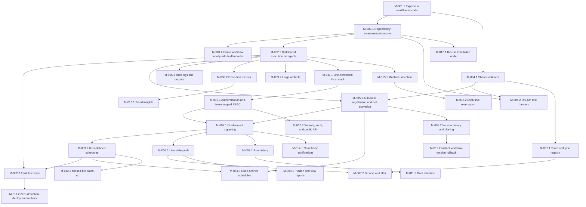

# Azure Task List: Workflow Scheduler (Kardia)

## Overview
- **Goal**: Build the code-first workflow scheduler: C# single-file workflows, a durable leader-elected engine with Windows/Linux agents, triggers and schedules, live UI, reports, team-scoped RBAC, local/cloud parity and machine reservation.
- **PRD**: [2026-10-13_workflow-scheduler_prd.md](../prds/2026-10-13_workflow-scheduler_prd.md) · **Technical design**: [2026-10-13_workflow-scheduler_technical-design.md](2026-10-13_workflow-scheduler_technical-design.md) · **Discovery**: [2026-10-12_workflow-scheduler_discovery.md](2026-10-12_workflow-scheduler_discovery.md)
- **Scope**: REQ-001 to REQ-015 (32 milestones, 88 user stories, 247 work items: 3 Debug, 244 Task).
- **Excluded for now** (user decision: no Bond-based service code): REQ-016 to REQ-024 and every sample/dummy Bond service, hook, codec, transport, request-source, load, perf and parity item. See [Deferred scope](#deferred-scope).
- **First build target**: this single machine (not bare metal): pure local (`aspire run`, `localhost`, no domain) and Docker Compose `dev`/`ppe` (`https://dev.kardia.sonapraneeth.in`, `https://ppe.kardia.sonapraneeth.in`). Self-hosted and Azure PaaS tasks stay in the plan; their code must stay portable.
- **Total Est. Manual**: 698:45 | **Total Est. AI**: 61:45

**Estimation rules**: Task estimates are `hh:mm`. Est. Manual is a developer's hands-on time (1–4 h per item); Est. AI is AI-agent execution plus prompting/review (10–45 min per item). Story = Σ items; Feature = Σ stories; Milestone = Σ features + exit verification (01:00 manual / 00:15 AI); Requirement = Σ milestones. Numbers `R.M.F.S.I` are Requirement.Milestone.Feature.Story.Item within this list; PRD IDs are unchanged.

## Implementation progress

Each completed item is committed separately with its task ID in the commit body.
Items not listed here remain pending. Milestone sign-off and remote CI results
are not implied by local task completion.

| Task | Status | Evidence |
|------|--------|----------|
| 1.1.1.1.1 | Complete | Backend solution builds without warnings; 11 SDK unit tests and 1 definition/delegate integration test pass; scenario A DAG sample compiles and prints four nodes. Full runtime/sample features follow in their own tasks. |
| 1.1.1.1.2 | Complete | 9 DAG cases pass, including 10,000-node depth, cycles naming all members, unknown dependencies and duplicate keys; integration test confirms invalid definitions cannot execute. |
| 1.1.1.1.3 | Complete | 9 execution-mode cases pass; constructor and builder reject invalid parallelism, preserve task order and reset to series; JSON integration preserves and validates execution contracts. |
| 1.1.1.2.1 | Complete | 8 stage authoring cases pass; reserved nodes, multiple named stage tasks, sync/async handlers and cancellation-context integration covered. Runtime ordering remains task 1.1.1.2.2, after its engine prerequisite. |
| 1.1.2.1.1 | Complete | All nine variable types, defaults, required flags, allowed values, immutability and name-only secret references covered by unit tests; schema JSON round-trip integration passes. |
| 1.1.2.1.2 | Complete | 26 binder cases pass; invalid/unknown/missing-required values rejected by name without value leakage; immutable typed values reach every stage/task through `ctx.Var`. Trigger/local-run call sites follow in their own tasks. |
| 1.1.2.2.1 | Complete | Exactly one explicit type required; immutable ordinal metadata survives manifest JSON and an actual LocalEngine run, including snapshot/event replay. Runtime verification completed with 1.2.2.1.2. |
| 1.1.3.1.1 | Complete | Defaults and all Hard/Soft × dependency-condition combinations pass JSON-contract tests; conflicting duplicate dependencies rejected. Source-generated manifest tests verify both policies and conditions. |
| 1.1.3.2.1 | Complete | Typed outputs, concurrent writes, immutable snapshots and shared task context tested; exactly 65,536 serialized UTF-8 bytes accepted, 65,537 rejected with node/size/artifact hint and no lost output. |
| 1.1.3.2.2 | Complete | 9 output-read cases pass, including all dependency conditions, unknown/unrelated/transitive sources and duplicate bindings; producer-to-consumer typed output integration passes. |
| 2.1.1.1.1 | Complete | Exhaustive run/node/task transition matrices pass; every allowed edge exercised, terminal states absorbing, invalid transitions logged/rejected. Implemented early to unblock stage ordering. |
| 1.1.1.2.2 | Complete | 15 stage-order cases plus SDK/core integration pass; canonical order independent of declaration, cleanup after hard failure/abort/timeout, active-work drain and `always` preservation; stage changes use ordinary node states. |
| 2.1.1.2.1 | Complete | Every dependency condition × execution state tested; diamond/fan-out readiness, all-dependencies-terminal skip safety and stage eligibility covered. `SoftFailed` satisfies `OnSuccess`; `OnFailure` matches `Failed`/`TimedOut`. |
| 1.1.3.1.2 | Complete | 17 failure-policy cases pass, including node/task policy × condition combinations, timeout policy, cancellation of unstarted siblings and draining active siblings; SDK function soft-failure integration continues the next task. |
| 2.1.1.1.2 | Complete | Live/rebuilt/snapshot-tail states match; proposals do not mutate before commit; sequence gaps/duplicates/late events rejected. Monthly-partitioned PG migration and persisted snapshot/event replay pass against Testcontainers and external-server modes. |
| 2.1.2.1.1 | Complete | Innermost-wins timeout/retry/platform-retry resolution tested across workflow/node/task/stages; defaults 0 retries, 1 h attempt, 24 h run, 15 min post stages. Source-generated manifest preserves resolved policies. |
| 1.2.2.2.1 | Complete | Golden JSON snapshot, all contract fields, no eager task execution, stable metadata ordering and manifest-to-core-run integration pass. CLI `--describe` mode dispatch remains task 1.2.2.1.1. |
| 1.2.1.1.1 | Complete | Kestrel tests cover headers/body, expected/unexpected status, plain 202, cancellation, bounded response buffering, source validation and SDK stable-key integration; HTTP response output uses source-generated JSON. |
| 1.2.1.1.2 | Complete | Real command tests cover exit code 3, retryable codes, raw/structured arguments, cwd/env snapshots, pre-start cancellation and process-tree cleanup; same cmd/sh suite wired to Windows/Linux CI. |
| 1.2.1.1.3 | Complete | Stable registry dispatch carries task identity, variables, inputs/outputs, logging, cancellation and publisher ports; absent publishers fail explicitly. SDK/contracts Release build has zero trim/AOT warnings; stage-to-node integration passes. |
| 2.1.2.1.2 | Complete | 19 retry cases plus real command/core integration pass; FsCheck covers jitter bounds, fixed/exponential overflow guards, author/platform budgets, forbidden categories, `NonRetryableException`, cancellation and earliest deadlines. |
| 2.1.2.1.3 | Complete | Virtual-clock timeout suite completes in under 1 s; cancellation/kill grace and retry times survive snapshot restoration, proposals wait for committed apply, stale actions rejected. PG migration persists run/node/attempt deadlines and retry/cancel/kill timestamps. |
| 2.1.2.1.4 | Complete | Task-named errors cover retry/delay limits and node/run timeout bounds, including stages and inherited manifest policies; worst-case warnings include capped maximum jitter and enabled platform retries. Boundary, overflow and manifest integration cases pass. |
| 2.1.2.2.2 | Complete | Queued/running/backoff/post/always abort cases pass; first accepted identity/reason/source survives duplicate requests and replay. Active attempts drain, later cleanup receives `ctx.Abort`, and `EndedAt` records actual stop. Real function cancellation/registry integration passes. |
| 2.1.1.1.3 | Complete | FsCheck-generated DAGs and explicit 200-node boundaries exercise all dependency/failure policies, series/parallel tasks, timeouts and queued/running/backoff/post/duplicate aborts. Every entity has exactly one terminal event, no tasks are lost, and full/snapshot-tail replay matches. Windows passes; Linux execution remains CI verification. |
| 1.2.2.1.2 | Complete | Local channel actor executes the shared core with committed in-memory events, live console states, all variable types, series/parallel/caps, retries/deadlines and abort cleanup. Scenario A runs with `--var env=dev`; real HTTP/command integration and failing exit-code cases pass. SDK line coverage 94.0%, definition/runtime 98.4%. Uncooperative in-process functions fail explicitly after grace; force-kill isolation follows in task-host work. |
| 1.2.2.1.3 | Complete | Scenario A local execution matches all 62 ordered shared-core fixture events and checked-in golden JSON across five repetitions. Parallel branches remain active together; explicit completion barriers remove scheduling noise without sorting, dropping or coalescing events. |
| 1.2.2.2.2 | Complete | Release BenchmarkDotNet measures precompiled 200-node manifest serialization: mean 0.483 ms, p95 0.524 ms on local Windows. Full JSON exported; missing results or p95 >= 1 s fail the command. Unit test verifies all 200 nodes, tasks and dependencies survive without delegate execution. |
| 2.1.1.2.2 | Complete | Actual 200-node no-op chain: mean 58.79 ms, run p95 69.982 ms; 1,000 individual Ready-to-terminal node samples p95 1.236 ms. Bounds <= 3 s / <= 10 ms enforced. Windows/Linux CI runs pinned baseline and head on the same runner and fails either > 10% regression; gate tests, command exit-code checks and workflow lint pass. Remote CI remains unrun until push. |
| 4.2.1.1.1 | Complete | Compiled sample accepts `--dry-run <mocks.json>` and emits JSON only. All five mock outcomes, explicit defaults, variables, retry budgets, Hard/Soft dependencies, outputs and cleanup use the real local/core actor without original delegates. Three hours of timeout/backoff complete in under 1 s; parallel mixed-outcome JSON replays through core. Implemented early to unblock mode dispatch. |
| 2.2.1.1.1 | Complete | Versioned `AgentGateway.Connect` generates shared client/server/message types. Fourteen unit cases cover every payload, oneof, unknown fields, malformed frames and streaming descriptors; real HTTP/2 integration exchanges all variants before request completion. Release build has zero warnings; Buf lint/format and v1 breaking check pass, intentional removal fails. CI gates v1 and PR-base compatibility. |
| 2.2.1.1.2 | Complete | Native AOT Windows/Linux publishes succeed with zero warnings. Both actual native binaries connect to a local HTTP/2 gateway and send real machine Hello/heartbeats; cross-OS unit tests cover options and native/proc telemetry. Connection integration covers cancellation, leader redirect/allowlist, reconnect, duplicate commands, bad epochs/acks, fatal authorization and handler/telemetry failures. Windows Service/systemd lifetimes wired; installation/registry follow in 2.2.1.1.3. |
| 2.2.1.1.3 | Complete | PostgreSQL registry and real gateway register Healthy within 5 s, acknowledge after persistence, fence superseded sessions and exclude expired agents at exactly 15 virtual seconds. Rebuild, duplicate name, invalid metrics and preserved drain tests pass. Both native binaries load installer-layout UUID/configuration and register against the real gateway/database; 25 agent integration cases pass on Windows and Linux. Installer validation passes locally; actual service install/start/remove is wired to disposable Windows/Linux CI, not claimed as a local system installation or remote CI result. |
| 2.2.3.1.1 | Complete | SDK/manifest cover OS, labels, pool, machine names and all four affinity modes at workflow/node/task/stages. Fourteen SDK cases and four local/manifest integration cases cover innermost replacement, independent affinity inheritance, symbolic variables, run-start resolution, immutable templates, bad types/secrets/missing/empty values and affinity deadlocks. Fully overridden outer variables are not evaluated; existing golden manifests and core/local/dry-run parity stay green. Implemented before dispatcher to supply real placement contracts. |
| 2.2.3.1.2 | Complete | Twenty-eight core cases cover every hard filter, reservation owner/node/epoch, exact RAM boundary, warm-run/package preference, fractional load, order-independent round-robin, all affinity modes, moved/recovered pins, NoAutoRetry, stale/foreign decisions and cleanup. Proposals do not mutate before committed apply. PostgreSQL registry integration verifies actual RAM, heartbeat expiry and drain eligibility. Dispatcher must account for committed pending dispatches in its capacity snapshot; timeout/API overrides remain 2.2.3.1.3. |
| 2.2.2.1.2 | Complete | Real workflow IL executes over owner-only UDS on Windows and Linux; warm dispatch proves unchanged process-start count and expected PID. Separate attempts isolate parallel siblings; typed variables/inputs/prior outputs, failure categories, throwing cancellation callbacks, deadlines, forced process-tree cleanup, failed starts and pool disposal covered. AD-012 explicitly changes to warm per-attempt hosts. Native AOT agent publishes on both OSes; package/coordinator wiring, resource limits, durable journal/re-adoption and full LRU/RSS/idle caps remain separate tasks. |
| 3.2.1.1.2 | Complete | Parallel-agent handoff integrated: 43 unit and 7 integration cases cover cron/elapsed intervals, exclusive UTC cursors, immutable preview and JSON-restored parity. Exact expected fires cover New York, London and Sydney spring gaps/fall folds, plus precision/range boundaries. Cronos 0.13.0 supplies explicit DST semantics; timezone IDs require IANA. Database/API/leader scheduling remain their dependent tasks. |
| 4.1.1.1.1 | Complete | Parallel-agent R-5 spike integrated: 26 cache unit/integration cases and existing validator regressions pass; parent separately verifies 14 key cases. Real 20-node workflow plus schedule JSON: raw cold 38.229 s, incremental warm 8.569 s, cache miss 35.523 s, integrity-checked hit 1.050 s (< 10 s). README holds timing evidence pending an explicitly requested PR. Concurrency, manifest/DLL/inventory corruption, compiler/describe failure, source changes and cancellation/process-tree cleanup covered. Full Validator API follows; external dependency closure must be declared. |
| 4.1.1.1.2 | Complete | Parallel-agent handoff integrated: shared sync/async Validator and Wf.Sdk.Testing facade expose immutable file/path/message/hint errors and WFV001-WFV004 catalogue. All 22 Validator cases and 128 validation regressions pass, including real compiled SDK workflow, compiler/definition failures, deterministic diagnostics, corruption and cancellation cleanup. Actual cold 31.119 s, cached 1.027 s. Infrastructure and malformed-contract errors propagate; later manifest/team/schedule/version rules remain separate. |
| 2.2.2.1.1 | Complete | PostgreSQL transaction commits Ready-validated Dispatched event, attempt reservation and replayable outbox before gateway delivery. Five database/real-agent tests cover uncommitted rejection, slot reservation/restart, rollback, result session fencing/idempotence and dependent task Ready/Dispatched/Running/Succeeded on expected warm PIDs; second run uses the same single HTTP download, without compilation or process start on warm binding. Cache integrity/ZIP safety, asynchronous cancellation, duplicate attempts and result reconnect replay covered. Native AOT publishes and 32 agent/protocol integration cases pass on both Windows and Linux. Agent result outbox is memory-only until the journal task; full actor/HA/resource controls remain separate. |
| 1.2.2.1.1 | Complete | Workflow.RunAsync routes all five modes through existing engines/hosts; 41 mode cases pass on Windows/Linux and all 222 SDK regressions pass. Real HTTP stub verifies POST /api/v1/runs, typed overrides, exact version, idempotency key and printed run UUID; redirects, bad statuses, invalid/oversized replies, cancellation and conflicting options fail explicitly. Twenty-seven actual host/package cases pass through the generic entrypoint. File-based sample describe/local/dry-run all succeed, with exact 62-event dry-run output. Full-mode workflows explicitly disable default file-app AOT; standalone SDK primitives remain AOT-compatible. Hosted trigger API/auth remain separate tasks. |
| 4.1.1.1.3 | Complete | Parallel-agent manifest rules integrated with raw preflight before build-cache typed deserialization and all Validator/testing-facade entrypoints. WFV005-WFV009 provide deterministic indexed errors for cycles, unknown dependencies, duplicate keys, variable constraints and required-flag shape. Fifty-eight targeted cases pass: 47 rule units, three cancellation/infrastructure cases, three real compiled-SDK integrations, catalogue and four cache regressions. Constructor invariants remain intact; required definitions without defaults stay valid, while runtime binder enforces supplied values. Team/schedule/version rules remain separate. |
| 4.1.2.1.1 | Complete | Parallel-agent API-baseline handoff integrated: immutable SemVer/variables/nodes contract, ordinal canonical JSON and source-generated strict parse/stream I/O. Ninety unit cases and one real SDK reflection-disabled manifest round-trip pass, including variable contracts, schema/version rejection, sanitized errors, secret-reference-only data and cancellation/infrastructure propagation. Classifier, version-bump enforcement, schedule compatibility and atomic file replacement remain outside this baseline task. |
| 4.1.2.1.2 | Complete | Parallel-agent classifier handoff integrated with shared catalogue WFV010. Seventy-nine classifier cases, catalogue test and reflection-disabled SDK integration spanning 39 changed manifests pass. Removed/renamed/type-changed APIs, incompatible variable constraints/defaults and new required-without-default values require MAJOR; compatible additions/loosening MINOR; implementation-only PATCH. Errors name the required bump in hints; immutable change ordering, unbounded numeric SemVer precedence, prereleases and ignored build metadata covered. Registration and schedule compatibility remain separate. |
| 2.2.2.1.3 | Complete | R-2 event-only synchronous appender spike and six BDN configurations per OS complete; 1,024-event probes verify real PG snapshot-tail recovery. Nine batching/durability/rollback/cancellation tests, five existing dispatch regressions and 13 benchmark-gate cases pass; Windows/Linux PG durability explicitly enabled. TD section 13 records all timings and decision: immediate coalescing by default, optional requested <= 2 ms windows, bounded groups, no early critical ACKs. Local 32-actor requested-2-ms ack p95 42.298 ms Windows / 27.715 ms Linux; persistence target 4 ms remains unmet. Azure HA, NFR-030 sign-off and production actor/outbox integration are not claimed. |
| 3.3.1.1.1 | Complete | Published JSON Schema is generated from strict source-generated ScheduleFile contracts; snapshot parity, checked-in sample, required IDs/timezones, unknown/duplicate fields, enum strings, nullability and default policies covered by 16 cases. Categorised defaults, per-instance overrides, exactly-one expression, version pin and overlap/catch-up represented; expression and variable semantics follow in task 3.3.1.1.2. |
| 3.3.1.1.2 | Complete | Strict parser resolves workflow defaults, categorised file defaults and instance overrides into immutable JSON values/shared expressions. Fifty unit/integration cases cover all nine variable types, missing required values, unknown/invalid/hidden defaults, duplicate categories/IDs/properties, timezone/expression errors, deterministic sanitized file/path/hint diagnostics and cancellation. Actual compiled SDK workflow plus shared Validator/testing-facade integration passes; 67 related schema/catalogue/validator cases green. Registration remains separate. |
| 4.1.2.1.3 | Complete | ScheduleCompatibilityRule reuses shared schedule validation against target API variables only. Eleven cases cover referenced variable removal after valid MAJOR, unreferenced removal, node removal/rename, type and allowed-value changes, new required values/defaults, override paths, exact offline diagnostics and cancellation. Ninety-one compatibility/classifier regressions pass. Pin resolution explicitly belongs to the caller selecting the target API; node APIs never participate in this rule. |
| 3.2.1.1.1 | Complete | Expand-only schedules migration passes 20 PostgreSQL empty/previous-schema cases: code/UI rows, cron/interval exclusivity, timezone/policy/JSON constraints, stable per-workflow code IDs including soft deletion, optimistic edit race and partial next-fire index. Existing run/event data and agent/attempt/outbox tables survive upgrade. Whole-second interval_s follows TD storage; registry/config-version foreign keys, endpoints and leader scheduling remain dependent tasks. |
| 4.1.1.1.4 | Complete | Parallel-agent registry handoff integrated: strict AOT-safe contracts and WFV015-WFV020 cover normalized/near-duplicate types, trusted quota, metadata schemas, unknown workflow types and invalid metadata. Forty-five rule tests plus real compiled workflow/shared Validator/testing-facade discovery and exact-error integration pass; optional nearest team.json lookup is bounded to two parents. Schedule rules already wired; combined registry/schedule errors accumulate. Presentation/role maps and authoritative registration remain separate. |
| 4.2.1.1.2 | Complete | Parallel-agent mock-harness handoff integrated and test project added to solution/CI inventory. Twenty-nine cases pass, including 19 real compiled out-of-process file-app cases covering every mock outcome, outputs/variables, hash-cache hits/input invalidation, custom assembly names/paths, independent retry counters, virtual timeout, invalid responses and process-tree cancellation cleanup. Immutable MockSpec reuses SDK dry-run contracts; WorkflowUnderTest reuses ScriptBuildCache. Trusted execution, declared dependency closure and caller cancellation limits remain explicit. |
| 3.3.2.1.1 | Complete | Expand-only schedule_config_versions migration passes 12 PostgreSQL cases on empty/previous schemas: source/Git/hash attribution, per-workflow content uniqueness, exact SHA-256 length, composite workflow/config ownership, UI-link rejection and referenced provenance protection. Existing code/UI schedule rows survive with nullable config_version_id; 40/64-hex Git object IDs supported. Atomic diff application and workflow-registry foreign keys remain their own dependent tasks. |
| 4.2.1.1.3 | Complete | Parallel-agent assertion handoff integrated: 284 self-tests pass, including 240 policy/dependency combinations and six real published-file-app cases. Framework-independent fluent log assertions check statuses, skipped work, completion-before-start order, persisted attempts/retries, stages and structural/type-sensitive outputs; missing keys/values and mismatches throw RunAssertionException. Every mock outcome covered; template generation remains the next dependent task. |
| 2.3.1.1.1 | Complete | Database-time 3 s renewal/10 s lease and captured-epoch fencing wired across all nine hosted persistence/delivery surfaces. Sixteen PG cases cover concurrent acquisition, renewal/takeover, paused former leaders, same-holder epoch reuse rejection, bounded-transaction rollback, deterministic conflict/hint expiry race and two real gRPC gateways with epoch-2 ACKs/leader readiness. Twelve new options cases and 42 affected integration cases pass; one optional native-installer test skipped in this run. Standalone spike fixtures remain explicitly unfenced; hosted DI always supplies authority. Recovery/outage buffering remain subsequent tasks. |
| 4.1.1.1.5 | Complete | Parallel-agent full-validator benchmark integrated: actual 200-node workflow, 50 cron/interval instances and team registry; warm operation includes dependency hashing, cache integrity and all shared semantic rules. Windows ten-iteration mean 906.736 ms (< 2 s), 5.78 MB allocated; cold publish/describe excluded explicitly. Twenty-four fixture/mean-boundary/existing-gate cases pass. Windows/Linux CI gate and artifact upload added; pinned engine baseline isolates its older-compatible harness. Local Linux/remote CI results not claimed. |
| 2.3.1.1.2 | Complete | Eleven recovery cases pass against PostgreSQL: snapshot plus committed tail matches pre-crash state; active-only recovery restores absolute run/node/attempt/retry and cancel/kill phases, including overdue timers without resetting grace. Durable trigger/abort inbox applies effects and processing markers atomically, retains first abort identity, handles equal-time trigger-before-abort and retries failed commits without duplicate events. Hosted acquisition/new-command/reacquisition and stale-epoch rejection covered; 25 persistence/dispatch and 27 recovery/lease affected cases pass. Readiness requires recovered current epoch. Recovery exposes bootstrap state/due proposals; full actor effects and outage commit buffering remain subsequent work. |

## Summary Rollup

| Requirement | Milestone | Est. Manual | Est. AI | Savings (%) |
|-------------|-----------|-------------|---------|-------------|
| REQ-001 (Must) | M-001.1 Express a workflow in code | 26:45 | 03:30 | ~87% |
| REQ-001 (Must) | M-001.2 Run a workflow locally with built-in tasks | 20:30 | 02:05 | ~90% |
| REQ-002 (Must) | M-002.1 Dependency-aware execution core | 33:00 | 03:10 | ~90% |
| REQ-002 (Must) | M-002.2 Distributed execution on agents | 43:00 | 03:30 | ~92% |
| REQ-002 (Must) | M-002.3 Fault tolerance | 58:00 | 05:05 | ~91% |
| REQ-003 (Must) | M-003.1 On-demand triggering | 12:30 | 01:15 | ~90% |
| REQ-003 (Must) | M-003.2 User-defined schedules | 29:00 | 02:15 | ~92% |
| REQ-003 (Must) | M-003.3 Code-defined schedules | 17:00 | 01:55 | ~89% |
| REQ-004 (Must) | M-004.1 Shared validator | 22:30 | 02:10 | ~90% |
| REQ-004 (Must) | M-004.2 Dry-run test harness | 15:00 | 01:25 | ~91% |
| REQ-005 (Must) | M-005.1 Automatic registration and hot activation | 24:30 | 02:00 | ~92% |
| REQ-005 (Must) | M-005.2 Version history and cloning | 15:00 | 01:25 | ~91% |
| REQ-006 (Must) | M-006.1 Live state push | 31:00 | 02:25 | ~92% |
| REQ-006 (Must) | M-006.2 Task logs and outputs | 17:30 | 01:20 | ~92% |
| REQ-007 (Must) | M-007.1 Team and type registry | 19:30 | 01:50 | ~91% |
| REQ-007 (Must) | M-007.2 Browse and filter | 19:30 | 01:35 | ~92% |
| REQ-008 (Must) | M-008.1 Run history | 16:30 | 01:25 | ~91% |
| REQ-008 (Must) | M-008.2 Execution metrics | 24:30 | 02:05 | ~91% |
| REQ-009 (Must) | M-009.1 Publish and view reports | 39:30 | 03:20 | ~92% |
| REQ-009 (Must) | M-009.2 Large artifacts | 10:30 | 00:55 | ~91% |
| REQ-010 (Must) | M-010.1 Authentication and team-scoped RBAC | 16:30 | 01:30 | ~91% |
| REQ-010 (Must) | M-010.2 Secrets, audit, and public API | 19:30 | 01:50 | ~91% |
| REQ-011 (Must) | M-011.1 One-command local stack | 21:30 | 01:50 | ~91% |
| REQ-011 (Must) | M-011.2 Zero-downtime deploy and rollback | 38:00 | 02:45 | ~93% |
| REQ-011 (Must) | M-011.3 Data retention | 10:00 | 00:50 | ~92% |
| REQ-012 (Should) | M-012.1 Re-run from failed node | 11:30 | 01:00 | ~91% |
| REQ-012 (Should) | M-012.2 Instant workflow-version rollback | 06:00 | 00:40 | ~89% |
| REQ-012 (Should) | M-012.3 Missed-fire catch-up | 06:30 | 00:45 | ~88% |
| REQ-013 (Should) | M-013.1 Trend insights | 19:30 | 01:30 | ~92% |
| REQ-014 (Should) | M-014.1 Completion notifications | 13:00 | 01:00 | ~92% |
| REQ-015 (Must) | M-015.1 Machine selection | 23:30 | 02:00 | ~91% |
| REQ-015 (Must) | M-015.2 Exclusive reservation | 18:00 | 01:25 | ~92% |
| **Total** | | **698:45** | **61:45** | **~91%** |

### By requirement

| Requirement | Priority | Milestones | Stories | Est. Manual | Est. AI |
|-------------|----------|------------|---------|-------------|---------|
| REQ-001 Workflows as single-file C# scripts | Must Have | 2 | 9 | 47:15 | 05:35 |
| REQ-002 Durable, fast, fault-tolerant execution engine | Must Have | 3 | 16 | 134:00 | 11:45 |
| REQ-003 On-demand and recurring triggers | Must Have | 3 | 8 | 58:30 | 05:25 |
| REQ-004 Pre-check-in validation and testability | Must Have | 2 | 5 | 37:30 | 03:35 |
| REQ-005 Versioning, registration, instant activation, cloning | Must Have | 2 | 5 | 39:30 | 03:25 |
| REQ-006 Live status and logs | Must Have | 2 | 5 | 48:30 | 03:45 |
| REQ-007 Team-isolated catalogue organised by type and metadata | Must Have | 2 | 5 | 39:00 | 03:25 |
| REQ-008 Run history and execution metrics | Must Have | 2 | 5 | 41:00 | 03:30 |
| REQ-009 Multiple reports per run and large artifacts | Must Have | 2 | 7 | 50:00 | 04:15 |
| REQ-010 SSO, team-scoped RBAC, secrets, audit, public API | Must Have | 2 | 5 | 36:00 | 03:20 |
| REQ-011 Zero-downtime operations, local/cloud parity, retention | Must Have | 3 | 7 | 69:30 | 05:25 |
| REQ-012 Recovery | Should Have | 3 | 3 | 24:00 | 02:25 |
| REQ-013 Trends and metric dashboards | Should Have | 1 | 2 | 19:30 | 01:30 |
| REQ-014 Run completion notifications | Should Have | 1 | 1 | 13:00 | 01:00 |
| REQ-015 Machine registry, capacity, selection, exclusive reservation | Must Have — phase 2 | 2 | 5 | 41:30 | 03:25 |
| **Total** | | **32** | **88** | **698:45** | **61:45** |

## Requirement 1 (REQ-001): Workflows as single-file C# scripts — Must Have
- **Outcome**: An author writes one `.cs` file importing the SDK that declares type, metadata, typed variables, lifecycle stages, and a node DAG with series/parallel tasks and failure policies, and runs it locally with identical behaviour to the hosted engine.
- **Est. Manual**: 47:15 | **Est. AI**: 05:35

### Milestone 1.1 (M-001.1): Express a workflow in code
- **Problem solved**: Authors have no API to declare a dependency-aware, parameterised workflow.
- **Depends on**: none
- **Est. Manual**: 26:45 | **Est. AI**: 03:30 (includes exit verification)

#### Feature 1.1.1 (FEAT-001.1.1): Workflow definition API
- **Est. Manual**: 11:00 | **Est. AI**: 01:15

##### User Story 1.1.1.1 (US-001): Declare nodes, dependencies, and tasks (series or parallel) in C#
- **Est. Manual**: 06:30 | **Est. AI**: 00:45

| # | Type | Item | Est. Manual | Est. AI | Verification | Notes |
|---|------|------|-------------|---------|--------------|-------|
| 1.1.1.1.1 | Task | Implement `Workflow.Define` fluent builder with `Node`, `DependsOn`, `Task`, `Series`/`Parallel(maxParallel)` producing an immutable definition - `backend/src/Wf.Sdk/Definition/WorkflowBuilder.cs`, `NodeBuilder.cs` | 03:00 | 00:20 | `dotnet build backend/Wf.slnx` clean; scenario A definition from TD 6.1 compiles under `backend/samples/workflows` | FR-001, FR-002; first SDK task, unblocks every REQ-001 story |
| 1.1.1.1.2 | Task | Implement `DagValidator` cycle, unknown-dependency and duplicate node/task key detection - `backend/src/Wf.Sdk/Definition/DagValidator.cs`, tests `backend/tests/Wf.Sdk.Tests/DagValidatorTests.cs` | 02:00 | 00:15 | `dotnet test backend/tests/Wf.Sdk.Tests --filter DagValidator` green; cycle error names all cycle nodes; duplicate error names the key | after US-001 task 1 |
| 1.1.1.1.3 | Task | Model node execution mode (`Series`, `Parallel` with optional `maxParallel`) in `backend/src/Wf.Contracts/Definition/NodeDefinition.cs` with tests `backend/tests/Wf.Sdk.Tests/NodeExecutionModeTests.cs` | 01:30 | 00:10 | `dotnet test backend/tests/Wf.Sdk.Tests --filter NodeExecutionMode` green; `maxParallel` < 1 rejected; declared task order preserved | runtime ordering enforced by engine core in US-011 |

##### User Story 1.1.1.2 (US-002): Lifecycle stages (system init → pre-setup → tasks → post-process → system post-process)
- **Est. Manual**: 04:30 | **Est. AI**: 00:30

| # | Type | Item | Est. Manual | Est. AI | Verification | Notes |
|---|------|------|-------------|---------|--------------|-------|
| 1.1.1.2.1 | Task | Add stage builders `SystemInit`, `PreSetup`, `PostProcess`, `SystemPostProcess` mapped to reserved nodes `$init`, `$pre`, `$post`, `$sys-post` - `backend/src/Wf.Sdk/Definition/StageBuilder.cs` | 02:00 | 00:15 | `dotnet test backend/tests/Wf.Sdk.Tests --filter Stages` green; user node keys starting with `$` are rejected | after US-001 task 1 |
| 1.1.1.2.2 | Task | Implement stage ordering and always-run post stages on failure or abort in `backend/src/Wf.Engine.Core/Stages/StagePlanner.cs`, tests `backend/tests/Wf.Engine.Core.Tests/StageOrderTests.cs` | 02:30 | 00:15 | tests green: order init, pre, nodes, post, sys-post; post stages run after hard failure and abort; stage states emitted as node events | FR-033; after US-010 task 1 |

#### Feature 1.1.2 (FEAT-001.1.2): Variables, metadata, and type
- **Est. Manual**: 06:00 | **Est. AI**: 00:50

##### User Story 1.1.2.1 (US-003): Typed variables with defaults and required flags
- **Est. Manual**: 04:30 | **Est. AI**: 00:30

| # | Type | Item | Est. Manual | Est. AI | Verification | Notes |
|---|------|------|-------------|---------|--------------|-------|
| 1.1.2.1.1 | Task | Implement `Variables(...)` builder (string, int, long, double, bool, enum, string list, duration, secret; defaults, required) - `Wf.Sdk/Definition/VariablesBuilder.cs`, `Wf.Contracts/Definition/VariableSchema.cs` | 02:30 | 00:15 | `dotnet test backend/tests/Wf.Sdk.Tests --filter Variables` green for every type, default and allowed-values case | secret refs hold names only, never values |
| 1.1.2.1.2 | Task | Implement `VariableBinder` validating trigger values pre-run and exposing `ctx.Var(...)` everywhere - `backend/src/Wf.Validation/VariableBinder.cs`, tests `backend/tests/Wf.Validation.Tests/VariableBinderTests.cs` | 02:00 | 00:15 | tests green; missing required or wrong type rejected with the variable name; no run created on reject | used by trigger API (REQ-003) and local runner US-008 |

##### User Story 1.1.2.2 (US-004): Declare the workflow's type and metadata
- **Est. Manual**: 01:30 | **Est. AI**: 00:20

| # | Type | Item | Est. Manual | Est. AI | Verification | Notes |
|---|------|------|-------------|---------|--------------|-------|
| 1.1.2.2.1 | Task | Enforce exactly one workflow type and add `Metadata(key, value)` copied to manifest and every run - `backend/src/Wf.Sdk/Definition/WorkflowBuilder.cs`, `Wf.Contracts/Definition/WorkflowMetadata.cs` | 01:30 | 00:20 | `dotnet test backend/tests/Wf.Sdk.Tests --filter Metadata` green; missing type fails; metadata present on a run created by the local engine | after US-001 task 1 |

#### Feature 1.1.3 (FEAT-001.1.3): Failure policies and node outputs
- **Est. Manual**: 08:45 | **Est. AI**: 01:10

##### User Story 1.1.3.1 (US-005): Mark a task or node failure as hard or soft
- **Est. Manual**: 05:00 | **Est. AI**: 00:40

| # | Type | Item | Est. Manual | Est. AI | Verification | Notes |
|---|------|------|-------------|---------|--------------|-------|
| 1.1.3.1.1 | Task | Add `Failure.Hard`/`Failure.Soft` on task and node and `DependsOn(..., when: OnSuccess, OnFailure, Always)` - `backend/src/Wf.Sdk/Definition/FailurePolicy.cs`, `DependencyCondition.cs` | 02:00 | 00:15 | `dotnet test backend/tests/Wf.Sdk.Tests --filter FailurePolicy` green; Hard and OnSuccess are defaults; manifest carries both | FR-013; after US-001 task 1 |
| 1.1.3.1.2 | Task | Implement hard/soft failure propagation (hard: Failed, dependents Skipped, unstarted siblings Cancelled; soft: SoftFailed, run succeeds with warnings) - `backend/src/Wf.Engine.Core/Transitions/FailurePropagation.cs` | 03:00 | 00:25 | `backend/tests/Wf.Engine.Core.Tests/FailurePolicyTests.cs` green for every policy x condition combination | FR-013; after US-010 task 1, US-011 task 1 |

##### User Story 1.1.3.2 (US-006): A node's outputs to be inputs of dependent nodes
- **Est. Manual**: 03:45 | **Est. AI**: 00:30

| # | Type | Item | Est. Manual | Est. AI | Verification | Notes |
|---|------|------|-------------|---------|--------------|-------|
| 1.1.3.2.1 | Task | Implement typed node outputs `ctx.Outputs[...]` with 64 KB per-node limit and artifact hint on overflow - `backend/src/Wf.Sdk/Runtime/NodeOutputs.cs`, tests `backend/tests/Wf.Sdk.Tests/NodeOutputsTests.cs` | 02:00 | 00:15 | `dotnet test backend/tests/Wf.Sdk.Tests --filter NodeOutputs` green; 64 KB + 1 byte fails naming node and size | FR-020 |
| 1.1.3.2.2 | Task | Add declared input bindings `Input(node, key)` and a `DagValidator` rule rejecting reads from non-dependency nodes - `backend/src/Wf.Sdk/Definition/DagValidator.cs` | 01:45 | 00:15 | `dotnet test backend/tests/Wf.Sdk.Tests --filter OutputReads` green; error names reader and source node | after US-001 task 2 |

**Milestone Exit Criteria** (from the PRD):
- [ ] **Unit tests**: FEAT-001.1.1–001.1.3 tests green (US-001–US-006 criteria, including cycles, duplicate keys, all policy combinations); ≥ 90% line coverage on the definition API.
- [ ] **Unit tests (cross-OS)**: same suite green on Windows and Linux CI runners.
- [ ] **Manual / UAT**: Author writes scenario A (discovery §6) as a script with no SDK workaround; sign-off from tech lead.

### Milestone 1.2 (M-001.2): Run a workflow locally with built-in tasks
- **Problem solved**: Authors cannot execute their workflow without a hosted environment.
- **Depends on**: M-002.1
- **Est. Manual**: 20:30 | **Est. AI**: 02:05 (includes exit verification)

#### Feature 1.2.1 (FEAT-001.2.1): Built-in task types
- **Est. Manual**: 08:30 | **Est. AI**: 00:45

##### User Story 1.2.1.1 (US-007): Built-in HTTP-call, command/script, and SDK-function tasks
- **Est. Manual**: 08:30 | **Est. AI**: 00:45

| # | Type | Item | Est. Manual | Est. AI | Verification | Notes |
|---|------|------|-------------|---------|--------------|-------|
| 1.2.1.1.1 | Task | Implement `Tasks.Http(method, url)` with headers, body, expected status, response as output - `backend/src/Wf.Sdk/Tasks/HttpTask.cs`, tests vs in-process Kestrel `backend/tests/Wf.Sdk.Tests/Tasks/HttpTaskTests.cs` | 03:00 | 00:15 | `dotnet test backend/tests/Wf.Sdk.Tests --filter HttpTask` green; unexpected status fails; 202 treated as plain response | synchronous only; remote-operation mode is US-112; FR-003 |
| 1.2.1.1.2 | Task | Implement `Tasks.Command(exe, args)` with working dir, env, retryable exit codes; non-zero exit fails - `backend/src/Wf.Sdk/Tasks/CommandTask.cs`, tests `backend/tests/Wf.Sdk.Tests/Tasks/CommandTaskTests.cs` | 03:00 | 00:15 | tests green on windows-latest and ubuntu-latest CI matrix; exit code 3 fails with code in error | cross-OS gate of M-001.2 |
| 1.2.1.1.3 | Task | Implement SDK-function tasks and `TaskContext` (vars, outputs, logger, CancellationToken, report/artifact publisher) resolved by stable `node/task` key - `backend/src/Wf.Sdk/Runtime/TaskContext.cs`, `TaskRegistry.cs` | 02:30 | 00:15 | `dotnet test backend/tests/Wf.Sdk.Tests --filter TaskContext` green; cancel fires token; trim/AOT analyzer warnings 0 | no reflection over the assembly (AOT-safe) |

#### Feature 1.2.2 (FEAT-001.2.2): Local run and describe mode
- **Est. Manual**: 11:00 | **Est. AI**: 01:05

##### User Story 1.2.2.1 (US-008): `dotnet run workflow.cs -- --var env=dev` to execute my workflow locally
- **Est. Manual**: 07:00 | **Est. AI**: 00:40

| # | Type | Item | Est. Manual | Est. AI | Verification | Notes |
|---|------|------|-------------|---------|--------------|-------|
| 1.2.2.1.1 | Task | Implement `RunAsync(args)` mode dispatch (local, `--engine <url>` submit via `POST /api/v1/runs`, `--describe`, `--task-host`, `--dry-run`) and `--var k=v` parsing - `backend/src/Wf.Sdk/Hosting/RunModeDispatcher.cs` | 02:00 | 00:10 | `dotnet test backend/tests/Wf.Sdk.Tests --filter RunMode` green; `--engine` posts to a WireMock stub and prints the run id | FR-036 |
| 1.2.2.1.2 | Task | Implement in-process `LocalEngine` hosting `Wf.Engine.Core` with in-memory event store and live console renderer; exit code 0 only on Succeeded - `backend/src/Wf.Sdk/Local/LocalEngine.cs`, `ConsoleRunRenderer.cs` | 03:30 | 00:20 | `dotnet run workflow.cs -- --var env=dev` on scenario A prints node/task states and final status; failing node gives exit code 1 | after US-010, US-011; same engine core as hosted |
| 1.2.2.1.3 | Task | Add golden-file test comparing local run of scenario A to the engine core fixture - `backend/tests/Wf.Integration.Tests/LocalRun/ScenarioAGoldenTests.cs`, `scenario-a.events.json` | 01:30 | 00:10 | `dotnet test backend/tests/Wf.Integration.Tests --filter ScenarioAGolden` green; event sequences identical | M-001.2 integration exit criterion |

##### User Story 1.2.2.2 (US-009): `--describe` to emit the workflow manifest as JSON without running tasks
- **Est. Manual**: 04:00 | **Est. AI**: 00:25

| # | Type | Item | Est. Manual | Est. AI | Verification | Notes |
|---|------|------|-------------|---------|--------------|-------|
| 1.2.2.2.1 | Task | Implement `--describe` manifest writer (SDK version, type, metadata, variables, stages, nodes, tasks, deps, resolved policies) - `Wf.Sdk/Manifest/ManifestWriter.cs`, `Wf.Contracts/Manifest/WorkflowManifest.cs` | 02:30 | 00:15 | `backend/tests/Wf.Sdk.Tests/ManifestSnapshotTests.cs` snapshot green; no task executes during describe | manifest consumed by validator and registration |
| 1.2.2.2.2 | Task | Add 200-node describe benchmark - `backend/tests/Wf.Benchmarks/DescribeBenchmarks.cs` | 01:30 | 00:10 | `dotnet run -c Release --project backend/tests/Wf.Benchmarks -- --filter *Describe*` reports < 1 s for 200 nodes pre-compiled | M-001.2 performance exit criterion |

**Milestone Exit Criteria** (from the PRD):
- [ ] **Unit tests**: FEAT-001.2.1 task types green on Windows and Linux (HTTP against an in-process test server; command with exit codes).
- [ ] **Integration tests**: US-008 local run of scenario A produces the same event sequence as the engine core test fixture (golden file).
- [ ] **Performance**: US-009 describe on a 200-node workflow < 1 s.

## Requirement 2 (REQ-002): Durable, fast, fault-tolerant execution engine — Must Have
- **Outcome**: Runs execute their DAG on Windows and Linux agents with dispatch p95 ≤ 50 ms, survive the loss of any single component, and always reach exactly one terminal status.
- **Est. Manual**: 134:00 | **Est. AI**: 11:45

### Milestone 2.1 (M-002.1): Dependency-aware execution core
- **Problem solved**: No deterministic engine executes a DAG with policies, retries, timeouts, and abort.
- **Depends on**: M-001.1
- **Est. Manual**: 33:00 | **Est. AI**: 03:10 (includes exit verification)

#### Feature 2.1.1 (FEAT-002.1.1): Event-sourced run state machine
- **Est. Manual**: 13:00 | **Est. AI**: 01:20

##### User Story 2.1.1.1 (US-010): Every run to end in exactly one of Succeeded, Failed, Aborted, TimedOut
- **Est. Manual**: 07:30 | **Est. AI**: 00:40

| # | Type | Item | Est. Manual | Est. AI | Verification | Notes |
|---|------|------|-------------|---------|--------------|-------|
| 2.1.1.1.1 | Task | Define run/node/task states and the transition table as single source of truth; invalid transitions rejected and logged - `backend/src/Wf.Engine.Core/StateMachine/TransitionTable.cs`, `backend/src/Wf.Contracts/States.cs` | 02:30 | 00:15 | `dotnet test backend/tests/Wf.Engine.Core.Tests --filter TransitionTable` green; 100% of transitions covered; terminal states absorbing | pure core, no I/O |
| 2.1.1.1.2 | Task | Implement event-sourced `RunState` (append with per-run seq, rebuild from events) and PG schema for runs, events, snapshots - `backend/src/Wf.Engine.Core/RunState.cs`, `backend/db/migrations/0002_runs_events.sql` | 03:00 | 00:15 | unit test: rebuild from events equals live state; migration applies on Testcontainers PG | after US-010 task 1 |
| 2.1.1.1.3 | Task | Add FsCheck property tests over random DAGs up to 200 nodes: exactly one terminal state, no lost tasks, random aborts end Aborted once - `backend/tests/Wf.Engine.Core.Tests/StateMachinePropertyTests.cs` | 02:00 | 00:10 | `dotnet test backend/tests/Wf.Engine.Core.Tests --filter StateMachineProperty` green on Windows and Linux | M-002.1 exit criterion |

##### User Story 2.1.1.2 (US-011): Nodes to start only when their dependencies satisfy the dependency condition
- **Est. Manual**: 05:30 | **Est. AI**: 00:40

| # | Type | Item | Est. Manual | Est. AI | Verification | Notes |
|---|------|------|-------------|---------|--------------|-------|
| 2.1.1.2.1 | Task | Implement `ReadinessEvaluator`: node Ready when deps meet condition, branches concurrent, downstream of hard failure Skipped, `always` runs - `backend/src/Wf.Engine.Core/Scheduling/ReadinessEvaluator.cs` | 03:00 | 00:25 | `backend/tests/Wf.Engine.Core.Tests/ReadinessEvaluatorTests.cs` green incl. diamond, fan-out and `always` cases | FR-013; after US-010 task 1 |
| 2.1.1.2.2 | Task | Add BenchmarkDotNet engine-core benchmark (200-node no-op, per-node overhead) with CI baseline and 10% regression gate - `backend/tests/Wf.Benchmarks/EngineCoreBenchmarks.cs`, `.github/workflows/benchmarks.yml` | 02:30 | 00:15 | 200-node no-op <= 3 s, per-node p95 <= 10 ms; CI fails when slower than baseline by > 10% | NFR-030; R-6 runner noise |

#### Feature 2.1.2 (FEAT-002.1.2): Retries, timeouts, abort
- **Est. Manual**: 19:00 | **Est. AI**: 01:35

##### User Story 2.1.2.1 (US-012): Retries and timeouts on every task, with workflow and node defaults
- **Est. Manual**: 11:00 | **Est. AI**: 00:50

| # | Type | Item | Est. Manual | Est. AI | Verification | Notes |
|---|------|------|-------------|---------|--------------|-------|
| 2.1.2.1.1 | Task | Implement `.Defaults`, node and task `Retry`/`Timeout`/`NoAutoRetry` with innermost-wins resolution written to the manifest - `backend/src/Wf.Sdk/Definition/PolicyResolver.cs` | 02:30 | 00:10 | `dotnet test backend/tests/Wf.Sdk.Tests --filter PolicyResolver` green; defaults 0 retries, 1 h attempt, 24 h run, 15 min post stages | FR-014 |
| 2.1.2.1.2 | Task | Implement retry decision: retry-on kinds, never-retried categories, fixed or exponential backoff +-20% jitter capped at max delay, platform budget 2 - `backend/src/Wf.Engine.Core/Retries/RetryPolicyEvaluator.cs` | 03:00 | 00:15 | `backend/tests/Wf.Engine.Core.Tests/RetryPolicyTests.cs` green; jitter bounds property-tested; NonRetryableException never retried | FR-014; after US-010 |
| 2.1.2.1.3 | Task | Implement attempt, node, run deadlines (`deadline_at`, `retry_at` stored; Cancel then kill after grace; `IClock`) - `backend/src/Wf.Engine.Core/Timers/DeadlineTracker.cs`, `backend/db/migrations/0003_attempt_timers.sql` | 03:30 | 00:15 | `backend/tests/Wf.Engine.Core.Tests/RetryTimeoutTests.cs` green in < 1 s real time; timers restored after simulated failover | UI attempt 2/4 display ships with live view stories |
| 2.1.2.1.4 | Task | Add validator rules rejecting retries > 10, max delay > 10 min, task timeout above node/run timeout; worst-case warning - `Wf.Validation/PolicyRules.cs`, tests `backend/tests/Wf.Validation.Tests/PolicyRulesTests.cs` | 02:00 | 00:10 | `dotnet test backend/tests/Wf.Validation.Tests --filter PolicyRules` green; each error names the task and limit |  |

##### User Story 2.1.2.2 (US-013): Abort a queued or running run with a reason
- **Est. Manual**: 08:00 | **Est. AI**: 00:45

| # | Type | Item | Est. Manual | Est. AI | Verification | Notes |
|---|------|------|-------------|---------|--------------|-------|
| 2.1.2.2.1 | Task | Implement `POST /api/v1/runs/{id}/abort` (role check, reason 1-500, 409 terminal, `Abort` command + `audit_log` in one tx) - `Wf.ControlPlane/Api/Runs/AbortEndpoint.cs`, `backend/db/migrations/0004_commands.sql` | 03:00 | 00:15 | WebApplicationFactory tests: 403 without role, 400 on empty reason, second abort 202 with original record, terminal 409 | FR-015 |
| 2.1.2.2.2 | Task | Implement engine abort: Queued to Aborted; Running to Aborting, Cancel running attempts, Skip unstarted, post stages and `always` see `ctx.Abort`, then Aborted - `backend/src/Wf.Engine.Core/Abort/AbortHandler.cs` | 03:00 | 00:15 | `backend/tests/Wf.Engine.Core.Tests/AbortTests.cs` green incl. abort during backoff, twice, and during post-process; `ended_at` = stop time | after US-002 task 2, US-012 task 3 |
| 2.1.2.2.3 | Task | Add `wf abort <runId> --reason` CLI and abort-after-failover integration test - `backend/src/Wf.Cli/Commands/AbortCommand.cs`, `backend/tests/Wf.Integration.Tests/Runs/AbortTests.cs` | 02:00 | 00:15 | CLI abort shows Aborting live; leader killed mid-abort still ends Aborted with one record; source recorded as CLI | UI confirm dialog ships with run page stories; after US-018 |

**Milestone Exit Criteria** (from the PRD):
- [ ] **Unit tests**: state machine transition table fully covered (100% of transitions, property-based tests over random DAGs ≤ 200 nodes: every run reaches one terminal state; aborts injected at random points (queued, mid-task, during post-process, twice) always end `Aborted` with exactly one abort record).
- [ ] **Unit tests**: US-012 retry/timeout suite on a virtual clock: policy inheritance, backoff and jitter bounds, retry-on kinds, non-retryable errors, platform re-placement budget and `.NoAutoRetry()`, node/run deadlines, abort during backoff, deadlines and retry timers restored after a simulated failover: all green.
- [ ] **Performance**: BenchmarkDotNet engine-core benchmark: per-node overhead p95 ≤ 10 ms; 200-node no-op workflow ≤ 3 s; result stored as CI baseline (regression > 10% fails build).
- [ ] **Unit tests (cross-OS)**: green on Windows and Linux.

### Milestone 2.2 (M-002.2): Distributed execution on agents
- **Problem solved**: Tasks must run on remote Windows/Linux machines quickly and without starving each other.
- **Depends on**: M-002.1
- **Est. Manual**: 43:00 | **Est. AI**: 03:30 (includes exit verification)

#### Feature 2.2.1 (FEAT-002.2.1): Agent service
- **Est. Manual**: 12:30 | **Est. AI**: 01:05

##### User Story 2.2.1.1 (US-014): Install an agent as a Windows Service or systemd unit
- **Est. Manual**: 08:00 | **Est. AI**: 00:40

| # | Type | Item | Est. Manual | Est. AI | Verification | Notes |
|---|------|------|-------------|---------|--------------|-------|
| 2.2.1.1.1 | Task | Define `AgentGateway.Connect` bidi stream messages (Hello, Heartbeat, Dispatch, Cancel, Drain, Ack, NotLeader) - `backend/proto/agent.proto`, generated types in `backend/src/Wf.Contracts` | 02:00 | 00:10 | `dotnet build backend/Wf.slnx` clean; `buf breaking` check wired in CI and green |  |
| 2.2.1.1.2 | Task | Implement Native AOT agent as Windows Service and systemd unit sending Hello (OS, cores, RAM, labels, version) and heartbeats - `backend/src/Wf.Agent/Program.cs`, `AgentConnection.cs` | 03:00 | 00:15 | `dotnet publish backend/src/Wf.Agent -r win-x64` and `-r linux-x64` AOT succeed; agent connects to local engine | NFR-032 footprint verified in US-017 |
| 2.2.1.1.3 | Task | Implement engine `AgentRegistry` (`agents` table, Healthy on Hello, Unhealthy after 15 s missed heartbeats, excluded from dispatch) and installers `infra/agent/install-agent.ps1`, `install-agent.sh` | 03:00 | 00:15 | `backend/tests/Wf.Integration.Tests/Agents/RegistrationTests.cs`: Healthy within 5 s; Unhealthy at 15 s on virtual clock; installers run on Win and Linux CI | registry in `backend/src/Wf.ControlPlane/Engine/Agents/AgentRegistry.cs` |

##### User Story 2.2.1.2 (US-015): Drain an agent before machine maintenance
- **Est. Manual**: 04:30 | **Est. AI**: 00:25

| # | Type | Item | Est. Manual | Est. AI | Verification | Notes |
|---|------|------|-------------|---------|--------------|-------|
| 2.2.1.2.1 | Task | Implement drain: API action + `Drain` message, dispatcher skips draining agents, after max drain time re-place tasks - `Wf.ControlPlane/Api/Agents/DrainEndpoint.cs`, `backend/src/Wf.Agent/DrainCoordinator.cs` | 03:00 | 00:15 | draining agent gets no new Dispatch; machine reported released after running tasks finish | after US-014, US-107 task 2; checkpoint resume needs US-110 |
| 2.2.1.2.2 | Task | Add drain integration test - `backend/tests/Wf.Integration.Tests/Agents/DrainTests.cs` | 01:30 | 00:10 | `dotnet test backend/tests/Wf.Integration.Tests --filter Drain` green; 0 failed tasks; max drain time re-places tasks | M-002.2 exit criterion; agent updates need no drain (US-109) |

#### Feature 2.2.2 (FEAT-002.2.2): Fast dispatch with warm task hosts and resource limits
- **Est. Manual**: 19:00 | **Est. AI**: 01:25

##### User Story 2.2.2.1 (US-016): Dependent tasks to start immediately
- **Est. Manual**: 11:00 | **Est. AI**: 00:45

| # | Type | Item | Est. Manual | Est. AI | Verification | Notes |
|---|------|------|-------------|---------|--------------|-------|
| 2.2.2.1.1 | Task | Implement `Dispatcher` pushing `Dispatch` after the Ready event commits, plus agent package cache by sha (no per-run compile) - `Wf.ControlPlane/Engine/Dispatch/Dispatcher.cs`, `Wf.Agent/Packages/PackageCache.cs` | 03:30 | 00:15 | integration test: dependent task Running on warm agent; second run of same version downloads nothing | NFR-028, NFR-029; after US-014 |
| 2.2.2.1.2 | Task | Implement agent to task-host gRPC over UDS and warm-host binding on first dispatch - `backend/proto/task_host.proto`, `Wf.Agent/Hosts/TaskHostPool.cs`, `Wf.Sdk/Hosting/TaskHostServer.cs` | 03:30 | 00:10 | `backend/tests/Wf.Agent.Tests/TaskHostPoolTests.cs` green on Win and Linux; bound dispatch has no process start | pool caps in US-017 |
| 2.2.2.1.3 | Debug | Spike R-2: measure group-commit (<= 2 ms window) latency with sync commit, decide batch or async-ack fallback - `Wf.ControlPlane/Engine/Events/GroupCommitAppender.cs`, `Wf.Benchmarks/GroupCommitBenchmarks.cs` | 02:00 | 00:10 | benchmark numbers and decision recorded in TD section 13 R-2 row | R-2, NFR-030; time-boxed |
| 2.2.2.1.4 | Task | Add dispatch latency benchmark over 10k dispatches and trigger-to-first-task timing - `backend/tests/Wf.Benchmarks/DispatchLatencyBenchmarks.cs` | 02:00 | 00:10 | dispatch p95 <= 50 ms, p99 <= 200 ms; run start p95 <= 1 s | M-002.2 performance exit criterion |

##### User Story 2.2.2.2 (US-017): Per-task CPU/RAM limits
- **Est. Manual**: 08:00 | **Est. AI**: 00:40

| # | Type | Item | Est. Manual | Est. AI | Verification | Notes |
|---|------|------|-------------|---------|--------------|-------|
| 2.2.2.2.1 | Debug | Spike R-3: verify cgroups v2 delegation (`Delegate=yes`) on Ubuntu 24.04 and Azure Linux, fallback `systemd-run --scope` - `infra/agent/wf-agent.service` | 02:00 | 00:10 | per-task cgroup created by non-root agent on both distros; result noted in TD R-3 | R-3; time-boxed |
| 2.2.2.2.2 | Task | Implement `IResourceLimiter` with Windows Job Objects (CsWin32) and Linux cgroups v2; RAM breach fails task with `ResourceLimit` - `backend/src/Wf.Agent/Limits/JobObjectLimiter.cs`, `CgroupV2Limiter.cs` | 03:30 | 00:20 | `backend/tests/Wf.Agent.Tests/ResourceLimitTests.cs` green on windows-latest and ubuntu-latest; ResourceLimit never retried | NFR-032; after US-017 task 1 |
| 2.2.2.2.3 | Task | Cap warm task-host LRU pool (4 processes, 200 MB RSS, emptied after 5 min idle) and add idle footprint test - `backend/src/Wf.Agent/Hosts/TaskHostPool.cs`, `backend/tests/Wf.Agent.Tests/FootprintTests.cs` | 02:30 | 00:10 | idle agent <= 1% CPU and <= 100 MB RAM; harness overhead <= 50 MB per task | after US-016 task 2 |

#### Feature 2.2.3 (FEAT-002.2.3): Run-time task placement
- **Est. Manual**: 10:30 | **Est. AI**: 00:45

##### User Story 2.2.3.1 (US-107): Each task placed on a suitable machine at run time, with optional selectors (OS, labels, pool, machine names, variable-driven) and affinity (none, same node, whole run, same machine as another node)
- **Est. Manual**: 10:30 | **Est. AI**: 00:45

| # | Type | Item | Est. Manual | Est. AI | Verification | Notes |
|---|------|------|-------------|---------|--------------|-------|
| 2.2.3.1.1 | Task | Add `RunsOn` selectors (OS, labels, pool, machine names, variable-driven) and `Affinity` (None, Node, Run, SameMachineAs) to SDK and manifest - `backend/src/Wf.Sdk/Definition/Placement.cs` | 02:00 | 00:10 | `dotnet test backend/tests/Wf.Sdk.Tests --filter Placement` green; variable selector resolved at run start | innermost selector wins |
| 2.2.3.1.2 | Task | Implement `PlacementEngine`: filter healthy, non-draining, matching, free slot, RAM; prefer warm host then least loaded; pins move on re-placement - `backend/src/Wf.Engine.Core/Placement/PlacementEngine.cs` | 03:30 | 00:15 | `backend/tests/Wf.Engine.Core.Tests/PlacementEngineTests.cs` green for each affinity mode and tie-break | after US-014 |
| 2.2.3.1.3 | Task | Add `WaitingForMachine` reason, 10 min timeout to `Placement` failure, single-machine override on `POST /runs` and `/rerun` with 400 checks - `backend/src/Wf.ControlPlane/Api/Runs/PlacementOverrideValidator.cs` | 03:00 | 00:10 | API tests: unsatisfiable selector returns 400 naming nodes; `runs.placement` kept on re-run; `wf run --single-machine` works | CLI flag in `backend/src/Wf.Cli/Commands/RunCommand.cs` |
| 2.2.3.1.4 | Task | Add placement integration suite on 3 simulated agents - `backend/tests/Wf.Integration.Tests/Placement/PlacementSuiteTests.cs` | 02:00 | 00:10 | `dotnet test backend/tests/Wf.Integration.Tests --filter PlacementSuite` green: selectors, affinity, timeout, re-placement after agent kill, override | reservation exclusion cases added with phase 2 FR-102 |

**Milestone Exit Criteria** (from the PRD):
- [ ] **Integration tests**: control plane + 2 agents (1 Windows, 1 Linux) run scenario A end to end; agent drain test fails 0 tasks.
- [ ] **Integration tests**: US-107 placement suite on 3 simulated agents: selectors, each affinity mode, reservation exclusion, `Ready(reason=WaitingForMachine)` → `Failed(category=Placement)` timeout, re-placement after agent kill, single-machine override (all tasks on one agent; unsatisfiable trigger → 400): all green.
- [ ] **Performance**: dispatch latency p95 ≤ 50 ms / p99 ≤ 200 ms over 10k dispatches; run start p95 ≤ 1 s; agent footprint within NFR-032.
- [ ] **Unit tests**: resource-limit enforcement tests green on both OSes.

### Milestone 2.3 (M-002.3): Fault tolerance
- **Problem solved**: Loss of an engine instance, agent, machine, or remote-operation response loses or stalls runs.
- **Depends on**: M-002.2, M-003.2
- **Est. Manual**: 58:00 | **Est. AI**: 05:05 (includes exit verification)

#### Feature 2.3.1 (FEAT-002.3.1): Highly available control plane
- **Est. Manual**: 13:00 | **Est. AI**: 01:15

##### User Story 2.3.1.1 (US-018): Runs to continue when an engine instance dies
- **Est. Manual**: 09:00 | **Est. AI**: 00:45

| # | Type | Item | Est. Manual | Est. AI | Verification | Notes |
|---|------|------|-------------|---------|--------------|-------|
| 2.3.1.1.1 | Task | Implement leader lease (renew 3 s, TTL 10 s) with epoch fencing on engine writes and `NotLeader` hint - `Wf.ControlPlane/Engine/Leadership/LeaseManager.cs`, `backend/db/migrations/0009_leases.sql` | 03:00 | 00:15 | integration test: paused ex-leader write rejected by epoch; standby takes lease <= 10 s | NFR-033; migration 0005 already used by agent registry |
| 2.3.1.1.2 | Task | Implement recovery on lease acquisition: load active runs from snapshots plus events, apply pending commands, re-arm `deadline_at`/`retry_at` - `backend/src/Wf.ControlPlane/Engine/Recovery/RunRecovery.cs` | 03:30 | 00:15 | `backend/tests/Wf.Integration.Tests/Recovery/RunRecoveryTests.cs` green; recovered state equals pre-crash state | after US-010 task 2, US-012 task 3 |
| 2.3.1.1.3 | Task | Add commit retry buffering during DB outage and 2-instance leader-kill test - `backend/src/Wf.ControlPlane/Engine/Events/GroupCommitAppender.cs`, `backend/tests/Wf.Integration.Tests/Recovery/LeaderFailoverTests.cs` | 02:30 | 00:15 | leader killed mid-run: run completes, resumption <= 30 s; PG restart: resume <= outage + 30 s | NFR-033, NFR-034; R-1 |

##### User Story 2.3.1.2 (US-019): Duplicate task results to be applied once
- **Est. Manual**: 04:00 | **Est. AI**: 00:30

| # | Type | Item | Est. Manual | Est. AI | Verification | Notes |
|---|------|------|-------------|---------|--------------|-------|
| 2.3.1.2.1 | Task | Implement idempotency key `(run, taskKey, attempt)`: duplicate `TaskCompleted` acked and ignored; agent journal replays until acked - `Wf.Engine.Core/Results/ResultDeduplicator.cs`, `Wf.Agent/Journal/ResultJournal.cs` | 02:30 | 00:20 | duplicate completion produces no second event; journal entry removed only after Ack | after US-010 task 2 |
| 2.3.1.2.2 | Task | Add duplicated, reordered and late message tests - `backend/tests/Wf.Engine.Core.Tests/IdempotencyTests.cs` | 01:30 | 00:10 | `dotnet test backend/tests/Wf.Engine.Core.Tests --filter Idempotency` green | M-002.3 exit criterion |

#### Feature 2.3.2 (FEAT-002.3.2): Agent restart, agent loss, and long-task resume
- **Est. Manual**: 35:00 | **Est. AI**: 02:50

##### User Story 2.3.2.1 (US-020): Tasks on a lost agent to be retried or failed with a reason
- **Est. Manual**: 05:00 | **Est. AI**: 00:35

| # | Type | Item | Est. Manual | Est. AI | Verification | Notes |
|---|------|------|-------------|---------|--------------|-------|
| 2.3.2.1.1 | Task | Implement agent-loss sweeper: 15 s Unhealthy, attempts reclaimable until 30 s then `AgentLost`; attempts missing from `Hello.inflight` lost at once - `backend/src/Wf.ControlPlane/Engine/Sweeper/AgentLossSweeper.cs` | 02:30 | 00:15 | virtual-clock tests in `backend/tests/Wf.Engine.Core.Tests/AgentLostTests.cs` green at 14 s, 15 s, 29 s, 30 s boundaries | after US-014 task 3 |
| 2.3.2.1.2 | Task | Wire `AgentLost` to platform re-placement (max 2, not author retries, `.NoAutoRetry()` honored) else Failed with reason - `backend/src/Wf.ControlPlane/Engine/Recovery/AgentLossHandler.cs` | 02:30 | 00:20 | integration test: kill agent mid-task, task re-placed and succeeds on other agent within 30 s of last heartbeat | after US-012 task 2, US-107 task 2 |

##### User Story 2.3.2.2 (US-109): Running tasks to keep running when the agent process crashes, restarts, or is updated
- **Est. Manual**: 10:00 | **Est. AI**: 00:45

| # | Type | Item | Est. Manual | Est. AI | Verification | Notes |
|---|------|------|-------------|---------|--------------|-------|
| 2.3.2.2.1 | Task | Launch task hosts outside agent lifetime (own job object; own cgroup, `KillMode=process`) and write `attempt.json` - `backend/src/Wf.Agent/Hosts/TaskHostLauncher.cs`, `infra/agent/wf-agent.service` | 03:30 | 00:15 | agent process killed: host process still alive on Windows and Linux CI | FR-061; after US-017 task 2 |
| 2.3.2.2.2 | Task | Implement host re-adoption on agent start: scan attempt dirs, check pid + start time, reconnect socket, resume from last acked seq, report `Hello.inflight` - `backend/src/Wf.Agent/Hosts/HostReadoption.cs` | 03:30 | 00:15 | `backend/tests/Wf.Agent.Tests/HostReadoptionTests.cs` green; re-adoption <= 10 s; reused pid not adopted; dead host reported AgentLost | after US-109 task 1 |
| 2.3.2.2.3 | Task | Spool results, logs and resource samples in attempt dir until acked; host self-enforces deadline - `backend/src/Wf.Sdk/Hosting/AttemptSpool.cs`, test `backend/tests/Wf.Integration.Tests/Agents/AgentRestartTests.cs` | 03:00 | 00:15 | agent restarted mid-task: attempt stays Running, no result or log line lost or duplicated | after US-019 task 1 |

##### User Story 2.3.2.3 (US-110): Checkpoint a long task
- **Est. Manual**: 09:00 | **Est. AI**: 00:45

| # | Type | Item | Est. Manual | Est. AI | Verification | Notes |
|---|------|------|-------------|---------|--------------|-------|
| 2.3.2.3.1 | Task | Implement `ctx.Checkpoint.SaveAsync` (<= 1 MB, 5 s min interval, blob, journaled until acked), `TryLoad<T>()`, `ctx.Attempt.ResumedFrom` - `Wf.Sdk/Runtime/CheckpointStore.cs`, `Wf.Agent/Journal/CheckpointJournal.cs` | 03:30 | 00:15 | `dotnet test backend/tests/Wf.Sdk.Tests --filter Checkpoint` green; 1 MB + 1 byte rejected; second save within 5 s delayed | FR-061; after US-109 task 1 |
| 2.3.2.3.2 | Task | Apply checkpoints to `task_checkpoints` by run + task, highest seq wins, purged with run retention - `Wf.ControlPlane/Engine/Checkpoints/CheckpointApplier.cs`, `backend/db/migrations/0006_task_checkpoints.sql` | 02:30 | 00:10 | integration test: replayed lower seq does not regress; retention purge removes rows and blobs | after US-019 task 1 |
| 2.3.2.3.3 | Task | Add dry-run checkpoint mocks and secret-leak check on checkpoint content - `backend/src/Wf.Sdk.Testing/Mocks/CheckpointMock.cs`, `backend/tests/Wf.Sdk.Tests/CheckpointSecretLeakTests.cs` | 02:00 | 00:10 | mocked checkpoint drives resume path in dry-run; secret value in state fails the save | built-in load-shard and parity auto-checkpoints deferred (Wf.Load, Wf.Parity out of scope) |
| 2.3.2.3.4 | Task | Show resumed-from-checkpoint time on the attempt - `frontend/src/features/runs/AttemptDetails.tsx`, test `AttemptDetails.test.tsx` | 01:00 | 00:10 | `bun run test AttemptDetails` green; resumed attempt shows checkpoint time |  |

##### User Story 2.3.2.4 (US-112): An opt-in HTTP task that safely tracks a long-running remote job
- **Est. Manual**: 11:00 | **Est. AI**: 00:45

| # | Type | Item | Est. Manual | Est. AI | Verification | Notes |
|---|------|------|-------------|---------|--------------|-------|
| 2.3.2.4.1 | Task | Add `Tasks.HttpOperation(...)` with status, cancel, dedup and lookup contract in manifest; validator needs `.NoAutoRetry()` if neither - `Wf.Sdk/Tasks/HttpOperationTask.cs`, `Wf.Validation/HttpOperationRules.cs` | 02:30 | 00:10 | `dotnet test backend/tests/Wf.Validation.Tests --filter HttpOperation` green | FR-062; R-14 |
| 2.3.2.4.2 | Task | Implement remote op runner: checkpoint `SubmissionPending` (stable key) before POST, `RemoteSubmitted` after 202, poll per Retry-After, resume, `RemoteOutcomeUnknown` - `backend/src/Wf.Sdk/Tasks/RemoteOperationRunner.cs` | 03:30 | 00:15 | unit tests: lookup miss never re-POSTs without dedup; immediate terminal response completes task | FR-063; after US-110 task 1 |
| 2.3.2.4.3 | Task | Add remote cancel on abort or timeout and per-attempt System Events via `TaskProgress` - `backend/src/Wf.Sdk/Tasks/RemoteOperationRunner.cs`, `backend/src/Wf.ControlPlane/Engine/Events/TaskProgressProjector.cs` | 02:30 | 00:10 | only remote-confirmed cancel shown as remotely cancelled; System Events show submit, wait, terminal, cancel | FR-064 |
| 2.3.2.4.4 | Task | Add stub remote API integration suite (202, pending, success, failure, lost response, host loss before and after submit, expiry, cancel) - `backend/tests/Wf.Integration.Tests/RemoteHttp/RemoteOperationTests.cs` | 02:30 | 00:10 | `dotnet test backend/tests/Wf.Integration.Tests --filter RemoteOperation` green on Win and Linux; at most one remote job per key | M-002.3 exit criterion; agent slot stays occupied while waiting |

#### Feature 2.3.3 (FEAT-002.3.3): Chaos suite
- **Est. Manual**: 09:00 | **Est. AI**: 00:45

##### User Story 2.3.3.1 (US-021): An automated fault-injection suite
- **Est. Manual**: 09:00 | **Est. AI**: 00:45

| # | Type | Item | Est. Manual | Est. AI | Verification | Notes |
|---|------|------|-------------|---------|--------------|-------|
| 2.3.3.1.1 | Task | Build chaos fixture: Testcontainers PG with Toxiproxy, process killers for engine, agent and task host, disk-full injector - `backend/tests/Wf.Chaos.Tests/Infrastructure/ChaosFixture.cs` | 03:00 | 00:15 | fixture smoke test starts 2 engines and 2 agents and injects each fault type | after US-018, US-109 |
| 2.3.3.1.2 | Task | Implement scenarios: kill leader, kill agent, restart agent, kill host, partitions to DB and agent, DB failover, disk full - `backend/tests/Wf.Chaos.Tests/Scenarios/CoreFaultScenarios.cs` | 03:30 | 00:15 | each scenario: every run terminal, no duplicate transitions, resume <= 30 s (DB failover <= failover + 30 s) | NFR-033; load-test chaos scenario deferred (Wf.Load out of scope) |
| 2.3.3.1.3 | Task | Add machine-reboot scenario with 1 h checkpointing task and nightly workflow over 1,000 randomised runs - `backend/tests/Wf.Chaos.Tests/Scenarios/MachineRebootTests.cs`, `.github/workflows/chaos-nightly.yml` | 02:30 | 00:15 | nightly green; 0 stuck runs; reboot loses <= 10 s of work; exactly one result | after US-110 |

**Milestone Exit Criteria** (from the PRD):
- [ ] **Integration tests (chaos)**: US-021 suite green in CI nightly and on every engine change; 0 stuck runs over 1,000 randomised runs with injected faults.
- [ ] **Unit tests**: idempotency tests for duplicated, reordered, and late messages green.
- [ ] **Integration tests**: 1 h checkpointing task: leader killed, agent process killed, and the machine rebooted once each → task completes; agent kill loses 0 s of work; reboot resumes from the last checkpoint (≤ 10 s of work lost); exactly one result.
- [ ] **Integration tests**: US-112 stub remote service: 202 → pending → success/failure, host loss after `SubmissionPending` but before POST (lookup miss remains unknown), lost submit response (dedup reattaches; lookup-only found resumes), host/machine loss after `RemoteSubmitted`, expiring status, abort and timeout with/without remote cancel → no duplicate remote job or blind retry; the System Events and logs remain separate. An agent slot remains occupied while waiting.
- [ ] **Manual / UAT**: Admin kills the leader during a live demo run; run completes; sign-off from platform lead.

## Requirement 3 (REQ-003): On-demand and recurring triggers — Must Have
- **Outcome**: Runs start on demand, from history ("Run now"), from UI-managed schedules, or from code-defined schedule files, firing on time and exactly once.
- **Est. Manual**: 58:30 | **Est. AI**: 05:25

### Milestone 3.1 (M-003.1): On-demand triggering
- **Problem solved**: Users cannot start a run with a chosen variable set.
- **Depends on**: M-005.1, M-010.1
- **Est. Manual**: 12:30 | **Est. AI**: 01:15 (includes exit verification)

#### Feature 3.1.1 (FEAT-003.1.1): Trigger via UI and API
- **Est. Manual**: 11:30 | **Est. AI**: 01:00

##### User Story 3.1.1.1 (US-022): Trigger a workflow with a variable set from the UI or API
- **Est. Manual**: 08:00 | **Est. AI**: 00:35

| # | Type | Item | Est. Manual | Est. AI | Verification | Notes |
|---|------|------|-------------|---------|--------------|-------|
| 3.1.1.1.1 | Task | Add `POST /api/v1/runs`: validate variables against version schema via `Wf.Validation`, insert `TriggerRun` command + NOTIFY, return 202 preallocated runId — `backend/src/Wf.ControlPlane/Api/RunsEndpoints.cs` | 03:00 | 00:15 | `dotnet test backend/tests/Wf.ControlPlane.Tests --filter TriggerRun` green; invalid variables return 400 problem+json with `errors[]` path and hint | FR-045, NFR-018; after REQ-002 engine command inbox |
| 3.1.1.1.2 | Task | Add `idempotency_keys` table (24 h TTL) and Idempotency-Key endpoint filter — `backend/db/migrations/NNNN_idempotency_keys.sql`, `backend/src/Wf.ControlPlane/Api/IdempotencyFilter.cs` | 02:00 | 00:10 | `dotnet test backend/tests/Wf.Integration.Tests --filter TriggerIdempotency` green: retry with same key returns same runId, one run row; `Wf.Benchmarks` TriggerApiBench p95 < 100 ms at 50 req/s | NFR-018; after task 1 |
| 3.1.1.1.3 | Task | Build schema-driven `VariablesForm` with defaults and inline validation plus trigger dialog on workflow page — `frontend/src/components/VariablesForm.tsx`, `frontend/src/features/runs/TriggerDialog.tsx` | 03:00 | 00:10 | Playwright `frontend/e2e/trigger-run.spec.ts` passes on Chromium, Firefox, WebKit; invalid value shown inline and submit disabled | After task 1; generated TS client from `/openapi/v1.json` |

##### User Story 3.1.1.2 (US-023): "Run now" on a recurring instance in its history
- **Est. Manual**: 03:30 | **Est. AI**: 00:25

| # | Type | Item | Est. Manual | Est. AI | Verification | Notes |
|---|------|------|-------------|---------|--------------|-------|
| 3.1.1.2.1 | Task | Add `POST /api/v1/schedules/{id}/run-now`: TriggerRun with instance effective variables, latest or pinned version, series from `run_series`, trigger = manual — `backend/src/Wf.ControlPlane/Api/SchedulesEndpoints.cs` | 02:00 | 00:15 | `dotnet test backend/tests/Wf.ControlPlane.Tests --filter RunNow` green; created run has schedule's series_id, pinned version and trigger Manual | FR-045; after US-022 task 1, US-024 task 1 |
| 3.1.1.2.2 | Task | Add Run now button to series history and schedule detail — `frontend/src/features/series/RunNowButton.tsx`, `frontend/src/routes/series.$id.tsx` | 01:30 | 00:10 | Playwright `frontend/e2e/run-now.spec.ts` passes on 3 browsers; new run appears in the same series tagged Manual | After task 1 |

**Milestone Exit Criteria** (from the PRD):
- [ ] **Integration tests**: trigger API contract tests (valid, invalid variables, idempotency key) green against PostgreSQL.
- [ ] **UI / E2E tests**: US-022, US-023 Playwright flows pass on Chromium, Firefox, WebKit.
- [ ] **Performance**: trigger API p95 < 100 ms at 50 req/s.

### Milestone 3.2 (M-003.2): User-defined schedules
- **Problem solved**: Recurring runs need schedules managed in the UI that fire precisely and exactly once.
- **Depends on**: M-003.1
- **Est. Manual**: 29:00 | **Est. AI**: 02:15 (includes exit verification)

#### Feature 3.2.1 (FEAT-003.2.1): Schedule management in UI
- **Est. Manual**: 17:00 | **Est. AI**: 01:15

##### User Story 3.2.1.1 (US-024): Create, edit, pause, resume, and delete cron or interval schedules with a timezone
- **Est. Manual**: 12:00 | **Est. AI**: 00:45

| # | Type | Item | Est. Manual | Est. AI | Verification | Notes |
|---|------|------|-------------|---------|--------------|-------|
| 3.2.1.1.1 | Task | Add `schedules` table (origin, cron or interval, timezone, overlap, paused, row version, next_fire_at index) — `backend/db/migrations/NNNN_schedules.sql` | 02:00 | 00:10 | `dotnet test backend/tests/Wf.Integration.Tests --filter Migrations` green on empty DB and previous-release schema | NFR-025 expand-only migration |
| 3.2.1.1.2 | Task | Implement cron/interval next-fire calculator with Cronos per timezone — `backend/src/Wf.Validation/Schedules/ScheduleExpression.cs`, `backend/tests/Wf.Validation.Tests/ScheduleExpressionTests.cs` | 03:00 | 00:10 | `dotnet test backend/tests/Wf.Validation.Tests --filter ScheduleExpression` green incl. spring-forward and fall-back for 3 timezones, no double or skipped fire | Shared by engine scheduler (US-026) and preview |
| 3.2.1.1.3 | Task | Add UI-only schedule create, edit, pause, resume, delete and next-5 preview endpoints with If-Match/ETag and SPA `azp` filter, excluded from public OpenAPI — `backend/src/Wf.ControlPlane/Api/UserSchedulesEndpoints.cs` | 03:30 | 00:15 | `dotnet test backend/tests/Wf.ControlPlane.Tests --filter UserSchedules` green: stale If-Match 412, app-only token 403; `/openapi/v1.json` has no schedule mutations | FR-035; edits picked up at next fire via NOTIFY (US-026 task 2); not in SDK or CLI |
| 3.2.1.1.4 | Task | Build schedule form with timezone picker and next 5 fire times, plus `/schedules/$id` page — `frontend/src/features/schedules/ScheduleForm.tsx`, `frontend/src/routes/schedules.$id.tsx` | 03:30 | 00:10 | Playwright `frontend/e2e/schedule-crud.spec.ts` passes on 3 browsers; axe zero critical or serious violations on schedule form | Uses internal SPA client document, not public client |

##### User Story 3.2.1.2 (US-025): An overlap policy (skip, queue, allow concurrent)
- **Est. Manual**: 05:00 | **Est. AI**: 00:30

| # | Type | Item | Est. Manual | Est. AI | Verification | Notes |
|---|------|------|-------------|---------|--------------|-------|
| 3.2.1.2.1 | Task | Implement overlap policy decision (skip default, queue, allow concurrent) in engine core — `backend/src/Wf.Engine.Core/Scheduling/OverlapPolicy.cs`, `backend/tests/Wf.Engine.Core.Tests/OverlapPolicyTests.cs` | 02:30 | 00:15 | `dotnet test backend/tests/Wf.Engine.Core.Tests --filter OverlapPolicy` green for all three policies with active and idle series | Pure function, no I/O |
| 3.2.1.2.2 | Task | Record skipped fires with reason in `schedule_fires` in the fire tx, show in series history — `backend/src/Wf.ControlPlane/Engine/Scheduler/ScheduleFireService.cs`, `frontend/src/features/series/SeriesFiresTable.tsx` | 02:30 | 00:15 | `dotnet test backend/tests/Wf.Integration.Tests --filter OverlapSkip` green: fire during running instance gets outcome Skipped, reason overlap, no run; row visible in series UI | After US-026 task 2 |

#### Feature 3.2.2 (FEAT-003.2.2): Precise, exactly-once firing
- **Est. Manual**: 11:00 | **Est. AI**: 00:45

##### User Story 3.2.2.1 (US-026): Schedules to fire on time exactly once
- **Est. Manual**: 11:00 | **Est. AI**: 00:45

| # | Type | Item | Est. Manual | Est. AI | Verification | Notes |
|---|------|------|-------------|---------|--------------|-------|
| 3.2.2.1.1 | Task | Add `schedule_fires` table, PK (schedule_id, fire_at), outcome, run_id, reason — `backend/db/migrations/NNNN_schedule_fires.sql` | 01:00 | 00:10 | Migration test green; duplicate (schedule_id, fire_at) insert is a no-op via ON CONFLICT DO NOTHING | After US-024 task 1 |
| 3.2.2.1.2 | Task | Implement leader scheduler: timer heap, single tx fire claim + run create + next_fire_at update, reload on NOTIFY — `backend/src/Wf.ControlPlane/Engine/Scheduler/ScheduleTimerHeap.cs`, `ScheduleFireService.cs` | 04:00 | 00:15 | `dotnet test backend/tests/Wf.ControlPlane.Tests --filter ScheduleFire` green; one fire per slot across 2 engines; edited schedule applies at next fire | NFR-002; engine is sole writer of run state; leader lease from REQ-002 |
| 3.2.2.1.3 | Task | Add failover catch-up: new leader re-attempts due fires, applies catch-up policy beyond grace (latest-only), records Missed — `backend/src/Wf.ControlPlane/Engine/Scheduler/ScheduleCatchUp.cs` | 03:00 | 00:10 | `dotnet test backend/tests/Wf.ControlPlane.Tests --filter ScheduleCatchUp` green; missed slots recorded, never silently dropped | After task 2 |
| 3.2.2.1.4 | Task | Add exactly-once chaos test: 1,000 schedules each minute for 1 h, leader killed twice — `backend/tests/Wf.Chaos.Tests/ScheduleExactlyOnceTests.cs` | 03:00 | 00:10 | `dotnet test backend/tests/Wf.Chaos.Tests --filter ScheduleExactlyOnce` green: 0 duplicates, 0 silent misses, p99 trigger delay ≤ 2 s | M-003.2 exit criterion; long-running, nightly lane |

**Milestone Exit Criteria** (from the PRD):
- [ ] **Unit tests**: cron/interval/timezone/DST next-fire tests (incl. spring-forward/fall-back for 3 timezones); overlap policies.
- [ ] **Integration tests**: 1,000 schedules firing every minute for 1 h with leader killed twice: 0 duplicates, 0 silent misses, p99 delay ≤ 2 s.
- [ ] **UI / E2E tests**: US-024 flow; **Accessibility**: schedule form has zero axe critical/serious violations.

### Milestone 3.3 (M-003.3): Code-defined schedules
- **Problem solved**: Recurring tests must be declared in code, scheduled by the system, and read-only in the UI.
- **Depends on**: M-003.2, M-005.1
- **Est. Manual**: 17:00 | **Est. AI**: 01:55 (includes exit verification)

#### Feature 3.3.1 (FEAT-003.3.1): Schedule config file
- **Est. Manual**: 08:30 | **Est. AI**: 01:00

##### User Story 3.3.1.1 (US-027): A JSON schedule file (with JSON Schema) holding categorised default variables and test instances with overrides
- **Est. Manual**: 05:00 | **Est. AI**: 00:40

| # | Type | Item | Est. Manual | Est. AI | Verification | Notes |
|---|------|------|-------------|---------|--------------|-------|
| 3.3.1.1.1 | Task | Define schedule file JSON Schema: categorised default variables, instances with stable id, cron or interval + timezone, version pin, overlap and catch-up — `backend/src/Wf.Contracts/Schemas/schedules.schema.json` | 02:00 | 00:15 | Schema test in `backend/tests/Wf.Validation.Tests/ScheduleSchemaTests.cs` accepts sample file, rejects missing id or timezone | Published for editor IntelliSense via `$schema` |
| 3.3.1.1.2 | Task | Parse schedule file, resolve effective variables (defaults then overrides), reject unknown or invalid values — `backend/src/Wf.Validation/Schedules/ScheduleFileValidator.cs`, `ScheduleFileValidatorTests.cs` | 03:00 | 00:25 | `dotnet test backend/tests/Wf.Validation.Tests --filter ScheduleFile` green incl. categorised defaults and override resolution; errors carry file, path, hint | After task 1; reused by US-030 and US-029 |

##### User Story 3.3.1.2 (US-028): Code-defined schedules shown read-only with their origin
- **Est. Manual**: 03:30 | **Est. AI**: 00:20

| # | Type | Item | Est. Manual | Est. AI | Verification | Notes |
|---|------|------|-------------|---------|--------------|-------|
| 3.3.1.2.1 | Task | Expose origin, source path and commit on schedule reads; return 409 on any mutation of origin = code — `backend/src/Wf.ControlPlane/Api/SchedulesEndpoints.cs`, `UserSchedulesEndpoints.cs` | 01:30 | 00:10 | `dotnet test backend/tests/Wf.ControlPlane.Tests --filter CodeScheduleReadOnly` green: PUT, DELETE, pause, resume on code schedule return 409 | After US-024 task 3, US-029 task 2 |
| 3.3.1.2.2 | Task | Render code schedules read-only with origin badge (code or UI, file path, commit link) and no edit controls — `frontend/src/features/schedules/OriginBadge.tsx`, `ScheduleDetail.tsx` | 02:00 | 00:10 | Playwright `frontend/e2e/schedule-readonly.spec.ts` passes: badge shows path and commit, no edit or delete buttons | After task 1 |

#### Feature 3.3.2 (FEAT-003.3.2): Atomic schedule sync on registration
- **Est. Manual**: 07:30 | **Est. AI**: 00:40

##### User Story 3.3.2.1 (US-029): Schedule file changes applied atomically
- **Est. Manual**: 07:30 | **Est. AI**: 00:40

| # | Type | Item | Est. Manual | Est. AI | Verification | Notes |
|---|------|------|-------------|---------|--------------|-------|
| 3.3.2.1.1 | Task | Add `schedule_config_versions` table (source path, git sha, content hash) and `schedules.config_version_id` — `backend/db/migrations/NNNN_schedule_config_versions.sql` | 01:30 | 00:10 | Migration test green on empty and previous-release schema | After US-024 task 1 |
| 3.3.2.1.2 | Task | Apply schedule file diff in one tx: insert config version, add, modify, stop removed instances (series kept), NOTIFY; no workflow version bump — `backend/src/Wf.ControlPlane/Registration/ScheduleFileApplier.cs` | 03:30 | 00:20 | `dotnet test backend/tests/Wf.ControlPlane.Tests --filter ScheduleFileApplier` green: schedule-only change returns only `scheduleConfigVersion`, active workflow version unchanged | After US-027 task 2, US-035 task 2 |
| 3.3.2.1.3 | Task | Add apply-under-load test: 50 schedule-file changes during continuous firing — `backend/tests/Wf.Integration.Tests/ScheduleFileApplyTests.cs` | 02:30 | 00:10 | `dotnet test backend/tests/Wf.Integration.Tests --filter ScheduleFileApply` green: 0 missed, 0 duplicated fires; removed instances stop | M-003.3 exit criterion; after US-026 task 2 |

**Milestone Exit Criteria** (from the PRD):
- [ ] **Unit tests**: schedule file schema + override resolution tests, including categorised defaults.
- [ ] **Integration tests**: apply 50 schedule-file changes during continuous firing: 0 missed, 0 duplicated fires.
- [ ] **UI / E2E tests**: US-028 read-only rendering and 409 on mutation.

## Requirement 4 (REQ-004): Pre-check-in validation and testability — Must Have
- **Outcome**: Every rule the engine enforces at registration is reproducible in `dotnet test`, and workflow logic is unit-testable offline in dry-run mode.
- **Est. Manual**: 37:30 | **Est. AI**: 03:35

### Milestone 4.1 (M-004.1): Shared validator
- **Problem solved**: Script and config errors are found only at registration or at runtime.
- **Depends on**: M-001.1
- **Est. Manual**: 22:30 | **Est. AI**: 02:10 (includes exit verification)

#### Feature 4.1.1 (FEAT-004.1.1): Validator package
- **Est. Manual**: 15:00 | **Est. AI**: 01:15

##### User Story 4.1.1.1 (US-030): Call the validator from unit tests
- **Est. Manual**: 11:30 | **Est. AI**: 00:50

| # | Type | Item | Est. Manual | Est. AI | Verification | Notes |
|---|------|------|-------------|---------|--------------|-------|
| 4.1.1.1.1 | Debug | Spike R-5: time cold and warm `dotnet publish workflow.cs` + `--describe`, prototype content-hash build cache — `backend/src/Wf.Validation/Build/ScriptBuildCache.cs` | 02:00 | 00:10 | Timing table recorded in PR; warm validate of typical workflow + schedule file < 10 s | R-5, NFR-022; time-boxed 2 h |
| 4.1.1.1.2 | Task | Create `Validator.Validate(dir)` API, rule catalogue and error model (file, path, message, hint) — `backend/src/Wf.Validation/Validator.cs`, `RuleCatalog.cs`, `ValidationError.cs` | 02:30 | 00:10 | `dotnet test backend/tests/Wf.Validation.Tests --filter Validator` green; callable from an xUnit test via `Wf.Sdk.Testing` | After task 1 |
| 4.1.1.1.3 | Task | Implement manifest rules: DAG cycles, unknown dependencies, duplicate keys, variable types and required — `backend/src/Wf.Validation/Rules/ManifestRules.cs`, `backend/tests/Wf.Validation.Tests/ManifestRulesTests.cs` | 03:00 | 00:10 | One positive and one negative test per rule green | After task 2 |
| 4.1.1.1.4 | Task | Add `team.json` type registry rules (duplicates, quotas, metadata schema), wire schedule rules — `backend/src/Wf.Validation/Rules/TeamRegistryRules.cs`, `backend/tests/Wf.Validation.Tests/TeamRegistryRulesTests.cs` | 02:30 | 00:10 | `dotnet test backend/tests/Wf.Validation.Tests --filter TeamRegistry` green | After task 2, US-027 task 2 |
| 4.1.1.1.5 | Task | Add validator benchmark on 200-node workflow + 50-instance schedule file — `backend/tests/Wf.Benchmarks/ValidatorBench.cs` | 01:30 | 00:10 | `dotnet run -c Release --project backend/tests/Wf.Benchmarks -- --filter *Validator*` mean < 2 s | M-004.1 exit criterion |

##### User Story 4.1.1.2 (US-031): Registration to use the same validator
- **Est. Manual**: 03:30 | **Est. AI**: 00:25

| # | Type | Item | Est. Manual | Est. AI | Verification | Notes |
|---|------|------|-------------|---------|--------------|-------|
| 4.1.1.2.1 | Task | Run `Wf.Validation` as registration backstop and return identical error list as problem+json `errors[]` — `backend/src/Wf.ControlPlane/Registration/RegistrationsEndpoint.cs` | 02:00 | 00:15 | `dotnet test backend/tests/Wf.ControlPlane.Tests --filter RegistrationValidation` green: server errors equal offline `Validator.Validate` output for same input | FR-042; after US-030 task 2 |
| 4.1.1.2.2 | Task | Add rule catalogue coverage test asserting every server rule id has an offline positive and negative test — `backend/tests/Wf.Validation.Tests/RuleCatalogCoverageTests.cs` | 01:30 | 00:10 | `dotnet test backend/tests/Wf.Validation.Tests --filter RuleCatalogCoverage` green; fails when a rule lacks a test | After task 1 |

#### Feature 4.1.2 (FEAT-004.1.2): SemVer bump rules
- **Est. Manual**: 06:30 | **Est. AI**: 00:40

##### User Story 4.1.2.1 (US-032): Breaking changes to require a MAJOR bump
- **Est. Manual**: 06:30 | **Est. AI**: 00:40

| # | Type | Item | Est. Manual | Est. AI | Verification | Notes |
|---|------|------|-------------|---------|--------------|-------|
| 4.1.2.1.1 | Task | Define `workflow.api.json` baseline (variables, nodes, version) and generator from manifest — `backend/src/Wf.Validation/SemVer/ApiBaseline.cs` | 02:00 | 00:10 | `dotnet test backend/tests/Wf.Validation.Tests --filter ApiBaseline` green; round-trip baseline equals manifest | After US-030 task 2 |
| 4.1.2.1.2 | Task | Implement breaking-change classifier (removed, renamed, type-changed = MAJOR; additive = MINOR; impl-only = PATCH) — `backend/src/Wf.Validation/SemVer/BreakingChangeClassifier.cs`, `BreakingChangeClassifierTests.cs` | 03:00 | 00:20 | `dotnet test backend/tests/Wf.Validation.Tests --filter BreakingChange` green; wrong bump fails with required level in hint | After task 1 |
| 4.1.2.1.3 | Task | Add schedule compatibility rule checking variables only, not node references — `backend/src/Wf.Validation/Schedules/ScheduleCompatibilityRule.cs`, `backend/tests/Wf.Validation.Tests/ScheduleCompatibilityTests.cs` | 01:30 | 00:10 | Tests green: removed variable referenced by schedule fails; removed node does not | After task 2, US-027 task 2 |

**Milestone Exit Criteria** (from the PRD):
- [ ] **Unit tests**: one test per validation rule (positive + negative); rule catalogue test asserts every server rule has an offline test.
- [ ] **Performance**: validator on a 200-node workflow + 50-instance schedule file < 2 s; full typical suite < 10 s.

### Milestone 4.2 (M-004.2): Dry-run test harness
- **Problem solved**: Workflow logic cannot be unit-tested without a running engine.
- **Depends on**: M-002.1, M-004.1
- **Est. Manual**: 15:00 | **Est. AI**: 01:25 (includes exit verification)

#### Feature 4.2.1 (FEAT-004.2.1): Dry-run harness
- **Est. Manual**: 14:00 | **Est. AI**: 01:10

##### User Story 4.2.1.1 (US-033): Run my workflow in dry-run with mocked task outcomes
- **Est. Manual**: 09:30 | **Est. AI**: 00:45

| # | Type | Item | Est. Manual | Est. AI | Verification | Notes |
|---|------|------|-------------|---------|--------------|-------|
| 4.2.1.1.1 | Task | Add `--dry-run` host mode running the compiled script on `Wf.Engine.Core` with a mock spec and emitting the event log as JSON — `backend/src/Wf.Sdk/Hosting/DryRunHost.cs` | 03:30 | 00:15 | `dotnet test backend/tests/Wf.Sdk.Tests --filter DryRun` green; event log matches engine core semantics | Requires REQ-002 engine core |
| 4.2.1.1.2 | Task | Add `WorkflowUnderTest.Build` (publish once, hash cache) and mock spec: succeed+outputs, fail, timeout, throw, fail-N-then-succeed — `backend/src/Wf.Sdk.Testing/WorkflowUnderTest.cs`, `MockSpec.cs` | 03:00 | 00:15 | `dotnet test backend/tests/Wf.Sdk.Testing.Tests --filter MockSpec` green for each outcome | Out-of-process because of CS9298 on file-based scripts |
| 4.2.1.1.3 | Task | Add event-log assertions (order, statuses, skipped, retries, stages, outputs) + self-tests — `backend/src/Wf.Sdk.Testing/Assertions/RunAssertions.cs`, `backend/tests/Wf.Sdk.Testing.Tests/HarnessSelfTests.cs` | 03:00 | 00:15 | Self-tests green for every mock outcome and policy combination | M-004.2 exit criterion |

##### User Story 4.2.1.2 (US-034): A project template with sample tests and a CI gate
- **Est. Manual**: 04:30 | **Est. AI**: 00:25

| # | Type | Item | Est. Manual | Est. AI | Verification | Notes |
|---|------|------|-------------|---------|--------------|-------|
| 4.2.1.2.1 | Task | Create `dotnet new wf-workflow` template with `workflow.cs`, `schedules.json`, `workflow.api.json` and sample tests — `backend/src/Wf.Templates/wf-workflow/.template.config/template.json` | 02:30 | 00:15 | Generated project passes `dotnet test` on Windows and Linux CI in < 10 s | After US-033 task 3, US-030 task 2 |
| 4.2.1.2.2 | Task | Add workflows-repo PR gate running `wf validate` and `dotnet test` on changed workflow dirs — `backend/src/Wf.Templates/workflows-repo/.github/workflows/pr-gate.yml` | 02:00 | 00:10 | Sample PR with invalid DAG or failing test fails the required check; valid PR passes | After US-035 task 1 (`wf validate`) |

**Milestone Exit Criteria** (from the PRD):
- [ ] **Unit tests**: harness self-tests for every mock outcome and policy combination.
- [ ] **Integration tests**: template-generated project passes `dotnet test` on Windows and Linux in < 10 s.

## Requirement 5 (REQ-005): Versioning, registration, instant activation, cloning — Must Have
- **Outcome**: A merged change is validated, compiled, registered, and active within 60 s with no restart; every version records who changed what; any version can be diffed and cloned.
- **Est. Manual**: 39:30 | **Est. AI**: 03:25

### Milestone 5.1 (M-005.1): Automatic registration and hot activation
- **Problem solved**: Checked-in changes don't reach the engine quickly and safely.
- **Depends on**: M-004.1, M-002.2
- **Est. Manual**: 24:30 | **Est. AI**: 02:00 (includes exit verification)

#### Feature 5.1.1 (FEAT-005.1.1): Publish pipeline
- **Est. Manual**: 15:30 | **Est. AI**: 01:10

##### User Story 5.1.1.1 (US-035): Merging to main to register my change automatically
- **Est. Manual**: 11:00 | **Est. AI**: 00:45

| # | Type | Item | Est. Manual | Est. AI | Verification | Notes |
|---|------|------|-------------|---------|--------------|-------|
| 5.1.1.1.1 | Task | Add `wf validate` command and package builder (`dotnet publish` to zip + sha256) — `backend/src/Wf.Cli/Commands/ValidateCommand.cs`, `backend/src/Wf.Cli/Packaging/PackageBuilder.cs` | 03:00 | 00:10 | `dotnet test backend/tests/Wf.Cli.Tests --filter Validate` green; same input gives identical sha256 | After US-030 task 2 |
| 5.1.1.1.2 | Task | Persist registrations: upload grants, workflow version with git commit, author, registering identity, change note; set active, audit, NOTIFY — `backend/src/Wf.ControlPlane/Registration/RegistrationService.cs` | 03:30 | 00:15 | `dotnet test backend/tests/Wf.ControlPlane.Tests --filter Registration` green; 201 lists only changed parts; duplicate sha256 grant returns 200 exists | FR-041, FR-053; after US-031 task 1 |
| 5.1.1.1.3 | Task | Add register-on-merge workflow: changed dirs, validate, test, publish with Entra OIDC — `backend/src/Wf.Templates/workflows-repo/.github/workflows/register-on-merge.yml` | 02:30 | 00:10 | Merge of sample change to main registers new version visible in `GET /api/v1/workflows/{id}/versions` | After US-036 task 1 |
| 5.1.1.1.4 | Task | Add registration latency test over 20 merges — `backend/tests/Wf.Integration.Tests/RegistrationLatencyTests.cs` | 02:00 | 00:10 | merge to active p95 ≤ 60 s; registration to active ≤ 5 s | NFR-027; M-005.1 exit criterion |

##### User Story 5.1.1.2 (US-036): `wf publish` to register to a local/dev engine
- **Est. Manual**: 04:30 | **Est. AI**: 00:25

| # | Type | Item | Est. Manual | Est. AI | Verification | Notes |
|---|------|------|-------------|---------|--------------|-------|
| 5.1.1.2.1 | Task | Add `wf publish --engine <url>` reusing validator and `PackageBuilder`, upload grant, register with dev token — `backend/src/Wf.Cli/Commands/PublishCommand.cs` | 03:00 | 00:15 | `wf publish` against `Wf.AppHost` local stack registers version; invalid workflow rejected with same errors as CI | After US-035 task 1, task 2 |
| 5.1.1.2.2 | Task | Add CLI publish tests — `backend/tests/Wf.Cli.Tests/PublishCommandTests.cs` | 01:30 | 00:10 | `dotnet test backend/tests/Wf.Cli.Tests --filter Publish` green; package sha256 equals CI-built package | After task 1 |

#### Feature 5.1.2 (FEAT-005.1.2): Hot activation
- **Est. Manual**: 08:00 | **Est. AI**: 00:35

##### User Story 5.1.2.1 (US-037): In-flight runs to finish on their version while new runs use the new one
- **Est. Manual**: 08:00 | **Est. AI**: 00:35

| # | Type | Item | Est. Manual | Est. AI | Verification | Notes |
|---|------|------|-------------|---------|--------------|-------|
| 5.1.2.1.1 | Task | Swap active version pointer on NOTIFY registry; runs pin version at creation — `backend/src/Wf.ControlPlane/Engine/Registry/ActiveVersionCache.cs` | 02:30 | 00:10 | `dotnet test backend/tests/Wf.ControlPlane.Tests --filter ActiveVersion` green; no engine restart needed | After US-035 task 2 |
| 5.1.2.1.2 | Task | Add agent package cache by content hash with on-demand fetch, sha256 verify and LRU eviction — `backend/src/Wf.Agent/Packages/PackageCache.cs`, `backend/tests/Wf.Agent.Tests/PackageCacheTests.cs` | 03:00 | 00:15 | `dotnet test backend/tests/Wf.Agent.Tests --filter PackageCache` green; corrupt download rejected, cached hit skips fetch | Native AOT safe; no reflection |
| 5.1.2.1.3 | Task | Add hot activation test: register v1.1 with 20 v1.0 runs active — `backend/tests/Wf.Integration.Tests/HotActivationTests.cs` | 02:30 | 00:10 | All 20 runs finish on v1.0, next run uses v1.1, activation ≤ 5 s after registration, no component restarts | M-005.1 exit criterion |

**Milestone Exit Criteria** (from the PRD):
- [ ] **Integration tests**: register v1.1 while 20 runs of v1.0 are active: all finish on v1.0, next run uses v1.1; activation ≤ 5 s after registration.
- [ ] **Performance**: merge → active p95 ≤ 60 s over 20 test merges.

### Milestone 5.2 (M-005.2): Version history and cloning
- **Problem solved**: Changes are untraceable and authors cannot branch from an old version.
- **Depends on**: M-005.1
- **Est. Manual**: 15:00 | **Est. AI**: 01:25 (includes exit verification)

#### Feature 5.2.1 (FEAT-005.2.1): Version history and diff
- **Est. Manual**: 08:30 | **Est. AI**: 00:40

##### User Story 5.2.1.1 (US-038): View versions with authors and change notes and diff any two
- **Est. Manual**: 08:30 | **Est. AI**: 00:40

| # | Type | Item | Est. Manual | Est. AI | Verification | Notes |
|---|------|------|-------------|---------|--------------|-------|
| 5.2.1.1.1 | Task | Add versions list and version detail endpoints (SemVer, authors, note, commit) — `backend/src/Wf.ControlPlane/Api/VersionsEndpoints.cs` | 02:00 | 00:10 | `dotnet test backend/tests/Wf.ControlPlane.Tests --filter Versions` green; cursor paging works | After US-035 task 2 |
| 5.2.1.1.2 | Task | Implement `GET /api/v1/workflows/{id}/diff` with manifest diff (nodes, variables, policies) and source diff — `backend/src/Wf.ControlPlane/Versions/ManifestDiff.cs`, `ManifestDiffTests.cs` | 03:00 | 00:10 | `dotnet test backend/tests/Wf.ControlPlane.Tests --filter ManifestDiff` green for add, remove, change of nodes and variables | Source from `sources/{versionId}.zip` |
| 5.2.1.1.3 | Task | Build Versions tab and version detail page with lazy Monaco diff, run-to-version links — `frontend/src/features/versions/VersionsTab.tsx`, `frontend/src/routes/t.$team.$type.w.$wf.versions.$v.tsx` | 03:30 | 00:20 | Playwright `frontend/e2e/versions.spec.ts` passes; axe zero critical or serious on version pages | After tasks 1-2 |

#### Feature 5.2.2 (FEAT-005.2.2): Clone from version
- **Est. Manual**: 05:30 | **Est. AI**: 00:30

##### User Story 5.2.2.1 (US-039): Clone any version into a new workflow
- **Est. Manual**: 05:30 | **Est. AI**: 00:30

| # | Type | Item | Est. Manual | Est. AI | Verification | Notes |
|---|------|------|-------------|---------|--------------|-------|
| 5.2.2.1.1 | Task | Implement clone endpoint returning zip scaffold (script with `ClonedFrom = <workflow>@<version>`, schedule stub, tests), original untouched — `backend/src/Wf.ControlPlane/Versions/CloneScaffolder.cs` | 03:00 | 00:15 | `dotnet test backend/tests/Wf.ControlPlane.Tests --filter Clone` green; scaffold passes `wf validate`; source version unchanged | After US-038 task 1; PR-creation variant deferred, zip satisfies criterion |
| 5.2.2.1.2 | Task | Add `wf clone` command and UI clone dialog — `backend/src/Wf.Cli/Commands/CloneCommand.cs`, `frontend/src/features/versions/CloneDialog.tsx` | 02:30 | 00:15 | Playwright `frontend/e2e/clone.spec.ts` downloads scaffold; `wf clone` writes files into workflows repo layout | After task 1 |

**Milestone Exit Criteria** (from the PRD):
- [ ] **Integration tests**: version list/diff/clone API tests green.
- [ ] **UI / E2E tests**: US-038, US-039 flows pass; **Accessibility**: zero axe critical/serious on version pages.

## Requirement 6 (REQ-006): Live status and logs — Must Have
- **Outcome**: Users see run, stage, node, and task state and logs live (p95 ≤ 1 s) with no polling, including after reconnects.
- **Est. Manual**: 48:30 | **Est. AI**: 03:45

### Milestone 6.1 (M-006.1): Live state push
- **Problem solved**: Users cannot see progress without refreshing.
- **Depends on**: M-003.1
- **Est. Manual**: 31:00 | **Est. AI**: 02:25 (includes exit verification)

#### Feature 6.1.1 (FEAT-006.1.1): Snapshot + delta stream with resync
- **Est. Manual**: 20:00 | **Est. AI**: 01:25

##### User Story 6.1.1.1 (US-040): State changes pushed to my browser
- **Est. Manual**: 12:30 | **Est. AI**: 00:50

| # | Type | Item | Est. Manual | Est. AI | Verification | Notes |
|---|------|------|-------------|---------|--------------|-------|
| 6.1.1.1.1 | Task | Add SignalR hub `/hubs/live/v1` (MessagePack) with subscribe auth, run/type/series/team groups, 250 ms list coalescing — `backend/src/Wf.ControlPlane/Live/LiveHub.cs`, `LiveFanout.cs` | 03:30 | 00:15 | `dotnet test backend/tests/Wf.ControlPlane.Tests --filter LiveHub` green; unauthorised subscribe rejected; no polling | FR-018, NFR-001 |
| 6.1.1.1.2 | Task | Build SignalR connection manager with ref-counted subscriptions and per-scope stores — `frontend/src/lib/live/connection.ts`, `frontend/src/lib/live/subscriptions.ts` | 03:00 | 00:10 | `bun test frontend/src/lib/live` green; one connection shared by multiple views | After task 1 |
| 6.1.1.1.3 | Task | Build System Events page: paged `run_events` with node, task, attempt filters, agent selection reason, remote-op transitions, live deltas — `frontend/src/routes/runs.$runId.events.tsx` | 03:30 | 00:15 | Playwright `frontend/e2e/system-events.spec.ts`: attempts ordered after retry or failover, selected agent vs planned shown, no secret values | US-112 transitions only, not polls; after task 2 |
| 6.1.1.1.4 | Task | Add fan-out benchmark: 500 clients at 10k events/s — `backend/tests/Wf.Benchmarks/LiveFanoutBench.cs` | 02:30 | 00:10 | State change to client p95 ≤ 1 s, p99 ≤ 2 s; 0 dropped updates after coalescing | NFR-019, R-7 SignalR volume |

##### User Story 6.1.1.2 (US-041): The view to resync after reconnect
- **Est. Manual**: 07:30 | **Est. AI**: 00:35

| # | Type | Item | Est. Manual | Est. AI | Verification | Notes |
|---|------|------|-------------|---------|--------------|-------|
| 6.1.1.2.1 | Task | Add `GET /api/v1/runs/{id}/events?afterSeq=` resync (≤ 5,000 events, else 409) and `lastSeq` in run snapshot — `backend/src/Wf.ControlPlane/Api/RunEventsEndpoints.cs` | 02:00 | 00:10 | `dotnet test backend/tests/Wf.ControlPlane.Tests --filter RunEventsResync` green incl. 409 beyond 5,000 | After US-040 task 1 |
| 6.1.1.2.2 | Task | Client gap detection, resume from last seq, snapshot reload on 409, reconnecting indicator — `frontend/src/lib/live/runStore.ts`, `frontend/src/components/ReconnectingIndicator.tsx` | 03:00 | 00:15 | `bun test frontend/src/lib/live/runStore.test.ts` green: gaps filled in order, 409 triggers reload | After task 1 |
| 6.1.1.2.3 | Task | Add resync integration test: drop connection mid-run and restart api — `backend/tests/Wf.Integration.Tests/LiveResyncTests.cs` | 02:30 | 00:10 | 0 missed or out-of-order updates in both scenarios | M-006.1 exit criterion |

#### Feature 6.1.2 (FEAT-006.1.2): Live run graph and task plan
- **Est. Manual**: 10:00 | **Est. AI**: 00:45

##### User Story 6.1.2.1 (US-042): A read-only live DAG view
- **Est. Manual**: 10:00 | **Est. AI**: 00:45

| # | Type | Item | Est. Manual | Est. AI | Verification | Notes |
|---|------|------|-------------|---------|--------------|-------|
| 6.1.2.1.1 | Task | Build live DAG graph with cached layout and per-frame batched delta application — `frontend/src/features/graph/RunGraph.tsx` | 04:00 | 00:15 | Chrome performance trace: 200-node graph holds 60 fps at 100 events/s | After US-040 task 2 |
| 6.1.2.1.2 | Task | Add keyboard navigation and icon + text status for graph nodes — `frontend/src/features/graph/GraphNode.tsx`, `frontend/src/components/StatusBadge.tsx` | 02:30 | 00:10 | Playwright `frontend/e2e/run-graph.spec.ts` navigates nodes by keyboard; axe zero critical or serious on run page | WCAG 2.2 AA |
| 6.1.2.1.3 | Task | Build read-only Task Plan from pinned version manifest (action, dependencies, placement, retries, timeouts; no secret values) — `frontend/src/features/taskplan/TaskPlanPage.tsx`, `VersionsEndpoints.cs` | 03:30 | 00:20 | Playwright `frontend/e2e/task-plan.spec.ts`: run link opens historical version after new publish; SDK task shows declared function; secret values absent | After US-038 task 1 |

**Milestone Exit Criteria** (from the PRD):
- [ ] **Integration tests**: resync tests (drop connection mid-run, server restart) show 0 missed or out-of-order updates.
- [ ] **UI / E2E tests**: System Events distinguishes selected agent from planned placement, shows every attempt in order after retry/failover, and links to the correct historical Task Plan after a new version is published; secret values are absent.
- [ ] **Performance**: event latency p95 ≤ 1 s with 500 simulated clients at 10k events/s; graph 60 fps (Chrome performance trace) at 100 events/s.
- [ ] **Accessibility**: zero axe critical/serious violations on run view; graph has a list alternative.

### Milestone 6.2 (M-006.2): Task logs and outputs
- **Problem solved**: Users can't see what a task is doing or did.
- **Depends on**: M-002.2
- **Est. Manual**: 17:30 | **Est. AI**: 01:20 (includes exit verification)

#### Feature 6.2.1 (FEAT-006.2.1): Log streaming and storage
- **Est. Manual**: 16:30 | **Est. AI**: 01:05

##### User Story 6.2.1.1 (US-043): Live and historical task logs with search and download
- **Est. Manual**: 12:30 | **Est. AI**: 00:40

| # | Type | Item | Est. Manual | Est. AI | Verification | Notes |
|---|------|------|-------------|---------|--------------|-------|
| 6.2.1.1.1 | Task | Agent log spool per attempt, gzip chunks (8 MB or 10 s), upload via UploadGrant with `index.json`, head+tail cap — `backend/src/Wf.Agent/Logs/LogSpooler.cs`, `LogChunkUploader.cs` | 03:30 | 00:10 | `dotnet test backend/tests/Wf.Agent.Tests --filter LogSpool` green; Windows and Linux agents stream logs; nothing written to PostgreSQL | FR-019; logs outside main DB |
| 6.2.1.1.2 | Task | Add task logs API: indexed range, search (10 s regex limit, 1,000 matches), streamed download — `backend/src/Wf.ControlPlane/Api/TaskLogsEndpoints.cs` | 03:00 | 00:10 | `dotnet test backend/tests/Wf.ControlPlane.Tests --filter TaskLogs` green; download streams without buffering | After task 1 |
| 6.2.1.1.3 | Task | Add live tail via `MirrorLogs` and virtualised per-attempt log viewer incl. prior retries — `backend/src/Wf.ControlPlane/Live/LogMirror.cs`, `frontend/src/features/logs/LogViewer.tsx` | 03:30 | 00:10 | Live tail ≤ 1 s behind; 1M-line log opens < 1 s and scrolls at 60 fps in Chrome trace | After task 2, US-040 task 1 |
| 6.2.1.1.4 | Task | Store structured outputs per attempt (JSON ≤ 64 KB, larger fails task with clear error) and show in UI and API — `backend/src/Wf.Agent/Execution/OutputsGuard.cs`, `frontend/src/features/runs/TaskOutputs.tsx` | 02:30 | 00:10 | `dotnet test backend/tests/Wf.Integration.Tests --filter TaskOutputs` green: > 64 KB fails task; outputs visible during and after run | FR-019 |

##### User Story 6.2.1.2 (US-044): Secret values masked in logs and outputs
- **Est. Manual**: 04:00 | **Est. AI**: 00:25

| # | Type | Item | Est. Manual | Est. AI | Verification | Notes |
|---|------|------|-------------|---------|--------------|-------|
| 6.2.1.2.1 | Task | Add agent secret masker: resolved secret values become `***` in logs and outputs, incl. values split across chunks — `backend/src/Wf.Agent/Secrets/SecretMasker.cs`, `backend/tests/Wf.Agent.Tests/SecretMaskerTests.cs` | 02:30 | 00:15 | `dotnet test backend/tests/Wf.Agent.Tests --filter SecretMasker` green | Before US-043 task 1 upload path |
| 6.2.1.2.2 | Task | Add masking integration test with known secret values — `backend/tests/Wf.Integration.Tests/SecretMaskingTests.cs` | 01:30 | 00:10 | 0 occurrences of known secrets in stored logs, outputs and System Events | M-006.2 exit criterion |

**Milestone Exit Criteria** (from the PRD):
- [ ] **Integration tests**: log streaming from Windows and Linux agents; masking test with known secret values (0 occurrences in stored logs); task outputs visible via UI and API, > 64 KB rejected.
- [ ] **Performance**: 1M-line log opens < 1 s and scrolls at 60 fps.

## Requirement 7 (REQ-007): Team-isolated catalogue organised by type and metadata — Must Have
- **Outcome**: Each team has its own UI area (team → type → workflows) laid out per its presentation config; types are unique; users find workflows and runs fast by metadata.
- **Est. Manual**: 39:00 | **Est. AI**: 03:25

### Milestone 7.1 (M-007.1): Team and type registry
- **Problem solved**: Types get duplicated and different teams' content mixes.
- **Depends on**: M-004.1
- **Est. Manual**: 19:30 | **Est. AI**: 01:50 (includes exit verification)

#### Feature 7.1.1 (FEAT-007.1.1): Type registry file with validation
- **Est. Manual**: 13:00 | **Est. AI**: 01:05

##### User Story 7.1.1.1 (US-045): Declare my team's types and their metadata schema in a checked-in registry file
- **Est. Manual**: 08:30 | **Est. AI**: 00:35

| # | Type | Item | Est. Manual | Est. AI | Verification | Notes |
|---|------|------|-------------|---------|--------------|-------|
| 7.1.1.1.1 | Task | Define `team.json` JSON Schema and C# model (types, metadata schema, free-form keys, role map) — `backend/src/Wf.Contracts/Registry/TeamRegistry.cs`, `backend/src/Wf.Validation/Schemas/team.schema.json` | 03:00 | 00:15 | Sample `backend/samples/workflows/teams/demo/team.json` deserialises; schema rejects a type missing name or owning team | FR-004, FR-057; foundation for US-046, US-047 |
| 7.1.1.1.2 | Task | Implement team registry validator with configurable type quota (default 10) — `backend/src/Wf.Validation/TeamRegistryValidator.cs`, wired into `wf validate` in `backend/src/Wf.Cli/Commands/ValidateCommand.cs` | 02:30 | 00:10 | `wf validate` on a team with 11 types exits non-zero naming the quota; 10 types passes | FR-057 |
| 7.1.1.1.3 | Task | Persist registry on registration: migration for teams/types tables + atomic upsert in registration tx — `backend/db/migrations/0007_team_type_registry.sql`, `backend/src/Wf.ControlPlane/Registry/RegistryWriter.cs` | 03:00 | 00:10 | `dotnet test backend/tests/Wf.Integration.Tests --filter Registry` green; merged registry change visible via `GET /api/v1/teams` in one tx | M-007.1 exit integration test; after US-045 task 1 |

##### User Story 7.1.1.2 (US-046): Near-duplicate types rejected
- **Est. Manual**: 04:30 | **Est. AI**: 00:30

| # | Type | Item | Est. Manual | Est. AI | Verification | Notes |
|---|------|------|-------------|---------|--------------|-------|
| 7.1.1.2.1 | Task | Add type-name normaliser (case, spaces, `-`/`_`, punctuation, plural s) and Levenshtein distance helper — `backend/src/Wf.Validation/TypeNameSimilarity.cs` | 02:00 | 00:15 | `dotnet test backend/tests/Wf.Validation.Tests --filter TypeNameSimilarity` green incl. `Load-Test` vs `load_tests`, distance 2 vs 3 cases | FR-058; after US-045 task 2 |
| 7.1.1.2.2 | Task | Reject near-duplicate types in a team with the conflicting type named; allow cross-team names with team prefix — `backend/src/Wf.Validation/TeamRegistryValidator.cs`, `frontend/src/features/catalog/TypeLabel.tsx` | 02:30 | 00:15 | `dotnet test backend/tests/Wf.Validation.Tests --filter NearDuplicate` green; same name in two teams passes; UI shows `teamA / perf` | FR-058; DB UQ(team_id, normalized_name) backs it |

#### Feature 7.1.2 (FEAT-007.1.2): Per-team presentation config
- **Est. Manual**: 05:30 | **Est. AI**: 00:30

##### User Story 7.1.2.1 (US-047): Set type order, grouping keys, list columns, default filters, and labels for my area
- **Est. Manual**: 05:30 | **Est. AI**: 00:30

| # | Type | Item | Est. Manual | Est. AI | Verification | Notes |
|---|------|------|-------------|---------|--------------|-------|
| 7.1.2.1.1 | Task | Add presentation section to registry (type order, grouping keys, list columns, default filters, labels) and validate keys against metadata schema — `backend/src/Wf.Validation/PresentationValidator.cs` | 02:30 | 00:15 | `dotnet test backend/tests/Wf.Validation.Tests --filter Presentation` green; unknown grouping key fails with key name | FR-059; after US-045 task 1 |
| 7.1.2.1.2 | Task | Apply team presentation config in team area (order, grouping, columns, default filters, labels) — `frontend/src/features/catalog/usePresentation.ts`, `frontend/src/routes/t/$team/index.tsx` | 03:00 | 00:15 | Vitest `frontend/src/features/catalog/usePresentation.test.ts` green; config of team A has no effect on team B area | FR-059; after US-048 task 2 |

**Milestone Exit Criteria** (from the PRD):
- [ ] **Unit tests**: registry validation (quota, duplicates incl. normalisation/edit-distance cases, metadata schema, presentation keys).
- [ ] **Integration tests**: registry change registered on merge and applied atomically.

### Milestone 7.2 (M-007.2): Browse and filter
- **Problem solved**: Users can't find workflows and runs quickly.
- **Depends on**: M-007.1, M-006.1
- **Est. Manual**: 19:30 | **Est. AI**: 01:35 (includes exit verification)

#### Feature 7.2.1 (FEAT-007.2.1): Team area and type views
- **Est. Manual**: 08:30 | **Est. AI**: 00:35

##### User Story 7.2.1.1 (US-048): Navigate team → type → workflows with latest status
- **Est. Manual**: 08:30 | **Est. AI**: 00:35

| # | Type | Item | Est. Manual | Est. AI | Verification | Notes |
|---|------|------|-------------|---------|--------------|-------|
| 7.2.1.1.1 | Task | Implement team-scoped catalogue endpoints (teams, types, workflows with latest status) filtered by caller scope — `backend/src/Wf.ControlPlane/Api/CatalogEndpoints.cs` | 03:00 | 00:15 | `dotnet test backend/tests/Wf.ControlPlane.Tests --filter Catalog` green; team A token gets no team B rows (404 or empty) | FR-021; after US-063 task 2 for scope checks |
| 7.2.1.1.2 | Task | Build team landing and type views with latest-status badges and live team updates — `frontend/src/routes/t/$team/index.tsx`, `frontend/src/routes/t/$team/$type/index.tsx`, `frontend/src/features/catalog/` | 03:30 | 00:10 | Home to workflow list in 3 clicks or fewer; Vitest component tests in `frontend/src/features/catalog/*.test.tsx` green | FR-021, NFR-009 |
| 7.2.1.1.3 | Task | Add isolation E2E and axe checks for team area — `frontend/e2e/catalog-isolation.spec.ts` | 02:00 | 00:10 | Playwright on Chromium, Firefox, WebKit: team A user sees no team B types or runs in UI or API; axe zero critical/serious | M-007.2 exit isolation test |

#### Feature 7.2.2 (FEAT-007.2.2): Filter, group, search
- **Est. Manual**: 10:00 | **Est. AI**: 00:45

##### User Story 7.2.2.1 (US-049): Filter, group, and search by metadata, status, type, and time range
- **Est. Manual**: 10:00 | **Est. AI**: 00:45

| # | Type | Item | Est. Manual | Est. AI | Verification | Notes |
|---|------|------|-------------|---------|--------------|-------|
| 7.2.2.1.1 | Task | Add run search API (metadata, status, type, time range) with keyset paging and indexes — `backend/src/Wf.ControlPlane/Api/RunQueryEndpoints.cs`, `backend/db/migrations/0008_run_filter_indexes.sql` | 03:30 | 00:15 | `dotnet test backend/tests/Wf.Integration.Tests --filter RunQuery` green; cursor paging stable across inserts | FR-022, NFR-006 |
| 7.2.2.1.2 | Task | Build filter bar, group-by, search and virtualised list with filters in typed URL params — `frontend/src/features/catalog/FilterBar.tsx`, `frontend/src/features/runs/RunList.tsx` | 04:00 | 00:15 | Reloading a copied URL restores filters and grouping; `frontend/e2e/catalog-filter.spec.ts` green on 3 browsers; keyboard-only flow works | FR-022, NFR-009; after US-048 task 2 |
| 7.2.2.1.3 | Task | Seed 100k runs and benchmark list/filter p95 — `backend/tests/Wf.Benchmarks/RunQueryBenchmarks.cs`, `backend/tests/Wf.Integration.Tests/Seed/RunSeeder.cs` | 02:30 | 00:15 | Benchmark report shows list/filter p95 < 300 ms on 100k-run seeded DB | NFR-006; M-007.2 performance exit |

**Milestone Exit Criteria** (from the PRD):
- [ ] **UI / E2E tests**: US-048 isolation test (team A user sees no team B data in UI or API); US-049 filter/group/search flows on Chromium, Firefox, WebKit.
- [ ] **Performance**: list/filter p95 < 300 ms on a 100k-run seeded DB.
- [ ] **Accessibility**: zero axe critical/serious violations; full keyboard navigation of lists and filters.
- [ ] **Manual / UAT**: usability check: 5 users find a target workflow in ≤ 3 interactions.

## Requirement 8 (REQ-008): Run history and execution metrics — Must Have
- **Outcome**: Full history per workflow and run series, and timing, failure, latency, CPU, and RAM metrics for every run, stage, node, task, agent, and engine component.
- **Est. Manual**: 41:00 | **Est. AI**: 03:30

### Milestone 8.1 (M-008.1): Run history
- **Problem solved**: No auditable history per workflow or recurring series.
- **Depends on**: M-003.1
- **Est. Manual**: 16:30 | **Est. AI**: 01:25 (includes exit verification)

#### Feature 8.1.1 (FEAT-008.1.1): History per workflow and run series
- **Est. Manual**: 15:30 | **Est. AI**: 01:10

##### User Story 8.1.1.1 (US-050): Run history per workflow and per series with status, duration, trigger, variables, version
- **Est. Manual**: 09:30 | **Est. AI**: 00:40

| # | Type | Item | Est. Manual | Est. AI | Verification | Notes |
|---|------|------|-------------|---------|--------------|-------|
| 8.1.1.1.1 | Task | Add run history and series history queries incl. skipped/missed fires with reasons, sort, abort filters (`abortedBy`, status Aborted) — `backend/src/Wf.ControlPlane/Api/RunHistoryEndpoints.cs` | 03:30 | 00:15 | `dotnet test backend/tests/Wf.Integration.Tests --filter RunHistory` green on 100k runs; aborted rows carry by/at/reason | FR-023, FR-015; after US-049 task 1 |
| 8.1.1.1.2 | Task | Build workflow and series history tables with status, duration, trigger, variables, version and `Aborted` badge with who/when/reason — `frontend/src/features/runs/HistoryTable.tsx`, `frontend/src/routes/series/$id.tsx` | 03:30 | 00:15 | Vitest `frontend/src/features/runs/HistoryTable.test.tsx` green; skipped fires show reason; filter by aborted-by works | FR-023, FR-015 |
| 8.1.1.1.3 | Task | Add Abort button (Operator/Admin only) with required-reason confirm dialog and run-page abort banner — `frontend/src/features/runs/AbortDialog.tsx`, `frontend/src/routes/runs/$runId.tsx` | 02:30 | 00:10 | `frontend/e2e/run-abort.spec.ts` green: empty reason blocked, banner and history show who/when/reason; Viewer sees no button | FR-015; abort API `POST /api/v1/runs/{id}/abort` from run-control stories; after US-063 task 3 |

##### User Story 8.1.1.2 (US-051): A run detail timeline (stages, nodes, tasks, attempts, agent)
- **Est. Manual**: 06:00 | **Est. AI**: 00:30

| # | Type | Item | Est. Manual | Est. AI | Verification | Notes |
|---|------|------|-------------|---------|--------------|-------|
| 8.1.1.2.1 | Task | Expose per-attempt timeline data (queue wait, start/end, agent, attempt no.) on run snapshot — `backend/src/Wf.ControlPlane/Api/RunTimelineEndpoints.cs` | 02:30 | 00:15 | `dotnet test backend/tests/Wf.ControlPlane.Tests --filter Timeline` green; retried task returns one row per attempt with agent | FR-023, FR-046 |
| 8.1.1.2.2 | Task | Build Gantt-style Timeline tab separating queue wait vs execution per task, with accessible table fallback — `frontend/src/features/runs/Timeline.tsx` | 03:30 | 00:15 | Vitest `frontend/src/features/runs/Timeline.test.tsx` green; `frontend/e2e/run-timeline.spec.ts` axe zero critical/serious | NFR-009; after US-052 task 1 |

**Milestone Exit Criteria** (from the PRD):
- [ ] **Integration tests**: history API paging/filter tests on 100k runs.
- [ ] **UI / E2E tests**: US-050 (including abort: confirm with reason → banner and history show who/when/reason), US-051 flows; **Accessibility**: zero axe critical/serious.

### Milestone 8.2 (M-008.2): Execution metrics
- **Problem solved**: There is no data to find slow, failing, or resource-hungry parts.
- **Depends on**: M-002.2
- **Est. Manual**: 24:30 | **Est. AI**: 02:05 (includes exit verification)

#### Feature 8.2.1 (FEAT-008.2.1): Metric capture
- **Est. Manual**: 17:30 | **Est. AI**: 01:20

##### User Story 8.2.1.1 (US-052): Queue wait, start/end/duration, retries, terminal status, and failure category per run/stage/node/task
- **Est. Manual**: 07:30 | **Est. AI**: 00:40

| # | Type | Item | Est. Manual | Est. AI | Verification | Notes |
|---|------|------|-------------|---------|--------------|-------|
| 8.2.1.1.1 | Task | Record queue wait, start/end/duration, retry count and terminal status per run/stage/node/task in engine transitions — `backend/src/Wf.Engine.Core/Metrics/RunMetricsRecorder.cs` | 03:00 | 00:15 | `dotnet test backend/tests/Wf.Engine.Core.Tests --filter RunMetrics` green; queue_wait_ms set on every attempt | FR-046 |
| 8.2.1.1.2 | Task | Add `FailureCategory` enum (TaskError, Timeout, Aborted, AgentLost, ResourceLimit, ValidationError, Placement, PlatformError) + classifier — `backend/src/Wf.Engine.Core/FailureClassifier.cs` | 02:30 | 00:15 | `dotnet test backend/tests/Wf.Engine.Core.Tests --filter FailureClassifier` green; each category produced by a scripted scenario | FR-046, FR-014 |
| 8.2.1.1.3 | Task | Serve `GET /api/v1/runs/{id}/metrics` with per stage/node/task timings and categories — `backend/src/Wf.ControlPlane/Api/MetricsEndpoints.cs` | 02:00 | 00:10 | `dotnet test backend/tests/Wf.Integration.Tests --filter RunMetricsApi` green for a scenario A run | FR-046; after task 1 |

##### User Story 8.2.1.2 (US-053): CPU and RAM per task process and per machine
- **Est. Manual**: 10:00 | **Est. AI**: 00:40

| # | Type | Item | Est. Manual | Est. AI | Verification | Notes |
|---|------|------|-------------|---------|--------------|-------|
| 8.2.1.2.1 | Task | Sample CPU, RAM and network bytes per task process and machine every 5 s or less — `backend/src/Wf.Agent/Sampling/WindowsResourceSampler.cs`, `backend/src/Wf.Agent/Sampling/LinuxResourceSampler.cs` | 04:00 | 00:15 | `dotnet test backend/tests/Wf.Agent.Tests --filter ResourceSampler` green on Windows and Linux; sample interval 5 s or less | FR-046; Job Objects / cgroups v2 counters (R-3) |
| 8.2.1.2.2 | Task | Ship samples as `ResourceSample`, store summary (avg/max CPU, peak RAM, net bytes) on attempt and rate series in blob `resources/` — `backend/src/Wf.ControlPlane/Engine/ResourceSampleSink.cs` | 03:00 | 00:15 | `dotnet test backend/tests/Wf.Integration.Tests --filter ResourceMetrics` green on Win and Linux agents; summary columns populated | FR-046; after task 1 |
| 8.2.1.2.3 | Task | Render per-task CPU/RAM/network series in run Metrics tab and measure sampler overhead — `frontend/src/features/runs/ResourceCharts.tsx`, `backend/tests/Wf.Benchmarks/SamplerOverheadBenchmarks.cs` | 03:00 | 00:10 | Vitest `ResourceCharts.test.tsx` green; benchmark shows sampler adds 1% CPU or less on agent | M-008.2 performance exit; phase 2 load consumers deferred |

#### Feature 8.2.2 (FEAT-008.2.2): OpenTelemetry export
- **Est. Manual**: 06:00 | **Est. AI**: 00:30

##### User Story 8.2.2.1 (US-054): Engine, agent, and SDK metrics, logs, and traces via OpenTelemetry
- **Est. Manual**: 06:00 | **Est. AI**: 00:30

| # | Type | Item | Est. Manual | Est. AI | Verification | Notes |
|---|------|------|-------------|---------|--------------|-------|
| 8.2.2.1.1 | Task | Add shared OpenTelemetry setup (metrics, logs, traces): Azure Monitor exporter in Azure, OTLP to Aspire dashboard locally — `backend/src/Wf.ControlPlane/Telemetry/TelemetryExtensions.cs` | 03:00 | 00:15 | `aspire run` shows engine, agent and SDK traces/metrics in dashboard; config switch selects exporter | NFR-010, NFR-017 |
| 8.2.2.1.2 | Task | Instrument agent and SDK task host (ActivitySource, Meter `wf.*`), set retention 90 days or more — `backend/src/Wf.Agent/Telemetry/AgentTelemetry.cs`, `backend/src/Wf.Sdk/Telemetry/SdkTelemetry.cs` | 03:00 | 00:15 | `dotnet test backend/tests/Wf.Agent.Tests --filter Telemetry` green; `infra/azure-paas/modules/monitor.bicep` what-if shows retentionInDays >= 90 | NFR-010; Native AOT trimming check for agent |

**Milestone Exit Criteria** (from the PRD):
- [ ] **Integration tests**: metrics recorded for a scenario A run on Windows and Linux agents; CPU/RAM and network-byte samples present at ≤ 5 s intervals.
- [ ] **Performance**: metric capture adds ≤ 1% CPU on agents.

## Requirement 9 (REQ-009): Multiple reports per run and large artifacts — Must Have
- **Outcome**: Any stage, node, or task publishes up to 10 reports (≤ 10 MB each, mixed kinds) rendered inline and live, and up to 5 GB of downloadable artifacts per run.
- **Est. Manual**: 50:00 | **Est. AI**: 04:15

### Milestone 9.1 (M-009.1): Publish and view reports
- **Problem solved**: Task results cannot be reviewed in the UI.
- **Depends on**: M-006.1
- **Est. Manual**: 39:30 | **Est. AI**: 03:20 (includes exit verification)

#### Feature 9.1.1 (FEAT-009.1.1): SDK report publishing with limits
- **Est. Manual**: 08:00 | **Est. AI**: 00:35

##### User Story 9.1.1.1 (US-055): Publish reports (kind, title, tags, payload) from any stage, node, or task
- **Est. Manual**: 08:00 | **Est. AI**: 00:35

| # | Type | Item | Est. Manual | Est. AI | Verification | Notes |
|---|------|------|-------------|---------|--------------|-------|
| 9.1.1.1.1 | Task | Add `ctx.Reports` publishing API (kind, title, tags, payload) for stage, node and task contexts — `backend/src/Wf.Sdk/Reports/ReportPublisher.cs`, `backend/src/Wf.Sdk/Reports/IReports.cs` | 03:00 | 00:15 | `dotnet test backend/tests/Wf.Sdk.Tests --filter ReportPublisher` green; report from post stage carries source key | REQ-009 traces FR-048–FR-052, FR-056 |
| 9.1.1.1.2 | Task | Enforce per-run count (10) and per-report size (10 MB) limits with per-type overrides, raising `ReportLimitExceededException` handled by failure policy — `backend/src/Wf.Sdk/Reports/ReportLimits.cs` | 02:30 | 00:10 | `dotnet test backend/tests/Wf.Sdk.Tests --filter ReportLimits` green: 11th report and 10 MB + 1 byte fail with clear message | REQ-009 traces FR-048–FR-052, FR-056; types.limits jsonb overrides |
| 9.1.1.1.3 | Task | Stream report payload to blob `reports/{runId}/{reportId}`, insert `reports` row and emit `ReportAdded` — `backend/src/Wf.ControlPlane/Reports/ReportStore.cs`, `backend/db/migrations/0009_reports.sql` | 02:30 | 00:10 | `dotnet test backend/tests/Wf.Integration.Tests --filter ReportPublish` green; DB holds pointer only | NFR-024; after task 1 |

#### Feature 9.1.2 (FEAT-009.1.2): Renderer registry and renderers
- **Est. Manual**: 18:00 | **Est. AI**: 01:25

##### User Story 9.1.2.1 (US-056): Markdown, HTML, table, chart, image, JSON, text, diff, and PDF reports rendered inline
- **Est. Manual**: 10:30 | **Est. AI**: 00:45

| # | Type | Item | Est. Manual | Est. AI | Verification | Notes |
|---|------|------|-------------|---------|--------------|-------|
| 9.1.2.1.1 | Task | Create renderer registry (kind to lazy component) with Markdown (no raw HTML), text, JSON tree, image — `frontend/src/renderers/registry.ts`, `frontend/src/renderers/markdown/`, `frontend/src/renderers/json/` | 03:30 | 00:15 | Vitest component tests in `frontend/src/renderers/**/*.test.tsx` green with sample payloads; raw HTML in markdown not rendered | REQ-009 traces FR-048–FR-052, FR-056 |
| 9.1.2.1.2 | Task | Add table (Papa Parse worker, virtualised), chart, diff (lazy Monaco) and PDF (lazy pdfjs) renderers — `frontend/src/renderers/table/`, `.../chart/`, `.../diff/`, `.../pdf/` | 04:00 | 00:15 | Vitest renderer tests green; heavy renderers in separate chunks in `vite build` output | REQ-009 traces FR-048–FR-052, FR-056; perf/parity-specific renderers deferred (Bond sample services deferred) |
| 9.1.2.1.3 | Task | Add progressive loading for reports > 5 MB and perf test — `frontend/src/renderers/useProgressiveContent.ts`, `frontend/e2e/report-render-perf.spec.ts` | 03:00 | 00:15 | Playwright: 5 MB table renders < 1 s; 10 MB loads progressively, scroll stays at 60 fps | NFR-023; M-009.1 performance exit |

##### User Story 9.1.2.2 (US-057): HTML/SVG reports sandboxed
- **Est. Manual**: 05:00 | **Est. AI**: 00:20

| # | Type | Item | Est. Manual | Est. AI | Verification | Notes |
|---|------|------|-------------|---------|--------------|-------|
| 9.1.2.2.1 | Task | Serve `GET /api/v1/reports/{id}/content` streamed with CSP `sandbox allow-scripts; frame-ancestors 'self'`, `nosniff`, and X-Frame-Options exempt only here — `backend/src/Wf.ControlPlane/Api/ReportContentEndpoints.cs` | 02:30 | 00:10 | `dotnet test backend/tests/Wf.ControlPlane.Tests --filter ReportContentHeaders` green; all other responses keep `X-Frame-Options: DENY` | REQ-009 traces FR-048–FR-052, FR-056; after US-055 task 3 |
| 9.1.2.2.2 | Task | Render HTML/SVG in `<iframe sandbox="allow-scripts">` and add sandbox escape test — `frontend/src/renderers/html/HtmlReport.tsx`, `frontend/e2e/report-sandbox.spec.ts` | 02:30 | 00:10 | Playwright: script cannot read cookies/storage or call API, form submit and top navigation blocked, also when content URL opened directly | REQ-009 traces FR-048–FR-052, FR-056; M-009.1 security exit |

##### User Story 9.1.2.3 (US-058): Add a report kind as a renderer only
- **Est. Manual**: 02:30 | **Est. AI**: 00:20

| # | Type | Item | Est. Manual | Est. AI | Verification | Notes |
|---|------|------|-------------|---------|--------------|-------|
| 9.1.2.3.1 | Task | Make renderer registration a single-file addition and document it — `frontend/src/renderers/registry.ts`, `frontend/src/renderers/README.md` | 01:30 | 00:10 | Adding a stub kind via one registry entry renders without backend change; Vitest `registry.test.ts` green | REQ-009 traces FR-048–FR-052, FR-056; after US-056 task 1 |
| 9.1.2.3.2 | Task | Add download fallback for unknown kinds — `frontend/src/renderers/DownloadFallback.tsx` | 01:00 | 00:10 | Vitest `DownloadFallback.test.tsx` green: unknown kind shows download link with title and size | REQ-009 traces FR-048–FR-052, FR-056 |

#### Feature 9.1.3 (FEAT-009.1.3): Report index and cross-run comparison
- **Est. Manual**: 12:30 | **Est. AI**: 01:05

##### User Story 9.1.3.1 (US-059): A report index grouped by stage/node/task, filterable by kind/tag, updating live
- **Est. Manual**: 05:30 | **Est. AI**: 00:30

| # | Type | Item | Est. Manual | Est. AI | Verification | Notes |
|---|------|------|-------------|---------|--------------|-------|
| 9.1.3.1.1 | Task | Implement `GET /api/v1/runs/{id}/reports` with kind/tag filters and push `ReportAdded` to run group — `backend/src/Wf.ControlPlane/Api/ReportIndexEndpoints.cs`, `backend/src/Wf.ControlPlane/Live/RunHub.cs` | 02:30 | 00:15 | `dotnet test backend/tests/Wf.Integration.Tests --filter ReportIndex` green; index p95 < 300 ms; event arrives 1 s or less after publish | NFR-001; after US-055 task 3 |
| 9.1.3.1.2 | Task | Build Reports tab index grouped by stage/node/task with kind/tag filters and live insert — `frontend/src/features/reports/ReportIndex.tsx`, `frontend/e2e/report-index.spec.ts` | 03:00 | 00:15 | Playwright: new report appears without reload within 1 s; filters work; axe zero critical/serious | REQ-009 traces FR-048–FR-052, FR-056; after US-056 task 1 |

##### User Story 9.1.3.2 (US-060): Compare the same report across runs in a series
- **Est. Manual**: 07:00 | **Est. AI**: 00:35

| # | Type | Item | Est. Manual | Est. AI | Verification | Notes |
|---|------|------|-------------|---------|--------------|-------|
| 9.1.3.2.1 | Task | Add cross-run report lookup matched by source key + title within a series — `backend/src/Wf.ControlPlane/Api/ReportCompareEndpoints.cs` | 02:30 | 00:15 | `dotnet test backend/tests/Wf.ControlPlane.Tests --filter ReportCompare` green; missing match returns 404 with reason | REQ-009 traces FR-048–FR-052, FR-056 |
| 9.1.3.2.2 | Task | Build side-by-side compare view with run pickers — `frontend/src/features/reports/ReportCompare.tsx`, `frontend/src/routes/series/$id.compare.tsx` | 03:00 | 00:10 | Vitest `ReportCompare.test.tsx` green; any two runs selectable, renderer reused per side | REQ-009 traces FR-048–FR-052, FR-056; after US-056 task 1 |
| 9.1.3.2.3 | Task | Add compare E2E with axe checks — `frontend/e2e/report-compare.spec.ts` | 01:30 | 00:10 | Playwright on 3 browsers green; axe zero critical/serious on compare view | REQ-009 traces FR-048–FR-052, FR-056; M-009.1 E2E exit |

**Milestone Exit Criteria** (from the PRD):
- [ ] **Unit tests**: SDK limit tests; each renderer has component tests with sample payloads.
- [ ] **Security**: sandbox test — HTML report script cannot read Kardia cookies or storage or call the API (opaque origin), form submission and top navigation are blocked, also when the content URL is opened directly; CSP and `nosniff` headers verified.
- [ ] **Performance**: 5 MB table report renders < 1 s; 10 MB loads progressively with 60 fps scrolling.
- [ ] **UI / E2E tests**: US-056, US-059, US-060 flows; **Accessibility**: zero axe critical/serious on report views.

### Milestone 9.2 (M-009.2): Large artifacts
- **Problem solved**: Large raw run data has nowhere to be stored or retrieved.
- **Depends on**: M-002.2
- **Est. Manual**: 10:30 | **Est. AI**: 00:55 (includes exit verification)

#### Feature 9.2.1 (FEAT-009.2.1): Streamed artifact upload and download
- **Est. Manual**: 09:30 | **Est. AI**: 00:40

##### User Story 9.2.1.1 (US-061): Store artifacts up to 5 GB per run via streaming
- **Est. Manual**: 09:30 | **Est. AI**: 00:40

| # | Type | Item | Est. Manual | Est. AI | Verification | Notes |
|---|------|------|-------------|---------|--------------|-------|
| 9.2.1.1.1 | Task | Add `IBlobStore` streamed upload/download with SHA-256 for Azure Blob (SAS) and filesystem (HMAC upload grant) — `backend/src/Wf.ControlPlane/Storage/AzureBlobStore.cs`, `.../FileSystemBlobStore.cs` | 04:00 | 00:15 | `dotnet test backend/tests/Wf.Integration.Tests --filter BlobStore` green on both stores; checksum mismatch rejected | NFR-024 |
| 9.2.1.1.2 | Task | Add SDK `ctx.Artifacts` streaming API with 5 GB per-run budget enforced on grant — `backend/src/Wf.Sdk/Artifacts/ArtifactPublisher.cs`, `backend/src/Wf.ControlPlane/Artifacts/ArtifactGrantService.cs` | 03:00 | 00:15 | `dotnet test backend/tests/Wf.Sdk.Tests --filter Artifact` green; 5 GB + 1 byte rejected; artifacts row has sha256 | REQ-009 traces FR-048–FR-052, FR-056; after task 1 |
| 9.2.1.1.3 | Task | Add 5 GB round-trip throughput and memory test on Windows and Linux — `backend/tests/Wf.Integration.Tests/Artifacts/LargeArtifactTests.cs` | 02:30 | 00:10 | Test green on both OSes: agent RAM growth 50 MB or less; in-region run shows 100 MB/s or more | REQ-009 traces FR-048–FR-052, FR-056; M-009.2 exit; needs Azure test env for throughput |

**Milestone Exit Criteria** (from the PRD):
- [ ] **Integration tests**: 5 GB upload/download on both OSes with agent RAM growth ≤ 50 MB; 5 GB + 1 byte rejected.
- [ ] **Performance**: ≥ 100 MB/s in-region throughput.

## Requirement 10 (REQ-010): SSO, team-scoped RBAC, secrets, audit, public API — Must Have
- **Outcome**: Only authenticated users act within their team/type roles; secrets are referenced, never stored or shown; every mutation is audited; everything in the UI is in the public API, except UI-only user-defined schedule mutations (FR-035).
- **Est. Manual**: 36:00 | **Est. AI**: 03:20

### Milestone 10.1 (M-010.1): Authentication and team-scoped RBAC
- **Problem solved**: Anyone could view or operate anything.
- **Depends on**: M-011.1
- **Est. Manual**: 16:30 | **Est. AI**: 01:30 (includes exit verification)

#### Feature 10.1.1 (FEAT-010.1.1): Entra ID SSO
- **Est. Manual**: 06:00 | **Est. AI**: 00:30

##### User Story 10.1.1.1 (US-062): Sign in with corporate SSO
- **Est. Manual**: 06:00 | **Est. AI**: 00:30

| # | Type | Item | Est. Manual | Est. AI | Verification | Notes |
|---|------|------|-------------|---------|--------------|-------|
| 10.1.1.1.1 | Task | Configure Entra ID JWT validation (Microsoft.Identity.Web), app roles Admin/Registrar/Agent, dev handler blocked in Production — `backend/src/Wf.ControlPlane/Auth/AuthExtensions.cs` | 03:00 | 00:15 | `dotnet test backend/tests/Wf.ControlPlane.Tests --filter Auth` green: unauthenticated call 401; dev handler throws in Production | NFR-007; Entra tenant assumption (R-13) |
| 10.1.1.1.2 | Task | Add MSAL.js sign-in (auth code + PKCE), token on API and SignalR calls; agent uses managed identity or client cert — `frontend/src/lib/auth/msal.ts`, `backend/src/Wf.Agent/Auth/AgentCredential.cs` | 03:00 | 00:15 | Browser sign-in lands on home; agent token carries `Agent` role and no user claims; user token rejected on agent endpoints | NFR-007 |

#### Feature 10.1.2 (FEAT-010.1.2): Team/type-scoped roles
- **Est. Manual**: 09:30 | **Est. AI**: 00:45

##### User Story 10.1.2.1 (US-063): Author/Operator/Viewer/Admin roles scoped by team and type
- **Est. Manual**: 09:30 | **Est. AI**: 00:45

| # | Type | Item | Est. Manual | Est. AI | Verification | Notes |
|---|------|------|-------------|---------|--------------|-------|
| 10.1.2.1.1 | Task | Sync team/type role bindings from `team.json` Entra group mappings on registration — `backend/db/migrations/0010_role_bindings.sql`, `backend/src/Wf.ControlPlane/Auth/RoleBindingSync.cs` | 03:00 | 00:15 | `dotnet test backend/tests/Wf.Integration.Tests --filter RoleBinding` green; removed group loses access after next registration | FR-021; after US-045 task 3 |
| 10.1.2.1.2 | Task | Add scope-aware handler (Author/Operator/Viewer/Admin) returning 403 Problem Details with reason, also on SignalR subscribe — `backend/src/Wf.ControlPlane/Auth/TeamRoleHandler.cs` | 04:00 | 00:15 | Authorization matrix test `backend/tests/Wf.Integration.Tests/Auth/AuthorizationMatrixTests.cs` green: every endpoint x role x in/out of scope | FR-021, NFR-007; after US-062 task 1 |
| 10.1.2.1.3 | Task | Expose caller permissions and hide unpermitted UI actions — `frontend/src/lib/auth/usePermissions.ts`, `frontend/src/components/ui/Can.tsx` | 02:30 | 00:15 | Vitest `usePermissions.test.ts` green; Viewer sees no Trigger/Abort buttons; live updates outside scope not received | FR-021; after US-063 task 2 |

**Milestone Exit Criteria** (from the PRD):
- [ ] **Integration tests**: authorization matrix test (every endpoint × every role × in/out of scope).
- [ ] **Security**: no high/critical findings in dependency scan + SAST (CodeQL).

### Milestone 10.2 (M-010.2): Secrets, audit, and public API
- **Problem solved**: Secrets could leak and changes are untraceable or UI-only.
- **Depends on**: M-010.1
- **Est. Manual**: 19:30 | **Est. AI**: 01:50 (includes exit verification)

#### Feature 10.2.1 (FEAT-010.2.1): Secret references
- **Est. Manual**: 07:00 | **Est. AI**: 00:35

##### User Story 10.2.1.1 (US-064): Reference secrets by name
- **Est. Manual**: 07:00 | **Est. AI**: 00:35

| # | Type | Item | Est. Manual | Est. AI | Verification | Notes |
|---|------|------|-------------|---------|--------------|-------|
| 10.2.1.1.1 | Task | Add `secret://<store>/name` reference model and validator; manifests keep names only — `backend/src/Wf.Sdk/Secrets/SecretRef.cs`, `backend/src/Wf.Validation/SecretRefValidator.cs` | 02:00 | 00:15 | `dotnet test backend/tests/Wf.Validation.Tests --filter SecretRef` green; literal secret value in manifest fails validation | FR-029 |
| 10.2.1.1.2 | Task | Implement agent `ISecretStore` resolved at task start: Key Vault (managed identity) and local protected file — `backend/src/Wf.Agent/Secrets/KeyVaultSecretStore.cs`, `.../LocalSecretStore.cs` | 03:00 | 00:10 | `dotnet test backend/tests/Wf.Agent.Tests --filter SecretStore` green; missing secret fails attempt as ValidationError | FR-029; after task 1 |
| 10.2.1.1.3 | Task | Add secret-leak test scanning DB, logs and events for test secret values — `backend/tests/Wf.Integration.Tests/Security/SecretLeakTests.cs` | 02:00 | 00:10 | Test green with 0 hits across DB tables, log blobs and run_events | M-010.2 exit |

#### Feature 10.2.2 (FEAT-010.2.2): Audit trail
- **Est. Manual**: 06:30 | **Est. AI**: 00:30

##### User Story 10.2.2.1 (US-065): Every mutating action audited
- **Est. Manual**: 06:30 | **Est. AI**: 00:30

| # | Type | Item | Est. Manual | Est. AI | Verification | Notes |
|---|------|------|-------------|---------|--------------|-------|
| 10.2.2.1.1 | Task | Create partitioned `audit_log` (13 monthly partitions) + audit middleware on mutating endpoints — `backend/db/migrations/0011_audit_log.sql`, `backend/src/Wf.ControlPlane/Audit/AuditMiddleware.cs` | 03:30 | 00:15 | `backend/tests/Wf.Integration.Tests/Audit/AuditCoverageTests.cs` green: 100% of mutating endpoints write actor, action, target, before/after summary, ts | retention >= 1 year via partition drop |
| 10.2.2.1.2 | Task | Add `GET /api/v1/audit` with actor/target/time filters and admin audit page — `backend/src/Wf.ControlPlane/Api/AuditEndpoints.cs`, `frontend/src/routes/admin/audit.tsx` | 03:00 | 00:15 | `dotnet test backend/tests/Wf.ControlPlane.Tests --filter AuditApi` green; Viewer gets 403; UI filters by actor and date | after US-063 task 2 |

#### Feature 10.2.3 (FEAT-010.2.3): Public API
- **Est. Manual**: 05:00 | **Est. AI**: 00:30

##### User Story 10.2.3.1 (US-066): Every UI capability in a documented, versioned API
- **Est. Manual**: 05:00 | **Est. AI**: 00:30

| # | Type | Item | Est. Manual | Est. AI | Verification | Notes |
|---|------|------|-------------|---------|--------------|-------|
| 10.2.3.1.1 | Task | Publish versioned OpenAPI 3.1 at `/openapi/v1.json`, exclude UI-only schedule mutations, generate TS client with drift check — `backend/src/Wf.ControlPlane/Api/OpenApiSetup.cs`, `frontend/src/lib/api/schema.d.ts` | 02:30 | 00:15 | `bun run api:check` fails on drift; document lists runs, reports, audit; schedule create/edit/pause/resume/delete absent | FR-035 |
| 10.2.3.1.2 | Task | Add contract test mapping every UI action to a public operation and asserting schedule mutations absent from document and CLI — `backend/tests/Wf.ControlPlane.Tests/Api/PublicApiContractTests.cs` | 02:30 | 00:15 | `dotnet test backend/tests/Wf.ControlPlane.Tests --filter PublicApiContract` green; schedule list/history present | FR-035 |

**Milestone Exit Criteria** (from the PRD):
- [ ] **Integration tests**: audit coverage test (100% of mutating endpoints produce an audit record); secret-leak test (DB, logs, events scanned for test secret values: 0 hits).
- [ ] **Security**: OWASP ASVS L2 checklist for authn/authz/secrets reviewed; no high/critical SAST findings.

## Requirement 11 (REQ-011): Zero-downtime operations, local/cloud parity, retention — Must Have
- **Outcome**: The full stack runs locally with one command; hosted production deployments cause 0 s downtime and 0 failed runs and roll back in ≤ 5 min; data is retained 90 days (configurable per type).
- **Est. Manual**: 69:30 | **Est. AI**: 05:25

### Milestone 11.1 (M-011.1): One-command local stack
- **Problem solved**: Developers cannot reproduce the cloud setup locally.
- **Depends on**: M-002.2
- **Est. Manual**: 21:30 | **Est. AI**: 01:50 (includes exit verification)

#### Feature 11.1.1 (FEAT-011.1.1): Local stack
- **Est. Manual**: 20:30 | **Est. AI**: 01:35

##### User Story 11.1.1.1 (US-067): One command to start the full stack locally
- **Est. Manual**: 10:00 | **Est. AI**: 00:50

| # | Type | Item | Est. Manual | Est. AI | Verification | Notes |
|---|------|------|-------------|---------|--------------|-------|
| 11.1.1.1.1 | Task | Model the dev stack in the AppHost: PG container with volume (skipped when `ConnectionStrings:wf` is set), `wf-host`, one native agent, Vite, file blob, Local secrets — `backend/src/Wf.AppHost/Program.cs` | 03:00 | 00:15 | `aspire run` shows all resources Healthy in the dashboard; `curl -fsS http://localhost:5000/healthz` returns 200 within 2 min cold | NFR-016; Docker optional path verified with native PG 17 |
| 11.1.1.1.2 | Task | Add `--agents <n>` and `--linux-agent` options creating agents with distinct names, labels and work dirs plus a Linux agent container or WSL — `backend/src/Wf.AppHost/AgentResources.cs` | 02:00 | 00:10 | `aspire run -- --agents 3 --linux-agent` then `GET /api/v1/machines` lists 4 Healthy agents with distinct names, one with os=linux | after task 1 |
| 11.1.1.1.3 | Task | Add `--lan` HTTPS listener on the raw IP with an mkcert IP-SAN cert, plain HTTP kept on loopback — `backend/src/Wf.ControlPlane/Hosting/LanListener.cs`, `backend/src/Wf.AppHost/Program.cs` | 02:00 | 00:10 | From a LAN host trusting the mkcert root, `curl -fsS https://<raw-ip>:5001/healthz` returns 200; `netstat -an` shows :5000 bound only on 127.0.0.1 | NFR-007; after task 1 |
| 11.1.1.1.4 | Task | Add CI job `local-stack` on windows-latest and ubuntu-latest that starts the stack and runs scenario A — `.github/workflows/ci.yml`, `backend/tests/Wf.Integration.Tests/LocalStackStartupTests.cs` | 03:00 | 00:15 | Both CI legs green; test asserts stack ready in at most 120 s and scenario A run ends Succeeded | M-011.1 exit criterion 1 |

##### User Story 11.1.1.2 (US-111): An optional prod-like Docker Compose mode, one stack per environment type, with production builds of all Linux/server components in containers (the Windows agent runs natively) behind the local HTTPS edge at a per-environment domain URL
- **Est. Manual**: 10:30 | **Est. AI**: 00:45

| # | Type | Item | Est. Manual | Est. AI | Verification | Notes |
|---|------|------|-------------|---------|--------------|-------|
| 11.1.1.2.1 | Task | Add `wf local up/down --env <dev or ppe>` (default ppe, IDs 2/7): `aspire publish` to compose, then `docker compose -p kardia-<env> up -d --wait` bound to `127.2.6.<id>` — `backend/src/Wf.Cli/Commands/LocalUpCommand.cs` | 03:30 | 00:15 | `wf local up --env dev` and `wf local up --env ppe` both succeed; `docker compose ls` shows kardia-dev and kardia-ppe; `netstat -an` shows ports only on 127.2.6.2 and 127.2.6.7 | Bond sample services A/B deferred (not in compose); also `LocalDownCommand.cs`, `infra/local/compose.override.yml`; Release builds of api, engine x2, PG, Linux agent, dashboard |
| 11.1.1.2.2 | Task | Build gateway Caddy image with the SPA: `/` SPA, `/api` and `/hubs` to wf-api, gRPC to engines with `lb_policy first` and `health_uri /healthz/leader` — `infra/local/Caddyfile.gateway`, `infra/local/gateway.Dockerfile` | 03:00 | 00:10 | `curl -fsS http://127.2.6.7/healthz` returns 200; `docker kill` of the leader engine container lets an in-flight run finish on the standby | after task 1; in-compose agents use h2c on the gateway network |
| 11.1.1.2.3 | Task | In GrihaSetu platform repo run `edge-up.ps1 -Action regen-cert`, `caddy reload --config edge/Caddyfile.edge --adapter caddyfile`, `apply-edge-hosts.ps1 -ServerIp <EDGE_BIND_IP>`; sync `infra/local/edge/kardia.caddy` | 01:00 | 00:10 | `curl -fsS https://ppe.kardia.sonapraneeth.in/healthz` and the dev URL return 200 with no cert warning; file compare with `edge/services/kardia.caddy` shows no diff | platform routes already in commit 589d490; operational only; then join a native Windows agent via `https://ppe.kardia.sonapraneeth.in` |
| 11.1.1.2.4 | Task | Nightly Linux job: `wf local up --env dev`, scenario A via `127.2.6.2:80`, kill leader, start `ppe` beside it — `.github/workflows/nightly-compose.yml`, `backend/tests/Wf.Integration.Tests/ComposeStackTests.cs` | 03:00 | 00:10 | Nightly job green: scenario A Succeeded after leader kill; both 127.2.6.2 and 127.2.6.7 answer `/healthz` 200 | M-011.1 exit criterion 2; no edge on CI runner |

**Milestone Exit Criteria** (from the PRD):
- [ ] **Integration tests**: CI job on Windows and Linux starts the stack and runs scenario A green in ≤ 2 min startup.
- [ ] **Integration tests**: nightly Linux job runs `wf local up --env dev`, runs scenario A against the gateway, kills the engine leader, and the run completes; a second job starts `ppe` beside `dev` and checks both answer on their own loopback addresses.

### Milestone 11.2 (M-011.2): Zero-downtime deploy and rollback
- **Problem solved**: Deployments interrupt users and running workflows.
- **Depends on**: M-002.3
- **Est. Manual**: 38:00 | **Est. AI**: 02:45 (includes exit verification)

#### Feature 11.2.1 (FEAT-011.2.1): Rolling/blue-green deployment
- **Est. Manual**: 29:30 | **Est. AI**: 01:55

##### User Story 11.2.1.1 (US-068): Deploy the control plane, agents, and UI with no downtime
- **Est. Manual**: 12:00 | **Est. AI**: 00:45

| # | Type | Item | Est. Manual | Est. AI | Verification | Notes |
|---|------|------|-------------|---------|--------------|-------|
| 11.2.1.1.1 | Task | API drain: SIGTERM sets `/healthz/ready` 503, finishes in-flight, closes SignalR with reconnect hint; client resyncs from `afterSeq` — `Hosting/DrainService.cs`, `frontend/src/lib/live/connection.ts` | 03:00 | 00:15 | `backend/tests/Wf.Integration.Tests/ApiDrainTests.cs`: no 5xx during drain and live client receives all events after reconnect | NFR-025 |
| 11.2.1.1.2 | Task | Make engine leader release the lease on SIGTERM after flushing so the standby leads within 3 s — `backend/src/Wf.ControlPlane/Engine/LeaderLease.cs` | 02:30 | 00:10 | `backend/tests/Wf.Integration.Tests/LeaseHandoverTests.cs`: handover gap at most 3 s, epoch increments, no run fails | NFR-025 |
| 11.2.1.1.3 | Task | Per-pool agent waves (10, 50, 100 percent): side-by-side install, task-host re-adoption, auto-rollback on 2 min heartbeat loss — `Engine/Agents/AgentRolloutService.cs`, `backend/src/Wf.Agent/Update/SelfUpdater.cs` | 03:30 | 00:10 | `backend/tests/Wf.Integration.Tests/AgentRolloutTests.cs` with 3 simulated agents: running tasks survive update; failing heartbeat triggers rollback | after US-109 (task hosts survive agent restart) |
| 11.2.1.1.4 | Task | Add deploy-under-load test: 100 active runs and 200 SignalR clients during deploy and rollback — `backend/tests/Wf.Chaos.Tests/DeployUnderLoadTests.cs` | 03:00 | 00:10 | Test reports 0 failed runs, 0 HTTP 5xx, all 200 clients resynced | M-011.2 exit criterion 1; uses plain test clients, not Wf.Load |

##### User Story 11.2.1.2 (US-069): Roll back any deployment in ≤ 5 min
- **Est. Manual**: 05:00 | **Est. AI**: 00:25

| # | Type | Item | Est. Manual | Est. AI | Verification | Notes |
|---|------|------|-------------|---------|--------------|-------|
| 11.2.1.2.1 | Task | Enable ACA multiple-revision mode and add a `rollback` input that shifts 100% traffic to the previous revision — `infra/azure-paas/modules/containerapps.bicep`, `.github/workflows/deploy-azure.yml` | 03:00 | 00:15 | workflow_dispatch rollback on dev env: `az containerapp revision list` shows previous revision at 100% within 5 min | NFR-026; schema stays compatible per US-070 |
| 11.2.1.2.2 | Task | Add rollback-under-load test asserting no data loss and timing at most 5 min — `backend/tests/Wf.Chaos.Tests/RollbackUnderLoadTests.cs` | 02:00 | 00:10 | Test passes: run and event counts equal before and after rollback, measured rollback time at most 300 s | after US-068 task 4; self-hosted rollback covered by US-108 |

##### User Story 11.2.1.3 (US-108): Run and upgrade the platform on bare metal or Azure VMs (Windows/Linux services, no containers)
- **Est. Manual**: 12:30 | **Est. AI**: 00:45

| # | Type | Item | Est. Manual | Est. AI | Verification | Notes |
|---|------|------|-------------|---------|--------------|-------|
| 11.2.1.3.1 | Task | Rolling deploy script: release folders + `current` link, expand-only migrations, api nodes one by one via drain, engine standby first, agent waves, `-Rollback` re-points link — `deploy/selfhosted.ps1` | 04:00 | 00:15 | Dry run with `-WhatIf` on Windows and Linux (pwsh 7) prints the ordered steps; `Invoke-Pester deploy/tests/selfhosted.Tests.ps1` passes | AD-025; after US-068 tasks 1-2 |
| 11.2.1.3.2 | Task | Agent endpoint list and standby `NotLeader{leaderHint}` redirect — `backend/src/Wf.Agent/Connection/LeaderConnector.cs`, `Engine/AgentGateway/AgentStreamService.cs`, `backend/proto/agent.proto` | 02:30 | 00:10 | `backend/tests/Wf.Agent.Tests/LeaderConnectorTests.cs`: agent pointed at standby reconnects to the leader within one retry | AD-022 |
| 11.2.1.3.3 | Task | Add Windows Service and systemd hosting plus unit files for wf-api, wf-engine — `backend/src/Wf.ControlPlane/Program.cs`, `infra/selfhosted/systemd/wf-api.service`, `infra/selfhosted/systemd/wf-engine.service` | 03:00 | 00:10 | `sc.exe query wf-api` RUNNING on Windows; `systemctl is-active wf-engine` active on Linux VM |  |
| 11.2.1.3.4 | Task | Patroni and HAProxy reference configs plus Npgsql failover retry — `infra/selfhosted/patroni/patroni.yml`, `infra/selfhosted/haproxy/haproxy.cfg`, `backend/tests/Wf.Chaos.Tests/SelfHostedLabTests.cs` | 03:00 | 00:10 | In the self-hosted lab: deploy-under-load 0 failed runs, 0 5xx; Patroni primary kill resumes runs within failover time + 30 s | M-011.2 exit criterion 3; lab only, not built on the first machine |

#### Feature 11.2.2 (FEAT-011.2.2): Backward-compatible migrations and clients
- **Est. Manual**: 07:30 | **Est. AI**: 00:35

##### User Story 11.2.2.1 (US-070): DB migrations and API changes to be backward compatible
- **Est. Manual**: 07:30 | **Est. AI**: 00:35

| # | Type | Item | Est. Manual | Est. AI | Verification | Notes |
|---|------|------|-------------|---------|--------------|-------|
| 11.2.2.1.1 | Task | Add DbUp migrator with expand-only lint rejecting DROP, RENAME and NOT NULL without default in a release — `backend/src/Wf.ControlPlane/Data/Migrator.cs`, `backend/tests/Wf.Integration.Tests/MigrationLintTests.cs` | 03:00 | 00:15 | Lint test fails on a sample `DROP COLUMN` script and passes on all `backend/db/migrations/*.sql` | NFR-025; contract scripts ship at least one release later |
| 11.2.2.1.2 | Task | Add `/api/v1` versioned route groups and a CI `schema-compat` job running the previous release's integration tests against the new schema — `backend/src/Wf.ControlPlane/Api/ApiVersioning.cs`, `.github/workflows/ci.yml` | 02:30 | 00:10 | `schema-compat` job green on PR; unknown version path returns 404 | after task 1 |
| 11.2.2.1.3 | Task | Emit hashed asset names, serve them immutable and `index.html` no-cache, keep previous release assets — `frontend/vite.config.ts`, `backend/src/Wf.ControlPlane/Hosting/SpaStaticFiles.cs`, `infra/local/Caddyfile.gateway` | 02:00 | 00:10 | `curl -I` on an `/assets/*.js` file shows `Cache-Control: public, max-age=31536000, immutable`; old tab lazy-loads a route after deploy without 404 |  |

**Milestone Exit Criteria** (from the PRD):
- [ ] **Integration tests**: deploy-under-load test: 100 active runs + 200 connected clients during deploy and rollback: 0 failed runs, 0 HTTP 5xx, all clients resynced.
- [ ] **Performance**: rollback completes ≤ 5 min.
- [ ] **Integration tests**: US-108 self-hosted lab (2 control-plane VMs, 3-node Patroni, 1 Windows + 1 Linux agent): same deploy-under-load test with 0 failed runs and 0 HTTP 5xx; Patroni primary kill → all runs reach a terminal state, resume ≤ the Patroni failover time + 30 s.

### Milestone 11.3 (M-011.3): Data retention
- **Problem solved**: Storage grows without bound.
- **Depends on**: M-008.1
- **Est. Manual**: 10:00 | **Est. AI**: 00:50 (includes exit verification)

#### Feature 11.3.1 (FEAT-011.3.1): Retention policies
- **Est. Manual**: 09:00 | **Est. AI**: 00:35

##### User Story 11.3.1.1 (US-071): Retention of 90 days by default, configurable per type
- **Est. Manual**: 09:00 | **Est. AI**: 00:35

| # | Type | Item | Est. Manual | Est. AI | Verification | Notes |
|---|------|------|-------------|---------|--------------|-------|
| 11.3.1.1.1 | Task | Retention config (90-day default, per-type overrides, audit at least 365 d) and `GET/PUT /api/v1/admin/retention` — `NNNN_retention_config.sql`, `Api/Admin/RetentionEndpoints.cs` | 02:30 | 00:10 | `backend/tests/Wf.ControlPlane.Tests/RetentionEndpointsTests.cs`: PUT audit_days 30 returns 400; valid PUT is audited | FR-030 |
| 11.3.1.1.2 | Task | Retention purger: drop partitions past global max, per-type deletes in 5,000-row batches off-peak, blob delete of logs, reports, artifacts — `backend/src/Wf.ControlPlane/Engine/Maintenance/RetentionPurger.cs` | 04:00 | 00:15 | Unit tests in `backend/tests/Wf.ControlPlane.Tests/RetentionPurgerTests.cs` cover partition drop, batch size, audit kept | FR-030; also `PartitionMaintenance.cs` pre-creates next month |
| 11.3.1.1.3 | Task | Add purge integration test with a per-type override across DB and blob while measuring live API p95 — `backend/tests/Wf.Integration.Tests/RetentionPurgeTests.cs` | 02:30 | 00:10 | Expired rows and blobs gone, unexpired kept; API p95 changes less than 10% during purge | M-011.3 exit criterion |

**Milestone Exit Criteria** (from the PRD):
- [ ] **Integration tests**: purge job removes expired data across DB and blob for a per-type override; live API p95 unaffected (< 10% change) during purge.

## Requirement 12 (REQ-012): Recovery — Should Have
- **Outcome**: Failed runs resume from the failed node, bad workflow versions roll back instantly, and missed fires are recorded and caught up.
- **Est. Manual**: 24:00 | **Est. AI**: 02:25

### Milestone 12.1 (M-012.1): Re-run from failed node
- **Problem solved**: Long workflows must re-run end to end after one failure.
- **Depends on**: M-002.1
- **Est. Manual**: 11:30 | **Est. AI**: 01:00 (includes exit verification)

#### Feature 12.1.1 (FEAT-012.1.1): Re-run from failed node(s)
- **Est. Manual**: 10:30 | **Est. AI**: 00:45

##### User Story 12.1.1.1 (US-072): Re-run from the failed node(s) reusing succeeded outputs
- **Est. Manual**: 10:30 | **Est. AI**: 00:45

| # | Type | Item | Est. Manual | Est. AI | Verification | Notes |
|---|------|------|-------------|---------|--------------|-------|
| 12.1.1.1.1 | Task | Add rerun planner: copy version and variables, mark succeeded upstream nodes Reused with `reused_from_run_id` and outputs, link `parent_run_id` — `backend/src/Wf.Engine.Core/Rerun/RerunPlanner.cs` | 03:00 | 00:15 | `backend/tests/Wf.Engine.Core.Tests/RerunPlannerTests.cs`: failed and downstream nodes Pending, others Reused with original outputs | FR-016 |
| 12.1.1.1.2 | Task | Add `POST /api/v1/runs/{id}/rerun` (`fromNodes`, Idempotency-Key) and engine `Rerun` handler — `backend/src/Wf.ControlPlane/Api/Runs/RerunEndpoint.cs`, `backend/src/Wf.ControlPlane/Engine/Commands/RerunHandler.cs` | 02:30 | 00:10 | `backend/tests/Wf.ControlPlane.Tests/RerunEndpointTests.cs`: 202 with new runId; repeat key returns same runId; non-terminal run returns 409 | after task 1 |
| 12.1.1.1.3 | Task | Add Re-run from failed action, Reused node badge and lineage links — `frontend/src/features/runs/RerunDialog.tsx`, `frontend/src/features/runs/RunLineage.tsx` | 02:30 | 00:10 | `bun test frontend/src/features/runs/RerunDialog.test.tsx` passes; axe zero critical or serious | after task 2 |
| 12.1.1.1.4 | Task | Add scenario A rerun from Deploy-US integration and E2E tests — `backend/tests/Wf.Integration.Tests/RerunFromFailedTests.cs`, `frontend/e2e/rerun.spec.ts` | 02:30 | 00:10 | Build and Deploy-EU shown Reused with original outputs; UI shows lineage link to original run | M-012.1 exit criterion |

**Milestone Exit Criteria** (from the PRD):
- [ ] **Integration tests**: scenario A re-run from Deploy-US reuses Build and Deploy-EU outputs; UI shows lineage.

### Milestone 12.2 (M-012.2): Instant workflow-version rollback
- **Problem solved**: A bad workflow version keeps breaking runs until a fix is merged.
- **Depends on**: M-005.2
- **Est. Manual**: 06:00 | **Est. AI**: 00:40 (includes exit verification)

#### Feature 12.2.1 (FEAT-012.2.1): Activate an older version
- **Est. Manual**: 05:00 | **Est. AI**: 00:25

##### User Story 12.2.1.1 (US-073): Activate a previous workflow version from UI/API
- **Est. Manual**: 05:00 | **Est. AI**: 00:25

| # | Type | Item | Est. Manual | Est. AI | Verification | Notes |
|---|------|------|-------------|---------|--------------|-------|
| 12.2.1.1.1 | Task | Add `POST /api/v1/workflows/{id}/versions/{v}/activate` (Admin, audited, NOTIFY) and newer-only re-activation on merge — `Api/Workflows/ActivateVersionEndpoint.cs`, `Registration/RegistrationService.cs` | 03:00 | 00:15 | `backend/tests/Wf.Integration.Tests/VersionActivationTests.cs`: new runs use activated version within 5 s; active schedules show 0 missed or duplicate fires; audit row present | M-012.2 exit; code-defined schedule configs roll back via source control revert, then re-register |
| 12.2.1.1.2 | Task | Add Activate action with confirmation on the Versions tab — `frontend/src/features/workflows/VersionsTab.tsx` | 02:00 | 00:10 | `bun test frontend/src/features/workflows/VersionsTab.test.tsx` passes; button hidden for non-Admin | after task 1 |

**Milestone Exit Criteria** (from the PRD):
- [ ] **Integration tests**: rollback during active schedules: 0 missed/duplicated fires; audit record present.

### Milestone 12.3 (M-012.3): Missed-fire catch-up
- **Problem solved**: A scheduler outage silently drops recurring runs.
- **Depends on**: M-003.2
- **Est. Manual**: 06:30 | **Est. AI**: 00:45 (includes exit verification)

#### Feature 12.3.1 (FEAT-012.3.1): Missed-fire recording and catch-up
- **Est. Manual**: 05:30 | **Est. AI**: 00:30

##### User Story 12.3.1.1 (US-074): Missed fires recorded and caught up per policy (none / latest-only)
- **Est. Manual**: 05:30 | **Est. AI**: 00:30

| # | Type | Item | Est. Manual | Est. AI | Verification | Notes |
|---|------|------|-------------|---------|--------------|-------|
| 12.3.1.1.1 | Task | Catch-up policy none or latest-only (default): record misses past grace as Missed, start one CaughtUp run with trigger catch-up — `backend/src/Wf.Engine.Core/Scheduling/CatchUpPolicy.cs`, `SchedulerLoop.cs` | 03:00 | 00:15 | `backend/tests/Wf.Engine.Core.Tests/CatchUpPolicyTests.cs` with fake TimeProvider: 10 missed fires yield 10 Missed and 1 CaughtUp under latest-only, 0 under none |  |
| 12.3.1.1.2 | Task | Add `catch_up_policy` column and scheduler-outage integration test — `backend/db/migrations/NNNN_schedule_catch_up.sql`, `backend/tests/Wf.Integration.Tests/MissedFireCatchUpTests.cs` | 02:30 | 00:15 | Scheduler stopped 10 min: misses recorded and exactly one catch-up run per schedule | M-012.3 exit criterion; badge in `frontend/src/features/runs/TriggerBadge.tsx` |

**Milestone Exit Criteria** (from the PRD):
- [ ] **Integration tests**: scheduler down 10 min: misses recorded; exactly one catch-up run per schedule under latest-only.

## Requirement 13 (REQ-013): Trends and metric dashboards — Should Have
- **Outcome**: Users see success-rate and duration trends per series and dashboards that pinpoint slow and flaky parts.
- **Est. Manual**: 19:30 | **Est. AI**: 01:30

### Milestone 13.1 (M-013.1): Trend insights
- **Problem solved**: Slow or flaky parts are invisible over time.
- **Depends on**: M-008.2
- **Est. Manual**: 19:30 | **Est. AI**: 01:30 (includes exit verification)

#### Feature 13.1.1 (FEAT-013.1.1): Series trends
- **Est. Manual**: 09:00 | **Est. AI**: 00:35

##### User Story 13.1.1.1 (US-075): Success rate and duration trends per run series
- **Est. Manual**: 09:00 | **Est. AI**: 00:35

| # | Type | Item | Est. Manual | Est. AI | Verification | Notes |
|---|------|------|-------------|---------|--------------|-------|
| 13.1.1.1.1 | Task | Add `daily_rollups` table and a rollup writer updated on run terminal state — `backend/db/migrations/NNNN_daily_rollups.sql`, `backend/src/Wf.ControlPlane/Engine/Maintenance/RollupWriter.cs` | 03:00 | 00:10 | `backend/tests/Wf.ControlPlane.Tests/RollupWriterTests.cs`: counts and durations match the seeded runs | FR-024 |
| 13.1.1.1.2 | Task | Add `GET /api/v1/series/{id}/trends?window=7d,30d,90d` with success rate, streak, p50 and p95 — `backend/src/Wf.ControlPlane/Api/Series/TrendsEndpoint.cs` | 03:00 | 00:15 | `backend/tests/Wf.Integration.Tests/TrendQueryTests.cs` returns known answers on a seeded dataset; p95 under 500 ms for 90 days | M-013.1 exit |
| 13.1.1.1.3 | Task | Add Trends panel with chart and tabular alternative on the series page — `frontend/src/features/series/TrendsPanel.tsx` | 03:00 | 00:10 | `bun test frontend/src/features/series/TrendsPanel.test.tsx` passes; renders in under 500 ms for 90 days; axe zero critical or serious | after task 2 |

#### Feature 13.1.2 (FEAT-013.1.2): Metric dashboards
- **Est. Manual**: 09:30 | **Est. AI**: 00:40

##### User Story 13.1.2.1 (US-076): Dashboards per workflow, schedule, node, and machine
- **Est. Manual**: 09:30 | **Est. AI**: 00:40

| # | Type | Item | Est. Manual | Est. AI | Verification | Notes |
|---|------|------|-------------|---------|--------------|-------|
| 13.1.2.1.1 | Task | Add `GET /api/v1/dashboards/{scope}/{id}` for workflow, schedule, node, machine: top-N slowest, highest failure rate, highest CPU/RAM — `backend/src/Wf.ControlPlane/Api/Dashboards/DashboardEndpoints.cs` | 03:30 | 00:15 | Endpoint returns ranked lists with run drill-down links for each scope | FR-047; after US-075 task 1; add CPU/RAM columns to `daily_rollups` |
| 13.1.2.1.2 | Task | Add dashboard query tests with known answers and p95 check on 90 days at 2,000 runs/day — `backend/tests/Wf.Integration.Tests/DashboardQueryTests.cs` | 02:30 | 00:10 | All rankings match seeded answers; measured p95 under 500 ms | M-013.1 exit |
| 13.1.2.1.3 | Task | Add dashboard page with table alternatives and drill-down to filtered runs — `frontend/src/routes/dashboards.$scope.$id.tsx`, `frontend/src/features/dashboards/DashboardPage.tsx` | 03:30 | 00:15 | `frontend/e2e/dashboards.spec.ts`: clicking a slow node opens its runs; axe zero critical or serious | after task 1 |

**Milestone Exit Criteria** (from the PRD):
- [ ] **Integration tests**: aggregate queries correct against a seeded dataset (known answers).
- [ ] **Performance**: dashboards p95 < 500 ms on 90 days of data at 2,000 runs/day.
- [ ] **Accessibility**: charts have tabular alternatives; zero axe critical/serious.

## Requirement 14 (REQ-014): Run completion notifications — Should Have
- **Outcome**: Subscribers learn about completion or failure without watching the UI.
- **Est. Manual**: 13:00 | **Est. AI**: 01:00

### Milestone 14.1 (M-014.1): Completion notifications
- **Problem solved**: Users must watch the UI to learn outcomes.
- **Depends on**: M-003.1
- **Est. Manual**: 13:00 | **Est. AI**: 01:00 (includes exit verification)

#### Feature 14.1.1 (FEAT-014.1.1): Subscriptions (email, Teams, webhook)
- **Est. Manual**: 12:00 | **Est. AI**: 00:45

##### User Story 14.1.1.1 (US-077): Subscribe to a workflow, schedule, or type for completion/failure
- **Est. Manual**: 12:00 | **Est. AI**: 00:45

| # | Type | Item | Est. Manual | Est. AI | Verification | Notes |
|---|------|------|-------------|---------|--------------|-------|
| 14.1.1.1.1 | Task | Add `subscriptions`, `notification_outbox` tables and `GET/POST/DELETE /api/v1/subscriptions` (workflow, schedule, type scopes) — `backend/src/Wf.ControlPlane/Api/Subscriptions/SubscriptionEndpoints.cs` | 03:00 | 00:10 | `backend/tests/Wf.ControlPlane.Tests/SubscriptionEndpointsTests.cs`: create, list, delete; invalid scope returns 400 | FR-028; migration `backend/db/migrations/NNNN_subscriptions.sql` |
| 14.1.1.1.2 | Task | Write outbox rows in the terminal-state tx; dispatcher sends CloudEvents 1.0 signed with HMAC-SHA256, exponential backoff on 5xx — `backend/src/Wf.ControlPlane/Engine/Notifications/NotificationDispatcher.cs` | 04:00 | 00:15 | `backend/tests/Wf.ControlPlane.Tests/CloudEventSignerTests.cs` verifies signature; dispatcher test retries on 503 then delivers | after task 1 |
| 14.1.1.1.3 | Task | Add email and Teams channels and delivery integration test — `backend/src/Wf.ControlPlane/Engine/Notifications/EmailChannel.cs`, `TeamsChannel.cs`, `backend/tests/Wf.Integration.Tests/NotificationDeliveryTests.cs` | 03:00 | 00:10 | Test webhook, mocked SMTP and Teams receive within 30 s of terminal state; 5xx retried; signature verified | M-014.1 exit criterion |
| 14.1.1.1.4 | Task | Add Subscribe menu on workflow, schedule and type pages — `frontend/src/features/subscriptions/SubscribeMenu.tsx` | 02:00 | 00:10 | `bun test frontend/src/features/subscriptions/SubscribeMenu.test.tsx` passes; axe zero critical or serious | after task 1 |

**Milestone Exit Criteria** (from the PRD):
- [ ] **Integration tests**: delivery to a test webhook and mocked email/Teams endpoints; retry on 5xx; signature verified.

## Requirement 15 (REQ-015): Machine registry, capacity, selection, exclusive reservation — Must Have — phase 2
- **Outcome**: Tests run on explicitly chosen or label-selected machines, reserved exclusively and always released; each machine's load capacity is known.
- **Est. Manual**: 41:30 | **Est. AI**: 03:25

### Milestone 15.1 (M-015.1): Machine selection
- **Problem solved**: Tests cannot target specific machines or know their capacity.
- **Depends on**: M-002.2
- **Est. Manual**: 23:30 | **Est. AI**: 02:00 (includes exit verification)

#### Feature 15.1.1 (FEAT-015.1.1): Machine registry and capacity
- **Est. Manual**: 14:30 | **Est. AI**: 01:10

##### User Story 15.1.1.1 (US-078): A machine list with OS, labels, pool, health, capacity, current reservation
- **Est. Manual**: 07:00 | **Est. AI**: 00:35

| # | Type | Item | Est. Manual | Est. AI | Verification | Notes |
|---|------|------|-------------|---------|--------------|-------|
| 15.1.1.1.1 | Task | Add `GET /api/v1/machines` (label, pool, os, status filters, current reservation) and Admin `PATCH /api/v1/machines/{id}` for labels and pool, audited — `backend/src/Wf.ControlPlane/Api/Machines/MachineEndpoints.cs` | 03:00 | 00:15 | `backend/tests/Wf.ControlPlane.Tests/MachineEndpointsTests.cs`: filters work; PATCH by Operator returns 403; PATCH by Admin writes audit_log |  |
| 15.1.1.1.2 | Task | Add machine list and detail pages with live updates and Admin label/pool editor — `frontend/src/routes/machines.tsx`, `frontend/src/features/machines/MachineList.tsx`, `EditLabelsDialog.tsx` | 04:00 | 00:20 | `frontend/e2e/machines.spec.ts` shows OS, labels, pool, health, capacity, reservation; axe zero critical or serious | M-015.1 exit; after task 1 |

##### User Story 15.1.1.2 (US-079): Each machine's max requests/s set manually or measured by a calibration run
- **Est. Manual**: 07:30 | **Est. AI**: 00:35

| # | Type | Item | Est. Manual | Est. AI | Verification | Notes |
|---|------|------|-------------|---------|--------------|-------|
| 15.1.1.2.1 | Task | Add `agent_capacity` keyed by profile (transport, codec, payload class, load settings), source Manual or Calibrated — `backend/db/migrations/NNNN_agent_capacity.sql`, `backend/src/Wf.Contracts/CapacityProfile.cs` | 02:00 | 00:10 | Migration applies on a fresh and previous-release DB; `backend/tests/Wf.Contracts.Tests/CapacityProfileTests.cs` passes | Bond sample services deferred: no Bond codec profile |
| 15.1.1.2.2 | Task | Add manual capacity per profile via `PATCH /api/v1/machines/{id}` (Admin, audited, overrides calibrated) and capacity table showing Unverified — `MachineEndpoints.cs`, `frontend/src/features/machines/CapacityTable.tsx` | 03:00 | 00:15 | `backend/tests/Wf.ControlPlane.Tests/MachineCapacityTests.cs`: manual value wins over calibrated; UI shows Unverified when none set | after US-078 task 1 |
| 15.1.1.2.3 | Task | Add `POST /api/v1/machines/{id}/calibrate` (409 when reserved) and engine `Calibrate{profile}` dispatch that records the reported req/s — `backend/src/Wf.ControlPlane/Engine/Agents/CalibrationService.cs` | 02:30 | 00:10 | `backend/tests/Wf.Integration.Tests/CalibrationCommandTests.cs`: reserved machine returns 409; reported value stored as Calibrated | Loopback load executor and the 5 percent stability check deferred (Wf.Load, transport, Bond codec excluded) |

#### Feature 15.1.2 (FEAT-015.1.2): Targeting
- **Est. Manual**: 08:00 | **Est. AI**: 00:35

##### User Story 15.1.2.1 (US-080): A node to target machines by ID or by label selector + count + OS
- **Est. Manual**: 08:00 | **Est. AI**: 00:35

| # | Type | Item | Est. Manual | Est. AI | Verification | Notes |
|---|------|------|-------------|---------|--------------|-------|
| 15.1.2.1.1 | Task | Add `RunsOn` selector by machine IDs or labels + count + OS in the SDK manifest — `backend/src/Wf.Sdk/Placement/Selector.cs` | 02:30 | 00:10 | `backend/tests/Wf.Sdk.Tests/SelectorTests.cs`: both forms serialize to the manifest; innermost level wins | extend if `RunsOn` exists from earlier stories |
| 15.1.2.1.2 | Task | Validate selectors at registration and trigger; unknown IDs or unsatisfiable selectors fail clearly — `backend/src/Wf.Validation/SelectorValidator.cs`, `backend/src/Wf.ControlPlane/Api/Runs/TriggerEndpoint.cs` | 03:00 | 00:15 | `backend/tests/Wf.Validation.Tests/SelectorValidatorTests.cs` and trigger test: 400 body names the missing machine or label | after task 1 |
| 15.1.2.1.3 | Task | Apply selector, count and OS in the placement filter and test on mixed agents — `backend/src/Wf.Engine.Core/Placement/PlacementFilter.cs`, `backend/tests/Wf.Integration.Tests/SelectorPlacementTests.cs` | 02:30 | 00:10 | With 2 Windows and 1 Linux simulated agents, tasks land only on matching machines | M-015.1 exit criterion 1 |

**Milestone Exit Criteria** (from the PRD):
- [ ] **Integration tests**: selector matching on mixed Windows/Linux agents; calibration produces a stable value (±5% across 3 runs).
- [ ] **UI / E2E tests**: US-078 machine list; **Accessibility**: zero axe critical/serious.

### Milestone 15.2 (M-015.2): Exclusive reservation
- **Problem solved**: Shared machines skew results and reservations leak.
- **Depends on**: M-015.1
- **Est. Manual**: 18:00 | **Est. AI**: 01:25 (includes exit verification)

#### Feature 15.2.1 (FEAT-015.2.1): Reservations
- **Est. Manual**: 17:00 | **Est. AI**: 01:10

##### User Story 15.2.1.1 (US-081): Machines reserved exclusively for my test
- **Est. Manual**: 11:30 | **Est. AI**: 00:45

| # | Type | Item | Est. Manual | Est. AI | Verification | Notes |
|---|------|------|-------------|---------|--------------|-------|
| 15.2.1.1.1 | Task | Add `reservations` table (epoch, expires_at, one active per agent) and atomic `Reserve(count, selector)` — `backend/db/migrations/NNNN_reservations.sql`, `backend/src/Wf.Engine.Core/Placement/ReservationManager.cs` | 04:00 | 00:15 | `backend/tests/Wf.Engine.Core.Tests/ReservationManagerTests.cs`: reserved machines take only that run's tasks; others avoid them | FR-102, FR-103; after US-080 |
| 15.2.1.1.2 | Task | Lease renewal; release on completion, failure, abort, expiry; expiry cancels and fences; dispatch carries `reservationEpoch` — `ReservationLeaseService.cs`, `agent.proto`, `Wf.Agent/Dispatch/EpochFence.cs` | 04:00 | 00:15 | `backend/tests/Wf.Agent.Tests/EpochFenceTests.cs`: stale-epoch dispatch and result rejected; expired lease frees machine only after cancel | after task 1 |
| 15.2.1.1.3 | Task | Adopt and renew reservations on leader failover; add race and chaos tests — `backend/tests/Wf.Integration.Tests/ReservationRaceTests.cs`, `backend/tests/Wf.Chaos.Tests/ReservationFailoverTests.cs` | 03:30 | 00:15 | 20 runs on 4 machines: no double reservation; leader kill: same reservations renewed before expiry; 0 leaked reservations | M-015.2 exit criterion |

##### User Story 15.2.1.2 (US-082): Queue or reject (configurable) a run when machines are unavailable
- **Est. Manual**: 05:30 | **Est. AI**: 00:25

| # | Type | Item | Est. Manual | Est. AI | Verification | Notes |
|---|------|------|-------------|---------|--------------|-------|
| 15.2.1.2.1 | Task | Add per-node `WhenUnavailable` Queue or Reject: reject fails the run with reason ReservationUnavailable, queue keeps FIFO with position — `backend/src/Wf.Engine.Core/Placement/ReservationQueue.cs` | 03:00 | 00:15 | `backend/tests/Wf.Engine.Core.Tests/ReservationQueueTests.cs`: FIFO order, reject path ends Failed with clear reason | after US-081 task 1 |
| 15.2.1.2.2 | Task | Expose queue position and blocking reservation in the run API and a live UI banner — `frontend/src/features/runs/QueuedBanner.tsx`, `backend/tests/Wf.Integration.Tests/ReservationQueueTests.cs` | 02:30 | 00:10 | Integration test returns position 2 and the blocking run id; banner test renders both | after task 1 |

**Milestone Exit Criteria** (from the PRD):
- [ ] **Integration tests**: concurrent reservation race (20 runs competing for 4 machines): no double reservation; chaos test (kill leader mid-test): the new leader adopts and renews every reservation before expiry, with no reassignment and no double reservation.

## Dependency Graph

Milestone order from PRD §9 (in-scope milestones only). Stories inside a milestone follow their table order unless a task's Notes say otherwise.

**Critical path**: M-001.1 → M-002.1 → M-002.2 → M-011.1 → M-010.1 → M-003.1 → M-003.2 → M-002.3 → M-011.2. **Parallel lanes**: from M-001.1, authoring M-004.1 → M-004.2 and M-007.1; after M-002.2, M-006.2, M-009.2, M-008.2 → M-013.1 and M-015.1 → M-015.2; after M-003.1, M-006.1 → M-007.2 and M-009.1, M-008.1 → M-011.3, and M-014.1; after M-005.1, M-005.2 → M-012.2.

## Risks & Mitigations
- R-2 group-commit latency may break the ≤ 10 ms/node budget: benchmark in M-002.1 before building on it; fall back to larger batches.
- R-3 cgroups v2 delegation on Linux agents: time-boxed spike in M-002.2; fall back to `systemd-run --scope`.
- R-5 file-based script compile time vs `wf validate` < 10 s: cache build output by content hash (M-004.1).
- R-6 runner latency noise makes benchmark gates flaky: run macro benchmarks on a self-hosted reference runner with relative thresholds.
- R-12 Compose mode depends on the GrihaSetu edge (routes already merged in platform `589d490`; cert regen and hosts entries still to run): `wf local doctor` checks them; CI calls the gateway directly.
- R-13 unvalidated sizing/Entra assumptions: confirm with stakeholders and size-test before M-011.1.
- R-14 remote API idempotency windows shorter than retry windows: require a service contract or disable automatic retries (US-112).
- Estimate drift: AI estimates assume a reviewer who knows the design; re-baseline after M-002.2 using actuals from the first six milestones.
- Deferred phase 2 (Bond) scope may force contract changes later: keep `Wf.Contracts` and the task-host protocol versioned so REQ-016+ plug in without breaking agents.

## Deferred scope

Not planned in this list (user decision: no Bond-based service code for now). PRD IDs stay reserved; plan them when phase 2 starts.

| Requirement | Priority | Milestones | PRD Est. AI |
|-------------|----------|------------|-------------|
| REQ-016 Pluggable transport/codec and versioned service hooks | Must Have — phase 2 | M-016.1, M-016.2 | 03:45 |
| REQ-017 Request sources | Must Have — phase 2 | M-017.1, M-017.2 | 03:50 |
| REQ-018 Performance testing | Must Have — phase 2 | M-018.1, M-018.2 | 03:40 |
| REQ-019 Response-parity testing | Must Have — phase 2 | M-019.1 | 02:15 |
| REQ-020 Dummy services, sample hooks, reference workflows | Must Have — phase 2 | M-020.1 | 01:45 |
| REQ-021 Comparison against a baseline run | Should Have — phase 2 | M-021.1 | 00:55 |
| REQ-022 Per-team quotas | Could Have — phase 2 | M-022.1 | 00:50 |
| REQ-023 Step-load "find max" mode | Could Have — phase 2 | M-023.1 | 00:55 |
| REQ-024 Recorded live traffic as request source | Could Have — phase 2 | M-024.1 | 01:00 |

In-scope stories that mention sample services, hooks or parity skip those parts; their Notes say so.
